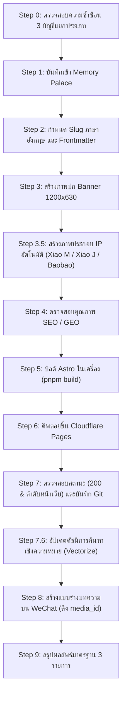

# คู่มือการสอนการเผยแพร่บล็อกด้วย Blog-Publisher Skill (ฉบับอบรมทีมงาน)

> เอกสารนี้จัดทำขึ้นเพื่อการเรียนการสอนและการฝึกอบรมภายในทีม เพื่อทำความเข้าใจขั้นตอนการทำงานแบบอัตโนมัติของ `blog-publisher` Skill แบบครบวงจร (ชุด 3 ประสาน: Blog + WeChat + Memory)

---

## ภาพรวมหลักสูตร: ตรรกะหลักของ AI Publishing

หัวใจสำคัญของการทำงานคือ: **เขียนครั้งเดียว บันทึกสามจุด เผยแพร่สองแพลตฟอร์ม** (เว็บไซต์ Blog สาธารณะ + แบบร่าง WeChat Official Account + ฐานข้อมูลความจำ/เวกเตอร์)



---

## ขั้นตอนการเรียกใช้งานอย่างละเอียด (10 ขั้นตอน)

### Step 0: ตรวจสอบความซ้ำซ้อนก่อนเขียน (Duplicate Check)
- **การกระทำ**: ตรวจสอบ 3 บัญชีบันทึกข้อมูลเพื่อป้องกันการเขียนหรือเผยแพร่ซ้ำ:
  1. `src/content/blog/` (บทความที่เผยแพร่บนเว็บแล้ว)
  2. กล่องแบบร่าง WeChat (ตรวจสอบสดผ่าน API)
  3. MemPalace / บัญชีบันทึกในเครื่อง (`published-ledger.jsonl`)
- **คำสั่ง**:
  ```bash
  node .agents/skills/blog-publisher/check-duplicate.cjs "<Primary Source URL>" "<Entity Name>"
  ```

### Step 1: บันทึกข้อมูลเข้า Memory Palace
- **การกระทำ**: ขั้นตอนแรกของชุด 3 ประสาน ต้องบันทึกแหล่งข้อมูลและข้อเท็จจริงหลักก่อนลงมือเขียนบทความ
- **ผลลัพธ์**: สร้างไฟล์ `project_SLUG.md` เพื่อบันทึกประเด็นสำคัญและ Slug ที่กำหนดไว้

### Step 2: กำหนดชื่อไฟล์ Slug และมาตรฐาน Frontmatter
- **กฎเหล็ก**: ต้องใช้ **ภาษาอังกฤษล้วน** เท่านั้น (เช่น `moss-tts-nano-local.md`) ห้ามใช้ภาษาจีนหรืออักขระพิเศษในชื่อไฟล์
- **การตั้งค่าสำหรับ WeChat**:
  - `wechatTitle`: ไม่เกิน 30 ตัวอักษร (ชื่อเอนทิตี + ข้อสรุปสำคัญ ห้ามพาดหัวหลอกหรือข้อความเยิ่นเย้อ)
  - `wechatDigest`: ไม่เกิน 54 ตัวอักษร (ประโยคสรุปสมบูรณ์ 1 ประโยค)
  - `category`: ต้องระบุ (ค่าเริ่มต้น: `Tech-News`)
- **การใส่ลิงก์**: แบบร่าง WeChat จะตัดไฮเปอร์ลิงก์ Markdown ออก ดังนั้นลิงก์อ้างอิงภายนอกที่สำคัญต้องแสดง URL แบบข้อความธรรมดาเสมอ

### Step 3: จัดเตรียมภาพปก Banner
- **มาตรฐาน**: ขนาด `1200x630`, ขนาดไฟล์ `< 99KB`, สไตล์ภาพเสมือนจริง (Photorealistic)
- **การเรียกใช้**: ใช้ `banner-creator` Skill ในการสร้างหรือเลือกจากคลังภาพที่กำหนด

### Step 3.5: จัดเตรียมภาพประกอบ IP ประจำบทความ
- **จับคู่อัตโนมัติตามประเภทเนื้อหา**:
  - เทคโนโลยี/วิศวกรรม/AI (`Tech-News`, `Tech-Experiment`): **Xiao M** (เห็ดสีดำ + ไมซีเลียมสีส้ม)
  - ความคิด/บทเรียน/กลยุทธ์ (`Research`, `Thought`): **Xiao J** (ตัวการ์ตูนผู้แต่ง มีเคราแพะและสายเอี๊ยมสีแดง)
  - วิทยาศาสตร์ทั่วไป/ให้ความรู้สาธารณะ: **Baobao** (แมวดีวอนเรกซ์สีขาว)
- **เกณฑ์**: เลือก 3–6 จุดสำคัญในเนื้อหา บีบอัดไฟล์ให้ `< 90KB` และแทรกในเนื้อหาทั้งภาษาไทย/จีนและอังกฤษให้ตรงกัน

### Step 4: ตรวจสอบคุณภาพ SEO / GEO
- เรียกใช้เกณฑ์ตรวจสอบจาก `seo-geo`:
  - ต้องมี BLUF (Bottom Line Up Front - สรุปคำตอบไว้ตอนต้น)
  - มีหัวข้อ H2/H3 อย่างน้อยหนึ่งข้อเป็นประโยคคำถาม
  - ระบุลิงก์อ้างอิงที่มีความน่าเชื่อถือ
  - ท้ายบทความมีข้อความแจ้งลิขสิทธิ์ CC BY 4.0 ของ Mycelium Protocol

### Step 5: บิลด์โปรเจกต์ในเครื่อง (Build)
- **คำสั่ง**:
  ```bash
  pnpm build
  ls dist/blog | grep <SLUG>
  ```

### Step 6: ดีพลอยขึ้น Cloudflare Pages
- **คำสั่ง**:
  ```bash
  source .env && NODE_TLS_REJECT_UNAUTHORIZED=0 npx wrangler pages deploy dist --project-name=blog-mushroom --branch=main --commit-dirty=true
  ```

### Step 7: ตรวจสอบความถูกต้องหน้าเว็บและบันทึก Git
- **ตรวจสอบ**: ยืนยันว่าหน้าบทความส่งคืน HTTP `200` และปรากฏที่ด้านบนสุดของรายการบล็อก
- **บันทึก**: รัน `git add` และคอมมิตด้วยข้อความ `feat(blog): publish <SLUG>`

### Step 7.6: อัปเดตดัชนีการค้นหาเชิงความหมาย (Vector Search Index)
- **การกระทำ**: ซิงค์บทความเข้า Vectorize เพื่อให้ระบบค้นหาความหมายและการสืบค้นผ่าน MCP ทำงานได้สมบูรณ์
- **คำสั่ง**:
  ```bash
  python3 semantic-search/scripts/incremental-index.py --slug <SLUG> --upsert
  ```

### Step 8: สร้างแบบร่างบน WeChat Official Account
- **คำสั่ง**:
  ```bash
  cd pipeline/m2 && node index.js "../../src/content/blog/<SLUG>.md" --theme blue
  ```
- **ผลลัพธ์**: รับค่า `media_id` และบันทึกลงไฟล์ `pipeline/m2/output/<SLUG>.json`

### Step 9: รายงานผลลัพธ์มาตรฐานชุด 3 ประสาน
เมื่อทุกขั้นตอนเสร็จสิ้น ต้องรายงานผลลัพธ์อย่างเป็นทางการและกระชับดังนี้:
```text
✅ Blog：https://blog.mushroom.cv/blog/<SLUG>/
✅ 公众号草稿：已创建（media_id: <MEDIA_ID>）
✅ 记忆：project_<SLUG>.md 已写入
```
