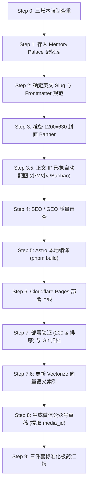

# Mycelium Blog 发布工作流教程（教学培训版）

> 本文供团队内部教学培训使用，全面拆解 `blog-publisher` Skill 的标准化调用全流程（三件套闭环）。

---

## 课程概览：AI 辅助发布核心逻辑

发布流程的核心目标是：**一次编写，三端归档，双平台分发**（Blog 线上站点 + 微信公众号草稿 + 记忆/语义索引库）。

Agent 执行发布的完整标准调用时序如下：



---

## 详细调用步骤分解

### Step 0：强制查重（Duplicate Check）
- **动作**：写作前必须比对三个账本，防止重复劳动或多端不一致：
  1. `src/content/blog/`（已发布的本地文件）
  2. 微信公众平台草稿箱（远程 API）
  3. MemPalace / 本地发布账本（`published-ledger.jsonl`）
- **命令**：
  ```bash
  node .agents/skills/blog-publisher/check-duplicate.cjs "<一手源 URL>" "<实体名>"
  ```

### Step 1：写入记忆库（Memory Palace）
- **动作**：三件套第一步，必须在下笔前沉淀事实源。
- **产物**：创建 `project_SLUG.md`，记录一手事实、核心价值与预定 Slug。

### Step 2：Slug 命名与 Frontmatter 规范
- **命名红线**：必须使用**纯英文 Slug**（如 `moss-tts-nano-local.md`），严禁任何中文文件名。
- **微信搜一搜关键参数**：
  - `wechatTitle`：≤ 30 字（实体名 + 核心结论，严禁标题党与无意义废话）。
  - `wechatDigest`：≤ 54 字（完整单句摘要）。
  - `category`：必填，默认 `Tech-News`。
- **链接避坑**：微信草稿会吞掉 Markdown 超链接语法，正文关键外链必须明文显示 URL。

### Step 3：封面 Banner 制作
- **规格**：`1200x630`，体积必须 `< 99KB`，照片级画质。
- **调用**：调用 `banner-creator` Skill，自动根据场景 Prompt 生成并裁剪落地。

### Step 3.5：正文 IP 自动配图
- **规则**：根据分类自动分发 IP：
  - 科技/工程类（Tech-News/Tech-Experiment）：**小M**（黑蘑菇+橙菌丝）
  - 思想/复盘类（Research/Thought）：**小J**（作者卡通形象）
  - 大众科普类：**Baobao**（白德文卷毛猫）
- **标准**：精选 3-6 个核心认知节点插图，压缩至 `< 90KB`，中英文双语节点对称插入。

### Step 4：SEO / GEO 优化校验
- 自动运行 `seo-geo` 规则集：
  - 必须包含 BLUF（结论前置）。
  - 必须包含至少一个问句型 H2/H3 标题。
  - 双语末尾附带 CC BY 4.0 版权声明（含 Mycelium Protocol 品牌词）。

### Step 5：本地编译（Build）
- **命令**：
  ```bash
  pnpm build
  ls dist/blog | grep <SLUG>
  ```

### Step 6：Cloudflare Pages 部署
- **命令**：
  ```bash
  source .env && NODE_TLS_REJECT_UNAUTHORIZED=0 npx wrangler pages deploy dist --project-name=blog-mushroom --branch=main --commit-dirty=true
  ```

### Step 7：线上健康检查与代码提交
- **验证**：检查 URL 状态码返回 `200`，确认首页列表最新置顶。
- **提交**：执行 `git add` 并规范提交 `feat(blog): publish <SLUG>`。

### Step 7.6：增量更新语义向量索引
- **动作**：确保站内语义搜索及 MCP 服务能够实时检索到新文章。
- **命令**：
  ```bash
  python3 semantic-search/scripts/incremental-index.py --slug <SLUG> --upsert
  ```

### Step 8：创建微信公众号草稿
- **调用**：
  ```bash
  cd pipeline/m2 && node index.js "../../src/content/blog/<SLUG>.md" --theme blue
  ```
- **产出**：输出 `media_id` 并持久化记录在 `pipeline/m2/output/<SLUG>.json`。

### Step 9：标准化输出（三件套交付标准）
流程结束后，必须以严格格式向用户交付，无冗余中间信息：
```text
✅ Blog：https://blog.mushroom.cv/blog/<SLUG>/
✅ 公众号草稿：已创建（media_id: <MEDIA_ID>）
✅ 记忆：project_<SLUG>.md 已写入
```
