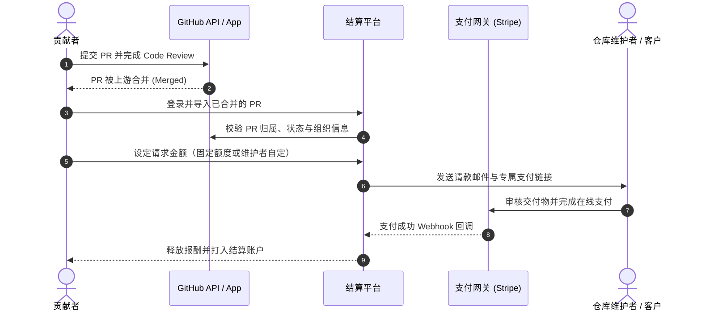

# 开源贡献事后请款（Retroactive PR Payment）机制与架构拆解

在传统开源协作与自由职业交付中，悬赏通常是“事前”设定的。但近期业界出现了一种反向思路：**允许贡献者直接导入已合并（Merged）的 Pull Request，向项目维护者或客户发起事后请款（Payment Request）**。

本文对该模式的底层技术栈、业务流转模型及商业逻辑进行深度剖析。

---

## 一、 技术栈与支付实现方案：是 HTTP 402 还是 Web2 Rails？

### 1. 核心支付机制
很多开发者会猜想该模式是否采用了 **HTTP 402 (Payment Required)** 协议或 Web3/ERC 智能合约微支付。经架构调研，目前落地的核心实现仍然是**成熟的 Web2 法币支付网关**：
- **支付基础设施**：以 **Stripe Connect** 为主通道（并支持 Whop 等多通道切换），通过 Webhook 与 Checkout Session/PaymentIntent 完成资金结算。
- **并非 HTTP 402**：HTTP 402 现阶段更多用于 AI Agent 间的无状态微计费与 API 计量；而在涉及开发者劳务报酬、平台分成、跨国税务（W-8BEN/1099）与法币提现时，传统支付清算通道依然是最合规且门槛最低的解法。

### 2. 基础系统架构
- **运行时环境**：Node.js + TypeScript
- **服务端框架**：Express / RESTful API
- **数据层**：PostgreSQL + Sequelize ORM
- **代码平台连接器**：GitHub App（基于 OAuth 与只读 Metadata 权限，抓取 PR 状态、Commits、组织成员关系）
- **前端**：React SPA + Webpack

---

## 二、 业务流程与逻辑模型

该平台的核心创新在于将代码仓库的 **Merge 动作** 作为事实上的“交付验收凭证（Proof of Work）”。

### 核心流转对比
| 维度 | 传统开源悬赏（事前模式） | 成果导入请款（事后模式） |
| :--- | :--- | :--- |
| **资金锁定** | 事前托管在平台，冻结维护者资金 | 事前无需资金池，按需支付 |
| **动机机制** | 利益驱动，容易吸引低质刷单 PR | 真实需求先满足，事后协商打赏/劳务费 |
| **定价权** | 发起方单一确定 | 贡献者可标价，或交由维护者裁定 |
| **适用场景** | 明确且复杂的独立需求开发 | 紧急 Bug 修复、日常功能迭代、自由职业外包验收 |

---

## 三、 机制优势与现实挑战

### 1. 优势
- **冷启动极轻**：维护者不需要预先充值，贡献者不需要等待悬赏发布，做完即请款。
- **代码交付的天然发票**：对于自由职业者与雇主，避免了传统发票与工作量证明脱节的问题，PR 即验收单。
- **心理认同收益**：在维护者合并代码、心存感激的时刻发起请求，转化率往往高于事前募捐。

### 2. 风险与瓶颈
- **垃圾请求与道德绑架**：可能导致维护者邮箱收到大量细微修改（如修复错别字）的请款骚扰。
- **心理账户偏差**：开源界普遍默认 PR 为志愿贡献，转为付费请求可能遭遇社区文化阻力。
- **缺乏强制执行力**：若维护者拒绝支付，贡献者代码已被合并，缺乏智能合约式的链上仲裁约束。

---

## 四、 总结与启示

这种“基于 PR 的事后请求付费”本质上是将 **GitHub 代码审查系统变成了轻量级的发票确认系统**。它并未采用前沿的 HTTP 402 或加密协议，而是利用 Web2 成熟的 GitHub App + Stripe Connect 实现了极低的落地摩擦力。未来若引入链上证明或 HTTP 402 协议，或可在 AI Agent 自动化开源维护场景中迸发更大的潜力。
