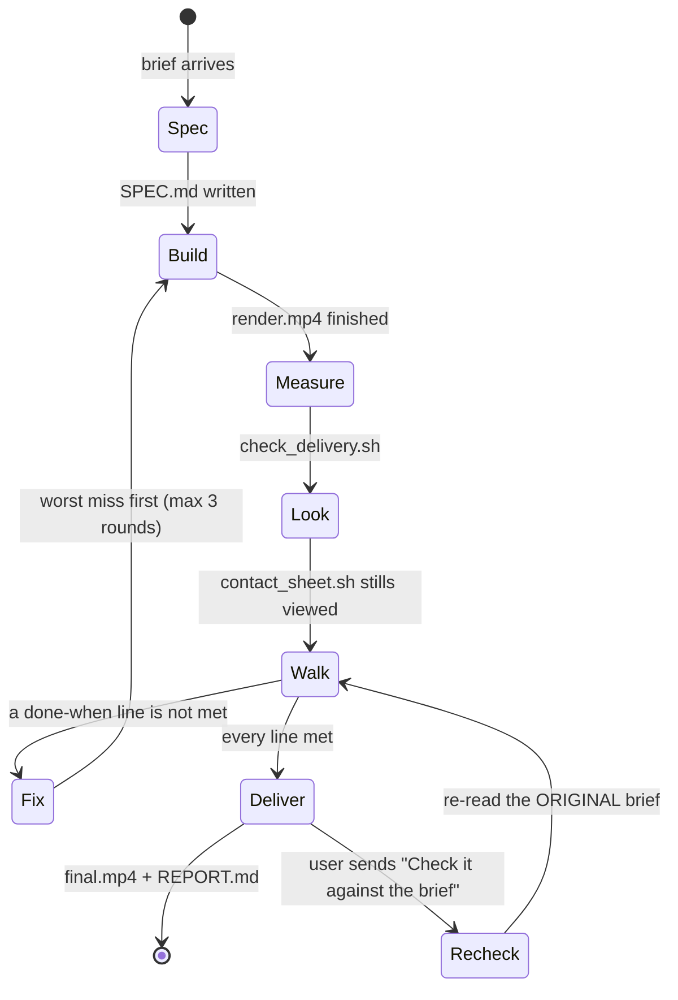
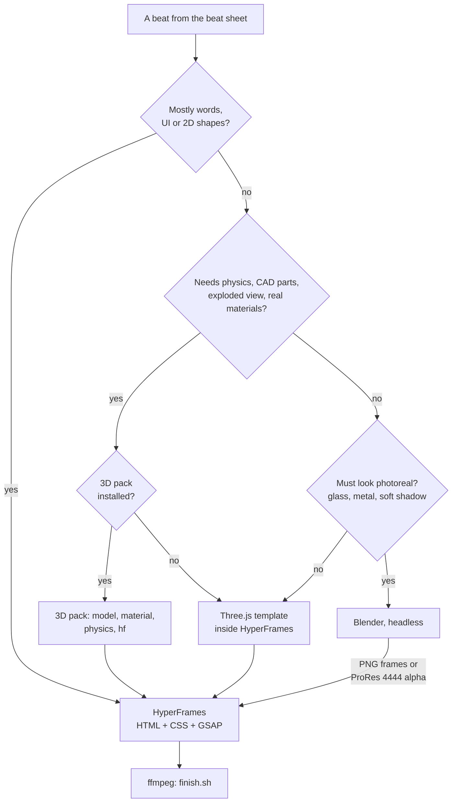
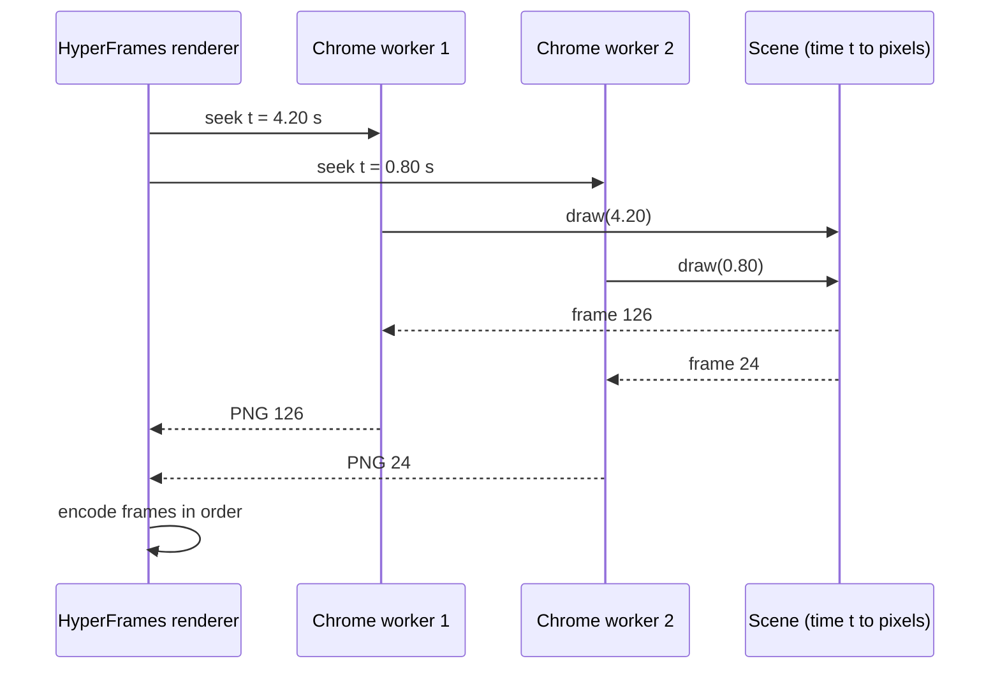
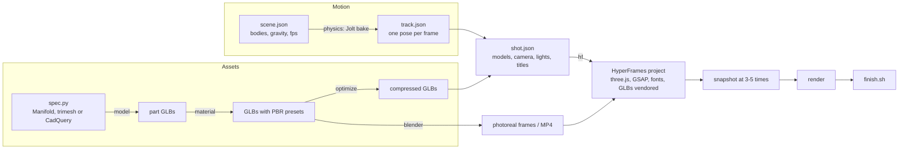

# Architecture

brief2mp4 is not a renderer. It is a loop that an agent runs, plus the scripts and references that make each step of the loop checkable. The renderers are open-source tools it routes to.

The image is generated from code: edit `docs/diagrams/architecture.html` and run `bash docs/diagrams/render.sh`.

## The loop

Three design choices make the loop work:

1. **The spec is a contract.** The agent turns every line of the brief into a checkable "done when" line before it writes any code: "at 9.5 s the words FINISH SOMETHING TODAY are fully on screen, nothing cut off". The self-check measures against that list, not against the agent's memory of what it meant to build.
2. **Machines measure, eyes look.** `check_delivery.sh` measures what a script can: duration to the frame, size, frame rate, codecs, loudness, true peak, silence. What it can't measure (spelling on screen, overlap, whether the hero moment is there) is checked by pulling stills at named times and viewing them. The report says which evidence came from where.
3. **Recheck against the brief, not the spec.** The follow-up "Check it against the brief" goes back to the user's words, because a spec can drift from the brief.

## Routing

Each beat in the beat sheet is routed on its own. One film often uses several routes.

HyperFrames is the spine. It is the one place where layers meet on a single timeline, so type always sits in HTML above 3D and stays sharp, exact and spell-checkable.

## Why every frame is a function of time

The renderer seeks frames out of order across parallel workers. A scene that reads the wall clock, uses unseeded randomness or fetches from the network at render time would draw a different frame for the same `t` in different workers, and the video would flicker or jump. So every visible value is computed from `t` alone. Physics is the hard case: the 3D pack runs the simulation once with Jolt at a fixed step, saves one pose per frame, and the page looks poses up by `t`. The bake is byte-identical across runs, and the tests check that.

## The 3D pack

Every subcommand prints one JSON object, so an agent reads results instead of parsing logs. The pack is optional and lives in its own folder (`~/.brief2mp4/3d`) with its own Python venv and `node_modules`, so it never touches the user's global Python or npm. `detect_3d.sh` lets the skill branch: with the pack it builds physics and exploded views; without it, it uses the Three.js template and says so in the report.

## Files and responsibilities

| Path | Responsibility |
|---|---|
| `plugin/skills/brief2mp4/SKILL.md` | The loop: spec, route, build, self-check, fix, deliver |
| `references/*.md` | What the agent needs per tool: HyperFrames, Three.js, Blender, ffmpeg, mixed pipelines, the wider ecosystem |
| `scripts/finish.sh` | Any render to a delivery MP4: exact length, H.264 and AAC, -14 LUFS, true peak at or below -1.5 dBTP |
| `scripts/check_delivery.sh` | PASS, WARN or FAIL against the delivery spec |
| `scripts/contact_sheet.sh` | Stills at named times, plus a grid |
| `scripts/doctor.sh`, `detect_3d.sh` | What is installed, and the fix for what is not |
| `templates/` | Starting points that already render: SPEC.md, a Three.js scene, a Blender turntable |
| `3d/` | The optional pack: `b2m3d` CLI, shot runtime, material presets, installers |
| `edit/` | The optional edit pack: verified installers for the ArtCraft editors' CLIs, pinned versions, one tested recipe per app |
| `SETUP.md` | Machine setup an agent follows, per OS |
| `tests/` | Determinism, generation, detection and render tests; CI on macOS, Windows and Ubuntu |

## Extending it

- **A new tool route:** add a reference file in `references/`, a row to the routing table in SKILL.md, and a template that already renders. The tool must pass the determinism test: render the same frame twice in separate runs and get identical PNGs.
- **A new check:** add it to `check_delivery.sh` if a script can measure it, otherwise to the "Look" step as a named question about a still.
- **A new 3D motion:** add a model key to the shot runtime in `3d/templates/shot-runtime.js`, computed from `t` alone, with a test in `tests/`.
