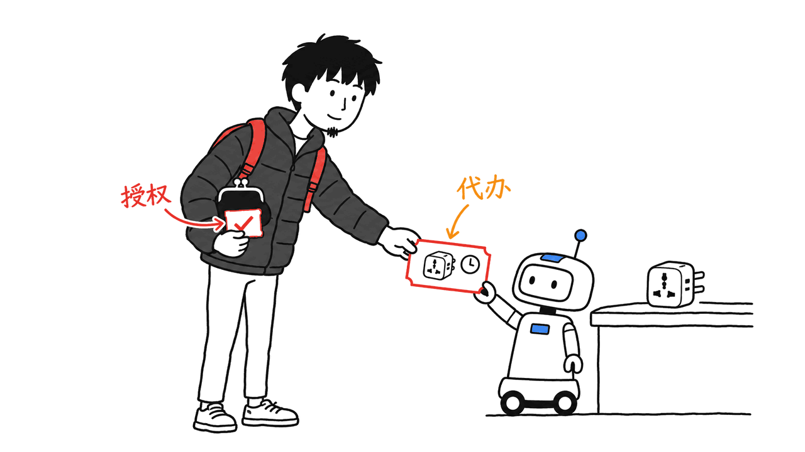
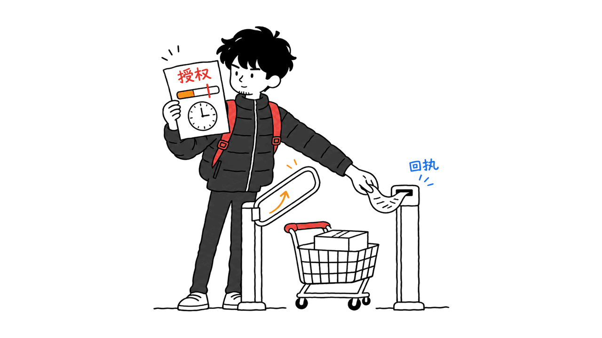

B2A 经济讨论的是：当 AI 代理用户筛选和使用产品时，企业怎样赢得这条新分发渠道。企业既要让 Agent 找到自己，也要让它在明确授权下办成事；点击量之外，还要核算成交、履约和利润。

Olivia Moore 与 Justine Moore 于 2026 年 11 月 10 日在 a16z 发表《Welcome to the B2A Economy》，提出企业将从阻挡机器人，转向争取 Agent 带来的业务。这是一项关于分发方式变化的判断，不是所有企业都应立刻撤掉反机器人系统的操作指令。

原文：https://a16z.com/welcome-to-the-b2a-economy/

## Agent 成了客户，谁才是付款的人？

在这里，可以把 B2A 理解为 Business-to-Agent：企业面对的直接操作方从人扩展到软件代理。但需求、预算和授权通常仍来自人或组织。Agent 执行采购流程，付款与售后仍要对应真实账户、明确权限和可追查的订单。

以下是 Mycelium Protocol 的分析，而非原文逐段转述。

假设你让一个助手购买下周出差需要的转换插头。它需要知道插头规格、目的地、送达时间、含运费价格和退货条件。商家网页写得再动人，如果这些条件不清楚，助手就难以负责任地推荐或下单。

这意味着企业需要服务两个对象：让人理解品牌和价值，让代理准确读取条件、比较方案、执行授权。界面仍然重要；只是购买路径不再必然从首页广告位开始，也不一定经过每一张营销落地页。

## 被 AI 提到，为什么还不等于做成生意？

建议把 Agent 带来的业务拆成四道关口，每道都能单独失败。

| 关口 | 用户真正需要什么 | 企业应该交付什么 |
|---|---|---|
| 发现 | 找到可能合适的产品 | 可读取的资料、明确的身份和来源 |
| 判断 | 确认是否满足约束 | 当前价格、库存、规格、区域和交付条件 |
| 授权 | 限定它可以替我做什么 | 身份关联、额度、范围、期限与确认机制 |
| 执行 | 付款、开通、交付并能追查 | 稳定接口、订单状态、回执、取消及售后路径 |

被推荐，只跨过了第一道关口。工具被调用，也未必意味着用户付钱。把 FAQ 写得适合模型引用，和把报价、支付、退款做成可执行流程，需要不同的产品与工程投入。

对软件服务也是如此。Agent 能找到某个视频工具，不代表它知道订阅包含多少额度、是否自动续费、生成结果能否导出。商家应该把这些条件变成可验证的约定，而不是要求模型从宣传文案猜出隐藏限制。

## 有哪些基础设施已经可以参考？

Agentic Commerce Protocol（ACP）是一个可公开查看的协议例子，不是 B2A 的全部，也不是唯一实现路线。其仓库 README 当前标记为 beta，本文参考 2026-04-17 日期快照。

我们查看了两份 OpenAPI 文档：结账接口定义创建、更新、读取、完成与取消会话；委托支付文档包含限定商家、金额上限和过期时间的 allowance，以及幂等键要求。这里展示的是“允许代理做多少”和“交易如何进入确定状态”的接口契约。

协议入口：https://github.com/agentic-commerce-protocol/agentic-commerce-protocol
结账快照：https://github.com/agentic-commerce-protocol/agentic-commerce-protocol/blob/main/spec/2026-04-17/openapi/openapi.agentic_checkout.yaml
委托支付快照：https://github.com/agentic-commerce-protocol/agentic-commerce-protocol/blob/main/spec/2026-04-17/openapi/openapi.delegate_payment.yaml

读懂规范，并不意味着商家已经接入或通过验收。本次没有开通商户、发起付款、调用生产交易接口，也没有验证不同平台的兼容性。对企业而言，协议只是起点，还要对接真实库存、支付服务和售后系统。

我的建议是先把流程设计成：报价带有效期，提交前重新核对库存和总价；相同操作的重试不能生成重复订单；超时后先查状态，再决定是否重发。无论从浏览器还是 API 进入，都应落到同一套可靠的业务逻辑。

## 为什么不能把所有机器人都当成好客户？

“机器人”“AI 引流”“Agent 交易”是三个统计口径。抓取公开信息、受用户委托查询、批量注册和自动付款，代表不同的意图、权限和风险。仅凭 User-Agent 字符串，也不足以证明背后有真实用户授权。

a16z 原文引用了多组行业增长数据，但本文没有逐项重建其样本与统计方法，因此不把它们写成本次实测，也不从机器访问占比推出机器消费占比。

更可行的策略是按能力开放：公开查询适用缓存与限流；账户信息需要身份验证；写入和交易需要更具体的授权。付款失败、异常访问或不受支持的操作，应返回明确状态，而不是诱导代理不断重试。

对品牌而言，还需要防止自己的资料被误读。商品介绍是待评估的数据，不应能覆盖用户的预算、改变购买目标或要求代理泄露凭证。让产品适合机器读取，不等于让商家接管用户代理。

## 衡量 B2A，先把分母写清楚

下面是为了说明指标设计而构造的假设，不是调研数据：某个观察期有 1,000 次资料读取、100 个报价请求、20 笔付款，之后退掉 2 笔。

报价到付款为 20%；扣除退款后保留 18 笔订单，相当于读取次数的 1.8%。这两个比例都能算对，却回答不同问题。若不知道分母，把它们都称为“Agent 转化率”，团队就很容易互相误导。

还应该记下失败原因：无法解析商品、地区不支持、库存变化、授权不足、支付被拒，还是用户主动取消。只有分开记录，才知道该补资料、改接口，还是重新考虑产品价格。

最后核算留存订单的毛利，再扣除平台费用、支付、退款处理、推理和客服成本。即使请求更多、成交更多，如果售后成本或渠道收费更高，也可能没有带来更好的生意。

## 小团队可以从哪里开始？

不必先做一个包揽所有工作的万能 Agent。选一条有真实需求的路径，例如“查规格与库存 → 给出含运费报价 → 用户确认 → 创建订单”，先把它做完整。

第一步，整理稳定的商品或服务标识，补齐当前价格、更新时间、使用限制与售后条款。第二步，提供有界限、可观察的查询和操作入口。第三步，用自己的任务集检查缺货、价格过期、重复提交、超时和取消，确认每次结果都能回查。

再观察有没有新增的授权用户、完成订单和保留毛利。没有这些证据，暂时只能说渠道接通了，还不能说找到了增长引擎。

同时保留直接面向用户的渠道与可迁移资料。Agent 平台可能影响推荐顺序、接口规则和佣金，企业若只优化某一个入口，就可能把新机会变成新的渠道依赖。

## 常见问题

### 是不是要关闭反机器人系统？

不需要一刀切。应区分公开读取、认证查询和高权限交易，对不同操作采用不同身份与授权要求。获得有效授权的代理，可以有清晰入口；恶意或越权流量仍应被限制。

### 做好 GEO 或增加 MCP 工具就够了吗？

它们可能改善发现和调用，但不能代替业务事实、授权、支付和售后。评价接口是否有价值，要看它帮助完成了什么，而不是只看工具数量。

### 谁最值得先尝试？

已有清楚商品规则、稳定履约和可追查订单的团队，更容易做出范围明确的试点。这是实施建议，不是对某一行业收益的保证；首先应验证自己的用户是否需要委托操作。

B2A 给企业提出了一个具体问题：当客户派软件来办事时，你能否提供明确、可靠、可追责的服务？把这件事做好，才能判断新渠道到底带来了多少新生意。

相关产品分析：Neura HQ 如何把品牌官网与消息渠道接到商品和售后流程。
https://blog.mushroom.cv/blog/neura-hq-conversational-commerce-product-architecture-cost/

## 参考与核查范围

核查日期：2026-11-17。本文是对分发与产品设计的独立分析，不是全文翻译。作者和日期已核验；协议做了文档级审阅；没有真实商户支付或业务增长实测。封面与正文为概念示意。

https://a16z.com/welcome-to-the-b2a-economy/
https://github.com/agentic-commerce-protocol/agentic-commerce-protocol

---

> © 2026 Author: Mycelium Protocol. 本文采用 [CC BY 4.0](https://creativecommons.org/licenses/by/4.0/deed.zh) 授权——欢迎转载和引用，须注明作者姓名及原文链接，不得去除署名后以原创发布。

<!--EN-->

B2A describes a distribution question: how should a business serve software acting for its customers? Being discoverable is one step. Completing an authorized task, fulfilling it, and retaining a margin are separate requirements.

Olivia Moore and Justine Moore published “Welcome to the B2A Economy” on a16z on November 10, 2026. Their thesis is that businesses will compete for agent-mediated demand after years of keeping bots out. That is a distribution hypothesis, not an instruction to disable bot protection everywhere.

Original: https://a16z.com/welcome-to-the-b2a-economy/

## When an agent is the customer, who pays?

Business-to-Agent can describe the immediate operator of a purchasing workflow. The person or organization behind it still supplies needs, budget and permission. A business still needs a real customer account, explicit permissions and a traceable order.

The following is Mycelium Protocol’s analysis rather than a section-by-section retelling.

Consider asking an assistant to purchase a travel adapter. It needs destination compatibility, delivery date, total price and return conditions. Attractive copy cannot substitute for those facts. A business must help people understand its value while giving their delegates accurate conditions and dependable actions.

The interface still matters. The buying journey simply may not begin on the homepage or pass through every marketing page.

## Why is an AI mention not a completed sale?

Treat the workflow as four independently testable gates.

| Gate | Customer need | Business deliverable |
|---|---|---|
| Discovery | Find a plausible option | Readable information and identifiable provenance |
| Evaluation | Check constraints | Current price, stock, specifications and delivery terms |
| Authorization | Bound delegated action | Identity, scope, limits, expiration and confirmation |
| Execution | Complete and trace the task | Reliable operations, receipts, cancellation and support |

A recommendation passes only the first gate. A tool call does not establish payment. Search visibility and dependable commercial execution require different work.

For software subscriptions, an assistant also needs to understand allowances, renewal, export rights and limitations. Those should be explicit business terms, not guesses extracted from promotional language.

## What infrastructure can teams study?

Agentic Commerce Protocol is one public example, not the whole B2A economy or its only possible implementation. Its README currently labels it beta. This review used the dated 2026-04-17 snapshot.

We reviewed its checkout and delegated-payment OpenAPI documents. The former specifies create, update, retrieve, complete and cancel operations. The latter describes merchant, amount and expiration constraints and idempotency requirements. These are contracts for bounded permission and observable transaction state.

Repository: https://github.com/agentic-commerce-protocol/agentic-commerce-protocol
Checkout: https://github.com/agentic-commerce-protocol/agentic-commerce-protocol/blob/main/spec/2026-04-17/openapi/openapi.agentic_checkout.yaml
Delegated payment: https://github.com/agentic-commerce-protocol/agentic-commerce-protocol/blob/main/spec/2026-04-17/openapi/openapi.delegate_payment.yaml

Reading a specification does not establish a working merchant integration. We did not open a merchant account, make a payment, call production transaction APIs or test cross-platform compatibility.

Our recommended workflow is to expire quotes, recheck inventory and totals before submission, deduplicate retries, and retrieve transaction state after ambiguous timeouts. Browser and API entry points should reach the same reliable business logic.

## Why not welcome every bot?

Automated traffic, AI referrals and authorized purchases measure different activity. Public crawling, delegated queries, bulk registration and payment have different permissions and risks. A User-Agent string alone does not prove customer consent.

The a16z essay cites industry growth statistics. We did not reconstruct their underlying samples and methods, and do not present them as our measurements or equate machine visits with machine-mediated spending.

Open access by capability: cache and rate-limit public information, authenticate account queries, and require narrower authority for writes and transactions. Return clear failures rather than encouraging endless retries.

Treat merchant descriptions as data to evaluate. They should not override a customer’s budget, change the requested goal or cause credential disclosure. Making a business readable to software does not give it control of the customer’s delegate.

## Measure the denominator before the conversion rate

This is a constructed illustration, not observed market data: 1,000 information reads lead to 100 quote requests and 20 paid orders; two orders are later refunded.

Quote-to-payment conversion is 20%. Eighteen retained orders represent 1.8% of reads. Both calculations are valid, but they answer different questions. Calling both “agent conversion” would obscure the difference.

Record failure reasons as well: parsing, unsupported regions, stock changes, missing authorization, payment rejection or customer cancellation. Each points to different work.

Then examine retained-order margin after platform, payment, refund handling, inference and support costs. More requests and more sales do not necessarily produce a better business if servicing the channel costs more.

## Where should a small team begin?

Choose one real customer task: check specifications and stock, produce a delivered quote, obtain confirmation, and create an order. Make that path complete before attempting a universal assistant.

First, establish stable product IDs, current prices, timestamps, restrictions and support terms. Next, expose bounded and observable operations. Finally, use your own scenarios to check stock loss, stale prices, duplicate submissions, timeouts and cancellation, with retrievable results.

Look for additional authorized customers, completed orders and retained margin. Until then, you have connected a channel, not demonstrated a growth engine.

Keep a direct customer route and portable product data. An agent platform can influence ranking, integration rules and fees; optimizing for one gatekeeper can create another dependency.

## FAQ

### Should a business turn off bot defenses?

No blanket change is necessary. Public reads, authenticated queries and transactions need different access policies. Legitimate delegates need a dependable entry point; malicious or unauthorized activity still needs controls.

### Are GEO and MCP tools sufficient?

They can help discovery and invocation. They do not replace authoritative business facts, authorization, payments or support. Judge an integration by completed customer work, not tool count.

### Who should experiment first?

Teams with explicit product rules, reliable fulfillment and traceable orders can define a clearer pilot. This is implementation advice, not an industry return forecast. First verify that actual customers want delegated execution.

B2A asks a practical question: can your business reliably serve software sent by a customer, with clear terms and accountable results? Answering it makes the value of this channel measurable.

Related product analysis: Neura HQ and the integration of storefronts, messaging, product data and support.
https://blog.mushroom.cv/blog/neura-hq-conversational-commerce-product-architecture-cost/

## Sources and review scope

Reviewed November 17, 2026. This is original distribution and product analysis, not a full translation. Authors and date were verified; protocol work was document review. No real merchant payment or business-growth experiment was performed. All images are conceptual illustrations.

https://a16z.com/welcome-to-the-b2a-economy/
https://github.com/agentic-commerce-protocol/agentic-commerce-protocol

---

> © 2026 Author: Mycelium Protocol. Licensed under [CC BY 4.0](https://creativecommons.org/licenses/by/4.0/) — free to share and adapt with attribution. You must credit the author and link to the original; removing attribution and republishing as original is not permitted.
