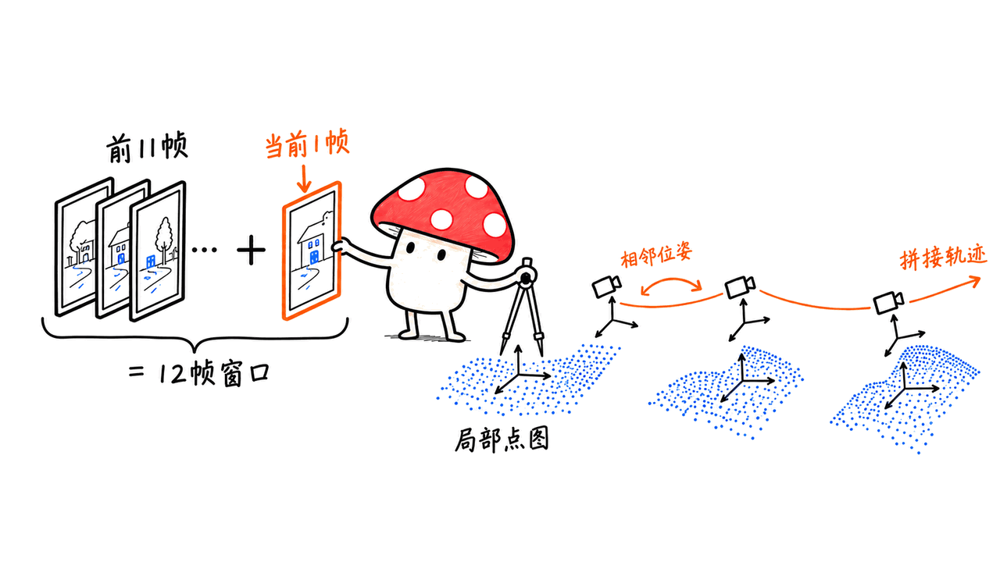
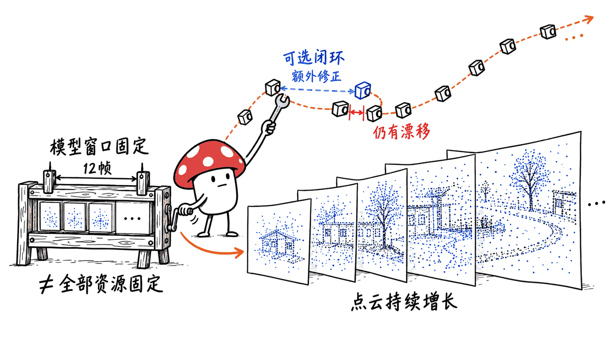
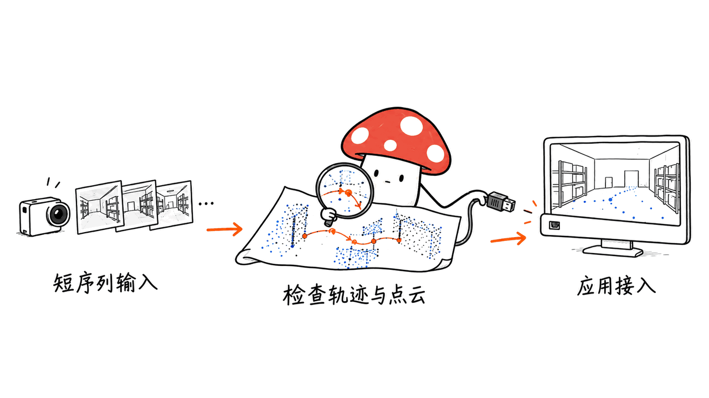

ABot-Recon 能从普通单目视频持续预测三维点云和相机轨迹，适合研究长视频建图。它让模型只处理固定的局部窗口，但并不保证零漂移，也不能把“约6.7GiB显存”直接换算成任意消费级显卡上的实时性能。

这是高德 AMAP CVLab 的项目，官方仓库为 `amap-cvlab/ABot-Recon`。截至2026年10月20日，我们核对了代码、技术报告和权重许可：代码为 Apache-2.0，仓库的权重许可文件写的是 CC BY-NC 4.0，但 Hugging Face 模型卡标签仍是 Apache-2.0，两处声明不一致。免费获取权重不能据此推导出已经明确的商业授权。

## 它究竟怎样边走边建图？

每到一帧，模型保留前11帧的 KV 特征，加上当前帧，组成12帧的因果窗口。它预测当前相机坐标系内的点图，以及相邻两帧的相对位姿，再把这些相对运动逐步组合为全局轨迹。

这里有三件不同的工作：点图告诉你“这一帧看到了怎样的局部表面”；相对位姿告诉你“摄像头相对上一帧怎么移动”；位姿组合把局部观察放回同一个世界坐标系。RGB 与点图对齐之后，才得到彩色点云。

**固定的是模型的局部上下文，不是整套应用所有内存、计算和存储。** 保存所有帧、稠密点图、颜色和置信度，仍会随着录像增长；把每帧计算保持稳定，也不代表处理一小时录像只需固定总时长。



这条路线值得关注，因为它减少了对持续扩张的学习式长程状态的依赖。代价是，邻帧旋转的小误差仍可能在组合时放大。论文用时序旋转修正和考虑位姿组合的训练损失来降低这种累积误差，而不是声称把误差消灭。

## 望京8.6公里、6.71GiB，原始材料怎么写？

把宣传中的几个数字拆开，结论会更清楚：

| 项目 | 一手材料里的数字 | 应该怎样理解 |
|---|---|---|
| 望京长序列 | 8.6公里、48,656帧、27分钟 | 官方 teaser 和报告标的是27分钟，不是40分钟 |
| 另一段北京序列 | 48公里、14,509帧、40分钟 | 与望京那一段是不同序列，不应拼成同一次测试 |
| KITTI-02效率 | 24.45 FPS、6.71 GiB | NVIDIA H100、504×280；显存统计不含输入存储 |
| Oxford Spires轨迹 | ATE 4.35米、RPE-R 0.12° | 流式模型，不使用闭环；有明确非零误差 |
| Oxford Spires重建 | CD 1.37米、F1 91.81% | F1采用4米阈值，不是毫米级零件扫描精度 |

这些都是作者公开报告的结果，我们没有运行模型复现。尤其不要把望京的演示长度、KITTI 的速度和 Oxford 的精度当成同一段视频、同一次运行的三项成绩。

6.71 GiB 也有单位差别，约为7.21 GB。即使显卡名义上装得下，算力、显存带宽、精度类型、CUDA内核、输入分辨率及额外缓存都会影响速度和余量。官方发布环境在 A100 验证，论文效率数字来自 H100，不能据此承诺一张8GB游戏显卡实时跑通。

## 为什么不能说“点云没漂移”？

一段轨迹视觉上接近地图，说明演示有吸引力；要证明精度，还需要真值、对齐方法、误差统计和完整评测设置。官方报告的 ATE 和相对旋转误差已经表明，“稳定长时重建”与“绝对不漂移”是两回事。

当前仓库还提供可选闭环：检测曾到访的区域，添加相对位姿约束，再进行稀疏位姿图优化。基础模型本身不依赖闭环，但启用这个后端，就多了检索、历史记录和全局优化，不能把“基础预测器固定窗口”的成本描述直接套到它身上。

仓库默认开启闭环。为了确认基础流式结果，第一轮应显式加 `--no-loop-closure`。启用后，`camera_poses` 是修正后的轨迹，`camera_poses_noloop` 才保留原始流式轨迹；比较结果时必须说明用的是哪一个。



单目结果也不天然等于测绘级绝对尺度。若项目需要碰撞距离、地图坐标或厘米级测量，应验证尺度、外参和坐标对齐，并结合可信测量。动态车辆、玻璃、弱纹理、运动模糊和长时间遮挡，都是需要单独验收的场景。

## 如何先跑一个可核对的短序列？

以下是基于固定提交的部署步骤，**不是我们已经完成的模型推理记录**。官方目标环境为 Linux、Python 3.10+、PyTorch 2.5.1、CUDA 12.1。先准备合适的 NVIDIA GPU 和驱动，再建立独立环境。

```bash
git clone https://github.com/amap-cvlab/ABot-Recon.git
cd ABot-Recon
git checkout 6e3b2e1257464a74dfceff22eb33190bd228276e
conda create -n abot-recon python=3.11 -y
conda activate abot-recon
pip install torch==2.5.1 torchvision==0.20.1 \
  --index-url https://download.pytorch.org/whl/cu121
pip install -e .
```

先用一小段有连续视差的视频，导出名称补零的图片。当前 CLI 接收图片目录，不能把任意 RTSP 摄像头地址直接当作已经做好的实时服务。

```bash
mkdir -p examples/images
ffmpeg -i input.mp4 -vf fps=5 -frames:v 300 examples/images/%06d.jpg
python demo.py \
  --image-dir examples/images \
  --output-dir outputs/short \
  --attention-backend auto \
  --no-loop-closure \
  --dense-stride 5
```

这里的5 FPS、300帧和每5帧保存一次稠密输出是起步采样建议，不是论文的测速参数。`dense-stride` 控制保存稠密结果的频率，不等于跳过所有中间帧的轨迹估计。实际采样频率要保证相邻帧重叠，急转弯或近距离运动不能照抄。

默认 `--max-frames` 为22,000；它是当前实现配置的一部分。不能看到48,656帧演示就假设默认命令会无条件覆盖同等长度。扩展前应核对位置编码支持、配置和运行资源。

FlashInfer 可提供 paged KV 算子，缺省时会回退到 PyTorch SDPA；cuRoPE 是额外加速步骤。第一次部署先把路径、权重和短序列输出对上，再分别记录加速后端，避免“能启动”和“达到论文速度”混为一谈。

权重会从 Hugging Face 自动下载并缓存；离线场景需预先下载，显式传本地 `--checkpoint`。本地运行、云端 demo 和上传私有视频是三种不同的数据路径，使用前要分清。

## 怎样检查输出，而不是只看酷炫视频？

最小检查链是：确认输入顺序和帧数，读取 `metadata.json`，检查 `camera_poses.npy` 的有限值和相邻运动，再查看 `local_points.pt`、`colors.pt` 与置信度是否对应同一批输出帧。置信度不是经过业务校准的“安全概率”。

按官方导出工具生成可查看的产物：

```bash
python scripts/export_reconstruction_ply.py \
  --poses outputs/short/camera_poses.npy \
  --metadata outputs/short/metadata.json \
  --points outputs/short/local_points.pt \
  --colors outputs/short/colors.pt \
  --output outputs/short/reconstruction.ply \
  --bev-output outputs/short/trajectory_bev.png
```

示例采用 `dense-stride 5`，点图帧数少于轨迹帧数，所以导出时必须传 `--metadata`，让脚本用 `dense_output_indices` 对齐，不能假设两者逐行对应。

不要未经坐标变换就把所有局部点图叠在一起；也不要把已经变换过的世界点云再乘一遍位姿。先拿一小段直线移动和一次转弯检查坐标约定，再考虑闭环、多视频融合、体素下采样或机器人系统接入。



我们实际做了一个很小的工程检查：在 CPU 上独立加载固定提交的几何辅助函数，验证两帧平移关系、局部原点到世界坐标的变换，以及单帧时空的相对位姿序列。另外用合成元数据验证了稠密输出帧与完整轨迹的索引对齐，以及缺少元数据时的拒绝行为。这些检查不验证学习模型的精度、速度、完整安装或 GPU 兼容性。

## 工程判断：值得接在哪一层？

它适合放在空间信息的感知层：将单目连续图像转成可探索的几何和轨迹，让后续系统做巡检回放、空间摘要或重建研究。10月14日新增的可视化脚本也让结果展示更方便；微调代码在独立 `train` 分支，评估协议在 `eval` 分支，需要分别固定版本。

更稳妥的第一阶段目标，是“录一段、算一段、检查产物”，再考虑实时队列、丢帧策略、显存监控、异常恢复和点云持久化。本文的建议是工程分阶段路径，不代表官方已经提供完整的车规导航或生产级机器人安全栈。

同样做三维资产，但从多视角图片生成参数化建模代码的是另一类任务。可对照本站零件建模文章，区分“可编辑CAD实体”和这里的“场景点云与相机轨迹”：
https://blog.mushroom.cv/blog/zero-to-cad-multiview-reconstruction/

## 常见问题

### 免费权重能直接用于商业产品吗？

当前 GitHub 的 `MODEL_LICENSE.md` 明确为 CC BY-NC 4.0，并要求商业用途另获书面授权；HF 模型卡标签却是 Apache-2.0。两处不一致，应先请作者澄清，不能只看标签认定权重可商用。

### 手机上能拍，是不是就在手机上实时运行？

不是。拍摄设备与计算设备不同。官方主要发布环境是 Linux/CUDA；AXERA-TECH 另有 AX650N 适配，应独立查看其模型、工具链及测试设置。

### 固定12帧意味着录像多长都不用管资源吗？

不是。模型的局部状态和每帧预测开销有界，但总运行时长、输入和输出存储仍增长。启用闭环时，还要另算检索与优化成本。

## 来源与复核范围

复核日期：2026年10月20日；源码固定为 `6e3b2e1257464a74dfceff22eb33190bd228276e`。封面采用官方重建 teaser 裁切，不是本机测试截图。未下载模型权重、运行完整视频重建或复现 H100 性能。

- 官方仓库：https://github.com/amap-cvlab/ABot-Recon
- 固定版本：https://github.com/amap-cvlab/ABot-Recon/tree/6e3b2e1257464a74dfceff22eb33190bd228276e
- 技术报告：https://github.com/amap-cvlab/ABot-Recon/blob/6e3b2e1257464a74dfceff22eb33190bd228276e/ABot-Recon-Tech-Report.pdf
- 项目演示：https://amap-cvlab.github.io/ABot-Recon-html/
- 权重：https://huggingface.co/acvlab/ABot-Recon
- 权重许可：https://github.com/amap-cvlab/ABot-Recon/blob/6e3b2e1257464a74dfceff22eb33190bd228276e/MODEL_LICENSE.md
- 社区硬件适配：https://github.com/AXERA-TECH/ABot-Recon-Axera

---

> © 2026 Author: Mycelium Protocol. 本文采用 [CC BY 4.0](https://creativecommons.org/licenses/by/4.0/deed.zh) 授权——欢迎转载和引用，须注明作者姓名及原文链接，不得去除署名后以原创发布。

<!--EN-->

ABot-Recon turns a monocular image stream into camera motion and 3D geometry while keeping its learned temporal context bounded. It is a promising basis for long-video mapping research. It does not guarantee zero drift or turn a published memory figure into a consumer-GPU speed guarantee.

AMAP CVLab publishes the code under Apache-2.0. The repository's model-license file specifies CC BY-NC 4.0, while the Hugging Face card still labels the model Apache-2.0. Those declarations conflict; a free download should not be treated as settled commercial authorization.

## How does a 12-frame window reconstruct a long journey?

The model caches features from the preceding eleven frames and combines them with the current frame. It predicts a local point map and adjacent relative motion, then composes the relative poses into a global trajectory. Colors align with the points to form a colored reconstruction.

The fixed window bounds the learned model state and per-frame prediction cost. It does not bound total work for an arbitrarily long recording. Saved frames, geometry, colors and confidence maps can keep growing. A rotation refiner and composition-aware training loss reduce accumulated drift; they do not remove every error.


## What do the published numbers actually describe?

| Evidence | Reported result | Qualification |
|---|---|---|
| Wangjing demonstration | 8.6 km, 48,656 frames, 27 minutes | The official teaser says 27, not 40 minutes |
| Separate Beijing demonstration | 48 km, 14,509 frames, 40 minutes | A different sequence |
| KITTI-02 efficiency | 24.45 FPS, 6.71 GiB | H100, 504×280, excludes input storage |
| Oxford Spires trajectory | ATE 4.35 m, RPE-R 0.12° | Streaming model without loop closure |
| Oxford Spires reconstruction | CD 1.37 m, F1 91.81% | F1 threshold is 4 m |

These are author-reported results, not our measurements. The long demonstration, efficiency benchmark and reconstruction metrics come from different sequences and protocols. Combining them into one implied test would be misleading.

6.71 GiB is approximately 7.21 decimal GB. Capacity alone says little about throughput. The release environment was validated on an A100, while the runtime result uses an H100. An 8 GB gaming GPU is not thereby guaranteed to fit the complete workload or match its speed.

## Is it drift-free, and what changes with loop closure?

A visually convincing trajectory is useful demonstration material. Accuracy still requires reference poses, alignment and a stated metric. The reported nonzero pose errors rule out an absolute drift-free claim.

The repository includes optional place retrieval and sparse pose-graph refinement. This is additional machinery beyond the local predictor, with its own history and optimization costs. The current CLI enables loop closure by default. Use `--no-loop-closure` when establishing a baseline for the base streaming model.

With refinement enabled, `camera_poses` contains the selected refined trajectory, while `camera_poses_noloop` preserves the original streaming prediction. State which one you evaluate. Learned monocular geometry also needs scale and coordinate validation before metric surveying, collision distances or map alignment can depend on it.


## How should an engineer start?

The following recipe pins commit `6e3b2e1257464a74dfceff22eb33190bd228276e` and follows the published Linux, Python 3.10+, PyTorch 2.5.1 and CUDA 12.1 setup. We did not execute that full installation or model inference.

```bash
git clone https://github.com/amap-cvlab/ABot-Recon.git
cd ABot-Recon
git checkout 6e3b2e1257464a74dfceff22eb33190bd228276e
conda create -n abot-recon python=3.11 -y
conda activate abot-recon
pip install torch==2.5.1 torchvision==0.20.1 \
  --index-url https://download.pytorch.org/whl/cu121
pip install -e .
```

Prepare a short clip with useful parallax. Extract zero-padded image names because the CLI sorts the directory lexicographically. For example, sample 300 frames at 5 FPS, then run:

```bash
mkdir -p examples/images
ffmpeg -i input.mp4 -vf fps=5 -frames:v 300 examples/images/%06d.jpg
python demo.py \
  --image-dir examples/images \
  --output-dir outputs/short \
  --attention-backend auto \
  --no-loop-closure \
  --dense-stride 5
```

The frame rate and length are our initial workflow suggestion, not paper benchmark settings. Dense stride controls which dense outputs are retained while poses are estimated for selected input frames. Too much temporal downsampling can remove the overlap needed during fast turns or close motion.

The current default maximum stream length is 22,000 frames. Check implementation limits and positional encoding before extending it; the longer demonstration is not a promise about the unchanged default command. Optional FlashInfer and cuRoPE acceleration should be recorded separately from a successful basic run.

The CLI consumes image directories. Connecting a live camera or RTSP source also needs an application ingestion layer. Automatic checkpoint downloads use the Hugging Face cache; for offline execution, download the weights beforehand and pass a local checkpoint path. A hosted demo is a different data path from local inference.

## What should acceptance check?

Check ordered input counts, run metadata, finite camera poses, reasonable adjacent motion, and matching geometry/color/confidence frame selections. Confidence values should not be treated as calibrated safety probabilities.

Use the official `export_reconstruction_ply.py` tool with local points, colors and the selected trajectory to export a colored PLY and a bird's-eye trajectory image. With `--dense-stride 5`, pass `--metadata outputs/short/metadata.json` to the exporter so its `dense_output_indices` can match dense frames to the full trajectory. Local points need the appropriate camera-to-world transform; world points should not receive that transform twice. Begin with a short translation and turn before testing loop closure or merging recordings.


We actually loaded the pinned geometry helpers in isolation on CPU. We checked the upstream two-frame translation example, local-origin world coordinates and the empty relative sequence for one frame. We also checked the exporter's dense-frame index mapping with synthetic metadata and its rejection of unmatched frame counts without metadata. These verify small helper behaviors and our coordinate explanation. It does not validate the checkpoint, reconstruction accuracy, GPU compatibility or speed.

For production planning, separate bounded inference from queues, dropped-frame behavior, output persistence, monitoring and failure recovery. Dynamic objects, glass, weak texture, blur and occlusion need targeted acceptance criteria. A working point-cloud demo is not evidence of a complete navigation safety stack.

The repository added visualization tools on October 14. Fine-tuning material lives on the `train` branch, and evaluation protocols on `eval`; pin those independently. Our engineering recommendation is to establish recorded-video outputs before committing to a real-time service.

## FAQ

### Can the published weights be used commercially?

The GitHub model-license file specifies CC BY-NC 4.0 and requires separate commercial permission, while the Hugging Face card labels the model Apache-2.0. Seek clarification of that inconsistency before treating the weights as commercially authorized.

### Does a phone demonstration imply phone inference?

No. Capture hardware and compute hardware are different. The main release targets Linux/CUDA. The separate AXERA-TECH adaptation has its own models, environment and measurements.

### Does bounded context make all resource use constant?

No. Predictor context is bounded, but total runtime and saved input/output data grow. Optional retrieval and pose-graph refinement add separate costs.

## Sources and scope

Reviewed October 20, 2026. Source commit: `6e3b2e1257464a74dfceff22eb33190bd228276e`. Cover: cropped official reconstruction teaser. We did not download model weights, reconstruct a complete video or reproduce the H100 benchmark.

- Code: https://github.com/amap-cvlab/ABot-Recon
- Technical report: https://github.com/amap-cvlab/ABot-Recon/blob/6e3b2e1257464a74dfceff22eb33190bd228276e/ABot-Recon-Tech-Report.pdf
- Project: https://amap-cvlab.github.io/ABot-Recon-html/
- Weights: https://huggingface.co/acvlab/ABot-Recon
- Model license: https://github.com/amap-cvlab/ABot-Recon/blob/6e3b2e1257464a74dfceff22eb33190bd228276e/MODEL_LICENSE.md
- Related CAD article: https://blog.mushroom.cv/blog/zero-to-cad-multiview-reconstruction/

---

> © 2026 Author: Mycelium Protocol. Licensed under [CC BY 4.0](https://creativecommons.org/licenses/by/4.0/) — free to share and adapt with attribution. You must credit the author and link to the original; removing attribution and republishing as original is not permitted.
