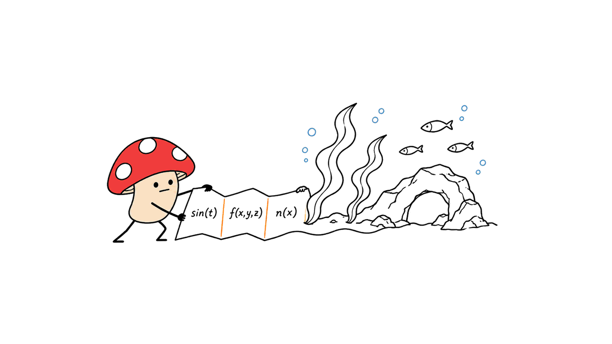
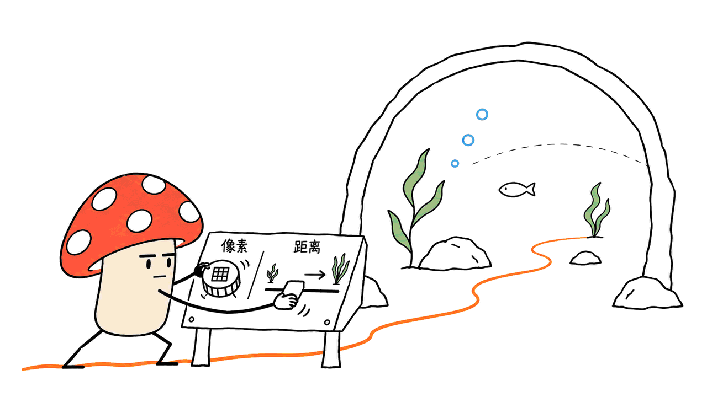

Abyssal Garden 是一个打开网页就能游览的程序化海底世界：海带随水流摆动，鱼群与蝠鲼穿行，海面光束照向沉船和岩洞。画面与环境声音由代码生成，运行时不需要下载贴图、三维模型或音频素材。

作者是 Noniv，官方仓库为 https://github.com/Noniv/abyssal-garden ，采用 MIT 许可。我们固定在提交 `a596354eff400d458bc2aeb9bdf5e0a9734b2bcf` 核对源码，完成本地重建和一次低画质浏览器启动检查；没有复测作者的帧率，也没有验证所有设备和浏览器。

## Abyssal Garden 怎么打开？

在线体验：https://noniv.github.io/abyssal-garden/

也可以从仓库下载 index.html，在支持 WebGPU 的桌面 Chrome 或 Edge 中打开。等待生成结束，点击 Dive in。W/A/S/D 游动，Q/E 下潜或上升，Shift 加速，数字1至6跳转预设视点；Esc 回到菜单，M切换声音，H显示性能信息。

菜单提供 Low、Medium、High 三级细节。作者将触屏操作标为实验性，因此手机能打开页面，不等于手感和兼容性已经与桌面一致。遇到 WebGPU 不可用时，要核对浏览器、图形后端和运行环境；项目没有提供 WebGL 替代渲染路径。作者建议直接打开下载文件；若浏览器策略不允许，可在文件目录运行 python3 -m http.server 8000 --bind 127.0.0.1，再访问 http://127.0.0.1:8000 。本次启动检查采用的是本地HTTP路径。

## 为什么一个HTML能装下海底？

它保存的是生成规则。礁石、地形、海带、鱼和船并非一套预先下载的美术资源，网页启动后根据参数构造场景。渲染直接调用 WebGPU，着色器使用 WGSL，没有引入游戏引擎或三维库；开发构建用到的 esbuild 属于工具链，不能把“运行时无三维库”写成“开发也没有依赖”。

源码中的分工也比“全部交给显卡”具体。GPU计算地形密度场，结果读回CPU后进行连通性清理与表面网格构造，再交回GPU绘制。海带等重复对象通过实例数据和着色器表现，雾、海面、光束与材质共同营造水下观感。

这条路线能把大量重复结构压缩为规则与参数。代价是在打开页面时付出生成工作，运行中持续分配并使用图形资源；复杂造型、独特角色与精细实拍质感也不会因为文件小就自动获得。



声音同样是程序生成。Web Audio API 组合低频、噪声、滤波、混响等声音层，形成海底氛围、气泡和远处鲸鸣。声音图在用户交互后启动，与每帧渲染分开驱动；本次没有进行实际听感或音量测量。

## “97KB”究竟是哪一种体积？

README写单个96KB HTML，仓库简介又写97KB。我们测得固定提交的成品为99,514字节，换算为97.18KiB；在本机以gzip level9压缩为39,812字节。这些是该文件的体积，不是启动内存、显存占用或完整仓库下载大小。

我们在临时克隆目录中按文档安装构建依赖，使用Node26.10.0与esbuild0.28.2执行npm run build。重建文件的SHA-256与仓库成品一致。初次尝试npm ci时，本机环境报告锁文件不匹配；改用README的npm install路径后成功，只更新了临时目录的安装状态，没有修改运行源码。

因此，体积可以精确复核，“所有机器都轻松运行”则没有得到证明。启动时的密度场、网格、阴影贴图、渲染目标与音频缓冲都需要资源，下载包尺寸不能代替这些测量。

## 小文件为什么还需要动态画质？

Low、Medium、High不仅改变分辨率，还改变叶片、细碎物体、阴影和部分几何的复杂度。运行时会根据负载调节像素数量，再调节植物和岩石的绘制距离，并保存部分设置。源码还用加载标记和设备丢失处理尝试降一级重载；这是一种恢复策略，不能保证所有崩溃都能恢复。



README报告RTX5070Ti在2560×1440下约180fps，Samsung Galaxy A16在Low、670×372下约20fps，都是作者给定条件下的结果。它们说明硬件和画质条件会明显影响体验，不能把其中一个数字套到普通笔记本或手机上。我们没有运行开发版的一分钟基准，也没有采集本机FPS、GPU时间或耗电数据。

碰撞也有明确取舍。海床、崖壁与岩拱会阻挡相机，植物、鱼、沉船、鲸尾等装饰物则可以穿过。浏览器演示的游览目标不需要每个可见对象都实现完整物理；若改成游戏，需要另行设计碰撞体、交互和玩法。

## 本地启动检查验证了什么？

我们通过本地HTTP服务，在隔离的桌面Chrome157无头会话中选择Low细节，观察到WebGPU可用、场景完成初始化并进入菜单；点击Dive in后，页面回报进入游览状态。随后发送视点和静音按键，记录状态及截图，并关闭该会话和服务。

运行资源记录中没有外部图片、模型或声音请求，仅看到本地favicon探测。这与源码的单文件路线一致，但没有模拟所有离线和设备故障条件。保存的截图是菜单状态，不能拿它冒充High画质游览实拍；本文封面来自作者的官方场景截图，已裁切压缩并保留出处。

该检查证明这套固定版本在本机选定环境中能启动并进入场景，没有验证长时间稳定性、全部视点与碰撞、手机触控、空间音频或画面质量。菜单显示成功与完整体验验收应分开记录。

## 工程师可以借鉴哪些做法？

先从可读源码学习，再改成自己的小场景。source/src/world.js定义布局，shaders.js处理视觉，main.js组织渲染、相机和输入，audio.js管理声音，quality.js管理细节选择。构建器按顺序组织这些文件，最终交付一个HTML；单文件成品仍然可以有清晰的开发模块。

```bash
git clone https://github.com/Noniv/abyssal-garden.git
cd abyssal-garden
git checkout a596354eff400d458bc2aeb9bdf5e0a9734b2bcf
cd source
npm install
npm run build
```

npm run build:readable生成便于调试的版本；npm run build:dev另写dev.html，增加飞行路径和基准工具。调试工具与正式成品分开，能避免把测试控制一起交给用户。部署自己的在线版本时，使用HTTPS或本地可信环境，并先检查目标设备的WebGPU支持。

我更愿意把它作为程序化内容、浏览器图形和渐进降级的完整样本来读。先做少量岩石与一小片海带，分别记录下载、生成、绘制和交互是否通过，再逐步增加数量。小体积是一个交付优点，工程复用仍需自己的设备与场景数据支撑。


## 常见问题

### 需要AI模型、API密钥或服务器生成场景吗？

运行这个固定版本不需要模型推理服务或API密钥。场景由浏览器内的图形与音频代码生成，在线体验页用于分发文件；程序化生成不等于世界模型或实时AI推理。

### 下载很小，是否意味着低配手机一定流畅？

不能这样推导。CPU生成、GPU资源、驱动和画质设置都影响结果，作者也报告过低端手机约20fps的条件。触屏支持仍标注为实验性，应在目标机型上实际验收。

### 能用于自己的项目或商业作品吗？

MIT许可允许使用、修改和分发，但需保留版权与许可声明。若增加第三方素材、库或声音，它们的许可还要单独核对；本文的实测范围也不替代你的产品验收。

## 来源与验证范围

作者Noniv；官方仓库与MIT许可：https://github.com/Noniv/abyssal-garden

在线体验：https://noniv.github.io/abyssal-garden/

固定源码：https://github.com/Noniv/abyssal-garden/tree/a596354eff400d458bc2aeb9bdf5e0a9734b2bcf

浏览器运行排查：https://developer.chrome.com/docs/web-platform/webgpu/troubleshooting-tips

封面采用仓库.github/screenshots/whale-fluke.jpg，作者Noniv，MIT许可，已裁切压缩；不是本机Low启动检查截图。本文保留构建日志、字节与哈希、浏览器命令及状态，不宣称复现作者性能数据。

---

> © 2026 Author: Mycelium Protocol. 本文采用 [CC BY 4.0](https://creativecommons.org/licenses/by/4.0/deed.zh) 授权——欢迎转载和引用，须注明作者姓名及原文链接，不得去除署名后以原创发布。

<!--EN-->

Abyssal Garden is a procedural underwater world that runs in a browser: swaying kelp, fish, manta rays, a wreck and illuminated rock formations. Graphics and ambient sound are generated by code rather than downloaded textures, 3D models or audio samples.

Noniv publishes it under MIT at https://github.com/Noniv/abyssal-garden . We pinned revision `a596354eff400d458bc2aeb9bdf5e0a9734b2bcf`, rebuilt the file and performed a bounded Low-detail browser startup check. We did not reproduce the author’s frame rates or test every device and browser.

## How do you enter Abyssal Garden?

Live demo: https://noniv.github.io/abyssal-garden/

Alternatively, download index.html and open it in a desktop Chrome or Edge with WebGPU support. After initialization, select Dive in. W/A/S/D swim, Q/E move vertically, Shift accelerates, and keys1–6 select preset viewpoints. Esc opens the menu, M toggles sound and H displays statistics.

The menu provides Low, Medium and High detail. Touch input is explicitly experimental. A phone loading the page does not establish desktop-equivalent control or compatibility. Check the browser, graphics backend and execution environment if WebGPU is unavailable; there is no WebGL fallback renderer. The author suggests opening the downloaded file directly; if browser policy prevents that, serve its folder with python3 -m http.server 8000 --bind 127.0.0.1 and visit http://127.0.0.1:8000 . Our startup check used local HTTP.

## How does one HTML file hold a world?

It stores generation rules. Terrain, kelp, fish and the ship are built from parameters instead of a downloaded asset package. Rendering uses WebGPU directly with WGSL shaders, without a game engine or 3D library. esbuild is still a development dependency; a library-free runtime is not a dependency-free build process.

The implementation has a useful CPU/GPU split. A compute shader generates a terrain density field; the result returns to the CPU for connectivity cleanup and surface-mesh construction, then reaches the GPU for rendering. Instance data and shaders represent repeated content, while fog, water, lighting and materials produce the underwater look.

Rules compact repeated structures into a small download, at the cost of startup generation and ongoing graphics work. They do not automatically provide unique characters, arbitrary complex shapes or live-action fidelity.


Web Audio synthesizes the soundscape using noise, oscillation, filtering and reverb. The audio graph starts after user interaction and is driven separately from the frame loop. We did not evaluate listening quality or measure sound levels.

## What does “97KB” measure?

The README says96KB while the repository description says97KB. The pinned file contains99,514bytes, or97.18KiB. Local gzip level9 produces39,812bytes. These are file sizes, not RAM, VRAM or the size of a complete repository checkout.

In a temporary clone, Node26.10.0 and esbuild0.28.2 rebuilt index.html with an identical SHA-256 to the shipped file. An initial npm ci attempt reported a lock mismatch in our environment; following the documented npm install path succeeded. Only temporary dependency installation state changed; runtime source files were not edited.

Startup still needs density data, meshes, shadow maps, render targets and audio buffers. Download size cannot substitute for measuring those resources on target hardware.

## Why does a small file need adaptive quality?

Low, Medium and High change foliage density, small objects, shadows and geometry complexity as well as rendering options. Runtime adaptation adjusts pixel count and then plant/rock draw distance, persisting selected settings. Loading markers and device-loss handling attempt a lower-detail reload; this is a recovery strategy rather than a guarantee against every crash.


The README reports roughly180fps at2560×1440 on an RTX5070Ti and roughly20fps at670×372 on a Galaxy A16 using Low. These are the author’s conditions and results. We did not run the development build’s one-minute benchmark, collect local FPS/GPU timings or measure power consumption.

Collision also has deliberate limits. Terrain, cliffs and arches block the camera; decorative plants, fish, ship and whale tail can be traversed. A browsing demo can separate visible geometry from collision geometry. Turning it into a game would require additional interaction, collision and gameplay design.

## What did the local browser check establish?

An isolated headless desktop Chrome157 session loaded a local HTTP copy with Low selected. WebGPU was available, initialization reached the menu, and clicking Dive in produced the in-scene state. We sent viewpoint and mute keys, retained commands/state and a screenshot, then closed the browser session and local service.

Resource records showed no external image, model or audio requests; only a local favicon probe appeared. This supports the single-file implementation but does not simulate every offline or device-failure condition. The saved screenshot shows the menu and is not proof of High-detail visual quality. The article cover is an official author screenshot, cropped and compressed with provenance retained.

This was a startup/control-state check, not extended stability, complete navigation/collision, touch, spatial-audio or visual-quality acceptance. Successful initialization and a fully reviewed experience are separate outcomes.

## What can engineers reuse?

Start with the readable modules: world.js defines layout, shaders.js visual behavior, main.js rendering/camera/input, audio.js sound and quality.js detail selection. The build script combines them in an explicit order into one HTML file. Compact distribution can coexist with modular authoring.

```bash
git clone https://github.com/Noniv/abyssal-garden.git
cd abyssal-garden
git checkout a596354eff400d458bc2aeb9bdf5e0a9734b2bcf
cd source
npm install
npm run build
```

build:readable produces readable output, while build:dev creates a separate dev.html with fly-through and benchmark controls. Keeping development tools outside the production file avoids exposing test controls by accident. Serve online copies over HTTPS or use a trusted local environment, and verify WebGPU on your actual target devices.

My recommendation is to study this as an end-to-end example of procedural content, browser graphics and quality adaptation. Begin with a few rocks and a small kelp patch, independently verify download, generation, drawing and interaction, then increase scene density. A small download is useful, but reuse decisions need evidence from your own devices and scenes.


## FAQ

### Does running it require an AI model, API key or generation server?

The pinned runtime needs none of those. Browser graphics and audio code generate the scene; the demo host distributes the file. Procedural generation does not imply a world model or live AI inference.

### Does the small download guarantee smooth low-end mobile use?

No. CPU work, GPU resources, drivers and quality settings matter. The author also reports a low-end phone condition around20fps, and touch remains experimental. Test the devices you intend to support.

### Can it be reused commercially?

MIT permits use, modification and redistribution while retaining its copyright and license notice. Added assets, libraries or audio may have separate terms. Our bounded check does not replace your product acceptance work.

## Sources and verification scope

Noniv’s repository and MIT license: https://github.com/Noniv/abyssal-garden

Live demo: https://noniv.github.io/abyssal-garden/

Pinned source: https://github.com/Noniv/abyssal-garden/tree/a596354eff400d458bc2aeb9bdf5e0a9734b2bcf

Browser troubleshooting: https://developer.chrome.com/docs/web-platform/webgpu/troubleshooting-tips

Cover: Noniv’s .github/screenshots/whale-fluke.jpg under MIT, cropped and compressed; not our Low-detail smoke-test capture. Build logs, sizes, hashes and browser states are retained. Author performance results are not claimed as reproduced.

---

> © 2026 Author: Mycelium Protocol. Licensed under [CC BY 4.0](https://creativecommons.org/licenses/by/4.0/) — free to share and adapt with attribution. You must credit the author and link to the original; removing attribution and republishing as original is not permitted.
