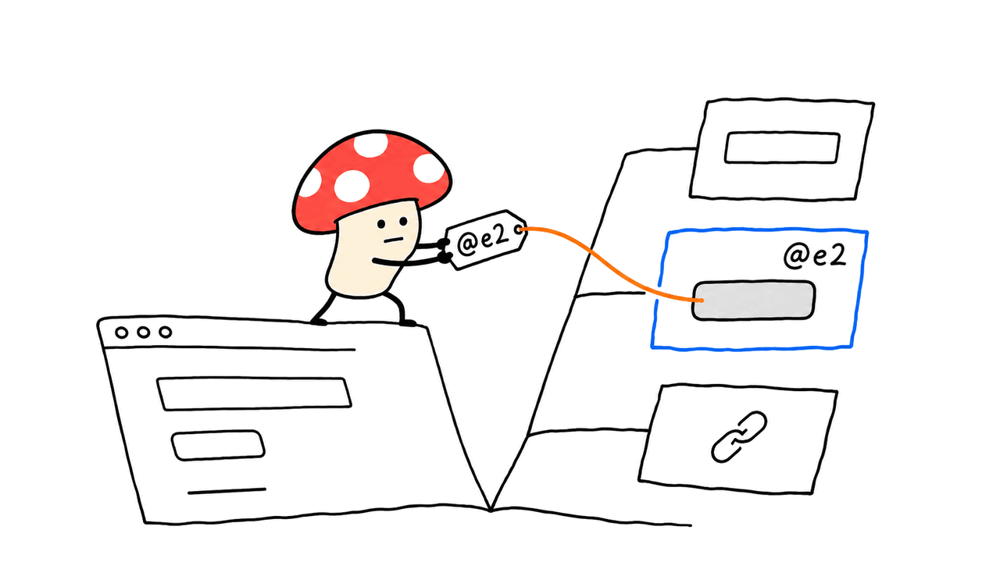
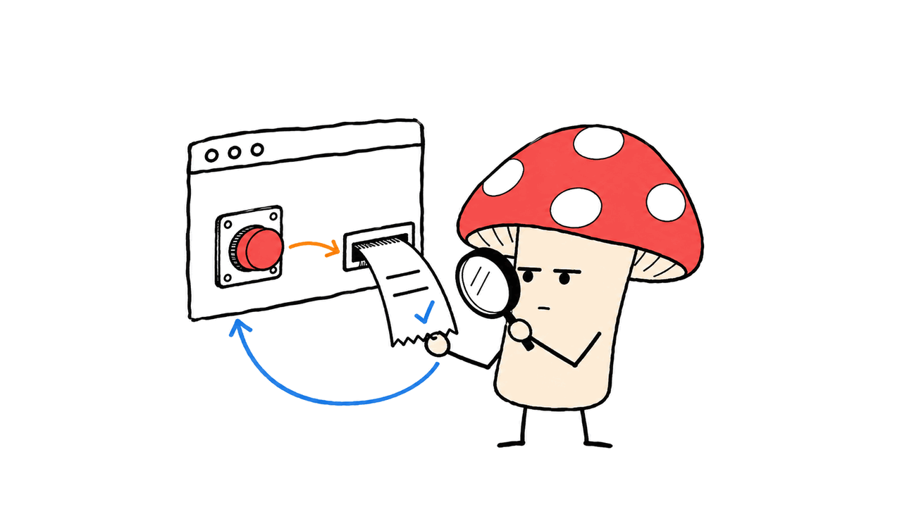
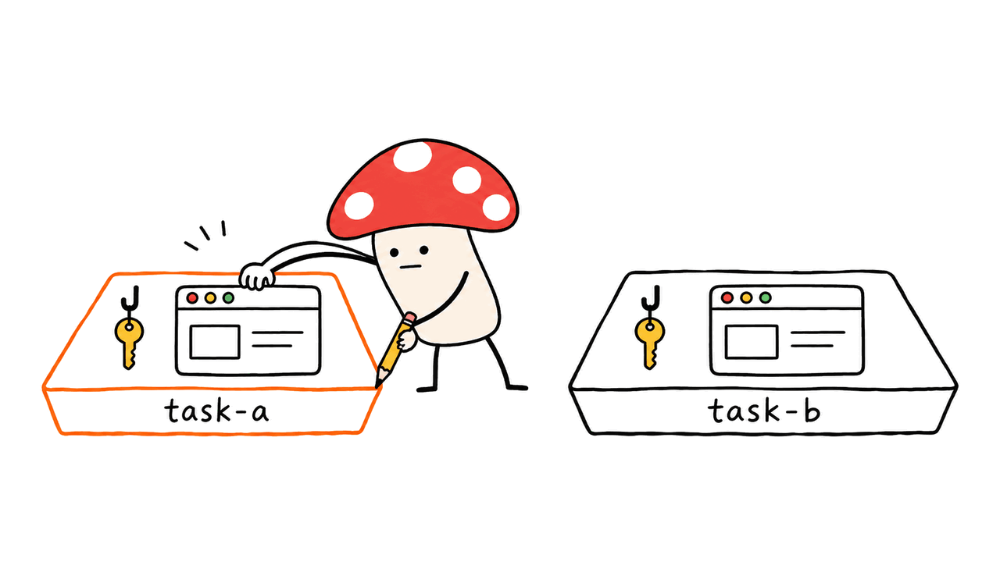

agent-browser 是一个让 AI 智能体从命令行操作真实浏览器的工具。它把页面转换成带元素引用的文字快照，让“读页面、点控件、查结果”成为一组可以记录和复查的步骤。

项目由 Vercel Labs 维护，官方仓库 vercel-labs/agent-browser，Apache-2.0 许可。本文核对的是 0.43.0 版本与源代码提交 `e0c121a96d3a5412e2078e0c8eba3f4d2db2b616`，不引用随时变化的 Star 数。

仓库：https://github.com/vercel-labs/agent-browser
文档：https://agent-browser.dev

## 它解决的是什么问题？

“以前 AI 只能靠截图猜”说得过头了。Selenium、Playwright、DOM 查询和无障碍树早已支持结构化定位。agent-browser 的贡献，是把这套能力包装成适合智能体逐步调用的 CLI 接口，让调用方不必每次写一段完整的浏览器脚本。

`snapshot -i` 返回可交互元素及其引用，比如文本框、按钮和链接。智能体可以对 `@e1` 执行填入，对 `@e2` 执行点击，而不必从像素坐标推算它在哪里。`find role`、CSS、文本和 XPath 定位同样可用。

引用描述的是当前页面状态。原 DOM 节点仍存在时，同文档更新可以保留引用；节点被替换或页面导航后，需要重新取快照。官方还实现了旧引用恢复：仅在原快照中的角色和名称唯一时尝试匹配，存在歧义就拒绝执行。工程上仍应坚持操作后重新观察，而非把引用当成永久 ID。



## Rust CLI、守护进程和浏览器如何配合？

当前版本的主路径是原生 Rust CLI 把命令交给后台守护进程，再通过 Chrome DevTools Protocol 控制浏览器。浏览器在多次命令之间保持打开，避免每点一次按钮就重新建立整套会话。默认引擎是 Chrome for Testing。

因此，“Rust CLI”不等于“整个浏览器也是 Rust 写的”，也不等于“不需要安装浏览器”。项目支持连接已有 Chrome，以及其他引擎、云浏览器和 iOS 模拟器，但这些后端的功能支持范围不完全相同。

它与刚开源的 Cloudflare Kitesurf 也不处于同一层：agent-browser 主要整理智能体的浏览器操作接口；Kitesurf 提供另一套浏览器执行引擎与部署路径。选型应分别考虑接口便利性和底层浏览器兼容性。

## 最小闭环怎样写？

官方安装方式如下。生产环境建议锁定经过验收的版本，而非让每次运行自动追最新版本。

```bash
npm install -g agent-browser@0.43.0
agent-browser install
agent-browser --session demo open https://example.com
agent-browser --session demo snapshot -i
# 从实际快照中选择目标引用，以下编号仅为示意
agent-browser --session demo click @e1
agent-browser --session demo get url
agent-browser --session demo close
```

先从自己的测试页面开始。对表单任务，循环应当是：读取快照、定位字段、填入内容、执行提交、等待特定状态、读取结果。等待“已保存”或指定 URL，比一律睡两秒更能表达业务条件。持续轮询或 WebSocket 页面未必会进入 network idle，不能把网络安静作为通用完成标准。

还要区分两类快照：`-i` 只保留交互控件，适合选下一步动作；完整快照或 `get text` 能看到状态文本，适合验证“保存成功”。只看按钮列表，可能错过错误提示和提交回执。



## 我们实际验证了什么？

Mycelium Protocol 在本机用 npm 0.43.0、独立 headless Chrome 会话和临时 HTTP 服务搭了一个合成表单。测试输入是 `demo@example.test`，所有提交都留在本地页面，没有接触真实账户。

检查覆盖了五项行为：交互快照能返回控件引用；按引用填写并提交；等待并读回 `Saved: demo@example.test`；禁用按钮点击失败；被覆盖层挡住的按钮点击失败。执行日志与可复跑脚本随本文源材料保存。

这个测试说明该版本在这张测试页面上能把不可执行的点击与成功操作区分开，也能完成观察—动作—验收闭环。它没有测试登录、验证码、跨站 iframe、复杂 SPA、长期任务、模型规划质量或真实购物下单；没有测量延迟、Token 节省或成功率提升。

尤其要注意，浏览器报告“点击成功”仅说明动作完成。表单可能被服务器拒绝、后台作业可能仍在排队。真正的完成标准应由应用的回执、状态或查询结果来定义。

## 接入工程时，哪些边界需要明确？

第一，给任务独立命名的 `--session`。默认会话可能与其他工作共享；带上独立会话并在结束时关闭，才不会误碰别人的标签页。需要保存登录态时，再明确配置持久化，而不是默认继承个人浏览器。

第二，保留视觉补充。无障碍树适合语义明确的 HTML 控件；Canvas、布局质量、无标签图标等仍可能需要截图或带引用标注的截图。页面的可访问性越好，结构化自动化通常越容易实施。

第三，安全功能需要主动配置。官方安全文档明确写着：导航、动作和输出限制默认不启用。可以开启内容边界、域名白名单、动作策略和确认门槛，但不能据此宣称工具默认免疫提示注入。

域名白名单还会影响 CDN 和第三方资源，且与部分连接已有浏览器、持久状态及后端模式不兼容。应先在目标部署模式中验收。内容边界帮助调用方识别“不可信页面文字”，不会自动替代模型编排层的权限判断；域名规则也不是操作系统防火墙。

第四，为外部写入定义验收和重试规则。读资料失败可以重读，提交订单或发消息失败则要先查回执，不能仅因超时就再提交。建议把请求标识、动作、结果证据和是否允许重试一起写进任务日志。



## 适合谁，如何开始？

如果你已经有能执行 shell 的编码智能体，agent-browser 很适合把“上网页查信息、在测试环境填表、复查页面状态”接到现有流程。CLI 之外，项目也提供 `agent-browser mcp` 的 stdio 接口，以及随安装版本提供的 `skills get core` 指引。

如果你在维护固定流程的回归测试，Playwright 等脚本框架仍有明确的断言和测试组织优势。两者可以并存：让智能体处理探索与不确定步骤，把稳定业务路径沉淀成可重复测试。

最值得借鉴的是把网页任务拆成可以验收的小步骤：先说明读到了什么，再记录对哪个控件做了什么，最后拿到业务结果。更好的定位方式降低了一类错误；结果验收和幂等设计决定了它能否进入长期运行的系统。

## 常见问题

### agent-browser 完全不用截图吗？

不是。默认优先用结构化快照操作语义控件，Canvas、视觉布局和无标签图标仍可通过截图补充。它也支持带元素引用标注的截图。

### 点击成功就代表任务完成吗？

不代表。还应等待并读取业务状态，例如服务器返回的提交编号、保存结果或目标页面。动作层成功与业务层成功需要分开记录。

### 安装后就有安全隔离吗？

独立会话提供浏览器状态隔离，但导航和动作限制需要主动配置。权限策略、凭证管理和系统网络边界仍属于部署工程的一部分。

来源：
https://github.com/vercel-labs/agent-browser
https://agent-browser.dev/snapshots
https://agent-browser.dev/security

---

> © 2026 Author: Mycelium Protocol. 本文采用 [CC BY 4.0](https://creativecommons.org/licenses/by/4.0/deed.zh) 授权——欢迎转载和引用，须注明作者姓名及原文链接，不得去除署名后以原创发布。

<!--EN-->

agent-browser lets an AI agent operate a real browser through shell commands. It exposes a page as a compact accessibility snapshot with element references, making the observation, action, and verification steps easier to record and inspect.

Vercel Labs maintains vercel-labs/agent-browser under Apache-2.0. This article examines package 0.43.0 and source commit `e0c121a96d3a5412e2078e0c8eba3f4d2db2b616`, rather than relying on a changing star count.

Repository: https://github.com/vercel-labs/agent-browser
Documentation: https://agent-browser.dev

## What does it change?

The claim that agents previously had to guess from screenshots is inaccurate. Selenium, Playwright, DOM queries, and accessibility trees already enabled structured interaction. agent-browser packages these capabilities into short CLI calls that an agent can use without writing a complete automation script for every step.

`snapshot -i` lists interactive controls and their refs. An agent can fill a textbox or click a button by a ref such as `@e1`. Role-based locators, CSS, text, and XPath are also supported.

A ref describes a page at an observation point. Surviving DOM nodes can keep their refs across same-document changes; navigation and replacement require fresh observation. Stale-ref recovery only attempts a role/name match when the original reference was unique. Ambiguous matches fail rather than selecting an arbitrary target. Re-snapshot after actions instead of treating refs as permanent application IDs.


## How do the CLI and browser fit together?

The current main path uses a native Rust CLI, a background daemon, and Chrome DevTools Protocol. The daemon keeps the browser alive between calls, so each interaction does not need a fresh browser session. Chrome for Testing is the default engine.

A Rust CLI does not imply a browser implemented entirely in Rust, or a deployment without a browser installation. Other engines, existing Chrome connections, cloud providers, and iOS Simulator are available, with different compatibility boundaries.

Cloudflare Kitesurf addresses a different layer: its browser engine and deployment model. agent-browser primarily organizes the interface an agent uses to operate a browser. Evaluate the command interface and the underlying browser compatibility separately.

## What is the smallest useful loop?

Pin the version you have validated before using it in a maintained workflow:

```bash
npm install -g agent-browser@0.43.0
agent-browser install
agent-browser --session demo open https://example.com
agent-browser --session demo snapshot -i
# Use the actual ref returned by the snapshot; this number is illustrative.
agent-browser --session demo click @e1
agent-browser --session demo get url
agent-browser --session demo close
```

For a form, observe the page, identify fields, fill them, submit, wait for an expected state, and read the result. A specific success message or URL expresses the requirement better than a fixed two-second sleep. Polling and WebSocket applications may never become network-idle, so that condition is not a universal completion test.

Interactive snapshots filter out noninteractive text. They help choose an action, but can omit the success message or error you need for acceptance. Use a full snapshot or `get text` when checking the outcome.


## What did we actually test?

Mycelium Protocol used npm package 0.43.0, an isolated headless Chrome session, and a temporary local HTTP server. Our synthetic form accepted `demo@example.test`; it did not interact with any real account or external transaction.

Five checks covered interactive refs, filling and submitting by ref, waiting for and reading back `Saved: demo@example.test`, rejection of a disabled button, and rejection of a button behind an overlay. The reproducible script and command logs accompany the article source.

This demonstrates the observe–act–verify loop on this fixture and distinguishes rejected clicks from successful actions. It does not establish performance on authentication, CAPTCHAs, cross-origin frames, complex SPAs, long tasks, or real shopping. We did not measure latency, token savings, planning quality, or task-success improvements.

A successful click is also not a successful business transaction. The server may reject a form, or a background job may still be pending. Application receipts and state queries should define completion.

## What should an integration make explicit?

Use a named `--session` for each task and close it afterward. The default session can be shared with other work. Configure persistence deliberately when login state must survive; avoid implicitly reusing a personal browser profile.

Keep visual observation available. Accessibility trees work well for semantic HTML controls, while canvas content, layout quality, and unlabeled icons may require screenshots or annotated screenshots. Accessible interfaces generally make structured automation easier.

Configure security rather than assuming it. The official security guide states that navigation, action, and output restrictions are opt-in. Content boundaries, domain allowlists, action policies, and confirmation gates are available, but do not make the default configuration immune to prompt injection.

Allowlists can block necessary CDN resources and do not support every attachment, saved-state, or backend mode. Validate the combination you deploy. Content markers help the orchestrator identify untrusted page output; they do not replace its authorization logic. Browser domain rules are not an operating-system firewall.

For external writes, define acceptance and retry behavior. Retrying a failed read is different from resubmitting an order or message. After an uncertain timeout, query the receipt first. Record the request identifier, intended action, outcome evidence, and whether retrying is permitted.


## Who should use it?

An existing shell-capable agent can use agent-browser to research pages, fill test forms, and inspect page state. The project also offers a stdio MCP server through `agent-browser mcp` and version-matched instructions through `skills get core`.

For fixed regression paths, scripted frameworks such as Playwright remain useful for organizing explicit assertions. The approaches can coexist: use an agent for exploration and uncertain steps, then turn stable paths into repeatable tests.

The useful engineering pattern is observable steps: record what the agent saw, which control it acted on, and what business result followed. Structured targeting reduces one class of errors. Acceptance conditions and idempotent retries determine whether the workflow can run reliably over time.

## FAQ

### Does agent-browser eliminate screenshots?

No. Structured snapshots are a useful default for semantic controls. Screenshots remain relevant for canvas content, visual layout, and unlabeled icons, and annotated screenshots can connect visual labels to refs.

### Does a successful click complete the task?

No. Wait for and inspect application evidence such as a saved-state message, transaction receipt, or expected destination. Record action success and business success separately.

### Are navigation and action restrictions enabled by default?

No. Named sessions isolate browser state, while navigation and action restrictions require explicit configuration. Credential handling, authorization, and network controls remain deployment responsibilities.

Sources:
https://github.com/vercel-labs/agent-browser
https://agent-browser.dev/snapshots
https://agent-browser.dev/security

---

> © 2026 Author: Mycelium Protocol. Licensed under [CC BY 4.0](https://creativecommons.org/licenses/by/4.0/) — free to share and adapt with attribution. You must credit the author and link to the original; removing attribution and republishing as original is not permitted.
