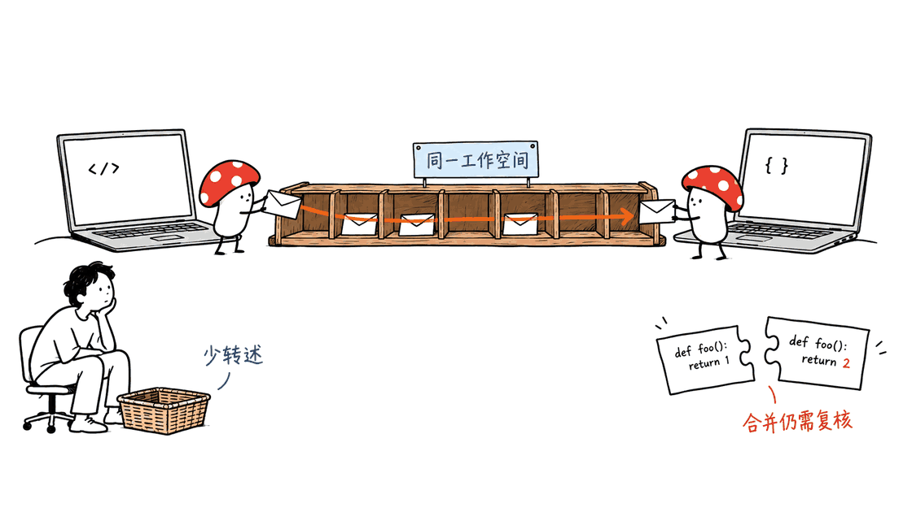
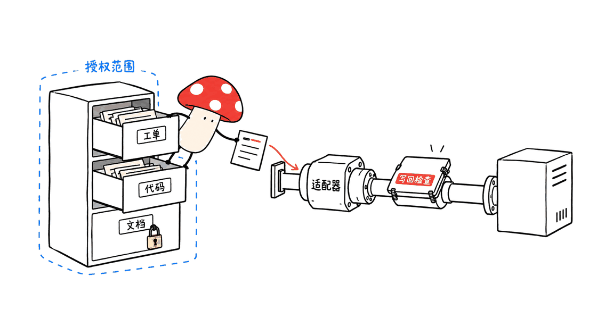
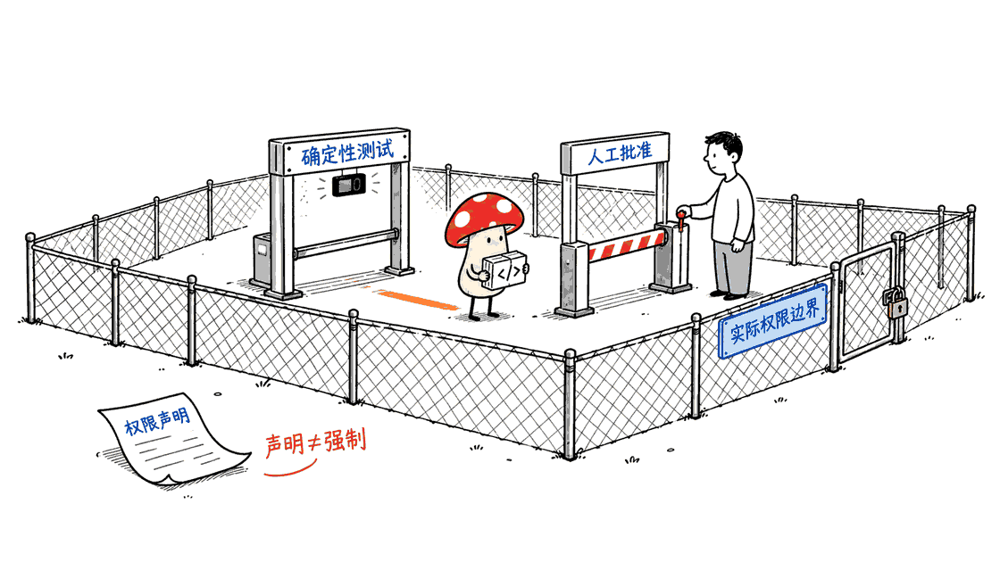

Agent Relay 让团队现有的编程 Agent 直接发消息、查询历史，并把重复协作步骤写成可检查的流程。它解决的是“谁掌握什么上下文、下一步由谁接手”，适合已经同时使用多个编程助手的团队。

项目来自 AgentWorkforce，核心仓库采用 Apache-2.0。YC 公司页面确认 Agent Relay 属于 Fall 2026 批次，由 Will Washburn 和 Khaliq Gant 创办。因此“YC 项目开源”成立，“YC 官方开发的框架”则不准确。

仓库：https://github.com/AgentWorkforce/relay

YC 公司页：https://www.ycombinator.com/companies/agent-relay

本文核查日期为 2026 年 10 月 29 日，主仓库固定在 `1503039856c5c8665601f814c17f751407f66497`。GitHub 最新正式 Release 和 npm CLI 均为 `14.0.0`，但当前主分支包含更新的功能，不能假定安装这个版本就具备所有主分支能力。

## Agent Relay 的四类能力分别在哪里？

素材概括的方向与官方 README 一致，但工程上需要拆成组件，才能判断部署成本和数据去向。

| 需求 | 对应组件 | 接入时需要确认什么 |
|---|---|---|
| Agent 发私信、进频道、读线程 | Relay CLI、Broker 与 Relaycast | 工作空间、每个 Agent 的身份、消息投递状态 |
| 把业务工具变成文件接口 | Relayfile，独立仓库 | 提供商授权、路径 ACL、写回状态、失败重试 |
| 查询过去的编码上下文 | RelayHistory、Trajectories、Cloud Shared Sessions | 本机索引与团队共享的区别、分享范围、版本支持 |
| 多步任务、确定性校验和人工门禁 | Flows，独立仓库 | 哪些检查实际执行、什么条件阻止后续步骤 |

Relayfile 与 Flows 的仓库标注 Apache-2.0，RelayHistory 标注 MIT。主仓库的许可证不能替代所有关联仓库或第三方依赖的许可证。



前端 Agent 可以询问后端 Agent 某个字段的含义；维护者也可以追查“金额为什么用分存储”。这些能力减少转述，但发送问题不代表对方马上有空，更不代表双方会自动得到正确答案。

官方提到协商合并冲突，这是使用场景。消息系统本身不会证明代码兼容，也不会替团队执行所有测试。分支隔离、合并检查和最终责任人仍需明确。

## 怎样先跑通本机消息？

当前 quickstart 推荐 Node.js 22 或 24，并提示较新的 Node 版本可能缺少本地 SQLite 模块预编译包。学习与试点优先按这个范围准备环境，而不是看到包的最低版本限制就直接使用最新 Node。

先安装已发布 CLI，并检查实际命令，而不是直接照抄主分支向导：

```bash
npm install -g agent-relay@14.0.0
relay --help
relay mcp --help
```

官方也提供安装脚本。执行远程脚本前应先阅读其内容；npm 与脚本的二进制放置方式不同，排查 PATH 时要看实际安装方式。

本次在临时目录安装 npm 14.0.0 后，实际帮助列出了 `workspace`、`message`、`mcp` 等命令，却没有 `init`；`mcp --help` 则确认存在 `--sessions-only`。因此，这个已发布包不能直接当作主分支 `relay init` 教程的可执行版本，云端历史端点也没有在本次测试中验证。

主分支 quickstart 的目标路径是运行 `relay init`，在向导中选择 `This machine`、已安装的 Claude Code 和 Codex，以及 `Project` 范围。文档描述的本机服务地址为 `http://127.0.0.1:8787`，不要求云账户。等安装版本确实提供 `init` 后，再按向导配置；当前试验可先从独立 Relaycast 引擎和自托管指南入手。

按该主分支向导配置时，会添加 MCP 连接。Claude Code 使用项目 `.mcp.json`，Codex 使用 `.codex/config.toml`。工作空间密钥另行保存，不应该提交到仓库；当前实现通过 Git 本地 exclude 隐藏项目运行状态。Agent 客户端仍有各自的项目信任和首次启用要求。

完成与安装版本匹配的 MCP 和工作空间配置后，在两个客户端分别打开项目，再要求一端向另一端发送问候。当前文档使用类似 `claude-my-project`、`codex-my-project` 的自动名称，同工具的多个会话可能带后缀。先核对实际名称，再发消息。

不用模型也能理解消息路径，官方 CLI 范例是：

```bash
relay agent register alice
relay agent register bob
relay message dm send bob "demo: amount is stored in cents" --as alice
relay message inbox check --as bob
```

注册命令会输出并保存 Agent token，终端日志也应按凭证处理。上述名称应只用于自己的测试工作空间。

文档特别说明，CLI 返回 `queued_unconfirmed` 代表消息已经保存、进入收件箱，尚未确认读取。不要因为这个状态重复发送。读取确认与任务完成也不是同一件事，任务完成应另附结果、提交或测试证据。

quickstart：https://github.com/AgentWorkforce/relay/blob/main/docs/quickstart.md

## 本地检查实际验证了什么？

Mycelium Protocol 在 Apple M4、16GB 内存的 Mac 上，使用 Node.js `22.23.4` 和 npm 发布的 `@relaycast/engine@12.2.1` 做了隔离检查。依赖安装在临时目录，未修改日常 Agent 配置，未索引真实聊天记录。

测试通过引擎的 Hono HTTP 请求处理器和真实内存 SQLite 运行，没有启动 TCP 监听。七项断言通过：创建工作空间、注册两个虚拟身份、拒绝无凭证读取、接受私信、接收方读到完整正文、发送方以自己的 token 访问收件箱，以及拒绝空正文。

这是消息与基础校验路径的 smoke test。没有测试 WebSocket、真实 Claude/Codex 会话注入、跨机网络、云端历史、SaaS 写回、模型质量或性能，16GB 也不是官方最低硬件要求。

引擎日志还显示，接收方没有就绪的投递提供方时，实时投递会被延后；消息依然能通过收件箱读取。这说明试点不能只检查“发送成功”，还要让真实客户端确认它收到了消息。

复核材料保留了脚本、依赖锁和原始结果。复现时将脚本放到安装了该引擎的目录运行即可，不需要模型 API Key。

## Relayfile 把工具变成文件，究竟省掉了什么？

Relayfile 把 GitHub、Linear、Notion、Slack 等提供商的数据投射为有访问控制的文件树，并处理外部事件与写回。Agent 可以先读目录说明，再用熟悉的文件操作访问数据，不必在每次任务里重新理解一套工具调用形式。

例如，读取一条工单的 JSON 后，提交允许修改的字段，由适配器向提供商写回。官方实现还考虑了队列、重试、冲突和失败重放。因此文件接口简化的是 Agent 的操作入口，底层 API、鉴权和一致性工作仍然存在。



团队应先给一个测试仓库或测试项目授权，并保持只读。确认目录内容、更新延迟和人员权限后，再开放一项可撤销的写操作。文件写入成功、队列接收、提供商实际更新，应该分别核对，不能统称“任务已完成”。

Relayfile：https://github.com/AgentWorkforce/relayfile

## 共享历史会不会把私有会话全交出去？

RelayHistory 的 `ai-hist` 把支持的本机会话索引进 SQLite，提供搜索、上下文打包和部分客户端的原生恢复入口。它采用 MIT 许可。独立工具 README 要求 Node.js 20 或 22，因此若和 Relay CLI 一起试验，Node.js 22 是两份文档共同覆盖的选择。

本地索引与 Cloud 团队历史搜索是两条部署路径。主仓库 Shared Sessions 插件通过 Cloud 登录后的工作空间权限搜索。插件 README 还保留版本警告：CLI 必须包含 `mcp --sessions-only`，Cloud 也必须部署对应端点，已发布 CLI 的支持情况需要单独核对。

本次已经确认 npm 14.0.0 有该命令参数，但未验证登录后的远端端点。这也说明，“主分支有代码”不等于“整条功能链已经可用”。上线前先检查实际 CLI 帮助和云端能力。也不要为了试一个历史功能，未经确认就索引、分享整个团队的私有会话。

团队应约定分享哪些仓库与会话、是否包含工具输出、保留多久，以及离职和项目结束如何撤回访问。历史中的决策只是当时的证据，仍需对照当前代码验证。

RelayHistory：https://github.com/AgentWorkforce/relayhistory

共享插件：https://github.com/AgentWorkforce/relay/tree/main/plugins/shared-sessions

## Flows 怎样把“记得检查”变成实际门禁？

Flows 用 TypeScript 描述多步执行，允许把 shell 校验、Agent 任务和检查结果串起来。对团队而言，一个实用流程是：取工单、实施修改、运行确定性测试、复核产物，再请求指定人员批准后进入合并步骤。这是建议的试点流程，并非安装后的默认保证。

官方提供的软件工厂、PR 审查和定期工单整理示例，可以作为起点。当前 authoring reference 区分了运行时 predicate gate 与可提前检查的命名 gate，并记录运行结果。让测试退出码或结构化结果决定是否继续，比让 Agent 自己说“测试通过了”更容易核查。

但要仔细看具体字段：本次读取的 Flows 文档明确把每步 `permissions` 标为“验证并记录，尚未执行限制”。其 `cwd` 也说明只是启动目录，不是沙盒。不能把配置里出现 `readonly` 当成已经阻止所有写操作。



需要强制隔离时，应使用实际执行限制的凭证范围、运行环境与代码托管平台保护规则。审批人必须在流程中明确配置，不能推断每次写入都有人工批准。官方 trust 页面同样说明，审批门禁按流程配置，并非所有写操作的通用要求。

Flows：https://github.com/AgentWorkforce/flows

API 边界：https://github.com/AgentWorkforce/flows/blob/main/packages/surface/AUTHORING.md

## 团队应该怎样试点，自托管到什么程度？

建议从两名开发者、两个 Agent 和一个非敏感测试项目开始，先观察一次接口协作，避免直接连接全部业务工具。

1. 只接消息，记录需要人类转述的次数，并检查未读、离线和重复消息如何处理。
2. 共享一份经人工整理的接口决策，检查另一端是否能找回来源并核对当前代码。
3. 给 Relayfile 接入测试数据，只开放必要路径和只读权限。
4. 把一项重复工作写成 Flow，故意让测试失败，确认后续步骤确实停止，再验证审批路径。
5. 根据完成时间、人工介入次数、重复工作与错误写回决定是否扩大范围。消息数量本身不是效率指标。

跨机协作可以使用托管服务，也可以搭自己的 Relaycast。官方自托管文档将 Node 与 SQLite 引擎定位为单租户、单进程，不能据此承诺水平扩容。

还应区分开源组件和完整 Cloud 产品。主仓库自托管指南说明，Cloud 沙盒、托管仪表盘和共享会话仍需 Cloud 账户；官方 trust 页面则明确表示完整 Cloud 产品尚无自托管打包。它还列出企业 SSO、全面客户可见安全审计、已完成 SOC 2 等尚未完成的事项。

因此，Agent Relay 很适合评估多编程助手的协作成本。对要求所有会话留在内网、完整审计或企业身份集成的团队，应逐项确认组件部署和数据路径，再决定采用范围。

自托管指南：https://github.com/AgentWorkforce/relay/blob/main/docs/self-hosting/README.md

信任说明：https://agentrelay.com/trust

延伸阅读：本站的 WebMCP 文章讨论网站如何向 Agent 声明工具入口，和 Agent Relay 的团队消息层解决不同的问题。
https://blog.mushroom.cv/blog/webmcp-chrome-browser-tools-api-guide/

## 常见问题

### Agent Relay 会替代 Claude Code 或 Codex 吗？

不会。它连接已有编程 Agent，补充通信、历史和流程能力。模型订阅、API 成本及客户端运行要求仍然存在。

### 自托管消息引擎后，所有功能都能离线运行吗？

不能这样推断。本地消息可独立部署，Cloud 共享会话等功能仍有云依赖，连接的 SaaS 与远程模型也会接收相应数据。

### Agent 可以自己合并所有冲突吗？

通信让协商成为可能，但不保证解决正确。合并前仍应检查对应提交、测试结果和授权，重要改动保留人工审核。

---

> © 2026 Author: Mycelium Protocol. 本文采用 [CC BY 4.0](https://creativecommons.org/licenses/by/4.0/deed.zh) 授权——欢迎转载和引用，须注明作者姓名及原文链接，不得去除署名后以原创发布。

<!--EN-->

Agent Relay connects the coding agents a team already uses. It adds messaging, searchable context and programmable workflows, so developers spend less time forwarding questions between assistants.

AgentWorkforce publishes the core repository under Apache-2.0. Y Combinator lists Agent Relay in its Fall 2026 batch, founded by Will Washburn and Khaliq Gant. It is a YC-backed company's project, not a framework developed by YC itself.

Repository: https://github.com/AgentWorkforce/relay

Company listing: https://www.ycombinator.com/companies/agent-relay

This review was checked on October 29, 2026, against Relay commit `1503039856c5c8665601f814c17f751407f66497`. The latest formal GitHub release and npm CLI were both `14.0.0`. Current main-branch documentation can describe functionality beyond that release.

## Which component provides each capability?

| Need | Component | Deployment question |
|---|---|---|
| Direct messages, channels and threads | CLI, Broker and Relaycast | Which workspace and agent identity receive the message? |
| Business tools through file operations | Relayfile | Which provider scopes, file paths and writeback states are allowed? |
| Previous conversations and decisions | RelayHistory, Trajectories and Cloud Shared Sessions | Is the history local or shared, and who can search it? |
| Required steps and checks | Flows | Which checks run, and what stops subsequent actions? |

Relayfile and Flows declare Apache-2.0. RelayHistory declares MIT. Each component and its dependencies need their own license review.


A frontend agent can ask a backend agent about a response field. Another agent can look for the decision to store money as integer cents. Messaging reduces forwarding, but does not prove that the recipient is available or that its answer is correct.

Conflict negotiation is a supported use case, not proof of reliable autonomous merging. Teams still need branch ownership, tests and a person accountable for integration.

## How can a team try local messaging?

The current quickstart recommends Node.js 22 or 24. It warns that newer Node releases may lack prebuilt binaries for the local SQLite module. Follow that guidance rather than assuming the latest runtime is best.

Install the published CLI and inspect its actual commands first:

```bash
npm install -g agent-relay@14.0.0
relay --help
relay mcp --help
```

The project also offers an installation script. Read remote scripts before executing them. The script and npm place binaries differently, which matters when diagnosing PATH problems.

An isolated installation of npm 14.0.0 listed `workspace`, `message` and `mcp`, but no `init` command. Its real `mcp --help` did confirm `--sessions-only`. The published package therefore cannot be treated as an executable version of the main-branch initialization tutorial. The Cloud endpoint was not tested.

The main-branch quickstart describes running `relay init`, then selecting `This machine`, installed clients and `Project` scope. Its documented local service is `http://127.0.0.1:8787`, without a Cloud account. Use that wizard only when the installed version actually provides it. For now, a local experiment can start with the standalone Relaycast engine and the self-hosting guide.

That main-branch wizard adds an MCP connection through `.mcp.json` for Claude Code or `.codex/config.toml` for Codex. Workspace credentials are stored separately. The current implementation excludes project runtime state through Git's local exclude file. Each client still applies its own project trust and activation rules.

After configuring MCP and the workspace for the installed version, open both clients and check their actual agent names before sending. Current documentation uses names such as `claude-my-project` and `codex-my-project`, with suffixes for additional sessions.

Shells can also use the documented CLI:

```bash
relay agent register alice
relay agent register bob
relay message dm send bob "demo: amount is stored in cents" --as alice
relay message inbox check --as bob
```

Registration prints and saves agent tokens. Treat terminal output as credential-bearing. Use synthetic identities only in a workspace you control.

The documented CLI status `queued_unconfirmed` means the message was stored in the recipient's inbox without read confirmation. Do not resend solely because of that status. Reading a message and completing a task are also different events. Completion should include an artifact, commit or test result.

Quickstart: https://github.com/AgentWorkforce/relay/blob/main/docs/quickstart.md

## What did the local check establish?

Mycelium Protocol tested npm package `@relaycast/engine@12.2.1` with Node.js `22.23.4` on an Apple M4 Mac with 16GB memory. Dependencies stayed in a temporary directory. The check did not modify everyday agent configuration or index private conversations.

Seven assertions passed through the engine's Hono HTTP request handlers with real in-memory SQLite: workspace creation, registration of two synthetic identities, rejection of unauthenticated inbox access, DM acceptance, exact message retrieval by the recipient, authenticated sender inbox access, and rejection of an empty DM.

No TCP listener was started. This was not a WebSocket, real-client injection, cross-machine, Cloud history, provider writeback, model-quality or performance test. The machine's 16GB memory is not an official minimum requirement.

The engine also logged deferred live delivery because the synthetic recipient had no ready delivery provider. Inbox retrieval still worked. A practical pilot must confirm receipt in the actual client, rather than stopping at successful submission.

The script, dependency lock and raw output are archived for reproduction. The check needs no model API key.

## What does Relayfile simplify?

Relayfile projects authorized provider data into a file tree and handles external events and writeback. Agents can inspect directory descriptions and use familiar file operations for GitHub, Linear, Notion or Slack data.

An agent might read a ticket's JSON, then submit a permitted field update. The adapter still handles the provider API, authorization, queues, retries and conflicts. File operations simplify the agent-facing interface. They do not remove the underlying integration work.


Start with a test repository and read-only access. Confirm data freshness and path permissions before allowing one reversible write. Distinguish acceptance into a queue from successful mutation at the provider.

Relayfile: https://github.com/AgentWorkforce/relayfile

## Is local history the same as shared team history?

RelayHistory's `ai-hist` indexes supported local agent conversations into SQLite. It can search history, produce context packs and print native resume commands for supported clients. Its README requires Node.js 20 or 22. Node.js 22 therefore overlaps the documented ranges for this tool and Relay's quickstart.

Cloud Shared Sessions is a separate path. The plugin searches history under the authenticated workspace's access. Its README explicitly requires a CLI containing `mcp --sessions-only` and a Cloud deployment with the matching endpoint. This review confirmed the option in npm 14.0.0, but did not verify the authenticated remote endpoint.

Before rollout, check the installed CLI and Cloud deployment. Code on main is not sufficient evidence of an available release. Do not index or share private team history as an incidental installation step.

Agree which repositories and sessions can be shared, whether tool output is included, retention periods and how access is revoked. Historical decisions need comparison with current code.

RelayHistory: https://github.com/AgentWorkforce/relayhistory

Shared Sessions: https://github.com/AgentWorkforce/relay/tree/main/plugins/shared-sessions

## What can Flows enforce?

Flows defines multi-step execution in TypeScript. A useful pilot sequence is ticket intake, implementation, deterministic tests, artifact review and explicit human approval before merging. This is a proposed team workflow, not a universal installation default.

Official examples cover software factories, PR review and scheduled ticket summaries. The authoring reference distinguishes runtime predicate gates from named gates that can be inspected before execution. Test exit codes and structured results provide stronger evidence than an agent's claim that tests passed.

Read individual field contracts carefully. The inspected reference marks per-step `permissions` as validated and recorded, but not currently enforced. It also states that `cwd` selects a starting directory rather than providing a sandbox. A `readonly` declaration does not prove that writes are blocked.


Use enforced credential scopes, execution environments and repository protection rules for isolation. Configure the human gate explicitly. The official trust page states that approvals are per-flow, not a universal requirement for writes.

Flows: https://github.com/AgentWorkforce/flows

API contracts: https://github.com/AgentWorkforce/flows/blob/main/packages/surface/AUTHORING.md

## How should a team pilot and host it?

Start with two developers, two agents and a non-sensitive test project. Observe one interface handoff before connecting all business systems.

1. Enable messaging and record human forwarding, unread messages, offline behavior and duplicates.
2. Share one reviewed interface decision and verify that another agent can retrieve its source and check current code.
3. Connect read-only Relayfile test data with limited paths.
4. Build one repeated task as a Flow. Force a test failure and confirm later steps stop. Then verify the approval route.
5. Evaluate completion time, human intervention, duplicated work and incorrect writes. Message volume alone does not measure productivity.

For multiple machines, use the hosted service or deploy Relaycast. The self-hosted Node and SQLite engine is documented as single-tenant and single-process. Do not assume horizontal scalability.

Open-source components and the full Cloud product have different deployment boundaries. The self-hosting guide says Cloud sandboxes, hosted dashboards and shared sessions still require a Cloud account. The trust page says full Cloud self-host packaging is not currently available. It also lists enterprise SSO, comprehensive customer-visible security auditing and completed SOC 2 work as unfinished.

Agent Relay is worth evaluating when coordination between existing coding assistants consumes developer time. Teams that require internal-only conversations, complete auditing or enterprise identity integration should verify each component and data path before expanding access.

Self-hosting: https://github.com/AgentWorkforce/relay/blob/main/docs/self-hosting/README.md

Trust: https://agentrelay.com/trust

Related reading: WebMCP exposes site-defined tools to agents. It addresses a different integration boundary from Agent Relay's team messaging.
https://blog.mushroom.cv/blog/webmcp-chrome-browser-tools-api-guide/

## Frequently asked questions

### Does Agent Relay replace Claude Code or Codex?

No. It connects existing agents. Their model subscriptions, API charges and runtime requirements still apply.

### Does self-hosting messaging make every feature offline?

No. Cloud shared sessions have Cloud dependencies. Connected SaaS services and remote models still receive the data required for their operations.

### Can agents safely merge every conflict themselves?

Messaging enables negotiation, but does not guarantee correctness. Check the relevant commits, tests and authorization before merging, and retain human review for important changes.

---

> © 2026 Author: Mycelium Protocol. Licensed under [CC BY 4.0](https://creativecommons.org/licenses/by/4.0/) — free to share and adapt with attribution. You must credit the author and link to the original; removing attribution and republishing as original is not permitted.
