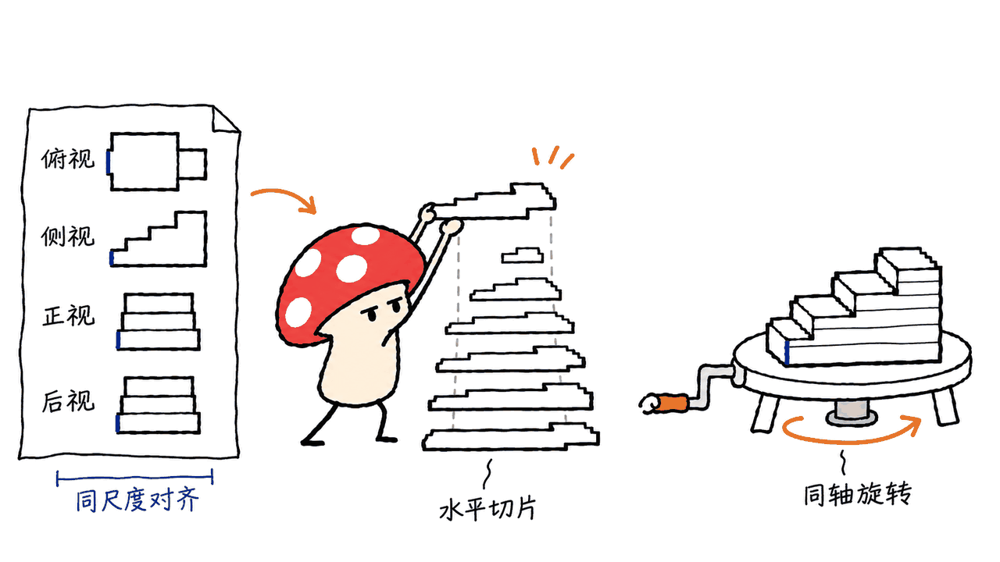
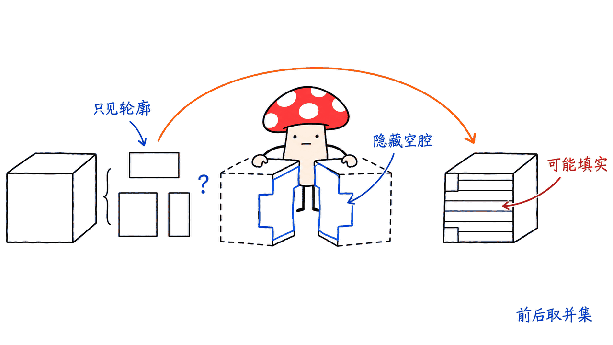
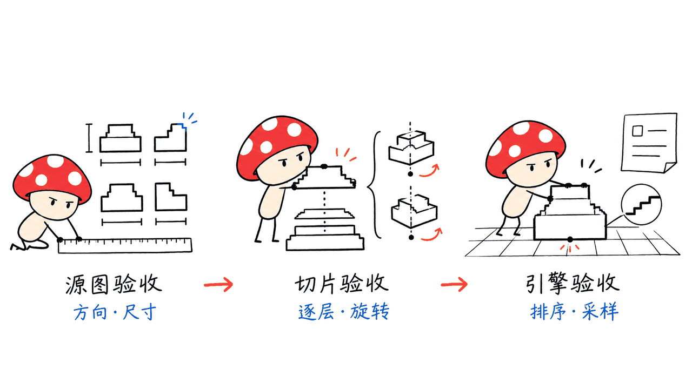

sprite-stacking 是一套把四张像素视图转成可旋转分层精灵的 Agent 技能。它把美术约束、切片脚本和预览器放在一起，适合制作俯视游戏里的车辆与道具；它不是从任意单张图片恢复真实三维结构的模型。

Daniel White 的 danielwh2/sprite-stacking 采用 MIT 许可证。Mycelium Protocol 核对了固定代码快照，运行原始自检、真实切片 CLI 和 Chrome 预览，还发现一个与“四剪影求交”描述不完全一致的实现细节。

## 四张图，怎么变成能转的对象？

输入是一张图纸里的俯视、侧视、正视和后视，通常排成一行。四张图要使用同一尺度、正交投影和一致朝向，不能把随手找来的四个透视截图拼在一起。俯视图给出占地形状，侧面和端面给出不同高度的轮廓。

脚本去背景、剥离边缘描线、统一调色板，再雕刻出体素体积。体积沿高度切成水平薄片，输出为横向 PNG 条带：从左到右对应地面到屋顶。渲染时从下往上绘制，每层绕同一中心旋转，按相机俯角压缩，再抬高对应的像素距离。

“假 3D”的假，主要指最终使用二维精灵层来表现旋转体积。中间确实存在体素占用数据，但输出不是自动完成拓扑、UV、骨骼和碰撞的游戏模型。堆叠技术也不是作者新发明的；项目自己把贡献定位为四视图雕刻与 Agent 工作流。

## 真的是四个剪影全求交吗？

README 用“四个视图都覆盖才保留体素”解释原理，但固定快照的 `carve()` 更具体：前视与后视掩码先做 OR，然后再与俯视、侧视相交。占用规则可概括为：`top AND side AND (front OR back)`。

这不是措辞上的小区别。我们构造了一个高 2、长 3、宽 4 的测试空间：前视只保留最左一列，后视只保留最右一列，两者没有交集。严格四路求交应得到零体素，原脚本却保留 12 个体素，正好对应两列的并集。清空俯视、侧视或同时清空前后视，输出才全部清空。

它意味着前后轮廓不一致时，脚本仍可能保留某些结构。不能只看到预览能转，就认定结果与四个输入完全一致。这项检查针对原函数，没有改动上游算法，也不是在评估生成模型的理解能力。

## 哪些细节能保留，哪些会被填平？

轮廓可以约束外形，却不能凭空提供被遮挡的信息。四个剪影都看不到的货斗凹槽、内部空腔，会倾向于填实；一个墙面上的小突出物，还可能沿整面墙形成台阶。这些情况通常需要改输入或手修切片。

圆形也要有明确约束。俯视画方形，结果就容易变成方块；宽底座上较窄的圆塔，可以尝试 `--round`，按该层侧面与端面的跨度增加椭圆裁剪。这个选项加入了形状假设，不是识别出了真实圆柱。

细杆是另一个实际问题：一像素的支柱或天线在旋转采样中可能闪烁，项目提供 `thin_runs` 警告，并建议至少两像素宽。更多层能增加高度细节，也会增加素材和渲染工作，不能无限堆层来补救错误的视图。

## Agent 的价值，体现在哪一步？

仓库不是一个新图像模型，而是一份技能说明、Python 切片器和独立 HTML 预览器。Agent 可以调用已有生图工具准备四视图，也可以用短 Python 脚本画原生像素图；图纸质量仍然是整个流程的上限。

技能要求先检查朝向、尺寸与硬边，再切片，打开检查图看多角度和爆炸视图，最后接入已有游戏渲染器。这个顺序很合理：把“看起来像四视图”的图片与“能被几何脚本消费”的输入分开验收，减少把坏素材接进游戏后再返工。

切片可接入 Canvas、Godot、Unity 或 Phaser，但参考代码不等于所有引擎都已验证。旋转中心要对称、关闭纹理平滑、避免逐层描边，多个对象还应按地面接触点整体排序。静态道具适合预烘焙；例如 200 棵树各 30 层，朴素实现就是每帧 6000 次绘制。

独立预览器也能导出 16 方向精灵表，方便换取更简单的运行时。它还提供天气、光照和试玩模式，但不能由演示直接推断碰撞、寻路、关卡和跨平台发布已经做好。README 的 Chrome 耗时属于作者报告，不能当成任意游戏场景的性能保证。

## 本地实际跑通了哪些环节？

我们在 Apple Silicon Mac 上，用现有 Python 3.12、Pillow 和 NumPy 运行上游 `tests/check.py`，原样通过。它包含八个编号检查组，覆盖视图排序、颜色污染、悬挑、圆形裁剪、细杆提示、法线、自发光及 HTML 控件存在性；最后一组是检查 HTML 字符串，不是浏览器交互测试。

随后用自己画的蓝橙色盒状四视图，调用原始 CLI，得到 18 层条带，每层 23×33 像素，整张 PNG 为 414×33。检查预览、同尺寸法线图、自发光掩码和内嵌图片的 HTML 均成功输出。合成夹具的目的只是验证数据链路，不代表完整美术生产质量。

我们再用真实 Chrome 打开生成的本地 HTML，保存了可见转台截图，确认它能显示分层对象。浏览器日志有无头显示设备诊断，截图后进程清理超时、退出码为 2，截图已人工查看；没有把它写成“零错误全功能验收”，也没有测试所有按钮、16 方向导出、Godot/Unity 集成或帧耗时。

我的判断是：它适合把“Agent 做素材”变成一条能检查中间产物的流程。先用简单道具验证视图一致性和旋转稳定性，再尝试复杂角色，比追求第一张演示的惊艳更有用。确定需要真正的任意视角、隐藏几何或骨骼动画时，也应及时切换到对应的三维资产流程。

## 常见问题

### 只给一张普通图片可以吗？

切片器需要四视图图纸，或直接使用已有切片条带。Agent 可以帮助补画视图，但那一步包含创作和猜测，不能称为从单张图片确定恢复背面结构。

### 能完全离线工作吗？

已有合格图纸时，Python 切片与生成的 HTML 可以在本地完成。若让 Agent 调用云端模型生成图纸，则会引入外部服务和费用；技能本身不提供免费无限生图。

### MIT 是否覆盖我生成的所有素材？

MIT 允许按条款使用项目代码和技能。输入图片、商标、第三方美术及所用生成服务的条款仍需分别核对，不能由仓库许可证推导全部素材的权利。

## 一手资料与延伸阅读

官方仓库：https://github.com/danielwh2/sprite-stacking

切片脚本：https://github.com/danielwh2/sprite-stacking/blob/main/skills/sprite-stacking/scripts/views_to_slices.py

作者工作流与限制：https://github.com/danielwh2/sprite-stacking/blob/main/skills/sprite-stacking/SKILL.md

原始自检：https://github.com/danielwh2/sprite-stacking/blob/main/tests/check.py

相关：用代码生成视频与游戏时怎样区分能渲染和能交付：https://blog.mushroom.cv/blog/raea-native-gpu-react-video-game-engine-guide/

代码快照：6fecdfd0d6e5a0595f979550e05f4b1fcde550fe。本文的测试证据只覆盖所述夹具、CLI 和浏览器显示；封面与正文图是解释性创作，不是项目生成质量或游戏集成的证明。

---

> © 2026 Author: Mycelium Protocol. 本文采用 [CC BY 4.0](https://creativecommons.org/licenses/by/4.0/deed.zh) 授权——欢迎转载和引用，须注明作者姓名及原文链接，不得去除署名后以原创发布。

<!--EN-->

sprite-stacking is an agent skill for turning four pixel-art views into layered sprites that can rotate. It combines artwork constraints, a Python slicer and a viewer for top-down vehicles and props. It is not a model that recovers a complete real-world 3D object from an arbitrary single image.

Daniel White publishes danielwh2/sprite-stacking under MIT. Mycelium Protocol reviewed a fixed commit, ran its original self-check, exercised the actual CLI and opened the output in Chrome. We also found that the occupancy rule is more specific than a strict intersection of four silhouettes.

## How do four views become a rotating object?

The usual input is a sheet containing top, side, front and back views. Scale, orthographic projection and orientation must agree; four unrelated perspective screenshots are not equivalent input. The top constrains the footprint, while side and end views constrain height profiles.

The script removes the background and outlines, shares a palette, carves a voxel volume and exports horizontal slices. The PNG strip runs from ground to roof. A renderer draws bottom to top, rotating each slice around a shared center, vertically compressing it for camera pitch and lifting successive layers.

The intermediate representation really has voxel occupancy, but the final effect uses 2D layers. It does not automatically supply mesh topology, UVs, skeletons or collision geometry. The README also credits sprite stacking as an established game technique; the contribution is four-view carving and the agent workflow.

## Is it a strict four-silhouette intersection?

The README describes keeping a voxel where all four views cover it. At our pinned commit, `carve()` first combines front and back masks with OR, then intersects that result with top and side: `top AND side AND (front OR back)`.

We isolated this with a volume two voxels high, three long and four wide. The front retained only the leftmost column; the back retained only the rightmost. The two end masks had no intersection. A strict four-way intersection would be empty, but the original function retained 12 voxels, exactly the union of both columns.

Clearing the top, the side or both end masks emptied the volume. These checks ran the unchanged source function. They show that inconsistent front and back silhouettes may still preserve geometry; a spinning preview alone does not establish consistency with every input view. This was a geometry check, not a generative-model evaluation.

## What information cannot be recovered?

Silhouettes constrain visible boundaries without revealing hidden cavities. Recessed truck beds or internal voids invisible in every silhouette can fill in. Small wall protrusions may create an extended ledge. Fixing these often requires editing views or individual slices.

Roundness also needs a constraint. A square top tends to produce a box. The optional `--round` adds an elliptical restriction from each layer's side and end spans, useful for a narrow tower on a wide base. It introduces a shape assumption rather than discovering the true cylinder.

One-pixel posts can flicker under rotational sampling. The project includes `thin_runs` warnings and recommends at least two-pixel thickness. Additional layers preserve height detail but increase asset and rendering work; more slices cannot repair inconsistent source geometry.

## What does the agent skill contribute?

The repository supplies instructions, a Python slicer and a standalone HTML viewer, rather than a new image model. An agent may use an existing image generator or draw native pixel views in Python. Source-art quality remains a limiting factor.

The workflow checks orientation, matching dimensions and hard edges before carving. It then inspects a multi-angle contact sheet and exploded view before integrating with an existing renderer. This separates a plausible-looking model sheet from an input that a geometry script can consume reliably.

Canvas, Godot, Unity and Phaser integration guidance is provided, but examples do not establish that every engine is tested. Symmetric rotation centers, nearest sampling, a single outline around the finished stack and sorting entire objects by ground contact are consequential details. A naive scene with 200 trees and 30 slices per tree needs 6,000 draws per frame, so static props benefit from baking.

The viewer can export a 16-direction sprite sheet and includes lighting, weather and play modes. Those demonstrations do not establish complete collision, pathfinding, level design or platform distribution. The README's Chrome timing is an author report, not our benchmark or a guarantee for arbitrary game scenes.

## What did we run locally?

The unchanged `tests/check.py` passed using an existing Python 3.12, Pillow and NumPy environment on Apple Silicon. Its eight numbered groups cover view ordering, color leakage, overhangs, round clipping, thin-part warnings, normals, emissive masks and viewer-control presence. The final group checks HTML strings, not browser interactions.

Our own blue-and-orange box fixture then passed through the real CLI. It produced 18 slices of 23×33 pixels, a 414×33 strip, a contact sheet, matching normal and emissive strips and an HTML file with embedded images. This simple synthetic asset checks the pipeline rather than production artwork quality.

Real Chrome opened the local viewer and produced a manually reviewed screenshot showing the stacked object. Headless-display diagnostics were retained; after producing the screenshot, Chrome exited with code 2 because its teardown watchdog expired. We do not label this a clean browser pass. We did not exercise every control, the 16-direction export, Godot/Unity integration or frame-time performance.

Our assessment is that the useful contribution is an inspectable asset workflow. Begin with simple props and verify view consistency and rotational stability before moving to complex characters. When arbitrary viewpoints, hidden geometry or skeletal animation are requirements, choose an appropriate 3D asset workflow instead.

## Frequently asked questions

### Can I provide one ordinary image?

The slicer needs a four-view sheet or an existing slice strip. An agent can invent missing views, but that involves creative assumptions rather than determined recovery of unseen geometry.

### Can it run offline?

With suitable artwork already available, slicing and viewing are local. Asking an agent to generate views through a cloud service introduces that service's data path and costs. The skill does not supply unlimited free image generation.

### Does MIT license every resulting asset?

MIT governs the repository's code and skill. Input art, trademarks, third-party assets and generation-service terms require separate consideration. Their rights do not follow automatically from the repository license.

## Primary sources and related reading

Repository: https://github.com/danielwh2/sprite-stacking

Actual slicer: https://github.com/danielwh2/sprite-stacking/blob/main/skills/sprite-stacking/scripts/views_to_slices.py

Workflow and limitations: https://github.com/danielwh2/sprite-stacking/blob/main/skills/sprite-stacking/SKILL.md

Original self-check: https://github.com/danielwh2/sprite-stacking/blob/main/tests/check.py

Related rendering-versus-delivery analysis: https://blog.mushroom.cv/blog/raea-native-gpu-react-video-game-engine-guide/

Source commit: 6fecdfd0d6e5a0595f979550e05f4b1fcde550fe. Evidence covers the described fixtures, CLI and visible browser rendering. Cover and body artwork illustrate the concepts and do not prove generated-asset quality or engine integration.

---

> © 2026 Author: Mycelium Protocol. Licensed under [CC BY 4.0](https://creativecommons.org/licenses/by/4.0/) — free to share and adapt with attribution. You must credit the author and link to the original; removing attribution and republishing as original is not permitted.
