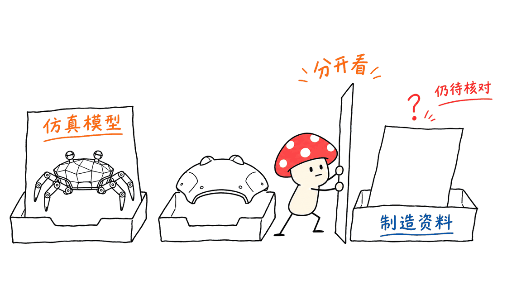
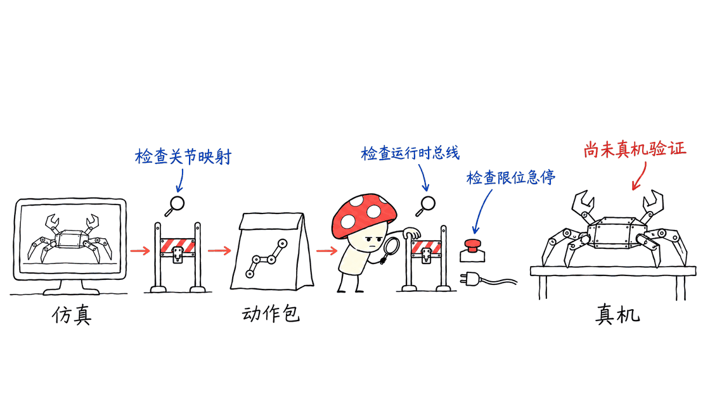

Agent Workspace让人用卡片和语音管理多个编码Agent；Jumper让人借助AI编程助手研究螃蟹机器人的外观、动作和仿真。它们是两个独立项目，没有证据表明前者就是后者的控制软件。

两个正确入口：
https://github.com/Flitternie/agent-workspace
https://github.com/KingKongRobotics/jumper

本文固定分析前者提交 `8adeac4bf2c2a2eeb93668a5b5cc143929bd46be`，应用包版本0.7.0、license字段标为MIT；后者提交 `198686eac0d188815d0943e9fee50de415edc80a`，主代码采用Apache-2.0。第三方依赖、机械素材与芯片工具链仍应分别核对许可。

## Agent Workspace：像开会一样管理编码Agent

它是Electron、React和TypeScript构成的桌面应用。每个Agent有自己的卡片，展示状态、完成内容、问题和权限请求；使用者不必来回切换多个终端才能知道谁在等回复。

主协调Agent负责分派、收集问题与回答状态查询。README明确限制它不直接改代码，也不能自行批准另一个Agent的权限请求。这样的设计意图是把协调与实际执行分开，而不是再增加一个不受约束的审批者。

它使用电脑上已登录的Claude Code或Codex CLI。语音可以按名字定向，比如让某个Agent暂停或补测试；短停顿会组合为一条消息，明确停止命令与普通跟进有不同含义。语音识别可选云端OpenAI，或下载本地SenseVoice、Whisper、Paraformer等模型。

本地转写不等于整个编码过程离线。真正处理代码任务的Claude Code或Codex仍有自己的服务、账户与数据路径。Cursor可以作为读写机器人项目的编辑器，但当前这个工作台公开列出的主要Agent接入是Claude Code和Codex，不能把三者混成同一支持清单。

## 语音并行编程，适合什么工作？

它适合多个边界明确的任务，例如一边补文档、一边检查测试、一边处理独立界面。项目还提供按任务分开的git worktree、会话续接、统一差异和终端内容，以及中英文界面。

并行的前提仍是工作拆分合理。两个Agent改同一个接口，依然需要明确契约和合并负责人；卡片变多不会自动消除冲突。语音环境也需要处理误识别、说话对象不明确和需要人工确认的请求。

官方主要验证平台为Apple Silicon macOS，文档要求Node 22；Windows安装包标为实验性。本文没有安装桌面发行包，也没有实际使用麦克风或登录编码CLI。

## Jumper：真正对应螃蟹机器人的仓库

Jumper是KingKong Robotics的22自由度螃蟹机器人项目。硬件规格页列出400×400×200毫米、RK3576主控、22个触觉舵机、4GB内存和64GB存储；整机重量标为1.8公斤，工程样机为2.8公斤。这些是官方规格，不是本机测量。

当前主仓库承担训练入口、机器人模型、任务、控制接口、动作包和部署工具。它使用MuJoCo相关环境，训练后把策略、关节顺序、观测布局和控制参数作为契约一起导出，避免不同程序各自猜一遍相同的含义。

外观和场景创作放在独立的jumper-design仓库，并不是主仓库已经包含的子模块：
https://github.com/KingKongRobotics/jumper-design

因此，先决定想做什么，比直接把全部工具装一遍更重要。设计外观、训练步态、修改游戏手柄控制和部署动作，是不同路线，需要不同依赖与验证。

## “图纸代码都有”，能否直接照着造一台？

当前能确认的是，仓库包含MJCF、URDF与STL机械模型、训练和部署代码。本文对排除`.git`及第三方`rl`目录的文件树做扫描，找到85个STL文件，未发现STEP/IGES或KiCad板图等常见制造资料格式。

这不是“所有硬件都不开放”的证明，也不涵盖其他仓库或未来版本。但它足以说明，不能仅凭GitHub可见模型就宣布完整可采购、可制造的资料已经齐备。规格表、仿真网格、可打印外壳、带公差装配图、PCB与BOM，解决的是不同问题。

官方工作流也强调，外观包的校验与渲染不证明实体装配适配。生成一个漂亮外壳，还需要安装空间、干涉检查、材料、加工方式和实际尺寸验证。

## 三种包，三条不同的验证链

`.skin`用于外观内容，`.map`用于场景，`.app`承载动作与控制器交付。主仓库文档提醒，导入地图在Train中用于回放，训练侧没有通用`.skin`加载器，机械结构差异也不能被悄悄抹平。

| 目标 | 首先看什么 | 仍需验证什么 |
|---|---|---|
| 改外观 | jumper-design工作流和内容协议 | 资源加载、视角、实体适配 |
| 训练动作 | 主仓库训练任务与环境 | 学习曲线、回放、稳定性和泛化 |
| 打包动作 | 导出契约、bundle与Schema | 文件齐备、关节映射、控制含义 |
| 上真机 | 板端部署文档和实际硬件 | 推理、总线、时序、限位和停止条件 |

Claude、Codex或Cursor可以帮助读文档、改奖励、补代码和定位错误，但不会替代测量。提示词里的“训练一个稳定步态”，只有在训练、回放和指标检查完成后，才可以转成“训练成功”。

## 为什么不能把演示视频当成真机部署证明？

固定提交的 `deploy/README.md` 保留了明确的开放问题：`rknn_run`尚未在真实硬件验证，控制循环也尚未跑过实际总线；实时调度和抖动统计仍有限制。

仓库另有官方动作展示视频，来源说明也写明，这些展示不证明配对的仿真策略就是视频中机器人的控制策略。因此，官方机器人的能力、某个训练策略的成绩，以及开源部署代码的完成度，需要分开判断。

这些记录反而有助于选择试验范围。刚入门时，可以先学习模型、控制契约和仿真；准备上板时，再逐项确认运行时、关节对应、输出限制和实际停止机制。不要把仿真中的跳跃参数直接当作现场安全的动作方案。

## 本次实际验证了什么？

Agent Workspace选择路由、语音文本组合、角色标签和私有目录规则四个文件，23项测试通过。这里测试的是逻辑与路径规则，不是实时语音、操作系统隔离或真实多Agent执行。初次`npm ci`因锁文件缺少平台依赖而失败；隔离克隆中改用不写锁文件、不执行安装脚本的安装方式后完成测试，上游源码与锁文件未改。

Jumper选择动作包归档、app Schema和环境变量三个文件，69项测试通过。最小环境补齐jsonschema后通过；另一次包含控制映射的收集因缺少Torch中断，未把该部分算作通过。没有运行完整依赖栈、强化学习训练、NPU转换或真机部署。

另用MuJoCo 3.11.0加载官方机器人XML，确认22个标量关节，并无渲染步进100次、共0.1秒，状态保持有限值。原始模型带自由基座，`nq=29`、`nv=28`，但没有声明执行器（`nu=0`）；它是机器人资产，不是一套已经装入策略的完整训练场景。

这个小检查只证明模型可加载和被动步进，不证明步态、跳高、抓取或硬件安全。没有接触真实机器人、没有进行语音云端调用，也没有让真实Claude Code/Codex接管设备。

## 常见问题

### agent-workspace就是Jumper的控制器吗？

不是。前者管理编码Agent，后者提供机器人仿真、训练和部署链路；本次没有验证两者集成。

### 有STL就能完成硬件复刻吗？

不能据此确认。还需要看文件是否可制造、零件与装配资料是否齐备，以及元件采购、加工公差和电子设计。

### Mac上能开始学习吗？

可以从阅读、模型与定向检查开始。训练、实时查看、转换和板端运行各有独立环境要求，本文没有完整复现这些流程。

主要参考：
https://github.com/KingKongRobotics/jumper/blob/main/docs/WORKFLOWS.md
https://github.com/KingKongRobotics/jumper/blob/main/docs/HARDWARE.zh.md
https://github.com/KingKongRobotics/jumper/tree/main/deploy

相关工程分析：https://blog.mushroom.cv/blog/hexashell-robot-coding-agent-harness/

---

> © 2026 Author: Mycelium Protocol. 本文采用 [CC BY 4.0](https://creativecommons.org/licenses/by/4.0/deed.zh) 授权——欢迎转载和引用，须注明作者姓名及原文链接，不得去除署名后以原创发布。

<!--EN-->

Agent Workspace coordinates coding agents through cards and voice. Jumper provides tools for a crab robot's appearance, motion and simulation. They are independent projects; the desktop workspace should not be presented as Jumper's controller.

Official sources:
https://github.com/Flitternie/agent-workspace
https://github.com/KingKongRobotics/jumper

This review fixes Agent Workspace at `8adeac4bf2c2a2eeb93668a5b5cc143929bd46be` (app version 0.7.0, package license field MIT) and Jumper at `198686eac0d188815d0943e9fee50de415edc80a` (Apache-2.0 main code). Dependency, mechanical-asset and chipset-toolchain terms remain separate.

## What does Agent Workspace coordinate?

The Electron/React/TypeScript application gives each coding agent a card with progress, questions and permission requests. A main coordinator dispatches work and collects decisions. The README states that it does not edit code itself or independently approve another agent's permission request.

It uses the existing Claude Code and Codex CLIs and logins. Spoken names select an agent, short pauses combine messages, and explicit stop commands differ from ordinary follow-up. Speech recognition can use OpenAI or downloaded local models such as SenseVoice, Whisper and Paraformer.

Local transcription does not make the coding model local. Claude Code and Codex retain their own services and data paths. Cursor can be an editor for working on robot code, but is not listed as a primary Agent Workspace provider. Per-task worktrees and session continuation help organization; they do not eliminate interface conflicts or the need for a merge owner.

The documented primary platform is macOS with Apple Silicon tested and Node 22 required; Windows installers are experimental. No desktop installer, microphone session or real coding-provider session was exercised here.

## Which project actually contains the crab robot?

KingKong Robotics' Jumper is a 22-DoF robot. Its hardware page lists a 400×400×200 mm body, RK3576 computer, 22 tactile servos, 4 GB RAM and 64 GB storage. Listed weight is 1.8 kg, with 2.8 kg for the engineering prototype. These are manufacturer specifications, not measurements performed for this article.

The main repository holds models, training tasks, controls, policy export and deployment tooling. It carries joint order, observation layout and control parameters as contracts rather than requiring downstream programs to reconstruct them.

Appearance and scene design live in a separate repository, not an included submodule:
https://github.com/KingKongRobotics/jumper-design

## Do visible model files establish a complete manufacturing release?

No. The checked tree contains MJCF, URDF and STL assets. A scan excluding `.git` and third-party `rl` found 85 STL files and no STEP/IGES or KiCad files. This scoped observation does not establish what other repositories contain, but it prevents assuming a complete procurement and manufacturing package from a visible simulation mesh.

Specifications, visual meshes, printable shells, toleranced assembly drawings, electronics and a bill of materials serve different purposes. The project's design workflow explicitly separates rendered/package validation from physical fit. A new shell needs dimensions, clearance, material and fabrication checks.

## What do the package formats deliver?

`.skin` carries appearance content, `.map` describes a scene, and `.app` delivers motion/controller artifacts. The training repository documents imported maps as replay-only and has no general training-side skin loader. Mechanical differences must not be silently reconciled.

An AI coding assistant can help inspect interfaces, change rewards and debug code. It cannot replace training, replay and measurement. A prompt asking for stable walking is not evidence that a stable policy has been obtained.

## Why keep simulation and board deployment separate?

At the pinned revision, deployment documentation explicitly says real-hardware `rknn_run` remains unverified and the control loop has not run against a bus. It also records limits in real-time scheduling and jitter accounting.

Official movement videos are separate demonstrations. Their provenance notes do not claim that the accompanying simulated policies drove the depicted hardware. Product capability, policy performance and readiness of the released controller must therefore be evaluated separately.

## What was actually tested?

Agent Workspace passed 23 tests across routing, speech-text composition, role labels and private-folder rules. These do not validate live transcription, OS confinement or real multi-agent execution. Initial `npm ci` failed because the lock omitted a platform dependency. Installing without rewriting the lock or running lifecycle scripts enabled the scoped tests; upstream source and lock stayed unchanged.

Jumper passed 69 tests across archive layout, app schema and environment configuration. A minimal environment needed jsonschema added first. A separate collection including control mappings stopped because Torch was absent; those tests are not counted as passing. No full training stack, reinforcement-learning run, NPU conversion or physical deployment was performed.

A headless MuJoCo 3.11.0 smoke check loaded the official XML, found 22 scalar joints and stepped 100 times over 0.1 seconds with finite state. The free-base asset has nq 29 and nv 28, but nu 0: it contains no declared actuators by itself and is not a complete policy-equipped training scene. Passive stepping does not establish walking, jumping, grasping or hardware safety.

## How should a newcomer start?

Choose one objective: study the coordination interface, inspect the robot model, design an appearance, train a motion or deploy a package. Read that route's instructions and preserve separate environments for Train and Design. Move toward hardware only after checking the matching policy contract, runtime, control limits and stop mechanism.

## FAQ

### Is Agent Workspace the Jumper controller?

No. One coordinates coding agents; the other contains robotics workflows. Their integration was not tested.

### Are STL files enough to replicate the hardware?

Not by themselves. Manufacturing suitability, assembly information, electronics, component availability and tolerances need separate verification.

### Can learning begin on a Mac?

Yes, with reading, model inspection and scoped checks. Training, viewers, conversion and board execution each have their own requirements and were not fully reproduced here.

Primary references:
https://github.com/KingKongRobotics/jumper/blob/main/docs/WORKFLOWS.md
https://github.com/KingKongRobotics/jumper/blob/main/docs/HARDWARE.zh.md
https://github.com/KingKongRobotics/jumper/tree/main/deploy

Related engineering analysis: https://blog.mushroom.cv/blog/hexashell-robot-coding-agent-harness/

---

> © 2026 Author: Mycelium Protocol. Licensed under [CC BY 4.0](https://creativecommons.org/licenses/by/4.0/) — free to share and adapt with attribution. You must credit the author and link to the original; removing attribution and republishing as original is not permitted.
