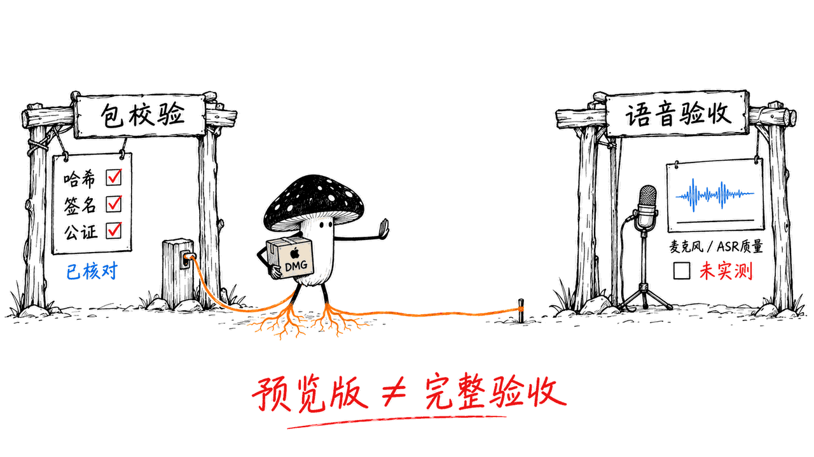
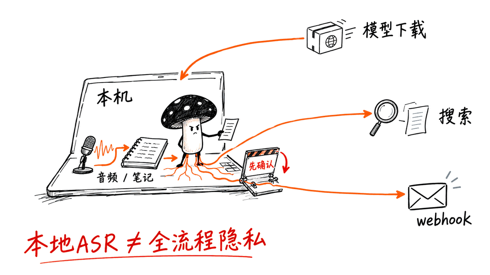

AgentEar 是一个 Mac 语音输入工具：按键录音、本地转成文字，再把结果送到剪贴板或笔记工作流。它的吸引力在于，口述的想法可以保留原始音频、变成可检索的 Markdown，并继续接入自己控制的 AI 服务。

项目仓库：https://github.com/iDoris-ai/AgentEar

本文基于固定提交 `5ac61569dcc551d7e0a4ee90538251f25a36d319` 的 README、源码与指定 Release。仓库主代码采用 Apache-2.0；打包运行时、模型和第三方组件仍应分别查阅其许可证。

先说明版本：你给的 `v0.27.0-preview.20261015.1` 是测试反馈用的核心预览，不是正式稳定版。GitHub API 的实际发布时间为 2026-10-19 11:04 UTC；标签中的日期不等于发布时间。

## 它和普通语音输入法有什么不同？

日常入口很简单：按右 Command 开始录音，再按一次停止；转写结果进入剪贴板，项目还支持通过模拟粘贴把文字送进前台应用。源码中的 `paste.rs` 选择“剪贴板 + ⌘V”，并把回车留给用户。粘贴失败时，文字仍可手动取用。

所以更合适的理解是菜单栏语音输入助手：不用先把录音传到某家云端，再拿一段转写回来。它也不意味着安装后替换整套键盘输入方案。

它的后半段更有意思。根据 README，每次转写会留下 `routes/` 决策记录；判出标签的内容再生成 Markdown。你明确说“这是一个 idea”或“记一个任务”，可以走本地规则，不必先运行大模型。

| 层次 | 做什么 | 需要什么 |
|---|---|---|
| 语音输入 | 录音、ASR、剪贴板与粘贴 | 本地识别引擎和模型、对应系统权限 |
| 知识库投递 | 把已标记的记录写成 Markdown | 默认开启；显式标签可以用本地规则 |
| 理解层 | 术语纠错、自动判标签 | 可选，默认关闭；另备本地 LLM 服务 |
| 对话层 | ASR → LLM → TTS | 另配模型和服务；README 描述的是半双工 |
| 指令层 | 记笔记、打开网址、调用 webhook | 已声明的指令表及确认策略 |

这些是项目文档描述的能力，不是本次预览包逐项完成的体验验收。


## README 和这个预览包，哪些地方不能混着看？

README 的安装段仍介绍 `macos-arm64.zip`、macOS 11+、本地自签和未公证。指定 Release 则明确提供已签名、公证的 DMG，并把本次系统门槛定为 macOS 26+。对这次下载，应以该资产的发布说明与实际元数据为准。

| 项目 | README 中的既有路径 | 本文指定的预览资产 |
|---|---|---|
| 包形态 | ZIP 应用包 | DMG，6,345,251 字节，约 6.05 MiB |
| 平台 | Apple Silicon，文档写 macOS 11+ | Apple Silicon，macOS 26.0+ |
| 签名状态 | 介绍自签、未公证 | Developer ID、Hardened Runtime、已公证 |
| 模型资源 | 旧打包路径介绍随包资源 | 不内置模型权重或声音资源，设置中显式下载 |
| 已验收说明 | 历史里程碑及各阶段数据 | 下载校验、安装记录和断网重启后的状态保留 |

包内 `Info.plist` 确实声明 `LSMinimumSystemVersion=26.0`。材料清单解释，限制来自本次固定的 SenseVoice 原生引擎构建；它不代表项目永久放弃旧版 macOS，也不代表把主程序重新编译就能解决整个包的兼容性。

尤其不要把“下载完成、安装状态能保留”理解成“实际说话已经测好”。这份 Release 明确列出：Whisper 真实语音、麦克风和录音质量尚未验收。维护者报告的首次下载测试针对 SenseVoice/VAD 两项，共 255,928,832 字节，约 244.1 MiB；这也说明 6 MiB 安装包不等于全部运行资源。

## 怎么安装、先验证哪一步？

建议先只验证语音输入，再逐层添加理解、笔记和对话功能。

1. 确认机器是 Apple Silicon，系统为 macOS 26.0 或更新版本。较旧系统不要直接照 README 的 11+ 安装这份预览包。
2. 在指定 Release 同时下载 DMG 和 `SHA256SUMS`，先校验，再打开镜像并把应用拖进“应用程序”。
3. 进入设置，明确选择并下载所需识别组件。离线推理仍需要先取得模型；包里没有模型不等于启动后会凭空具备识别能力。
4. 使用录音时按系统提示授予麦克风权限；快捷键监听和自动粘贴还涉及辅助功能。按 README，授权后应重启应用，未授权辅助功能时有 `Ctrl+Shift+R` 快捷键降级路径，但不能因此推断自动粘贴也已获授权。
5. 在空白笔记里录一条短句，检查原始记录、文字和手动粘贴；再尝试显式标签及知识库。不要用一条长录音同时排查模型、权限、纠错和对话服务。

下载地址：https://github.com/iDoris-ai/AgentEar/releases/tag/v0.27.0-preview.20261015.1

发布说明给出的校验方式，需在两个文件所在目录执行：

```bash
shasum -a 256 -c SHA256SUMS
spctl -a -t open --context context:primary-signature -v \
  AgentEar-0.27.0-preview.20261015.1-macos26-arm64.dmg
codesign --verify --deep --strict --verbose=1 /Applications/AgentEar.app
```

README 还提供 `--diagnose` 环境自检、`--transcribe` 离线文件转写和 `--search` 检索命令。应用包装进 `/Applications` 不代表 CLI 已加入 shell 的 PATH；命令找不到时，应核对应用内可执行文件的位置。

### 这次我们实际核对了什么？

在 macOS 26.6.2 上，我们下载该资产，以只读方式挂载，检查后卸载。以下是本次检查结果：

| 检查项 | 结果 |
|---|---|
| DMG 大小 | 6,345,251 字节，与发布说明一致 |
| SHA-256 | 与 GitHub 资产 digest、发布正文一致 |
| 应用架构 | Mach-O arm64 |
| `codesign --verify --deep --strict` | 通过 |
| DMG Gatekeeper 检查 | `accepted`，`Notarized Developer ID` |
| 应用与 DMG 的 `stapler validate` | 均通过 |

我们没有启动应用、访问麦克风、下载识别模型或测试转写。签名与公证校验通过，证明的是这些安装包检查项目通过，不能代替语音准确率、延迟和可用性体验。



## 本地知识库为什么值得关注？

AgentEar 的设计把几个容易混淆的东西分开了：原始音频是材料，`routes/` 是路由权威记录，`kb/` 是面向阅读的 Markdown，SQLite 索引是可重建的检索副本。

默认数据根目录为 `~/.agentear/`；知识库通常位于 `~/.agentear/kb/`，也可通过 `kb_dir` 指向已有笔记目录。Markdown 可被多种笔记工具读取，不必再向某个专属云端格式迁移。

这对经常口述想法的人很实用：同一句话能保留来源，而不是只在当前聊天框里出现一次。README 还区分了未分类内容与可投递笔记：没有启用理解层、也没有显式说出标签的内容，可以留在 `routes/`，不会全涌入知识库。

恢复能力也有边界。`--replay-kb` 按已有路由记录重建 Markdown，不会因为后来启用 LLM，就自动重新分类此前的 `unknown`。想“找回未分类录音”与“重建已分类笔记”，是两个问题。

## “全本地”要按哪段数据流理解？

默认录音和转写的目标是在本机完成，可选理解与对话服务也默认指向本机。下载模型权重是取回资源，与上传自己的录音是不同的流向。

但是项目也明确支持向外动作。浏览器搜索会把搜索词送给搜索引擎，`http_post` 会把配置的内容发给 webhook；如果把模型服务地址改到远端，也必须重新判断数据去向。不能用“本地 ASR”替整个工作流背书。

指令表只提供 `builtin`、`open_url`、`http_post` 三类动作，不直接执行 shell。README 规定 webhook 和 `mailto:` 先确认，普通网页搜索默认不问；邮件动作打开的是草稿，不等于已发信。

另外，本地保存的音频和 Markdown 仍是敏感资料。把 `kb_dir` 指进一个自动同步的笔记库，内容就可能经由那套同步系统离开电脑；这与 ASR 是否联网是两回事。



## 性能数字应该怎么看？

README 记录过一条 7.4 秒录音、全程 7.8 秒完成的样例，其中转写约 0.26 秒，另有空闲守护进程 13 MB 的记录。7.8 秒包含录音时间，不能说“停止说话后还要等 7.8 秒”；13 MB 也不是把 LLM、TTS 和所有模型同时加载后的总内存。

这些都是维护者在既有路径上的历史数据，不是我们对本次预览的复测，更不是每台 Mac 的保证。可选理解层和对话层会引入额外模型、内存与等待；只需要口述输入时，可以先保持它们关闭。

仓库另有一般版 `v0.27.0` 说明，讨论 Qwen3-ASR 常驻运行时的 MLX 缓存修补与内存回收。它不是这份预览 Release 的完整语音验收报告，也不能和早期 SenseVoice 数字拼成一张统一性能表。

同样，README 的对话功能是推键式打断的半双工链路；句子级合成流水线不等于全双工，AEC 和 VAD 自动打断仍列有未解决项。

## 谁适合现在试？

如果你想在自己的 Mac 上保存口述材料，再接现有 Markdown 笔记与本地模型服务，AgentEar 的结构值得研究。它把输入、存储和后续动作拆开，让你可以先拥有一条简单链路，再逐步加功能。

如果你要的是拿来即用、兼容旧系统且语音表现已经充分验证的日常输入法，这份核心预览仍应按测试版对待。我的建议是先验“录一句、得到文字、找回原记录”，再验知识库；把对话和自动动作放到最后。

## 常见问题

### 不启用大模型，还能用吗？

按 README，可以使用本地 ASR 转写；显式标签还能驱动 Markdown 投递。自动术语纠错、语义分类和对话回答需要对应的额外服务，不是下载 6 MiB DMG 后全部就绪。

### 支持 Intel Mac 或旧 macOS 吗？

本文指定的资产只有 arm64，最低 macOS 26.0。README 的旧平台描述不能覆盖这份安装包；是否有适合旧系统的其他版本，应查看对应资产而不是猜测。

### 本文验证了输入法体验吗？

没有。我们验证了下载文件哈希、架构、签名、公证票据和 Gatekeeper 结果，未做真实录音、模型推理、准确率或延迟测试。Release 自己也保留了语音验收缺口。

## 来源与延伸阅读

指定预览版：https://github.com/iDoris-ai/AgentEar/releases/tag/v0.27.0-preview.20261015.1
固定 README：https://github.com/iDoris-ai/AgentEar/blob/5ac61569dcc551d7e0a4ee90538251f25a36d319/README.md
粘贴实现：https://github.com/iDoris-ai/AgentEar/blob/5ac61569dcc551d7e0a4ee90538251f25a36d319/src/paste.rs
一般版 0.27 说明：https://github.com/iDoris-ai/AgentEar/blob/5ac61569dcc551d7e0a4ee90538251f25a36d319/docs/releases/v0.27.0-notes.md
相关工程阅读：https://blog.mushroom.cv/blog/praisonai-five-layer-agent-stack-managed-agents/

---

> © 2026 Author: Mycelium Protocol. 本文采用 [CC BY 4.0](https://creativecommons.org/licenses/by/4.0/deed.zh) 授权——欢迎转载和引用，须注明作者姓名及原文链接，不得去除署名后以原创发布。

<!--EN-->

AgentEar is a Mac voice-input tool that records speech on a hotkey, transcribes locally and sends text to the clipboard or a notes workflow. Its appeal is preserving spoken ideas as source audio and searchable Markdown, with optional services under your control.

Repository: https://github.com/iDoris-ai/AgentEar

This article uses the README, source and requested Release at commit `5ac61569dcc551d7e0a4ee90538251f25a36d319`. The main project is Apache-2.0 licensed; bundled runtimes, models and dependencies have their own terms.

The requested `v0.27.0-preview.20261015.1` is a core preview for feedback, not a stable release. GitHub's API reports publication on 2026-10-19 at 11:04 UTC. The date embedded in its tag is not its publication timestamp.

## How Is It Different from Basic Dictation?

The README describes pressing right Command to start and stop recording. Text goes to the clipboard, and the project can paste it into the foreground application. In `paste.rs`, delivery uses the clipboard and a synthesized Command-V; pressing Enter remains the user's responsibility. If automatic paste fails, manual paste is still available.

Think of it as a menu-bar dictation assistant rather than assuming it replaces your entire keyboard input system.

Its next stage is more distinctive. Each transcription leaves a routing record in `routes/`; classified content can then become Markdown. Explicit phrases such as “this is an idea” can use local rules without a language model.

| Layer | Purpose | Requirement |
|---|---|---|
| Voice input | Recording, ASR, clipboard and paste | Local engine/model and relevant permissions |
| Knowledge-base delivery | Render classified records as Markdown | Enabled by default; explicit labels can use local rules |
| Understanding | Terminology correction and automatic labels | Optional, off by default, separate local LLM service |
| Conversation | ASR → LLM → TTS | Additional models/services; documented as half-duplex |
| Commands | Notes, URLs and webhooks | Declared command table and confirmation policy |

These are documented project capabilities, not a claim that we exercised every feature in this preview.


## Why Must the README and Preview Be Read Separately?

The README's installation section still describes a ZIP, macOS 11+, local self-signing and no notarization. This specific Release supplies a signed and notarized DMG with a macOS 26 minimum. Follow the selected asset's release notes and actual metadata when installing it.

| Item | Earlier README path | Requested preview |
|---|---|---|
| Distribution | ZIP application bundle | DMG, 6,345,251 bytes, approximately 6.05 MiB |
| Platform | Apple Silicon; documentation says macOS 11+ | Apple Silicon, macOS 26.0+ |
| Signing | Self-signing, not notarized | Developer ID, Hardened Runtime, notarized |
| Models | Earlier packaging describes included resources | No bundled weights or voice resources; explicit downloads in settings |
| Acceptance evidence | Historical milestones and measurements | Download integrity, install records and state retained after offline restart |

The bundle's `Info.plist` declares `LSMinimumSystemVersion=26.0`. Its materials file attributes the floor to the particular native SenseVoice engine shipped here. That is not a permanent product-wide compatibility policy, and recompiling the main executable alone does not fix every component's requirements.

The Release explicitly excludes real Whisper speech, microphone and recording-quality acceptance. Its maintainers report an initial-download check for SenseVoice/VAD totaling 255,928,832 bytes, approximately 244.1 MiB. A 6 MiB installer is not the full set of operational resources.

## How Should You Install and Validate It?

Start with dictation, then add understanding, notes and conversation in separate steps.

1. Verify Apple Silicon and macOS 26.0 or later. The README's earlier 11+ statement does not establish compatibility for this preview.
2. Download both the DMG and `SHA256SUMS` from the specified Release. Check integrity before opening the image and dragging the app into Applications.
3. Explicitly select and download the required recognition components in settings. Offline inference still requires obtaining models first.
4. Grant microphone access when recording. Global key listening and automatic paste also involve Accessibility. The README calls for restarting after authorization and describes a `Ctrl+Shift+R` hotkey fallback; that fallback does not establish authorization for automatic paste.
5. Record one short sentence into a blank note. Check the source record, text and manual paste before testing explicit labels and knowledge-base delivery. Avoid debugging every optional service with one long recording.

Release: https://github.com/iDoris-ai/AgentEar/releases/tag/v0.27.0-preview.20261015.1

The Release provides these checks. Run the first two where the downloaded files reside:

```bash
shasum -a 256 -c SHA256SUMS
spctl -a -t open --context context:primary-signature -v \
  AgentEar-0.27.0-preview.20261015.1-macos26-arm64.dmg
codesign --verify --deep --strict --verbose=1 /Applications/AgentEar.app
```

The README also documents `--diagnose`, offline-file `--transcribe` and `--search`. Installing an app bundle does not automatically put its executable on your shell's PATH; check the executable inside the application if the bare command is unavailable.

### What Did We Actually Check?

On macOS 26.6.2, we downloaded the asset, mounted it read-only, inspected it and detached it.

| Check | Result |
|---|---|
| DMG size | 6,345,251 bytes, matching the Release |
| SHA-256 | Matches the GitHub asset digest and release body |
| Application architecture | Mach-O arm64 |
| Deep, strict `codesign` verification | Passed |
| DMG Gatekeeper assessment | Accepted, Notarized Developer ID |
| App and DMG `stapler validate` | Both passed |

We did not launch the application, access the microphone or download recognition models. These results validate the stated package checks, not transcription accuracy, latency or the user experience.


## Why Does Its Knowledge-Base Design Matter?

The project separates source audio, authoritative routing records, readable Markdown and a rebuildable SQLite search index. The default data root is `~/.agentear/`; notes normally live in `~/.agentear/kb/`, and `kb_dir` can point to an existing notes directory.

That makes spoken material available beyond a single chat field. Markdown can be read by multiple notes applications, and records retain links back to the source. Without the optional understanding service or an explicit label, content can remain in `routes/` instead of flooding the notes collection.

Recovery has a specific boundary: `--replay-kb` renders existing routing labels. It does not reclassify old `unknown` records after you enable an LLM. Recovering classified notes and reinterpreting unclassified audio are separate operations.

## Where Does “Local” End?

The default recording and transcription pipeline is designed to stay on the Mac. Optional understanding and conversation services also default to local endpoints. Downloading weights is an inbound resource transfer, distinct from uploading a recording.

External actions change the picture. Browser searches send queries to search services; configured webhooks send their payloads outward. A remote model endpoint also changes where content goes. Local ASR alone does not establish that the entire workflow keeps data on-device.

The command table exposes `builtin`, `open_url` and `http_post`, without direct shell execution. The README requires confirmation for webhooks and `mailto:` actions, while ordinary web searches do not ask by default. Mail actions open a draft rather than sending it outright.

Local files remain sensitive, too. Pointing `kb_dir` at an automatically synchronized notes collection may move its Markdown off the machine through that other system.


## How Should You Interpret Its Performance Numbers?

The README records a 7.4-second recording completing in 7.8 seconds overall, with roughly 0.26 seconds of transcription, and a 13 MB idle daemon observation. The overall time includes recording; it is not a 7.8-second wait after speaking. The idle-memory figure does not include every optional LLM and TTS model loaded together.

These are maintainers' historical observations on earlier paths. We did not reproduce them on this preview, and they are not guarantees for every Mac. Additional understanding and conversation services introduce their own model memory and latency.

A separate general `v0.27.0` note discusses an MLX cache fix for resident Qwen3-ASR. It is not a full speech-acceptance report for this preview and should not be combined with early SenseVoice observations into a supposedly uniform benchmark.

The README's conversation pipeline is half-duplex with push-key interruption. Sentence-level synthesis pipelining does not establish full-duplex operation; AEC and automatic VAD interruption still have documented gaps.

## Who Should Try It Now?

AgentEar is worth studying if you want spoken material stored on your Mac and connected to an existing Markdown collection or local model services. Its separation of input, storage and actions lets you begin with a small workflow and add capabilities gradually.

Treat this core preview as a test build if you need dependable daily dictation, older-system compatibility or fully verified voice behavior. First verify one recording, its text and its recoverable record. Add knowledge-base delivery next; leave conversation and external actions until later.

## FAQ

### Does dictation require a large language model?

The README supports local ASR without the understanding layer. Explicit labels can also drive Markdown delivery. Automatic correction, semantic classification and conversational answers need their respective extra services; the small DMG does not provide all of them immediately.

### Does this asset support Intel or older macOS releases?

The requested asset is arm64-only and declares macOS 26.0 as its minimum. Check another asset's requirements separately; the older README statement does not override this package.

### Did this review test the actual dictation experience?

No. We checked the downloaded package's hash, architecture, signature, notarization tickets and Gatekeeper assessment. We did not test recording, model inference, accuracy or latency. The Release itself also lists remaining speech-acceptance gaps.

## Sources and Further Reading

Requested preview: https://github.com/iDoris-ai/AgentEar/releases/tag/v0.27.0-preview.20261015.1
Pinned README: https://github.com/iDoris-ai/AgentEar/blob/5ac61569dcc551d7e0a4ee90538251f25a36d319/README.md
Paste implementation: https://github.com/iDoris-ai/AgentEar/blob/5ac61569dcc551d7e0a4ee90538251f25a36d319/src/paste.rs
General 0.27 notes: https://github.com/iDoris-ai/AgentEar/blob/5ac61569dcc551d7e0a4ee90538251f25a36d319/docs/releases/v0.27.0-notes.md
Related engineering: https://blog.mushroom.cv/blog/praisonai-five-layer-agent-stack-managed-agents/

---

> © 2026 Author: Mycelium Protocol. Licensed under [CC BY 4.0](https://creativecommons.org/licenses/by/4.0/) — free to share and adapt with attribution. You must credit the author and link to the original; removing attribution and republishing as original is not permitted.
