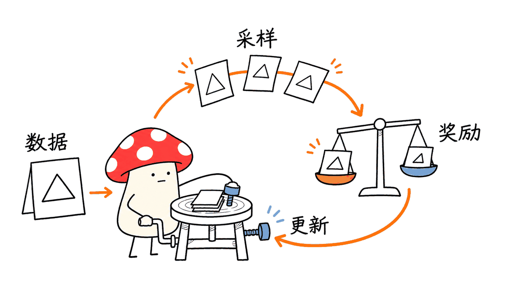
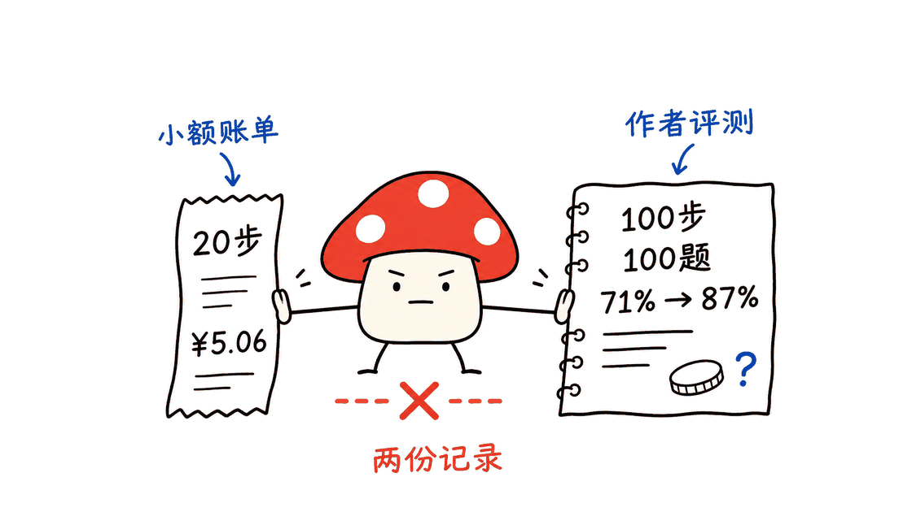

agentic-rl-lab是一套把奖励、采样、训练和评测串起来的Agent强化学习实验教程，适合已经会写Python、希望理解后训练的人。它采用Apache-2.0协议，目前由Datawhale仓库维护；训练示例依赖PyTRIO远端服务，开源代码不等于免费算力。

## 2026年11月更新：应该怎样读这个仓库？

仓库现已把实验统一放到`experiments/`，包含GRPO、GSPO、DAPO、OPD、OPSD、Search-R1、ReTool、ALFWorld，以及TEMPO、AgentOPSD、Spec-o3等章节。它定位是实验记录和教程；README把更友好、轻量的训练框架列为未来方向，不能当作已交付的通用生产框架。



最值得学的是边界如何拆开：数据模块定义题目和答案，rollout生成多条轨迹，reward给轨迹打分，训练脚本构造优势并调用远端更新，eval再用固定数据验证。可验证答案任务容易写规则奖励；搜索、代码执行或长任务则还需要环境反馈、工具权限、超时和轨迹归因。不要把“接入工具”直接等同于“Agent已经学会可靠使用工具”。

## 71%到87%，具体改善了什么？

Vision GRPO记录的格式正确率同时从75%升到91%。在格式正确的回答内部，正确率分别为71/75≈94.7%与87/91≈95.6%。这说明总分增长与更稳定地遵循可解析输出格式紧密相关，不能仅凭总分就断言几何推理发生了同等幅度跃迁。两个checkpoint的格式正确样本集合不同，这个条件比值也不能单独证明因果。



独立评测应保留逐题输出、解析失败、正确选项、token数和耗时，扩大到完整测试集，并做多个seed与不参与调参的留出集。固定100题每题就是1个百分点；反复查看同一子集再选checkpoint，会增加选择偏差。项目中的`analysis.py`绘制预先写入的汇总数字，不会自动读取新评测JSON；运行绘图脚本不是复现实验结果。

## 从哪一章开始最有效？

先读Loss Function与文本GRPO，用几道人工检查过的样本走一遍奖励与组内优势：一组全对或全错时，相对奖励通常提供不了区分信号。随后看Vision GRPO，检查图片token对齐与答案解析；最后再进入Search-R1、ReTool或ALFWorld，处理多轮环境反馈。先明确预算、凭证与可停止条件，再启动会产生费用的远端训练；不要把README中的一次花销当作自己的费用上限。

建议先冻结一份base评测，再做小规模训练与独立复测。自定义任务还应加入长度、工具调用次数和实际费用指标，防止模型通过冗长回答或无效调用“刷奖励”。业务任务应先明确什么叫成功，再选择RL，而非先训练再寻找目标。


## 常见问题

### 普通电脑能本地训练这些模型吗？

本地主要编排实验，重计算由PyTRIO服务承担。这降低本机显存门槛，但不意味着权重训练在普通电脑上完成，也不意味着没有网络与服务费用。

### 约5元能保证获得87%准确率吗？

不能。5.06元是作者20步会话截图；87%来自100步checkpoint的固定100题评测，两者不是同一次成本和效果的对应关系。

### 这是可以直接上线的Agent平台吗？

它首先是实验教程。生产系统仍需要独立评测、凭证保护、工具隔离、失败恢复和监控；本次核对没有运行远端训练，也没有测量新的准确率或费用。

原始仓库：https://github.com/datawhalechina/agentic-rl-lab
Vision实验与成本边界：https://github.com/datawhalechina/agentic-rl-lab/tree/main/experiments/vision-grpo
在线手册：https://datawhalechina.github.io/agentic-rl-lab/

以下保留早期实验的算法讲解；章节数量与历史star数不代表当前仓库规模。

*by Mycelium Protocol*

---

训练大模型通常是这样一张清单：租一台 8 卡机器，搭 infra，接采样服务，写 trainer，调 LoRA，接 checkpoint，跑日志——然后才开始做你真正想做的事：验证某个 reward 函数行不行，某个 loss 有没有差别。

KMnO4-zx 从另一个方向开始：**把 infra 交给远端，只写数据、reward 和 loss**。

作者记录了两组不同信息：20步小规模会话花费约5.06元；100步 checkpoint 在固定100道题上的准确率从71%提高到87%。仓库没有给出100步正式实验的可核验总费用，不能把两者拼成“5元训练100步”。

GitHub: https://github.com/datawhalechina/agentic-rl-lab | 2026-11-07 核对 | Apache 2.0 | Python

---

## 这个系列在做什么

agentic-rl-lab 是一个「逐篇复现 RL 算法」的开源实验记录。目前完成了 10 章：

| 章节 | 算法 | 任务 |
|------|------|------|
| 0 | Loss 函数基础 | importance sampling / PPO / CISPO |
| 1 | GRPO | GSM8K 数学题（文本） |
| 2 | OPD | 通用数学 + 医学推理 |
| 3 | Search-R1 | 多轮搜索 RL（Qwen3.5-4B） |
| 4 | OPSD | 步骤蒸馏 |
| 5 | ReTool | 代码交错 agent RL |
| 6 | DAPO | 4 项核心改进 |
| 7 | GSPO | 序列级重要性比率 |
| 8 | ALFWorld | 家庭任务 agent（文本 env） |
| 9 | **Vision GRPO** | **GeoQA 几何图形问答** |

前 8 章的输入都是文本。第 9 章第一次把整条 RL 链路推进到多模态：模型先看一张几何图，再读题，做 RL 更新。

基础设施是 **PyTRIO**（远程训练平台）和 **SwanLab**（实验追踪）。本地只写实验逻辑，前向、反向、采样、checkpoint 都在远端跑。

---

## GRPO 是什么

GRPO（Group Relative Policy Optimization）来自 DeepSeekMath 论文。它要解决的问题是：**PPO 好用，但太重**。

PPO 需要一个 value model 来估计 baseline，而 value model 本身也是一个大模型，显存和计算都要上去。

GRPO 的替换思路很直接：

1. 对同一个问题，采样一组回答（group）
2. 给每个回答打 reward
3. 用这组回答的平均 reward 作为 baseline——不需要单独训练 value model
4. 比组内平均分高的回答，advantage 为正；低的为负
5. 用这个 advantage 更新 policy

$$
A_i = \frac{r_i - \mathrm{mean}(r_1, \ldots, r_G)}{\mathrm{std}(r_1, \ldots, r_G)}
$$

同一道题里，相对更好的答案被鼓励，相对更差的被压低。这就是整个 GRPO 的核心。

第 1 章的文本 demo 跑 GSM8K 数学题，reward 是 0/1（答对或答错）。调试完整流程花了 55 元；如果只跑 10 步验证脚本能走通，成本可以低到 5 元。

---

## Vision GRPO：把图片送进训练循环

第 9 章做的事情，是把上面这套机制接上图片输入。

任务是 **GeoQA**——一个中文几何问答数据集。每条样本包含：几何图片、题目、四个候选项（A/B/C/D）、正确答案标签。共 5010 条，取 3503 条训练，固定 100 条测试。

模型看到的输入只有图片、题目和选项，不看解析过程。Reward 是选项匹配：答对 1，答错 0。

**实验结果**：

| 模型 | Accuracy | Format rate |
|------|---:|---:|
| Qwen3.5-4B Base | 71.0% | 75.0% |
| GRPO step 100 | 87.0% | 91.0% |
| 提升 | **+16.0 pp** | **+16.0 pp** |

这是作者在固定100题子集上的单次对照，提升16个百分点。仓库没有提交逐题评测JSON与远端checkpoint，本文也没有复跑训练。100步正式实验总费用未核验。

---

## 图片怎么进入 PyTRIO

Vision GRPO 和纯文本版本差异最大的地方，是图片如何进入训练循环。

训练脚本用模型自己的 chat template 格式化输入，同时放入文本和图片占位符：

```python
messages = [
    {
        "role": "user",
        "content": [
            {"type": "text", "text": format_question(subject, choices)},
            {"type": "image", "image": "geoqa"},
        ],
    }
]
```

渲染后的 prompt 沿 `<|image_pad|>` 拆成三个 chunk：文本 → 图片 → 文本。图片在送入服务前先合成白色背景（处理 RGBA），再用模型的 image processor 计算视觉 patch 数写入 `ImageChunk.expected_tokens`。

采样完成后会检查：

```python
response.input_tokens == len(prompt)
```

本地视觉 token 估计和远端结果必须一致，否则训练立刻报错——因为后续的 `target_tokens`、old logprobs 和 advantages 依赖同一个位置坐标系。

---

当前Vision训练代码使用`advantage = reward - mean_reward`，只做组内均值中心化；前面带标准差的公式是常见GRPO形式，不能直接当作这份代码的实际实现。训练配置还应与锁定的源码版本对应。

## 训练配置

| 项目 | 配置 |
|------|------|
| 基座模型 | Qwen/Qwen3.5-4B |
| 训练方式 | LoRA，rank 32 |
| 优化方法 | group-relative advantage + importance_sampling |
| 训练步数 | 100 steps |
| 每步题目数 | 8 |
| 每题 rollout 数 | 8 |
| 最大生成长度 | 1,024 tokens |
| 学习率 | 4e-5 |

整条数据流：

```text
GeoQA 图文题目
  ↓ 当前 LoRA 权重生成 sampler
  ↓ 同题并发采样 8 条 completion
  ↓ 解析最后一个 \boxed{A-D}
  ↓ 规则 reward：正确 1，其余 0
  ↓ 组内计算 relative advantage
  ↓ 构造多模态 Datum 并更新 LoRA
```

---

## 为什么这件事值得关注

大模型的后训练通常被认为是「大厂才能做的事」：需要大量 GPU、复杂 infra、专门的团队。

agentic-rl-lab 证明的是另一件事：**如果你只需要验证某个 reward 函数、某个 loss 变体，或者某个任务领域的 RL 适配性，你不需要那些**。

PyTRIO 把本地需要处理的东西压缩到最小：数据处理、reward 函数、loss 函数、实验循环。其他全部在远端。这让「做一个 RL 实验」的感觉更像做一个普通的数据分析——写逻辑，跑，看结果，改。

Vision GRPO 这章是这套方法第一次接上图片输入。从 GSM8K 文字题到 GeoQA 几何图，RL 训练循环本身的结构没有改变——变化的只是图片怎么进入 prompt，和 reward 怎么从选项匹配算出来。

这个扩展路径是清晰的。

---

## 快速上手

```bash
# 克隆仓库
git clone https://github.com/datawhalechina/agentic-rl-lab
cd agentic-rl-lab

# 当前根项目要求Python >=3.13，按uv.lock解析依赖
# 安装依赖（uv）
uv sync

# 登录 PyTRIO
trio login

# 跑 Vision GRPO（先下载数据集）
cd experiments/vision-grpo
# 参考 start.md
```

先跑 1-2 步验证脚本能走通，再开正式训练。成本是可控的。

---

*Mycelium Protocol — 追踪 AI 系统的底层演化*

---

> **关于 Mycelium**
>
> 菌丝协议。持续追踪 AI 工具、系统和实验的内容节点。

---

> © 2026 Author: Mycelium Protocol. 本文采用 [CC BY 4.0](https://creativecommons.org/licenses/by/4.0/deed.zh) 授权——欢迎转载和引用，须注明作者姓名及原文链接，不得去除署名后以原创发布。

<!--EN-->

agentic-rl-lab is an educational collection that connects rewards, rollouts, parameter updates and evaluation for LLM agents. Datawhale maintains the Apache-2.0 repository. Its examples use remote PyTRIO training: open-source code does not make compute free.

### November 7 update: how should this repository be used?

Experiments now live under `experiments/`, covering GRPO, GSPO, DAPO, distillation, Search-R1, ReTool, ALFWorld and newer topics such as TEMPO, AgentOPSD and Spec-o3. The README describes a more friendly training framework as a possible future direction. The repository is primarily a tutorial and experiment log, rather than evidence of a completed production platform.


Read the boundaries between modules: data defines questions and answers; rollouts produce trajectories; rewards score them; training constructs advantages and requests remote updates; evaluation checks a fixed dataset. Search and tool-use tasks additionally need environment feedback, timeouts and attribution across turns. Exposing a tool is not evidence that an agent reliably learned to use it.

### What does the 71% to 87% increase establish?

The author also reports format compliance increasing from 75% to 91%. Conditional accuracy among parseable responses is 71/75, about 94.7%, versus 87/91, about 95.6%. The aggregate improvement is closely associated with more reliable answer formatting; it cannot establish an equally large gain in geometry reasoning. The two sets of parseable responses also differ, so these ratios alone do not establish causation.


Retain individual outputs, parsing failures, labels, token counts and latency. Evaluate the full test split, multiple seeds and a holdout excluded from checkpoint selection. Each example in a 100-question subset contributes one percentage point. Repeatedly selecting checkpoints against the same subset risks selection bias. `analysis.py` plots hard-coded summary values rather than loading a newly generated evaluation file; drawing the chart is not reproduction.

### Where should learners start?

Start with loss functions and text GRPO. Manually verify a few rewards and group advantages: all-correct or all-incorrect groups generally provide no relative discrimination. Continue with image-token alignment and answer parsing in Vision GRPO, then tackle multi-turn feedback in Search-R1, ReTool or ALFWorld. Define a budget and stopping conditions before invoking paid remote services. A historical invoice does not cap a future bill.

Freeze a base evaluation first, run a small experiment and then evaluate independently. Add output length, tool-call counts and real costs for custom tasks so reward improvement cannot hide wasteful behavior. Choose reinforcement learning only after defining success for the intended task.


### FAQ

#### Does training happen on an ordinary laptop?

The laptop orchestrates the experiment; PyTRIO performs expensive training remotely. This reduces local memory requirements but introduces network and paid-service dependencies.

#### Does ¥5 guarantee an 87% score?

No. ¥5.06 refers to a 20-step session, whereas 87% refers to the 100-step checkpoint on a fixed 100-question subset. These are different records.

#### Is this a production agent framework?

Its primary role is education. Deployment still requires evaluation, credential management, tool isolation, recovery and monitoring. This review did not run training or independently measure accuracy or cost.

Repository: https://github.com/datawhalechina/agentic-rl-lab
Vision experiment: https://github.com/datawhalechina/agentic-rl-lab/tree/main/experiments/vision-grpo
Manual: https://datawhalechina.github.io/agentic-rl-lab/

The following retains the earlier algorithm explanation; historical chapter counts do not describe the current repository.

## agentic-rl-lab: Learning Agent Reinforcement Learning Through Experiments

*by Mycelium Protocol*

---

Training a large model usually looks like this: rent an 8-GPU server, build infra, wire up a sampling service, write a trainer, tune LoRA, handle checkpointing, set up logging — and then finally start doing what you actually wanted to do: test whether a reward function works, whether one loss function beats another.

KMnO4-zx started from the other direction: **hand the infra to a remote platform, write only the data, reward, and loss.**

Two records must be separated: a 20-step session cost about ¥5.06, while the 100-step checkpoint scored 87% versus 71% on a fixed 100-question subset. The repository does not establish the total cost of the 100-step run. This article did not reproduce training.

GitHub: https://github.com/datawhalechina/agentic-rl-lab | 2026-11-07 核对 | Apache 2.0 | Python

---

### What This Series Does

agentic-rl-lab is an open-source "reproduce one RL paper at a time" experiment log. Ten chapters completed:

| Chapter | Algorithm | Task |
|---------|-----------|------|
| 0 | Loss function basics | importance sampling / PPO / CISPO |
| 1 | GRPO | GSM8K math (text) |
| 2 | OPD | General math + medical reasoning |
| 3 | Search-R1 | Multi-round search RL (Qwen3.5-4B) |
| 4 | OPSD | Step distillation |
| 5 | ReTool | Code-interleaved agentic RL |
| 6 | DAPO | 4 core improvements |
| 7 | GSPO | Sequence-level importance ratio |
| 8 | ALFWorld | Household agent (text env) |
| 9 | **Vision GRPO** | **GeoQA geometric visual QA** |

Chapters 1–8 are text-only. Chapter 9 is the first to push the full RL loop into multimodal: the model sees a geometry image, reads the question, and gets RL updates based on whether it picks the right answer.

Infrastructure is **PyTRIO** (remote training platform) and **SwanLab** (experiment tracking). Local code handles only the experiment logic; forward pass, backward pass, sampling, and checkpointing all run remotely.

---

### What GRPO Is

GRPO (Group Relative Policy Optimization) comes from the DeepSeekMath paper. The problem it solves: **PPO works, but it's heavy**.

PPO requires a separate value model to estimate the baseline — and for LLMs, that value model is itself a large model, adding both memory and compute. GRPO's substitution is direct:

1. Sample a group of completions for the same question
2. Score each completion with a reward
3. Use the group's average reward as baseline — no value model needed
4. Completions above average get positive advantage; below average get negative
5. Update policy with this advantage

Same question, same group — better answers are encouraged, worse ones are pushed down. That's the whole mechanism.

Chapter 1's text demo runs on GSM8K with binary reward (0 if wrong, 1 if right). Debugging the full pipeline cost ¥55; running just 10 steps to check the script works can cost as little as ¥5.

---

### Vision GRPO: Getting Images into the Training Loop

Chapter 9 extends this to image inputs.

The task is **GeoQA** — a Chinese geometric QA dataset. Each sample has: a geometry image, a question, four candidate answers (A/B/C/D), and a correct label. 5,010 total samples; 3,503 for training, fixed 100 for evaluation. The model sees only the image, question, and choices — not the solution.

**Results:**

| Model | Accuracy | Format rate |
|-------|---:|---:|
| Qwen3.5-4B Base | 71.0% | 75.0% |
| GRPO step 100 | 87.0% | 91.0% |
| Gain | **+16.0 pp** | **+16.0 pp** |

The author reports a 16 percentage-point increase on a fixed 100-question subset, not the complete test set. Per-example evaluation JSON and the remote checkpoint are not included. The total cost of the 100-step run is unverified.

---

The current Vision script uses `advantage = reward - mean_reward`, without standard-deviation normalization. The standardized GRPO formula describes a common variant, not the exact implementation here.

### Training Config

| Setting | Value |
|---------|-------|
| Base model | Qwen/Qwen3.5-4B |
| Training | LoRA, rank 32 |
| Optimization | group-relative advantage + importance_sampling |
| Steps | 100 |
| Topics per step | 8 |
| Rollouts per topic | 8 |
| Max generation length | 1,024 tokens |
| Learning rate | 4e-5 |

Full data flow:

```text
GeoQA image+text question
  ↓ sampler from current LoRA weights
  ↓ 8 concurrent completions per question
  ↓ extract last \boxed{A-D}
  ↓ rule reward: correct=1, else=0
  ↓ group-relative advantage
  ↓ multimodal Datum → LoRA update
```

---

### Why This Is Worth Attention

LLM post-training is commonly considered a large-lab problem: many GPUs, complex infra, dedicated teams.

agentic-rl-lab demonstrates something different: **if your goal is to validate a reward function, a loss variant, or RL adaptation for a specific domain, you don't need any of that**.

PyTRIO compresses what needs to be done locally to its minimum: data processing, reward function, loss function, experiment loop. Everything else runs remotely. "Running an RL experiment" starts to feel like running a data analysis script — write the logic, run it, read results, iterate.

Vision GRPO is the first chapter in this series to handle image inputs. From GSM8K text to GeoQA geometry, the RL loop structure didn't change — only how images enter the prompt and how reward is computed from option matching.

The extension path is clear.

---

### Quick Start

```bash
git clone https://github.com/datawhalechina/agentic-rl-lab
cd agentic-rl-lab

uv sync  # current project requires Python >=3.13
trio login

# Vision chapter: see experiments/vision-grpo/start.md
```

Run 1–2 steps first to verify the script works, then scale up. Cost is controllable.

---

*Mycelium Protocol — tracking the deep evolution of AI systems*

> © 2026 Author: Mycelium Protocol. Licensed under [CC BY 4.0](https://creativecommons.org/licenses/by/4.0/) — free to share and adapt with attribution. You must credit the author and link to the original; removing attribution and republishing as original is not permitted.
