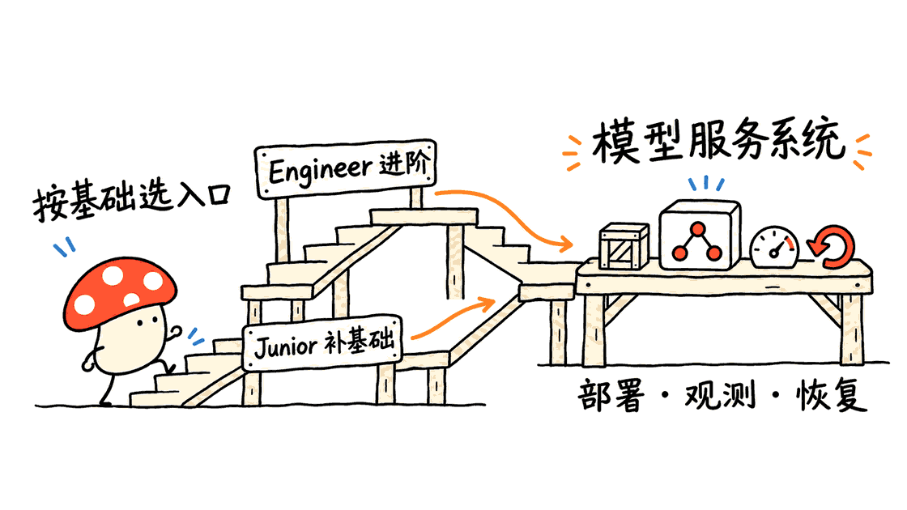

AI Infrastructure Engineer — Learning Path 是一份用讲义、实验和项目脚手架组织起来的 AI 基础设施学习路线，适合把“模型能运行”推进到“服务能部署、监控和维护”。它有明确先修要求，零基础读者宜先走同组织的 Junior 路线。

对应仓库是 `ai-infra-curriculum/ai-infra-engineer-learning`，采用 MIT 许可证。本次固定提交 `0d1b6558dc68c042a3dad54095b707cd92fc0529`，核对了目录、练习与项目实现，并对第一个项目发出了五个本地接口请求。结论是：它能提供学习顺序和实现任务，项目中的 TODO 需要学习者实际补完，不能把目录齐全直接当成生产系统验收通过。

## AI Infrastructure Engineer 学的究竟是什么？

AI 基础设施工程关心模型周围的系统：运行环境、数据与制品管理、计算资源、发布流程、监控告警、故障恢复及容量成本。训练出一个模型或调用一次接口，只覆盖其中一段。

这份路线的实用价值是把这些问题串起来。仓库定位约有 2–4 年相关经验的 Engineer 层级，README 列出的先修能力包括中级 Python、Linux 命令行、Git、机器学习基础、Docker 和 Kubernetes 入门。对已经写过后端服务或做过运维的人，它更像补齐 ML 系统能力的地图。

如果还不熟悉虚拟环境、HTTP 请求、容器日志和基本网络排查，先选 `ai-infra-junior-engineer-learning`。这里的 Junior 与 Engineer 是两个实际仓库，不只是同一篇 README 的不同称呼。配套 `ai-infra-engineer-solutions` 是另一个参考解答仓库，本次确认其存在和说明，但没有验收其全部实现。



## 十个模块如何连成一条学习路径？

| 模块 | 主题 | 建议留下的学习成果 |
|---|---|---|
| 101 | 基础能力 | 可复现的 Python 环境、测试和命令行排障记录 |
| 102 | 云计算 | 能解释计算、存储、网络和权限边界的部署图 |
| 103 | 容器化 | 可构建、可启动、可定位故障的镜像 |
| 104 | Kubernetes | 理解服务发现、探针、资源限制与滚动发布 |
| 105 | 数据流水线 | 数据校验、版本记录与可重跑的处理任务 |
| 106 | MLOps | 实验、模型制品、部署版本之间的追踪关系 |
| 107 | GPU 计算 | 区分显存不足、算力瓶颈与数据等待 |
| 108 | 可观测性 | 有实际流量支持的指标、日志和告警 |
| 109 | 基础设施即代码 | 可审查、可重复的资源配置与清理步骤 |
| 110 | LLM 基础设施 | 理解推理服务、RAG、缓存与并发的组合约束 |

表中成果是本文建议的验收方式，不是仓库授予的认证。三个综合项目分别围绕模型服务、MLOps 流水线和 LLM 部署，把章节中的零散知识放回完整应用。

README 的 500 多小时应理解为作者给出的学习规模估计，不是保证学完的计时结果。阅读、填代码、调环境和故障复盘的时间因人而异，也不能把课程中的薪资或成本节约宣传当成个人就业和预算承诺。

## “材料齐全”和“项目跑通”之间还有什么？

本次按明确规则清点 `lessons/mod-*`：找到 10 个模块、62 个 `lab-*.md` 实验文件，以及 119 个练习入口。练习入口包含 `exercise-*` 目录下的 README 或同名前缀的独立 Markdown，不能把这两个布局漏算一类。

这些是文件存在性统计，不代表逐条步骤已经执行。文档自身也存在不同步：顶部有“100% complete”表述，更新说明和进度段落还保留“32/119”的旧数字，而当前目录已能列出 119 个入口。使用时以固定提交和实际内容为准，不能单靠某一个徽章判断完成度。

更重要的是项目的教学设计。`project-101` 的模型加载、预测及指标等位置明确留有 TODO；`project-103` 的两个 Python 文件目前存在待补齐的 `try/except` 代码块，语法解析会失败。这符合脚手架需要填空的使用方式，却与“下载后就已完整运行”的理解有距离。

对三个项目测试文件做 AST 结构检查时，发现项目 101 的 45 个测试函数、项目 103 的 29 个测试函数，函数体仅含文档字符串和 `pass`。文档字符串中的示例断言不会执行；不能把这些函数将来显示为绿色，当作 74 项行为已经验收。项目 102 的 19 个函数不属于这一空体类别，本次未进一步断言其覆盖质量。

根目录 `make test` 只遍历带 Makefile 的项目，并用 `|| true` 忽略子项目测试命令失败。当前项目 101 没有 Makefile，会被这一入口跳过。因此顶层命令退出成功不足以证明所有项目通过；应进入具体项目，直接运行测试并检查实际断言与退出码。

## 五个接口请求揭示了什么？

Mycelium Protocol 在独立 Python 3.12 环境中，使用 FastAPI 的 `TestClient` 加载未修改的 `project-101/src/api.py`，执行启动与关闭流程。没有下载模型，也没有启动云资源或公网服务。

| 请求 | 实际结果 | 对学习者的意义 |
|---|---|---|
| `GET /` | 200，返回服务说明 | 路由能够响应 |
| `GET /health` | 200，JSON 为 `{}` | 当前响应模型与就绪检查仍需补齐 |
| `GET /metrics` | 200，返回未实现提示 JSON | 还不是 Prometheus 指标输出 |
| `POST /predict`，带合成上传 | 501，预测端点未实现 | 模型推理链路没有完成 |
| `POST /predict`，不带文件 | 422 | 框架的必填参数校验生效 |

启动后也未出现已初始化的 `app.state.model`。这组检查说明教学骨架能被导入并响应部分请求，同时把后续待实现任务暴露出来；它不是模型精度、系统吞吐或部署可靠性测试。

其中最值得亲手补完的是健康检查：进程活着、模型加载完成、下游依赖可用是三个不同状态。建议将存活探针与就绪探针分开；模型没准备好时，就绪检查应返回不可接流量的结果，而不是仅看 HTTP 200。


## 怎样把路线拆成一段能完成的实践？

建议先做一个四周、每周约 4–8 小时的小切片。它覆盖第一个服务闭环，目标不是四周读完全部课程，更不代表四周达到某个职级。

第一周只做本地服务：建立虚拟环境、固定依赖，完成输入校验和一个小模型的真实预测。先写能验证输出结构与错误输入的测试，再把脚手架补到测试通过。

第二周完成运行状态：实现存活与就绪检查，接入真实请求计数和耗时指标，记录模型版本；刻意模拟模型加载失败，确认服务不会误接流量。

第三周做可重复部署：构建容器，配置非敏感参数与密钥边界，验证日志、重启和资源限制。先在单机上能解释故障，再迁移到 Kubernetes；可以把尚未接入的云组件记为待办。

第四周做发布与复盘：保留两版模型制品，执行一次版本切换与回滚，写清触发原因、观测指标和恢复过程。最后产物应是一份别人能按说明复现的项目，而不只是学习打卡。

已经有 SRE 或 DevOps 经验的人，可以较快通过基础章节，把时间放到模型生命周期、数据版本与推理资源规划；ML 背景读者则应加强容器、网络、观测和故障恢复。这是按背景裁剪路线的建议，不是仓库的统一必修顺序。


## GPU 与 LLM 实验该怎样看待？

GPU 部分可以后置，先理解输入长度、并发、精度与显存的关系。举例说，7B 参数按每参数两字节计算，仅权重就约 14 GB（十进制），尚未计入 KV 缓存和运行时开销；不能把实验开头的“至少 12GB 显存”当作所有 BF16 示例的可运行保证。

仓库的 vLLM 实验使用了历史版本镜像，后续复现应核对当前官方平台与模型支持。Mac 上完成 Python、API、测试和部分容器学习，并不等于该课中的 NVIDIA Docker 命令也能原样执行。

另一个需要自己重做的环节是性能比较：所读 vLLM 实验示例对服务端使用并发请求，对 Transformers 基线则串行执行，负载设置并不一致。因此不能直接拿它宣称的倍数作为本次结论。公平比较应统一模型、精度、输入输出长度、并发、预热和硬件，记录吞吐、首 token 延迟及错误率；本文没有执行这类基准测试。

对新人而言，先学会做出可解释、可重跑的测量，比先记住某个框架“快几倍”更有长期价值。

## 从哪里开始？

```bash
git clone https://github.com/ai-infra-curriculum/ai-infra-engineer-learning.git
cd ai-infra-engineer-learning
git rev-parse HEAD
```

先读 `PREREQUISITES.md`，再看 `lessons/00-your-relationship-to-the-model/README.md` 和适合自己的模块。本次根 `pyproject.toml` 要求 Python 3.11 及以上，基础实验也推荐 3.11 或 3.12；部分旧说明仍写 3.9，建立环境时应交叉核对。

不要为了“先装齐所有东西”一开始就混装整个技术栈。按当前选定项目建立独立环境，保存依赖、提交号和验收结果，遇到 TODO 就把它当成实现任务逐项完成。

这份仓库最适合充当结构化地图与练习清单。能真正迁移到工作中的，是你补完的服务、写出的有效断言、跑通的发布流程，以及能解释清楚的一次失败。

## 常见问题

### 完全零基础可以从这里开始吗？

可以先用它了解全景，但正式跟练建议先补 Junior 路线或等价的 Python、Linux、容器和机器学习基础。Engineer 仓库的先修要求是明确存在的。

### 119 个练习入口等于119个已验证实验吗？

不等于。119 是本次固定提交的练习文件或目录入口数，62 是实验文件数。它们都不是实测运行通过的数量，也不代表每个练习内容完整。

### 本次有没有证明三个项目都能部署？

没有。本次做了目录与 AST 核对，以及第一个项目的五个 TestClient 请求。没有安装全部依赖、训练或加载模型、启动 Docker/Kubernetes、创建云资源或执行 GPU 基准。

## 来源与相关学习资料

主仓库：https://github.com/ai-infra-curriculum/ai-infra-engineer-learning

先修要求：https://github.com/ai-infra-curriculum/ai-infra-engineer-learning/blob/main/PREREQUISITES.md

Junior 路线：https://github.com/ai-infra-curriculum/ai-infra-junior-engineer-learning

配套参考解答：https://github.com/ai-infra-curriculum/ai-infra-engineer-solutions

vLLM 当前平台安装说明：https://docs.vllm.ai/en/latest/getting_started/installation/gpu/

相关阅读，AI平台的共享服务与实现边界：https://blog.mushroom.cv/blog/designing-ai-systems-book-platform-code-review/

---

> © 2026 Author: Mycelium Protocol. 本文采用 [CC BY 4.0](https://creativecommons.org/licenses/by/4.0/deed.zh) 授权——欢迎转载和引用，须注明作者姓名及原文链接，不得去除署名后以原创发布。

<!--EN-->

AI Infrastructure Engineer — Learning Path organizes AI infrastructure topics into lessons, labs and implementation scaffolds. It is useful for moving from a model that runs to a service that can be deployed, observed and maintained. Learners need prerequisites; complete beginners should first consider the separate Junior track.

The MIT-licensed repository is `ai-infra-curriculum/ai-infra-engineer-learning`. This review pins commit `0d1b6558dc68c042a3dad54095b707cd92fc0529`, inventories its materials, inspects selected code, and issues five local requests against the first project's unmodified API. It provides a map and implementation assignments; its TODOs still need to be completed and verified.

## Who is the Engineer track for?

Infrastructure engineering covers runtime environments, data and artifact management, compute resources, deployment, monitoring, recovery and capacity planning. Training a model or calling an API covers only part of that work.

This repository targets the Engineer level, described as roughly two to four years of relevant experience. Its prerequisites include intermediate Python, Linux, Git, ML fundamentals, Docker and introductory Kubernetes. Backend engineers and operations practitioners can use it to fill gaps around ML systems.

The separate `ai-infra-junior-engineer-learning` repository supplies an entry route. If virtual environments, HTTP requests, container logs and network troubleshooting are unfamiliar, start there or acquire equivalent skills. A paired `ai-infra-engineer-solutions` repository supplies reference material; its existence and description were checked, but its full solution coverage was not tested.


## How do the ten modules connect?

| Module | Topic | A suggested learning artifact |
|---|---|---|
| 101 | Foundations | Reproducible Python environment and useful tests |
| 102 | Cloud computing | A deployment diagram explaining compute, storage and networking |
| 103 | Containers | An image that builds, starts and can be debugged |
| 104 | Kubernetes | Service discovery, probes, resource limits and rollouts |
| 105 | Data pipelines | Validated data, versions and repeatable processing |
| 106 | MLOps | Traceability between experiments, artifacts and deployments |
| 107 | GPU computing | Diagnosis of memory, compute and input bottlenecks |
| 108 | Observability | Metrics, logs and alerts supported by actual traffic |
| 109 | Infrastructure as code | Reviewable resource configuration and cleanup |
| 110 | LLM infrastructure | Serving, RAG, caches and concurrency constraints |

These artifacts are this article's suggested acceptance criteria, not a certification issued by the repository. Three integration projects cover model serving, an MLOps pipeline and LLM deployment.

The advertised 500-plus hours are an author estimate of study scope. They are not a measured completion time or a guarantee of job readiness. Salary and cost-saving claims likewise should not become personal employment or budget promises.

## What does a materials inventory establish?

A rule-based inventory of `lessons/mod-*` found ten module directories, 62 `lab-*.md` files and 119 exercise entries. Entries include either `exercise-*` directories containing a README or standalone Markdown exercise files. File presence does not establish execution or completeness.

The documentation is not fully synchronized. Its headline says complete, while progress text still includes an older 32-of-119 figure even though the current tree contains 119 entries. Record the commit and inspect the actual content rather than relying on a badge or one historical paragraph.

Project code is also deliberately scaffolded. Model loading, prediction and metrics in project 101 contain TODOs. Two Python files in project 103 have unfinished try/except blocks and fail syntax parsing at this commit. Across the repository, 44 Python files were examined with Python AST parsing; this was not a full build or import test.

Structural inspection found that all 45 test functions in project 101 and all 29 in project 103 contain only docstrings and `pass`. Example assertions inside docstrings do not execute. A green result from those empty functions would not establish 74 verified behaviors. Project102 has 19 functions outside that empty-body category; this review makes no claim about their behavioral coverage.

The root `make test` visits only projects with a Makefile and ignores child test-command failures using `|| true`. Project 101 has no Makefile at this commit, so this entry point skips it. Inspect the actual tests and run the selected project's commands directly; a successful top-level exit is insufficient evidence of readiness.

## What did five actual requests show?

Mycelium Protocol loaded the unmodified project 101 API in an isolated Python 3.12 environment using FastAPI `TestClient`, including startup and shutdown. No model was downloaded, no public server was started and no cloud resources were created.

| Request | Observed result | Interpretation |
|---|---|---|
| `GET /` | 200 with service information | The route responds |
| `GET /health` | 200 with `{}` | Response fields and readiness logic need implementation |
| `GET /metrics` | 200 with a placeholder JSON message | Prometheus exposition is not implemented |
| `POST /predict` with a synthetic upload | 501, not implemented | Inference is not completed |
| `POST /predict` without a file | 422 | Framework-required parameter validation works |

Startup did not initialize `app.state.model`. These observations identify the boundary between the working API skeleton and the implementation work ahead. They are not model-quality, throughput or deployment-reliability results.

A useful exercise is separating liveness from readiness: an alive process may still have an unloaded model or unavailable dependencies. A readiness endpoint should reject traffic when service prerequisites fail, with response bodies and tests that prove that behavior.


## How can a learner complete a manageable slice?

A proposed four-week slice at roughly four to eight hours per week can produce the first service loop. It does not complete the curriculum or confer a professional level.

Week one: establish an isolated environment and pinned dependencies, then implement validated inputs and real prediction with a small model. Write assertions that check output structure and failure cases before filling in the relevant TODOs.

Week two: implement liveness, readiness, request counts, latency metrics and model-version reporting. Simulate a failed model load and verify that the service does not incorrectly accept traffic.

Week three: build a repeatable container, configure parameters and secrets, and test logging, restarts and resource limits. Explain failures on one machine before moving to Kubernetes; record cloud components that remain unimplemented.

Week four: keep two model artifact versions, perform a version switch and rollback, and document the trigger, observations and recovery. Deliver a project another learner can reproduce from its instructions.

Practitioners with SRE or DevOps experience can focus on model lifecycle, data versions and inference resources. ML practitioners may need more work on networking, containers, observability and recovery. This is a proposed adaptation to background, not an official mandatory order.


## How should GPU and LLM labs be approached?

GPU labs can follow the smaller service loop. Learn how precision, context and concurrency affect memory. A seven-billion-parameter model at two bytes per parameter requires about 14 GB of raw weights in decimal units before KV cache and runtime overhead. A twelve-GB prerequisite should not be interpreted as a guarantee that every BF16 example fits.

The repository's vLLM lab uses a historical image tag. Consult current official platform and model support before reproducing it. Doing Python and API work on a Mac does not establish that the lab's NVIDIA Docker command runs unchanged there.

Its performance comparison also needs redesign before drawing a speedup conclusion: the server example uses concurrent requests while the Transformers baseline runs sequentially. A fair comparison should align hardware, model, precision, prompt/output lengths, concurrency and warmup, then record throughput, first-token latency and failures. No GPU benchmark was performed in this review.

For a learner, explaining a repeatable measurement is more useful than memorizing a framework's claimed multiplier.

## Where should a learner start?

```bash
git clone https://github.com/ai-infra-curriculum/ai-infra-engineer-learning.git
cd ai-infra-engineer-learning
git rev-parse HEAD
```

Read `PREREQUISITES.md`, then the role-orientation module at `lessons/00-your-relationship-to-the-model/README.md` and the selected lessons. The pinned root `pyproject.toml` requires Python 3.11 or newer, and the foundations lab recommends 3.11 or 3.12; some older text still mentions 3.9. Cross-check the selected project's requirements.

Create an environment for the current project rather than installing the whole stack immediately. Save dependencies, commit and acceptance results. Treat every TODO as an implementation assignment. The durable value is the completed service, meaningful assertions and failure explanation that the learner produces.

## FAQ

### Is this a zero-prerequisite course?

No. It can provide an overview, but its Engineer track explicitly expects Python, Linux, containers and ML knowledge. Use the separate Junior track or equivalent preparation when those foundations are missing.

### Do 119 exercise entries mean 119 verified labs?

No. This inventory counts 119 exercise entries and 62 lab files at one commit. It does not count successful executions or certify that every exercise is complete.

### Were all three projects deployed in this review?

No. The work was a directory/AST audit and five TestClient requests against project 101. Full dependencies, model loading, Docker, Kubernetes, cloud provisioning and GPU benchmarks were not run.

## Sources and related learning

Main repository: https://github.com/ai-infra-curriculum/ai-infra-engineer-learning

Prerequisites: https://github.com/ai-infra-curriculum/ai-infra-engineer-learning/blob/main/PREREQUISITES.md

Junior track: https://github.com/ai-infra-curriculum/ai-infra-junior-engineer-learning

Reference solutions: https://github.com/ai-infra-curriculum/ai-infra-engineer-solutions

Current vLLM GPU/platform installation: https://docs.vllm.ai/en/latest/getting_started/installation/gpu/

Related AI platform review: https://blog.mushroom.cv/blog/designing-ai-systems-book-platform-code-review/

---

> © 2026 Author: Mycelium Protocol. Licensed under [CC BY 4.0](https://creativecommons.org/licenses/by/4.0/) — free to share and adapt with attribution. You must credit the author and link to the original; removing attribution and republishing as original is not permitted.
