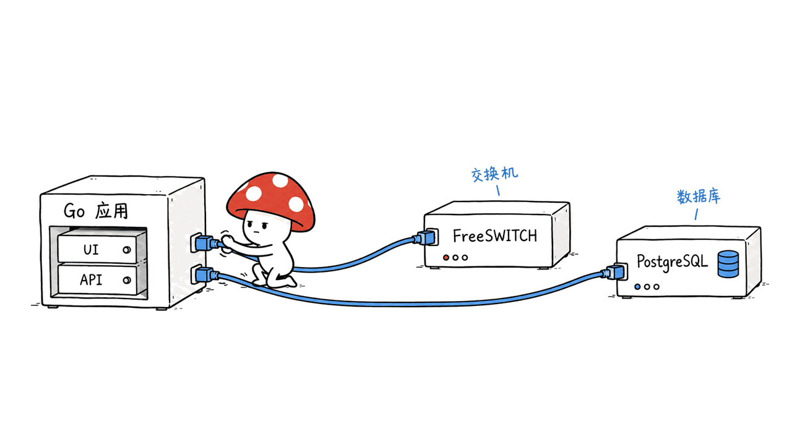
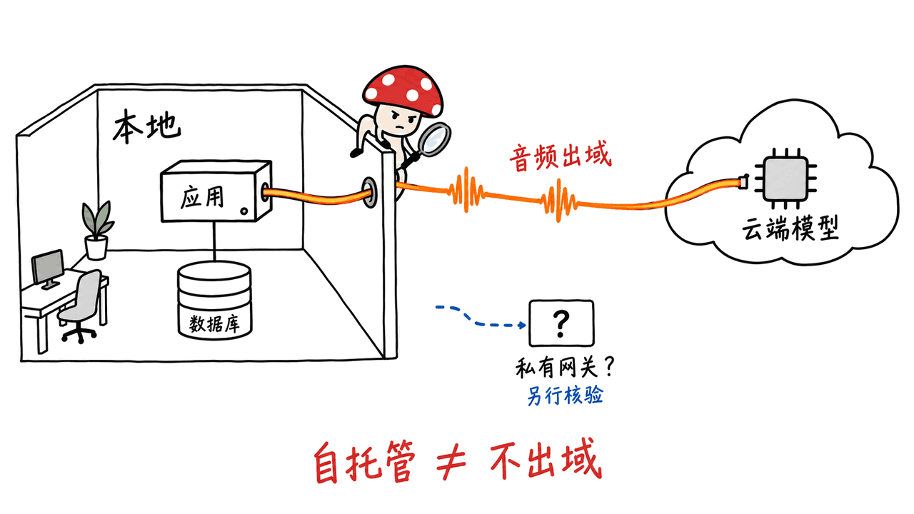

ai-native-callcenter 把语音机器人、真人坐席队列和管理界面接成一个自托管呼叫中心。它能减少从零拼装话务系统的工作，但“一行安装”不等于没有外部依赖，也不等于默认实现数据不出域。

官方仓库是 `rasonyang/ai-native-callcenter`，采用Apache 2.0。本文截至2026年10月15日固定代码提交 `b4a1ceb4abdd7ab183df576e65f7a5e013f7e23e`，并核对安装文档和发布信息；最新正式发布为10月10日的v0.4.0，发布包与当前主分支可能有差异。

仓库：https://github.com/rasonyang/ai-native-callcenter

发布页：https://github.com/rasonyang/ai-native-callcenter/releases/tag/v0.4.0

## 一个Go二进制，到底装进了什么？

二进制内嵌的是REST API、SSE事件流和Web界面。FreeSWITCH与PostgreSQL是独立组件，安装器通过Docker Compose把应用、交换机和数据库等组件编排起来。



这不是措辞上的小差别。如果以为下载一个可执行文件就具备完整电话能力，就会漏掉数据库持久化、交换机配置、容器网络、SIP注册和RTP音频通路。

| 组件 | 负责什么 | 仍需确认的事情 |
|---|---|---|
| Go应用 | API、事件、Web界面、AI通话腿、流程控制 | 配置、权限、模型连接 |
| FreeSWITCH | 电话交换、真人队列、呼叫桥接 | SIP、媒体地址、号码或中继 |
| PostgreSQL | 配置、账号及业务状态 | 持久卷、备份与恢复 |
| Realtime模型服务 | 理解和生成对话语音 | 凭证、费用、响应与数据流向 |
| 坐席电话扩展 | 浏览器坐席的SIP注册与音频 | 独立安装、网络及通话验证 |

“一行命令”的实际价值，是把一套有默认配置的系统交给安装器，而不是让这些组件消失。

安装器说明：https://github.com/rasonyang/ai-native-callcenter/blob/main/deploy/one-line-installer.md

## AI和真人怎样接在一起？

来电先进入FreeSWITCH，再由应用自己的SIP/RTP端点把音频接到语音模型。模型负责对话，流程引擎负责当前阶段、可调用工具及阶段转换。

当业务需要人工时，系统把来电转入FreeSWITCH的 `mod_callcenter` 队列。仓库设计让 `callId` 跨机器人和真人阶段保持连续，坐席可通过SSE事件看到来电与已有上下文，通话记录、转写和录音可以关联在同一会话下。

这里还藏着一个容易漏掉的依赖：浏览器页面主要负责状态与呼叫控制，真人坐席的音频由另一个仓库的 `web-sip-phone` Chrome扩展承载。打开Web UI，不等于坐席电话已经准备好了。


坐席扩展：https://github.com/rasonyang/web-sip-phone

“无缝”应该如何验收？我们的建议是看真实结果：转接期间来电是否保留、双方何时能听到对方、坐席是否拿到正确上下文、队列不可用时机器人怎样解释。架构支持这些路径，不代表每个网络和业务配置下都已验证成功。

## 自托管为什么不自动等于数据不出域？

当前代码支持OpenAI、Qwen、Grok、Doubao及自建Realtime gateway。部署启动时选择一个provider，通话语言并不会自动选择另一个provider。

使用云端语音模型时，音频会通过模型连接离开本地系统。数据库和录音留在自己的服务器，并不能据此说整条通话链路都留在内网。

`gateway` 提供了接入自有服务的入口，但协议兼容只是第一步：还得确认网关后面的识别、推理、合成、日志和存储实际跑在哪里。仓库自身不在进程内实现ASR→LLM→TTS级联；这种组合需要独立网关服务。



模型扩展说明：https://github.com/rasonyang/ai-native-callcenter/blob/main/docs/provider-extension.md

因此，对“要求数据不出域”的团队，更合理的说法是：它提供了自管话务和定制模型链路的基础，完整的数据驻留仍需要逐段核对，不能直接由self-hosted标签推导出来。

## 流程怎样限制模型，而不是全靠提示词？

流程文件定义阶段、工具白名单、结构化槽位和转换条件。模型可以组织措辞，但不能仅凭一句回答就改变业务状态。转人工、查询订单等动作，要经过对应工具及业务结果。

HTTP工具也有明确边界：流程配置选定哪些返回字段能进入模型和槽位；业务拒绝与网络失败是不同结果。当前文档给HTTP调用设置5秒上限。队列关闭、工具被拒绝等情况，是需要设计的对话分支，不应被一句“转人工成功”遮过去。

对已有CRM或工单系统的团队，这层分工很有用：呼叫中心管理会话与阶段，业务服务保留自己的事实和操作规则。API返回成功之前，机器人不应该把“我试一下”说成“已经办好了”。这是我们的接入建议，不是模型永远不会出错的保证。

流程说明：https://github.com/rasonyang/ai-native-callcenter/blob/main/docs/flow-authoring.md

## 怎样从安装走到可信的PoC？

Linux安装路径需要Docker Engine与Compose；macOS需要Colima或Docker Desktop。Colima尤其要核对UDP转发方式，SIP信令通了但RTP没通，可能表现为能接电话却没有声音。

先固定发布版本、下载并查看脚本，再做预检。例如在macOS上：

```bash
curl -fL \
  https://github.com/rasonyang/ai-native-callcenter/releases/download/v0.4.0/install.sh \
  -o aicc-install.sh
less aicc-install.sh
sh aicc-install.sh --check
```

`--check`只做预检，不等于完成部署。准备好环境后，可按官方说明安装；下面选择 `none`，先把AI通话腿关闭，避免把基础安装和模型接入混为一个问题：

```bash
sh aicc-install.sh --provider none
```

Linux应遵循安装文档的root权限要求。真正启用模型时，再按provider配置凭证；从 `none` 切回AI模式，还需要移除或调整 `AICC_BOT_ENABLED=false`。不要把示例命令理解为我们已经在本机运行完整安装。

建议把PoC拆成四个可观察结果：

1. 容器和管理界面正常，`aicc doctor`检查通过，重启后配置仍在。
2. 测试软电话与交换机之间有双向音频，确认信令和媒体两条链路。
3. 在授权测试环境接模型，验证打断、静音、工具拒绝与断连后的行为。
4. 用内部测试来电走完机器人→队列→真人，核对上下文、录音和通话记录。

演示种子数据已经带有队列、流程和历史记录，工作台不空并不代表系统已经接入真实客户。接公网号码还要按自己的SIP中继或运营商环境配置路由；内部分机演示不能替代这一步。

部署指南：https://github.com/rasonyang/ai-native-callcenter/blob/main/deploy/README.md

## “一个周末”能证明什么？

它可能足够让熟悉Docker、SIP和模型API的工程师搭起实验环境，但仓库没有提供能普遍兑现的交付周期。原素材中的“以前三个月、现在一个周末”不能当成经过验证的生产率结论。

节省的主要是基础集成和重复开发，剩下的往往是企业自己的业务接口、号码接入、坐席流程、故障恢复和运营工作。取消订阅费也不会取消模型费、线路费、机器费与维护投入。

当前仓库明确是单租户系统。把它作为一个团队自用的底座，与改造成隔离多个客户的SaaS，是不同工作量；有API权限范围，并不自动等于已经有租户隔离。

## 我们实际验证了哪些部分？

我们在M4、16GB Mac上使用Go 1.27.1，对临时检出的原始代码运行：

```bash
go test -race -json ./internal/flow ./internal/flowsim
sh deploy/install_test.sh
```

两个Go包通过，记录109个顶层测试成功；若计入子测试，共有231条成功事件。真实模型种子场景 `TestLiveSeedScenarios` 被跳过。安装器夹具测试121项通过、0项失败，只在临时目录检查函数行为。

这些检查覆盖流程执行与模拟、安装配置等确定性行为。我们没有安装完整Docker栈、拨打真实电话、调用付费语音模型、完成真人转接或做并发压测，因此不报告生产容量、端到端延迟和“无缝转人工”实测结论。

仓库本身也要求容量和延迟数字先经过专门压测，不能拿开发机数据对外承诺。对语音链路中延迟口径的区别，可参看本站X2Streaming-ASR调研：
https://blog.mushroom.cv/blog/x2streaming-asr-append-only/

## 常见问题

### FreeSWITCH已经编译进Go程序了吗？

没有。Go应用内嵌API、事件与Web界面；FreeSWITCH和PostgreSQL仍独立运行，安装器负责整体编排。

### 选Qwen就可以保证数据不出域吗？

不能。要看实际provider端点和整条服务链路。选择云端Qwen时，音频仍会发送到相应模型服务。

### 安装完Web界面就能让真人接听吗？

还要配置坐席电话扩展、SIP注册与双向音频，并验证队列转接。浏览器控制界面与坐席音频不是同一个组件。

---

> © 2026 Author: Mycelium Protocol. 本文采用 [CC BY 4.0](https://creativecommons.org/licenses/by/4.0/deed.zh) 授权——欢迎转载和引用，须注明作者姓名及原文链接，不得去除署名后以原创发布。

<!--EN-->

ai-native-callcenter connects realtime voice bots, human queues and a management interface into a self-hosted call center. It reduces integration work, while leaving real dependencies, media networking and provider data flows to understand.

The official Apache 2.0 repository is `rasonyang/ai-native-callcenter`. This October 15, 2026 review pins commit `b4a1ceb4abdd7ab183df576e65f7a5e013f7e23e`. The latest formal release checked is v0.4.0, published October 10; release bundles and current main may differ.

Repository: https://github.com/rasonyang/ai-native-callcenter

Release: https://github.com/rasonyang/ai-native-callcenter/releases/tag/v0.4.0

## What the Go binary actually contains

The binary embeds REST, SSE and the Web UI. FreeSWITCH and PostgreSQL remain separate components. The one-line installer orchestrates the application, switch, database and supporting services through Docker Compose.


| Component | Responsibility | Deployment consideration |
|---|---|---|
| Go application | API, events, UI, AI call leg and flow control | Configuration, permissions, provider connection |
| FreeSWITCH | Switching, human queues, call bridges | SIP, media addresses, routing and trunks |
| PostgreSQL | Configuration, accounts, application state | Persistence, backup and restoration |
| Voice provider | Realtime speech understanding and generation | Credentials, cost and data destination |
| Agent phone extension | SIP registration and human audio | Separate installation and media checks |

The installer packages integration work. It does not turn an entire telephony system into a dependency-free executable.

Installer: https://github.com/rasonyang/ai-native-callcenter/blob/main/deploy/one-line-installer.md

## How bots hand calls to people

FreeSWITCH bridges incoming calls to the application's SIP/RTP endpoint, which connects the audio to a voice provider. The model handles dialogue while the flow controls phases and available tools.

Human handoff goes through `mod_callcenter` queues. The design preserves a call identifier across bot and human stages, carries context through SSE events, and associates transcript, recording and call records with the conversation.

A separate dependency matters: browser controls do not carry human-agent audio. The companion `web-sip-phone` Chrome extension maintains the agent's SIP leg.


Phone extension: https://github.com/rasonyang/web-sip-phone

Our acceptance criteria for “seamless” are observable: the caller remains connected, both sides hear each other, the correct context reaches the agent, and unavailable queues produce sensible fallback behavior. Architectural support is not proof that a particular deployment passes those checks.

## Self-hosted does not automatically mean private inference

The reviewed code supports OpenAI, Qwen, Grok, Doubao and a custom Realtime gateway. A deployment selects its provider at startup; call language does not select a provider.

With a cloud provider, audio leaves the locally hosted system. Keeping recordings and the database on your server does not keep the complete conversation pipeline inside your network.

The gateway option enables a custom service, but protocol compatibility does not establish that recognition, inference, synthesis, logs and storage are private. The application deliberately does not embed an ASR–LLM–TTS cascade; such composition belongs in a separate gateway.


Providers: https://github.com/rasonyang/ai-native-callcenter/blob/main/docs/provider-extension.md

## What constrains the conversation flow?

Flows define phases, tool allowlists, structured slots and transitions. Business state changes depend on tool outcomes rather than the model merely claiming success.

The HTTP tool configuration selects which result fields reach the model. Business refusals differ from transport failures, and documented HTTP calls have a five-second bound. Queue closure and tool denial should be authored as dialogue branches.

Our integration recommendation is to keep business facts and action rules in the existing CRM or ticketing service. Until its API confirms an action, an attempted operation should not be presented as completed. This is a design recommendation, not a guarantee that the model never errs.

Flow guide: https://github.com/rasonyang/ai-native-callcenter/blob/main/docs/flow-authoring.md

## Move from setup to an observable proof of concept

Linux requires Docker Engine and Compose. macOS requires Colima or Docker Desktop, with particular attention to UDP forwarding. Working SIP signaling with broken RTP can produce a connected call with no audio.

Download and inspect a fixed release's script before running its preflight. On macOS:

```bash
curl -fL \
  https://github.com/rasonyang/ai-native-callcenter/releases/download/v0.4.0/install.sh \
  -o aicc-install.sh
less aicc-install.sh
sh aicc-install.sh --check
```

Preflight is not installation. Once the host is ready, `sh aicc-install.sh --provider none` installs with the AI leg disabled. Follow the documented root requirements on Linux. Enabling AI later also requires removing or changing `AICC_BOT_ENABLED=false` and configuring the selected provider's credentials. We did not run this complete installation.

Our suggested sequence is to verify management and persistence, establish bidirectional softphone audio, test provider interruptions and failures in an authorized environment, then complete an internal bot-to-queue-to-human call with its context and records intact.

The seeded dashboard contains demo history and flows, not evidence of real customer traffic. Public telephone access still needs the deployment's carrier or SIP trunk routing; an internal extension demo does not establish that path.

Deployment: https://github.com/rasonyang/ai-native-callcenter/blob/main/deploy/README.md

## A weekend prototype is not a delivery commitment

An engineer familiar with Docker, SIP and model APIs may bring up an experiment quickly. The repository does not establish a universal three-month-to-one-weekend productivity claim.

The savings are primarily in assembly and repeated implementation. Business connectors, numbers, operating procedures, recovery and maintenance remain. Subscription savings do not eliminate model, carrier, infrastructure or support costs.

The current application is single-tenant. Running it for one organization differs from building a service that isolates multiple customers; scoped API authorization alone does not provide tenant isolation.

## What we verified

On an M4 Mac with 16GB memory and Go 1.27.1, we ran unchanged upstream checks in a temporary checkout:

```bash
go test -race -json ./internal/flow ./internal/flowsim
sh deploy/install_test.sh
```

Both Go packages passed, with 109 successful top-level tests or 231 success events including subtests. `TestLiveSeedScenarios` was skipped. Installer fixtures passed all 121 checks with no failures, exercising functions in a temporary directory.

We did not deploy the full Docker stack, place real calls, invoke paid voice models, test human audio transfer or measure concurrent capacity. These checks establish deterministic flow and installer behavior, not working production telephony or latency.

For a different voice-system latency boundary, see our X2Streaming-ASR review:
https://blog.mushroom.cv/blog/x2streaming-asr-append-only/

## FAQ

### Is FreeSWITCH compiled into the Go application?

No. The binary embeds the API, events and UI; FreeSWITCH and PostgreSQL are separate, orchestrated dependencies.

### Does choosing Qwen guarantee that data stays local?

No. Inspect the actual provider endpoint and all downstream services. A cloud Qwen connection still sends audio to that service.

### Can agents answer calls as soon as the Web UI opens?

They also need the phone extension, SIP registration, bidirectional media and a verified queue transfer path.

---

> © 2026 Author: Mycelium Protocol. Licensed under [CC BY 4.0](https://creativecommons.org/licenses/by/4.0/) — free to share and adapt with attribution. You must credit the author and link to the original; removing attribution and republishing as original is not permitted.
