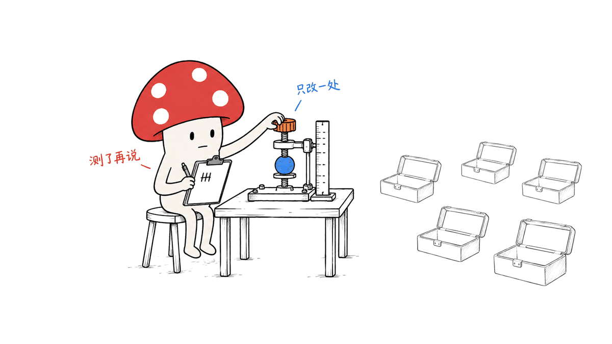

语音 AI 的六个方向都能找到公开模型和工程起点，但适合入手的问题不同：先做可测的交互与延迟基线，再决定是否投入全双工模型、语音理解或可控合成。本文把模型、运行框架、数据和评测分开，给学生与开发者一张能据此选课题、搭实验的地图。

调研截至 2026-10-11，主要核对官方 GitHub、模型卡、数据页与论文，保存了仓库版本与来源索引。这里是一组按可复现性和六方向覆盖面挑选的代表性项目，不是全部项目的排行榜。此前已有的单模型文章保留，本篇增加跨方向比较、许可核对与研究设计。

我们只实际运行了文中的 Silero VAD 组件测试；其余模型的能力、规模和发布方延迟数字来自一手资料。没有把演示效果写成生产可靠性，也没有复现全部排行榜。

完整来源索引与本机测试摘要（含固定仓库版本）：
https://blog.mushroom.cv/research/ai-speech-six-frontiers-open-source.json

## 六个方向先看哪些开源起点？

| 方向 | 模型或表示层 | 工程与验证起点 | 首先研究什么 |
| --- | --- | --- | --- |
| 全双工实时对话 | Moshi、PersonaPlex、NemotronLabs VoiceChat 11B | LiveKit Agents、Pipecat、回声处理与播放取消 | 何时抢话、何时继续听，打断后多久真正停声 |
| 语音大模型 | Qwen3-Omni、Moshi/Mimi | 官方推理脚本、音频编码与流式状态 | 音频表示如何影响理解、表达和计算成本 |
| 直接语音理解 | SenseVoiceSmall、emotion2vec+、SpeechBrain 配方 | 意图/情感分类、文本基线、跨说话人划分 | 除转写之外，语气和停顿提供多少有效信息 |
| 实时与端侧推理 | Qwen3-ASR、Kyutai STT、Silero VAD | Sherpa-ONNX、faster-whisper、流式传输 | 首片延迟、修订稳定性、尾延迟和内存 |
| 情感 TTS 与克隆 | Qwen3-TTS、CosyVoice 3 | AudioSeal、ASVspoof 5 基线 | 情感控制、音色保持、内容正确性与防伪 |
| 多语种与噪声 | Qwen3-ASR、Whisper、SenseVoiceSmall | FunASR、SpeechBrain、FLEURS、AISHELL-1 | 哪种语言、口音、噪声与设备组合会失败 |

“公开模型”与“标准开源许可”也要分开：一些代码使用 MIT/Apache，权重却采用专门协议。下文列出实际核对的区别，而不是把能下载都称作无限制开源。

## 一、全双工：能边听边说，是否一定要端到端？

不一定。全双工描述输入和输出能否同时进行，以及系统如何处理重叠发言；端到端描述模型内部是否把语音理解与语音生成联合建模。流式 ASR → LLM → 流式 TTS 的级联系统也能持续收音、检测插话并取消播放，但插话含义、回声和状态恢复仍需要处理。

Moshi 是研究音频双流的清晰起点：7B 级时间 Transformer 配合 Mimi 编解码器，在用户与助手的语音流之间建模。官方提供 PyTorch、MLX 和 Rust/Candle 路径；Mimi 将 24kHz 音频压到 12.5Hz 表示。论文/README 的 160ms 理论延迟、L4 上最低约 200ms 实际延迟有各自条件，不等于你部署后的一律往返延迟。

https://github.com/kyutai-labs/moshi
https://arxiv.org/abs/2410.00037

PersonaPlex 基于 Moshi，增加文本角色提示与声音条件，适合研究“持续交互时人物设定是否稳定”。官方有在线服务和离线评测路径，并提供 CPU offload。权重需要接受 NVIDIA 模型许可；offload 能减少 GPU 驻留压力，不保证保持实时。

https://github.com/NVIDIA/personaplex
https://huggingface.co/nvidia/personaplex-7b-v1

NemotronLabs VoiceChat 11B 更贴近语音 Agent：官方模型卡描述了联合流式理解、语音生成与单独的工具调用输出通道。它可作为“工具执行期间如何继续对话”的研究基线。其示例系统提示与工具响应要求 ASCII，默认对话设定面向英语，不能直接当作中文客服方案；权重采用 OpenMDW 1.1。

https://huggingface.co/nvidia/NVIDIA-NemotronLabs-VoiceChat-11B
https://github.com/NVIDIA-NeMo/Speech/tree/nemotron-labs-voicechat

在工程层，LiveKit Agents 提供实时音视频会话与 Agent 编排，Pipecat 提供可组合的实时处理管道。两者是框架，不是新的语音权重。示例可能调用付费云服务；接入本地模型后，还要核对所选适配器、采样率、传输与取消行为。

https://github.com/livekit/agents
https://github.com/pipecat-ai/pipecat

可做的课题是把“检测到声音”与“用户要打断”拆开：嗯、咳嗽、旁人说话、扬声器回声都可能被 VAD 检出。实验需要同时记录误打断率、漏打断率、停声延迟和恢复后任务完成率，而不仅展示“说一句话能停下来”。

## 二、语音大模型：token 化之后，还有哪些问题？

Qwen3-Omni 是理解与生成的多模态基线。30B-A3B-Instruct 具有 Thinker–Talker 路径；Thinking 与 Captioner 的交付边界不同，不能把所有同系列 checkpoint 都当作可输出语音的完整对话模型。

官方报告覆盖 19 种语音输入语言、10 种语音输出语言；文本的 119 语种不是语音覆盖数。A3B 指激活规模，不代表只需加载 3B 权重。README 的 BF16 15 秒视频输入示例列出约 78.85GB GPU 内存，这是特定视频配置，不是所有纯音频任务的最低要求。

https://github.com/QwenLM/Qwen3-Omni
https://huggingface.co/Qwen/Qwen3-Omni-30B-A3B-Instruct
https://arxiv.org/abs/2509.17765

Moshi 的 Mimi 则提供较直接的流式 codec 研究入口。可以固定下游任务，比较码率、帧长、延迟与语义/说话人信息保留；也可以研究音频 token 与文本辅助通道如何协作。不要把“使用音频 token”简单等同于“没有中间误差”：量化、编码、对齐与生成仍可能丢失信息。

对学生而言，直接重训语音基础模型通常超出单张消费级卡的预算。更可控的路线是冻结大部分模型，研究表示、适配层、流式状态或某个具体任务，并保留相同数据与推理预算的对照。

## 三、直接语音理解：怎样证明语气确实有帮助？

SenseVoiceSmall 同时提供 ASR、语言识别、情感与音频事件标签。当前官方仓库明确限定已发布 Small checkpoint 的识别语言为普通话、粤语、英语、日语、韩语；研究系列“五十多语种”的描述不能直接套在 Small 权重上。说话人分离还需要组合其他模型，不是它单独的输出。

https://github.com/FunAudioLLM/SenseVoice
https://huggingface.co/FunAudioLLM/SenseVoiceSmall

emotion2vec+ 是专注情感表示的候选，提供 seed/base/large 分档及特征提取接口，可接小分类器。SpeechBrain 提供语音任务的训练与评测配方，适合建立受控基线，而不是只调用一个封装 API 得到标签。

https://github.com/ddlBoJack/emotion2vec
https://huggingface.co/emotion2vec/emotion2vec_plus_base
https://github.com/speechbrain/speechbrain

最关键的实验是同时做文本与音频对照：同一句“可以啊”，肯定、犹豫与讽刺的录音是否能被区分？使用转写文本的分类器、文本加声学特征、直接音频模型三个基线，再按说话人与录音 session 划分训练和测试。

如果同一人的相邻片段出现在两边，模型可能记住声音、设备或场景。建议报告 macro-F1、UA（非加权准确率）与各类混淆矩阵，并观察换说话人、换麦克风后性能是否仍然存在。情感标签是任务定义，不应被表述为读取人的真实内心状态。

## 四、实时与端侧：RTF 小于 1 为什么还会慢？

Qwen3-ASR 有 0.6B 与 1.7B 版本，官方描述 30 种语言与 22 种中文方言，并提供流式/离线路径。这里的“52”是语言加方言口径。官方高并发吞吐数字不能直接换算成单用户首字延迟；流式 API、chunk、历史窗口与文本修订策略仍要检查。

https://github.com/QwenLM/Qwen3-ASR
https://huggingface.co/Qwen/Qwen3-ASR-0.6B

Kyutai Delayed Streams Modeling 提供原生流式 STT/TTS。STT 1B 英法模型标注 0.5 秒延迟，2.6B 英语模型标注 2.5 秒延迟；这是模型设计中的延迟配置，不是测量所有网络与播放开销后的用户体验。

https://github.com/kyutai-labs/delayed-streams-modeling

Sherpa-ONNX 是端侧运行工具箱，覆盖流式/非流式识别、VAD、合成等多种模型与设备；它不是任意 Hugging Face 模型的通用加载器。先看具体导出模型与后端，再决定 CPU、移动端或其他加速路径。faster-whisper 则是 Whisper 的 CTranslate2 实现，可作速度和精度基线；把离线模型分块运行不自动得到原生流式的上下文行为。

https://github.com/k2-fsa/sherpa-onnx
https://github.com/SYSTRAN/faster-whisper
https://github.com/openai/whisper

Silero VAD 可以作为低成本入口。它判断是否有语音活动，既不负责声学回声消除，也不能独立理解“等等，我想改时间”是否构成语义打断。

https://github.com/snakers4/silero-vad

### 本机小实验：只测 VAD，不冒充整机语音 Agent

在 16GiB 内存的 Apple M4 上，我们运行固定 commit 的 Silero ONNX，文件 2,327,524 字节，CPUExecutionProvider、单线程，输入 16kHz，窗口 512 个采样，即 32ms，保留 64 个采样的历史上下文。

输入是 macOS `say` 生成的一段 5.494 秒英语语音；另构造确定随机种子的 20dB/0dB 白噪声混合及等长静音。每种输入只顺序跑一次，共 172 块/输入；没有隔离后台任务。

| 输入 | 组件 RTF | 预热后块耗时 P50 / P95 | 概率 ≥0.5 的块比例 |
| --- | --- | --- | --- |
| 合成语音，干净 | 0.00287 | 0.075 / 0.082ms | 88.95% |
| 加白噪声，20dB | 0.00269 | 0.073 / 0.074ms | 88.37% |
| 加白噪声，0dB | 0.00266 | 0.073 / 0.075ms | 84.88% |
| 静音 | 0.00263 | 0.073 / 0.076ms | 0% |

P50/P95 排除了各序列首块；会话加载约 19.1ms，未计入上述 RTF。阈值通过比例不是准确率，因为这些块没有逐帧人工标注。白噪声也不代表真实会议噪声、回声或口音。结果只证明这次本机组件执行很快，不能证明全双工响应快、打断可靠或中文识别正确。

可复核文件包括模型 SHA-256、版本、构造方法、逐块概率和计时。它说明一种值得学习的实验方法：每一个延迟数字先说明测了哪一段。

测试脚本与逐块结果：
https://github.com/MushroomDAO/blog/tree/main/source/20261011-speech-ai-frontiers

其中 `reproduce-vad.sh` 适用于 macOS，依赖 uv、FFmpeg 与系统 say；其他系统可提供自己的 16kHz 单声道 PCM16 `fixture.wav`，运行 `vad-smoke.py`。系统音色和硬件不同，数值不会逐位相同。

### 统一测量口径

`RTF = 计算用时 / 音频时长`。RTF < 1 表示这一段计算快于音频播放速度，不能反映排队、等用户停顿、网络抖动或已经进入扬声器的缓存。建议把时间点同时记录在客户端和服务器，并注明时钟对齐方法。

| 指标 | 建议定义 | 要一起报告 |
| --- | --- | --- |
| 首个可播放音频 | 选定触发时刻 → 客户端拿到可播放音频 | P50/P95、冷/热启动、是否包含端点检测 |
| 端点等待 | 用户最后发声 → 系统确认可回答 | 提前截断率、长停顿误判 |
| 打断停止 | 用户真实插话起点 → 扬声器停止旧回答 | 误/漏打断率、播放缓冲与设备条件 |
| 流式稳定性 | 首个部分转写到最终结果 | 修订次数、最终 WER/CER、chunk 大小 |
| 运行成本 | 长会话与并发下的 RTF/内存 | P95/P99、功耗/温升、并发数与上下文 |

论文中的帧长、TTS 首包、服务端首 token 和终端停止播放是不同事件。例如 Qwen3-TTS 官方“最低 97ms”是合成延迟宣称，不能和 Moshi 的不同口径数字直接排列成整机快慢榜。

## 五、情感 TTS 与音色克隆：既要像，也要说对

Qwen3-TTS 提供 0.6B/1.7B 路线，当前列出十种语言。Base 用参考音频做克隆，CustomVoice 用预置音色，VoiceDesign 做文字描述的音色设计；并不是每个版本都同时支持同等程度的自由情感控制。官方三秒参考音频能力是一个测试起点，不代表任何噪声录音都能稳定复刻。

https://github.com/QwenLM/Qwen3-TTS
https://huggingface.co/Qwen/Qwen3-TTS-12Hz-0.6B-Base

CosyVoice 3 当前推荐 `Fun-CosyVoice3-0.5B`，可作为流式、跨语言和指令控制的另一条基线。把音色相似、情感匹配、可懂度、文本忠实度和首音频延迟分别记录，别只挑一段最自然的音频评价。

https://github.com/FunAudioLLM/CosyVoice
https://huggingface.co/FunAudioLLM/Fun-CosyVoice3-0.5B-2512

防伪侧，AudioSeal 是主动水印：先给生成音频嵌入水印，再检测其片段。它不是识别所有假声音的万能检测器；没有检测到水印也不能证明声音来自真人。ASVspoof 5 提供反欺骗与深伪检测基线，Track 1 主指标为 minDCF，辅以 EER 等，需要测试未见过的攻击与编解码条件。

https://github.com/facebookresearch/audioseal
https://github.com/asvspoof-challenge/asvspoof5
https://www.asvspoof.org/database

可做的题是“情感控制会不会破坏音色或内容”：同一声线、同一文本、改变情感/强度，加入重采样与有损编码后再测试可懂度、水印和检测器。用本人或明确授权的声音建立配对数据，才能把声音来源与实验变量讲清楚。

## 六、多语种、口音与噪声：难点如何变成实验？

Qwen3-ASR 与 Whisper 可作多语种基线，SenseVoiceSmall 可作五语与中文/粤语标签任务基线；FunASR 与 SpeechBrain 提供训练、数据处理和评测工具。支持某种语言不等于在该语言的所有口音、远场噪声和中英混读上都稳定。

https://github.com/modelscope/FunASR
https://github.com/speechbrain/speechbrain

数据起点可选 FLEURS 的 102 语种平行语音（数据卡 CC BY 4.0）、AISHELL-1 的普通话语料（OpenSLR 页面 Apache 2.0），以及 Mozilla Data Collective 中的具体 Common Voice 版本。Common Voice 的下载条件、版本与许可应按具体数据页核对，不能用一个旧标签概括所有资料。

https://huggingface.co/datasets/google/fleurs
https://www.openslr.org/33/
https://mozilladatacollective.com/

建议先固定语言与设备，分别施加噪声、混响、压缩与丢包，形成小型扰动矩阵；再增加语言或口音。SNR 变化时要记录语音功率计算方式，别把“加了一段背景声”当成可复现的噪声强度。

中文报告 CER，英语可报 WER；混读需要明确切词与归一化规则。除总体平均外，给出语言、口音、噪声强度和说话人子组结果。数据容易下载不等于实验容易：划分、标签质量与训练污染仍需要检查。

## 许可与算力：哪些边界会影响选型？

以下是本次核对的发布信息，不替代某一版本的完整许可证。尤其要把代码、权重和训练/评测数据分开。

| 项目 | 代码 | 选定权重/资产的口径 |
| --- | --- | --- |
| Moshi | Python/网页 MIT；Rust Apache 2.0 | 官方 Moshi 模型 CC BY 4.0 |
| PersonaPlex | MIT | NVIDIA Open Model License，需接受条款 |
| NemotronLabs VoiceChat 11B | 以所用 NeMo 分支为准 | 模型卡 OpenMDW 1.1 |
| Qwen3-ASR / Qwen3-TTS | Apache 2.0 | 本文选定卡片标 Apache 2.0 |
| Qwen3-Omni | Apache 2.0 | 当前卡 `license_name: apache-2.0`，但 `license` 元数据为 `other`，记录此差异 |
| SenseVoiceSmall | 代码 MIT | 卡片指向 FunASR 专门模型协议，不能直接说权重也是 MIT |
| emotion2vec+ | README 声明 MIT | 所选 base 权重卡标专门模型许可，需进一步核对 |
| CosyVoice 3 | Apache 2.0 | 本文选定 0.5B-2512 卡标 Apache 2.0 |
| LiveKit / Pipecat | Apache 2.0 / BSD-2-Clause | 是框架；所接服务和模型另算 |
| Silero VAD / AudioSeal | MIT | AudioSeal 官方明确代码与权重均 MIT |
| Sherpa-ONNX / SpeechBrain | Apache 2.0 | 各下载模型与数据另查 |

SenseVoiceSmall 的模型许可入口：
https://github.com/modelscope/FunASR/blob/main/MODEL_LICENSE

算力上，CPU 或 16GB Mac 适合先做 VAD、导出的轻量 ASR、延迟记录与评测；CUDA 优化的 0.6B/1.7B 模型不能仅因参数小就默认兼容 MPS。7B/11B 对话模型应按选定精度、codec、缓存和实现实测驻留内存。30B 级多模态模型更适合作为共享 GPU 服务器基线。

没有统一的“全双工最低显存”：框架连接云 API、全本地级联、量化端到端推理与训练，是四种完全不同的预算。完整复现还要有麦克风、扬声器或耳机、网络与真实播放时间戳。

## 怎样把它落成三个可复现课题？

下面是本文基于上述项目提出的实验设计，不是已经取得的研究成果。

| 课题 | 最小基线 | 改一个变量 | 主要证据 |
| --- | --- | --- | --- |
| A：中文语音 Agent 的语义打断 | Silero + 本地/服务端 ASR + LiveKit/Pipecat 的播放取消 | 固定超时 vs 声学/语义联合决策 | 不同重叠场景的误/漏打断、停声 P95、恢复任务成功率 |
| B：同词不同语气的意图理解 | 文本分类 vs SenseVoice/emotion2vec 表示 + 小分类器 | 是否使用韵律/停顿；跨设备适配 | speaker/session 隔离的 macro-F1、UA 与校准/混淆矩阵 |
| C：可控情感与可追溯合成 | Qwen3-TTS 或 CosyVoice + AudioSeal | 情感强度、量化或编码扰动 | 内容错误、说话人相似、盲听情感、水印检出和误报 |

方向二可以成为 A/B 的表示层扩展；方向四是所有课题的系统指标；方向六是三者的鲁棒性测试轴。这样六个方向能接成一套问题体系，避免为了覆盖名词而同时训练六种模型。

一个可操作的八周安排：第 1–2 周固定版本、数据和指标，复现最小基线；第 3–4 周建立错误分类与可重放用例；第 5–6 周只加入一个方法变量并做消融；第 7–8 周测试未见说话人/设备和系统尾延迟，整理复现脚本与失败案例。论文价值由问题与证据决定，不由仓库 star 或演示新颖程度决定。

## 常见问题

### 文本 NLP 背景应该先补哪些基础？

采样率与分帧、频谱与特征、VAD/AEC、流式缓存和时间戳，以及说话人独立的数据划分。先把音频从采集到播放的路径跑通，再研究更复杂模型。

### 做一个 ASR + LLM + TTS Demo 算研究吗？

它是工程基线。提出可验证的失败模式，固定对照和预算，再用改进与消融解释结果，才能形成研究证据；单次演示不能说明泛化。

### 六个方向里哪个一定更容易发论文？

公开资料不足以给出这种保证。选择能获得数据、算力与可靠评测的具体问题，比比较大方向的热度更有用。

### 开源框架是否意味着整个服务能离线免费？

不意味着。还要检查云模型、传输服务、外部接口、权重许可与模型下载权限；本地方案同样有硬件和维护成本。

延伸阅读：
https://blog.mushroom.cv/blog/qwen3-asr-small-business-bilingual-voice-ai-local-deploy/
https://blog.mushroom.cv/blog/full-duplex-model-cascaded-e2e-speech-engineering-teardown/
https://blog.mushroom.cv/blog/nvidia-nemotron-voicechat-11b-full-duplex-speech-tool-calling/

---

> © 2026 Author: Mycelium Protocol. 本文采用 [CC BY 4.0](https://creativecommons.org/licenses/by/4.0/deed.zh) 授权——欢迎转载和引用，须注明作者姓名及原文链接，不得去除署名后以原创发布。

<!--EN-->

All six speech-AI directions have public models and engineering starting points, but they lead to different experiments. Build a measurable interaction and latency baseline first, then decide whether to invest in duplex modeling, direct speech understanding or controllable synthesis. This map separates models, runtimes, datasets and evaluation so students and developers can choose a reproducible problem.

The review is current to October 11, 2026 and uses official repositories, model cards, dataset pages and papers. It is a representative selection, not a complete leaderboard. Existing single-project articles remain intact; this survey adds cross-direction comparisons, licensing and experiment design.

Only the Silero VAD component probe below was executed locally. Other capabilities, sizes and latency claims are attributed to their publishers. We did not reproduce every benchmark or validate arbitrary production conversations.

Source index and local-probe summary, including pinned repository versions:
https://blog.mushroom.cv/research/ai-speech-six-frontiers-open-source.json

## Where should each direction begin?

| Direction | Model/representation candidates | Engineering and evaluation | First research question |
| --- | --- | --- | --- |
| Full-duplex dialogue | Moshi, PersonaPlex, VoiceChat 11B | LiveKit Agents, Pipecat, echo control and playback cancellation | When to yield, and how quickly old speech actually stops |
| Speech foundation models | Qwen3-Omni, Moshi/Mimi | Official inference and codec/state experiments | How audio representation affects meaning, expression and cost |
| Direct speech understanding | SenseVoiceSmall, emotion2vec+, SpeechBrain recipes | Text baselines and speaker-separated classification | What prosody adds beyond transcripts |
| Real-time/edge inference | Qwen3-ASR, Kyutai STT, Silero VAD | Sherpa-ONNX, faster-whisper, streaming transport | First-output latency, revisions, tail latency and memory |
| Emotional TTS and cloning | Qwen3-TTS, CosyVoice 3 | AudioSeal and ASVspoof 5 baselines | Control, identity, intelligibility and traceability |
| Multilingual/noisy speech | Qwen3-ASR, Whisper, SenseVoiceSmall | FunASR, SpeechBrain, FLEURS and AISHELL-1 | Which language, accent, device and noise combinations fail |

Publicly downloadable weights are not always licensed like their source code. Treat those as separate artifacts.

## 1. Does full duplex require an end-to-end model?

No. Duplex is an interaction property: listening and speaking can overlap. End-to-end describes the architecture. Streaming ASR → LLM → TTS can keep listening and cancel playback, while still requiring semantic interruption decisions, acoustic echo handling and state recovery.

Moshi uses a 7B-class temporal Transformer with the Mimi codec and supports PyTorch, MLX and Rust/Candle paths. Mimi converts 24kHz audio into a 12.5Hz representation. Its reported 160ms theoretical delay and practical latency as low as 200ms on L4 have specific conditions; neither guarantees your client round trip.

https://github.com/kyutai-labs/moshi
https://arxiv.org/abs/2410.00037

PersonaPlex extends Moshi with text role and voice conditioning. It is useful for persistent-persona experiments. Its official CPU-offload option reduces GPU residency but does not guarantee real-time speed; its weights require acceptance of NVIDIA's model license.

https://github.com/NVIDIA/personaplex
https://huggingface.co/nvidia/personaplex-7b-v1

NemotronLabs VoiceChat 11B adds a separate tool-call channel alongside streaming understanding and generation. It offers a baseline for conversation during tool execution. The official examples require ASCII system/tool-response text and default to English; they are not a ready-made Chinese service. Its model card specifies OpenMDW 1.1.

https://huggingface.co/nvidia/NVIDIA-NemotronLabs-VoiceChat-11B
https://github.com/NVIDIA-NeMo/Speech/tree/nemotron-labs-voicechat

LiveKit Agents and Pipecat are integration frameworks, not model weights. Example cloud providers may be paid; local integration still needs compatible adapters, sample rates, transport and cancellation.

https://github.com/livekit/agents
https://github.com/pipecat-ai/pipecat

A researchable problem distinguishes speech activity from an intended interruption. Backchannels, coughs, another speaker and acoustic echo can all trigger a VAD. Report false/missed interruptions, audible-stop latency and recovery task success together.

## 2. What remains after speech tokenization?

Qwen3-Omni-30B-A3B-Instruct offers a Thinker–Talker path, while Thinking and Captioner variants have different output boundaries. Not every checkpoint is a complete speech-output dialogue model.

The publisher reports 19 speech-input and ten speech-output languages; 119 text languages is a different count. A3B denotes active parameters, not a 3B weight-loading budget. The README's BF16 example lists 78.85GB for 15-second video input, a specific video configuration rather than a universal audio minimum.

https://github.com/QwenLM/Qwen3-Omni
https://huggingface.co/Qwen/Qwen3-Omni-30B-A3B-Instruct
https://arxiv.org/abs/2509.17765

Mimi supplies a streaming-codec research entry point. Fix a downstream task and compare bitrate, frame duration and preservation of semantic or speaker information, or study audio tokens alongside text assistance. Tokenization does not eliminate compression, alignment and generation errors.

For a student budget, frozen-backbone adaptation, representation studies or streaming-state experiments are usually more controllable than training a speech foundation model from scratch. Keep task data and inference budgets matched.

## 3. How do you prove that prosody helps understanding?

SenseVoiceSmall produces recognition, language, emotion and event tags. Its current official repository limits the released Small checkpoint to Mandarin, Cantonese, English, Japanese and Korean. The broader research series' “50+ languages” claim should not be assigned to Small. Diarization requires additional models.

https://github.com/FunAudioLLM/SenseVoice
https://huggingface.co/FunAudioLLM/SenseVoiceSmall

Emotion2vec+ offers seed/base/large emotion representations and feature extraction; a small classifier can be trained on top. SpeechBrain provides training and evaluation recipes.

https://github.com/ddlBoJack/emotion2vec
https://huggingface.co/emotion2vec/emotion2vec_plus_base
https://github.com/speechbrain/speechbrain

Compare identical words spoken affirmatively, hesitantly and sarcastically using transcript-only, transcript-plus-acoustics and direct-audio baselines. Split by speaker and recording session to avoid learning identity or recording conditions. Report macro-F1, unweighted accuracy and per-class confusion, including unseen microphones. Emotion labels are task annotations rather than access to someone's true internal state.

## 4. Why can RTF below one still feel slow?

Qwen3-ASR has 0.6B/1.7B variants and streaming/offline paths. Its 52-language-and-dialect coverage means 30 languages plus 22 Chinese dialects. Concurrent throughput does not establish single-user first-token latency; inspect chunking, history and revision behavior.

https://github.com/QwenLM/Qwen3-ASR
https://huggingface.co/Qwen/Qwen3-ASR-0.6B

Kyutai's delayed-streams STT/TTS is explicitly streaming. The STT 1B English/French model specifies 0.5-second delay and its 2.6B English model 2.5 seconds. These are model-delay configurations, not measurements including all network and playback costs.

https://github.com/kyutai-labs/delayed-streams-modeling

Sherpa-ONNX is a deployment toolbox for specific exported models and backends, not a universal loader for any Hugging Face checkpoint. Faster-whisper is a CTranslate2 implementation of Whisper and provides a useful accuracy/speed baseline. Chunking an offline model does not create native streaming context behavior.

https://github.com/k2-fsa/sherpa-onnx
https://github.com/SYSTRAN/faster-whisper
https://github.com/openai/whisper

Silero VAD detects speech activity. It neither removes speaker echo nor understands whether a spoken phrase intends to interrupt.
https://github.com/snakers4/silero-vad

### Local probe: a VAD component, not a full voice agent

We ran the pinned 2,327,524-byte Silero ONNX model on an Apple M4 with 16GiB RAM, CPUExecutionProvider and one thread. Input was 16kHz, 512 samples per chunk (32ms), with 64 history samples.

A 5.494-second English macOS `say` fixture was tested once per condition: clean, deterministic white noise at 20dB and 0dB SNR, and silence. Each condition contained 172 chunks. Background workload was not isolated.

| Input | Component RTF | Warm chunk P50/P95 | Fraction ≥0.5 |
| --- | --- | --- | --- |
| Clean synthetic speech | 0.00287 | 0.075/0.082ms | 88.95% |
| White noise, 20dB | 0.00269 | 0.073/0.074ms | 88.37% |
| White noise, 0dB | 0.00266 | 0.073/0.075ms | 84.88% |
| Silence | 0.00263 | 0.073/0.076ms | 0% |

Percentiles exclude each sequence's first chunk. Session loading took approximately 19.1ms, outside these RTF values. Threshold fractions are not accuracy because no human frame labels were supplied. White noise is not real meeting noise, echo or an accent test. This only establishes fast local component execution, not duplex responsiveness, semantic interruption reliability or Chinese ASR quality. Hashes, setup, probabilities and timings were retained.

Scripts and per-chunk results:
https://github.com/MushroomDAO/blog/tree/main/source/20261011-speech-ai-frontiers

`reproduce-vad.sh` is macOS-specific and uses uv, FFmpeg and system say. Other systems can supply a 16kHz mono PCM16 `fixture.wav` to `vad-smoke.py`. Voice and hardware differences prevent bit-identical timing results.

### Use one explicit timing contract

`RTF = computation time / audio duration`. RTF below one indicates faster-than-playback computation for that component; it excludes endpoint waits, queues, transport and playback buffering. Record both client and server timestamps and clock-alignment assumptions.

| Metric | Suggested definition | Paired evidence |
| --- | --- | --- |
| First playable audio | Chosen trigger → playable audio at client | P50/P95, cold/warm starts, endpoint inclusion |
| Endpoint wait | Last user speech → permission to answer | Premature cutoff and long-pause errors |
| Interruption stop | True user interruption → old audible output stops | False/missed interruption and playback buffer |
| Streaming stability | First partial transcript → final result | Revisions, final WER/CER, chunk size |
| Runtime cost | Sustained/concurrent RTF and memory | Tail latency, power/thermal state, concurrency/context |

Frame length, TTS first packet, server first token and audible playback stop are different events. Qwen3-TTS's reported minimum 97ms synthesis latency cannot be placed beside Moshi's differently defined figures as a universal end-to-end ranking.

## 5. Emotional TTS and cloning: sound similar and say the right thing

Qwen3-TTS offers 0.6B/1.7B paths and ten listed languages. Base uses reference audio for cloning, CustomVoice supplies preset speakers, and VoiceDesign follows voice descriptions. Control capabilities differ by version. Three-second reference cloning is a published starting point, not a guarantee for arbitrary noisy recordings.

https://github.com/QwenLM/Qwen3-TTS
https://huggingface.co/Qwen/Qwen3-TTS-12Hz-0.6B-Base

CosyVoice currently recommends the Fun-CosyVoice3-0.5B path. Measure speaker similarity, emotional control, intelligibility, text fidelity and first-audio timing separately.

https://github.com/FunAudioLLM/CosyVoice
https://huggingface.co/FunAudioLLM/Fun-CosyVoice3-0.5B-2512

AudioSeal embeds and detects localized watermarks; it is not a universal detector of all synthetic speech. An absent watermark cannot establish human origin. ASVspoof 5 provides anti-spoofing baselines: Track 1 prioritizes minDCF with EER and other secondary metrics. Evaluate unseen attacks and codecs.

https://github.com/facebookresearch/audioseal
https://github.com/asvspoof-challenge/asvspoof5
https://www.asvspoof.org/database

A reproducible problem tests whether changing emotion damages identity or content. Keep speaker/text fixed, vary emotion and intensity, then apply resampling/compression before testing intelligibility, watermark survival and detector errors. Use your own or explicitly authorized reference voices so provenance is a controlled variable.

## 6. Multilingual, accented and noisy speech

Qwen3-ASR and Whisper are multilingual baselines; SenseVoiceSmall covers its five-language scope. FunASR and SpeechBrain supply experiment tooling. Language support does not establish robustness across accents, far-field noise or code switching.

https://github.com/modelscope/FunASR
https://github.com/speechbrain/speechbrain

FLEURS offers parallel speech across 102 languages under its CC BY 4.0 card. AISHELL-1's official OpenSLR page specifies Apache 2.0. For Common Voice, verify the chosen Mozilla Data Collective dataset's version, download conditions and terms individually.

https://huggingface.co/datasets/google/fleurs
https://www.openslr.org/33/
https://mozilladatacollective.com/

Fix language/device first and sweep noise, reverberation, compression and packet loss before expanding coverage. Document speech-power estimation for SNR. Use Chinese CER, appropriate English WER and explicit code-switch tokenization/normalization. Show subgroup results rather than only an overall mean. Public availability does not resolve split quality, annotation or training contamination.

## Which licensing and compute boundaries matter?

| Project | Code | Selected weights/assets |
| --- | --- | --- |
| Moshi | Python/web MIT; Rust Apache 2.0 | Official Moshi weights CC BY 4.0 |
| PersonaPlex | MIT | NVIDIA Open Model License, acceptance required |
| VoiceChat 11B | Check selected NeMo branch | OpenMDW 1.1 model card |
| Qwen3-ASR / TTS | Apache 2.0 | Selected cards Apache 2.0 |
| Qwen3-Omni | Apache 2.0 | Card says `license_name: apache-2.0`, but `license` metadata is `other`; discrepancy retained |
| SenseVoiceSmall | MIT code | Dedicated FunASR model agreement, not automatically MIT weights |
| emotion2vec+ | README states MIT | Selected base card uses a dedicated model license; verify further |
| CosyVoice 3 | Apache 2.0 | Selected 0.5B-2512 card Apache 2.0 |
| LiveKit / Pipecat | Apache 2.0 / BSD-2-Clause | Frameworks; connected services/models separate |
| Silero / AudioSeal | MIT | AudioSeal explicitly licenses both code and weights MIT |
| Sherpa-ONNX / SpeechBrain | Apache 2.0 | Individual models and datasets separate |

Model-agreement source:
https://github.com/modelscope/FunASR/blob/main/MODEL_LICENSE

CPU or a 16GB Mac is useful for VAD, supported exported lightweight ASR and instrumentation. A small CUDA-optimized checkpoint is not automatically MPS-compatible. Measure 7B/11B dialogue residency with precision, codec and caches included; 30B-class multimodal models are better treated as shared-server baselines.

There is no universal minimum VRAM for duplex: cloud-connected orchestration, local cascades, quantized end-to-end inference and training have distinct budgets. Reproduction also requires real capture/playback devices and timestamps.

## How can this become three reproducible projects?

These are proposed experiments, not completed findings.

| Project | Minimal baseline | One changed variable | Primary evidence |
| --- | --- | --- | --- |
| A: Semantic interruption in a Chinese agent | Silero + ASR + LiveKit/Pipecat playback cancellation | Timeout vs acoustic/semantic joint decision | False/missed interruption, stop P95 and recovery task success |
| B: Intent from identical words with different prosody | Text classifier vs SenseVoice/emotion2vec + small head | Prosody/pauses or cross-device adaptation | Speaker/session-separated macro-F1, UA and confusion/calibration |
| C: Controllable and traceable synthesis | Qwen3-TTS or CosyVoice + AudioSeal | Emotion intensity, quantization or codec | Content errors, speaker similarity, blind emotion listening and watermark errors |

Foundation models can extend A/B's representation layer; real-time systems constrain all three; multilingual/noisy evaluation is a robustness axis. Six research areas need not become six simultaneous training projects.

An eight-week plan: weeks 1–2 freeze versions, data and metrics; weeks 3–4 build an error taxonomy and replay cases; weeks 5–6 add one method variable with ablations; weeks 7–8 test unseen speakers/devices and system tail latency, then publish reproduction and failures. Research value comes from a problem and evidence, not stars or demo novelty.

## FAQ

### What should a text-NLP student learn first?

Sampling and framing, spectral features, VAD/AEC, streaming buffers/timestamps and speaker-independent splits. Build capture-to-playback before tackling a large model.

### Is an ASR–LLM–TTS demo research?

It is an engineering baseline. A defined failure mode, matched controls and budget, improvements and ablations create research evidence. One demo does not establish generalization.

### Which direction guarantees easier publication?

The public evidence supports no such guarantee. Choose a problem with accessible data, compute and reliable evaluation rather than a popularity label.

### Does an open framework mean an offline, free service?

No. Check connected models/services, external interfaces, model access and weight terms. Local systems still require hardware and maintenance.

Related articles:
https://blog.mushroom.cv/blog/qwen3-asr-small-business-bilingual-voice-ai-local-deploy/
https://blog.mushroom.cv/blog/full-duplex-model-cascaded-e2e-speech-engineering-teardown/
https://blog.mushroom.cv/blog/nvidia-nemotron-voicechat-11b-full-duplex-speech-tool-calling/

---

> © 2026 Author: Mycelium Protocol. Licensed under [CC BY 4.0](https://creativecommons.org/licenses/by/4.0/) — free to share and adapt with attribution. You must credit the author and link to the original; removing attribution and republishing as original is not permitted.
