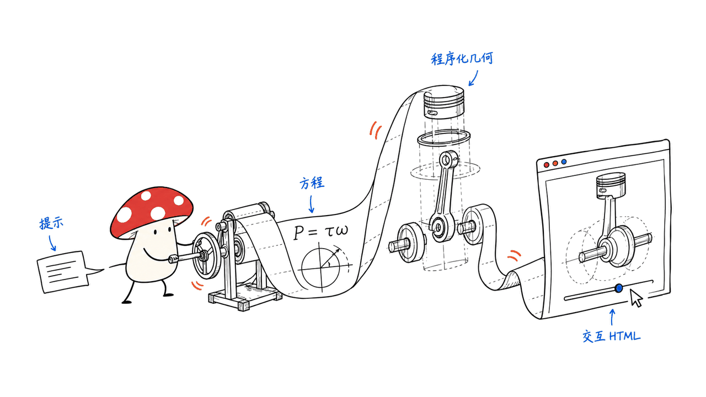

Machine Skill 能让 Claude Code 把机械原理做成可交互的 3D 网页：调参数、看剖面、拆开零件，再录成讲解视频。它适合教学和产品演示；工程数值仍要核对公式、假设与实测。

项目已经找到，官方仓库是 AirsupHQ/machine-skill，采用 MIT 许可证。本文核对官网、README、技能说明、运行时代码和涡扇示例，源码固定在 e0bd066ac5beaf48512935de2fc0f0e55636853a，资料核查日期为 2026-10-25。

仓库：https://github.com/AirsupHQ/machine-skill
官网：https://www.airsup.ai/lab/skill

## 它到底是模型、CAD，还是一个 skill？

它是一套给 Claude Code 使用的工程演示技能包。你描述一台机器，Agent 按技能约束写几何、公式、交互界面和镜头，交付 HTML。它没有提供新的大模型权重，也不是传统 CAD 的参数化实体建模内核。

仓库的分工很清楚：SKILL.md 定义工作方式；references/solvers.md 给出不同机械的简化计算起点；kit 提供 Three.js 场景、材料、剖切与界面；examples 展示成品；scripts 负责截图、检查和视频录制。真正值得复用的，是这些约束一起工作。



## 官方示例展示了什么？

| 示例 | 计算与交互的重点 | 阅读时应保留的边界 |
|---|---|---|
| 涡扇发动机 | 油门、转速、推力、温度和叶片脱落 | 使用零维布雷顿循环，并非完整发动机数字孪生 |
| 甲烷液氧火箭发动机 | 喷管流动、推力与冷却故障 | 是简化热力学演示，不是发动机设计认证 |
| 炼油厂离心泵 | 相似定律、工作点与汽蚀 | 需要输入曲线和适用条件 |
| 多级压缩机 | 压缩过程、性能图与喘振 | 集总模型不能替代详细流场计算 |

封面采用官方涡扇示例图。图上的推力是示例求解器输出，不能读作我们的台架测量。剖面、爆炸图、透明显示和实时标签的价值，是把“里面怎么动”和“参数为什么变”放在同一个视野里。

## 算出 16.9 kW，就证明模型准确吗？

用户素材中的“249cc、8513rpm、16.9kW，与公开19.4kW接近”，没有在本次固定版本的官方四个示例与说明中找到对应出处。因此这里不把它作为已验证案例，也不据此给出精度结论。

源码提供了更有用的判断办法。活塞发动机参考模型用曲柄连杆关系描述活塞位置，并用四冲程关系计算扭矩：T = BMEP × Vd / (4π)，随后 P = T × ω。排量和转速都知道，功率仍依赖平均有效压力 BMEP；参考文件把它作为随转速变化的假定曲线。

这意味着：几何做得像，不会自动让功率算得准。若 BMEP、燃烧效率或损失来自人为设定，输出接近某个公开值，可能只是校准点相近。需要再检查其他转速、负载与失效条件，才能判断模型是否有解释力。


Mycelium Protocol 的判断是：它很适合做可解释的机械演示原型。先明确量纲和守恒关系，再让视觉表现服务于公式，比只生成一个会转的漂亮模型更有价值；用于选型或结构决策时，还需要专业工具与实物验证。

## 怎么开始使用？

官方安装方式如下，命令会下载并安装第三方技能，建议先阅读仓库再运行。本文仅调研与测试官方示例，没有替读者安装全局 skill。

```bash
npx skills add AirsupHQ/machine-skill -g -a claude-code
```

进入 Claude Code 后，可以从一台简单机器开始：

```text
/machine 一个曲柄连杆机构。输入曲柄半径、连杆长度和转速，
显示活塞位移与速度，支持剖面和爆炸图。
请公开公式、单位、参数范围与简化条件。
```

先验收最小机构，再增加燃烧、泵送或热力学过程。第一轮检查尺寸和运动方向；第二轮检查极值、单位与参数联动；第三轮测试剖切、标签遮挡和异常输入；最后才安排镜头与录制。不要一开始就要求复杂整机，同时期待每一项数值可信。

要固定可复现版本，可以克隆仓库并检出本文提交：

```bash
git clone https://github.com/AirsupHQ/machine-skill.git
cd machine-skill
git checkout e0bd066ac5beaf48512935de2fc0f0e55636853a
```

## 一个 HTML，是否意味着离线零依赖？

不意味着。官方模板通过 CDN 导入 Three.js 0.170.0，还使用 Google Fonts；运行时会加载 Poly Haven HDR 环境图。场景和技能运行时代码可以内联，但这些外部资源需要另外处理，才能交付给断网环境。

浏览器需要 WebGL2 和可用的图形加速。普通电脑可以尝试简化场景，复杂零件、剖切和后处理则会增加 GPU 负担。仓库没有给出可作为最低要求的统一显卡或 Mac 内存门槛，因此不宜承诺“任何机器都流畅”。

录制工具还需要 Node.js 18 或以上、Playwright/Chromium 和 ffmpeg。按官方示例，生成 watch.html 后可使用：

```bash
node ~/.claude/skills/machine/scripts/record.mjs \
  watch.html out/watch.mp4 --music freepd:Classical/Easy_Lemon
```

录制脚本可控制场景时间与镜头节奏，减少实时抓屏的不确定性；这不等于验证了机械模型的物理精度。音乐、模型生成服务和图形计算也有各自成本，MIT 免费开源不代表整个创作链条零费用。


## 我们实际核验到了哪一步？

在 M4、16GiB 内存、macOS 26.6.2 上，我们用本地 HTTP 服务加载固定版本的官方涡扇 HTML，并通过无头 Chromium 检查交互。WebGL2 初始化成功；油门从 0 调到 100 后，推力与温度显示变化；剖面与爆炸图控制均激活。本次运行未捕获页面异常或资源请求失败。这只是功能 smoke test，没有测性能、没有生成新整机、没有测试视频录制，也没有做真实发动机精度验证。

我们还检查了求解器的建模路径：涡扇例明确写出静态海平面 ISA 条件，空气流量由风扇环面积与马赫数推导，压力比和燃烧室温度随转速变化，最终由核心流与旁通流动量计算推力。这比页面上一个漂亮数字更重要：读者能定位数字从哪里来，也能看到哪些关系仍是设定。

如果把它用于客户项目，我建议交付时附一页模型说明：输入范围、单位、方程、标定来源、已知失效区间，以及“演示用途”的明确定位。机械教学、技术销售和科普短片可以先试；承载件设计、可靠性评估和安全相关决策，需要另行验证。

## 常见问题

### 能直接导出可制造的 CAD 吗？

本次核查的交付中心是 Three.js HTML 和视频工具，没有证据表明它提供可直接用于制造的参数化 CAD 工作流。网页网格展示与工程实体模型是不同交付物。

### Mac 能运行吗？

可以先用支持 WebGL2 的浏览器打开示例，再考虑生成新场景。是否流畅取决于场景复杂度和图形资源；本文的运行结果只适用于记录的测试环境，不是全系列 Mac 的兼容性保证。

### 免费意味着不用付模型费用吗？

不意味着。技能仓库采用 MIT；使用 Claude Code 或其他生成服务的权限、套餐与费用，需要按对应服务单独确认。也可以只研究仓库和现成示例。

## 一手资料

- 官网与示例入口：https://www.airsup.ai/lab/skill
- 仓库与安装说明：https://github.com/AirsupHQ/machine-skill
- 固定版本求解器参考：https://github.com/AirsupHQ/machine-skill/blob/e0bd066ac5beaf48512935de2fc0f0e55636853a/references/solvers.md
- 固定版本涡扇源码：https://github.com/AirsupHQ/machine-skill/blob/e0bd066ac5beaf48512935de2fc0f0e55636853a/examples/turbofan.html

原文：https://blog.mushroom.cv/blog/airsup-machine-skill/

---

> © 2026 Author: Mycelium Protocol. 本文采用 [CC BY 4.0](https://creativecommons.org/licenses/by/4.0/deed.zh) 授权——欢迎转载和引用，须注明作者姓名及原文链接，不得去除署名后以原创发布。

<!--EN-->

Machine Skill turns a mechanical description into an interactive 3D web demonstration through Claude Code. It combines controls, cutaways, exploded views and recording tools. It is useful for explaining machinery; calculated outputs still require scrutiny of equations, assumptions and measurements.

The official repository is AirsupHQ/machine-skill, licensed under MIT. This review examines the website, README, skill instructions, runtime and turbofan example at commit e0bd066ac5beaf48512935de2fc0f0e55636853a, checked on 2026-10-25.

Repository: https://github.com/AirsupHQ/machine-skill
Website: https://www.airsup.ai/lab/skill

## What does the skill actually contain?

The package guides an agent to write procedural geometry, a small solver, controls and camera sequences. SKILL.md defines the workflow; references/solvers.md supplies modeling starting points; kit contains the Three.js runtime; examples show completed pages; scripts handle capture and recording. This is an orchestration and presentation toolkit, rather than new model weights or a parametric CAD kernel.


## What do the official examples demonstrate?

| Example | Main behavior | Modeling boundary |
|---|---|---|
| Turbofan | Throttle, thrust, temperatures and blade loss | Zero-dimensional Brayton cycle |
| Methalox rocket engine | Nozzle flow, thrust and cooling failure | Simplified thermodynamic demonstration |
| Refinery pump | Affinity laws, operating point and cavitation | Requires suitable curves and assumptions |
| Multistage compressor | Compression, map and surge | Lumped model, not detailed flow simulation |

The cover is an official turbofan screenshot. Its thrust display is the example solver's output, not a bench measurement made by us. The practical value is seeing internal motion and parameter changes together, with cut surfaces, exploded parts and live labels.

## Does plausible power prove physical accuracy?

We could not locate the supplied 249 cc, 8513 rpm, 16.9 kW example or its 19.4 kW comparison in the pinned official examples and documentation. We therefore do not treat that claim as verified evidence.

The piston-engine reference shows why assumptions matter. It uses slider-crank geometry for position, then four-stroke torque T = BMEP × Vd / (4π), followed by P = T × angular velocity. Displacement and speed alone do not determine power: BMEP is an assumed curve over engine speed in this starting model.

A convincing shape cannot establish that curve. Matching one published power figure might reflect a calibration choice. Validation needs other operating points, loads and failure conditions, with the assumptions exposed.


Mycelium Protocol sees the strongest use as an explainable demonstration prototype: connect visible behavior to units and conservation relationships. Structural decisions and equipment selection require additional tools and real validation.

## How should you start?

Read the third-party repository before installing. The documented global Claude Code command is:

```bash
npx skills add AirsupHQ/machine-skill -g -a claude-code
```

We researched the package and tested its example; we did not install a global skill on the reader's behalf. Begin with a small mechanism:

```text
/machine A slider-crank mechanism with crank radius, rod length
and speed controls. Show piston displacement and velocity,
cutaway and exploded views. State equations, units,
valid input ranges and simplifications.
```

Check geometry and motion first, units and extreme values second, controls and clipping third. Add recording only after the demonstration behaves coherently. A complex complete engine is a poor first acceptance test.

To inspect the exact reviewed revision:

```bash
git clone https://github.com/AirsupHQ/machine-skill.git
cd machine-skill
git checkout e0bd066ac5beaf48512935de2fc0f0e55636853a
```

## Is one HTML file fully offline?

The template imports Three.js 0.170.0 from a CDN and uses Google Fonts. The runtime loads Poly Haven HDR environment maps. Inlining scene and runtime code does not bundle every external resource. Offline delivery requires collecting those dependencies and testing the result without a network.

A browser with WebGL2 and functioning graphics acceleration is required. Complex geometry, clipping and post-processing add GPU work. The repository does not establish a universal minimum GPU or Mac memory specification, so a promise of smooth operation on every machine would be unsupported.

Recording additionally needs Node.js 18+, Playwright/Chromium and ffmpeg. For a generated watch.html, the documented example is:

```bash
node ~/.claude/skills/machine/scripts/record.mjs \
  watch.html out/watch.mp4 --music freepd:Classical/Easy_Lemon
```

Controlled scene time supports repeatable camera sequences. It does not establish physical accuracy. MIT licensing covers the repository; model services, music selection and local graphics work remain separate considerations.


## What did we verify?

On our M4 Mac with 16 GiB memory and macOS 26.6.2, a local HTTP server served the pinned official turbofan HTML to headless Chromium. WebGL2 initialized successfully. Moving the throttle from 0 to 100 changed the displayed thrust and temperature; cutaway and explode controls both activated. No page exception or failed resource request was captured during this run. This was a functional smoke test, not a speed benchmark, a generated custom machine, a recording test or a validation against a real engine.

Source inspection also traced the turbofan output: static sea-level ISA conditions, annulus area and Mach number for airflow, speed-dependent pressure ratios and combustor temperature, then core and bypass momentum for thrust. These relationships make the output inspectable while also exposing its assumptions.

For client delivery, include input ranges, units, equations, calibration references and known invalid regimes. Teaching, technical sales and explanatory videos are reasonable starting uses. Manufacturing, reliability and safety decisions need a separate validation process.

## FAQ

### Does it produce manufacturing-ready CAD?

The reviewed workflow centers on Three.js HTML and video capture. We found no basis for treating it as a manufacturing-ready parametric CAD pipeline. Display meshes and engineering solids serve different purposes.

### Can a Mac run it?

Start by opening an example in a WebGL2-capable browser. Results depend on scene complexity and graphics resources. Our recorded environment is one functional check, not a compatibility guarantee across all Macs.

### Does MIT mean generation is free?

The repository is MIT licensed. Claude Code access and any other generation services have their own terms and costs. Studying the existing code and examples does not require generating a new machine.

## Primary sources

- Website: https://www.airsup.ai/lab/skill
- Repository and installation: https://github.com/AirsupHQ/machine-skill
- Pinned solver references: https://github.com/AirsupHQ/machine-skill/blob/e0bd066ac5beaf48512935de2fc0f0e55636853a/references/solvers.md
- Pinned turbofan source: https://github.com/AirsupHQ/machine-skill/blob/e0bd066ac5beaf48512935de2fc0f0e55636853a/examples/turbofan.html

Original article: https://blog.mushroom.cv/blog/airsup-machine-skill/

---

> © 2026 Author: Mycelium Protocol. Licensed under [CC BY 4.0](https://creativecommons.org/licenses/by/4.0/) — free to share and adapt with attribution. You must credit the author and link to the original; removing attribution and republishing as original is not permitted.
