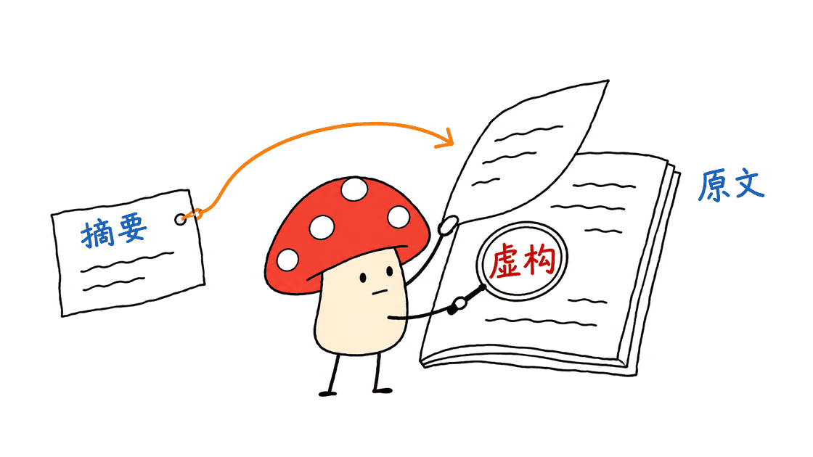

AI Safety HOT是一个把AI安全新闻、研究论文和事件进展集中整理的网站，适合用来发现线索、建立阅读清单。它的价值在于减少分散搜集材料的时间；重要事实仍需要回到原文核对，不能仅凭聚合摘要作出安全判断。

网站：https://aisafetyhot.com/zh/
公开仓库：https://github.com/wuyoscar/AISafetyHot

本次核对日期为2026年11月3日，仓库提交为`cf15c9b55745564482379df818f8a2bdc248e6e6`。旧地址`wuyoscar/AISafetyHot-Hub`会跳转到当前仓库，部分官方安装文档仍沿用旧名称。

## AI Safety HOT可以用来做什么？

AI安全信息分布在论文、厂商公告、研究博客和社区讨论中。单看一条新闻，往往不知道它与哪种攻击、哪项防御或哪个既有事件相关。网站试图把这些入口放到同一套导航中，让读者沿着来源继续阅读。

首页采用“科研观测台”的展示方式，将材料与信源、事件、研究方向联系起来，并展示近期新闻流。对于习惯线性阅读的人，直接进入新闻列表、论文页或日报通常更省时间，不必从立体星图开始。

| 想解决的问题 | 建议入口 | 阅读时保留什么 |
|---|---|---|
| 最近有什么新进展？ | 实时新闻 | 原始链接、发表时间、来源 |
| 同一件事怎么发展？ | 热点新闻 | 不同报道之间的时间关系与分歧 |
| 某个方向有哪些研究？ | 实时论文、会议论文 | 论文版本、实验条件、原始题录 |
| 每天集中了解一次？ | 安全日报 | 与工作相关的条目及待核实问题 |

新闻入口：https://aisafetyhot.com/zh/featured
热点入口：https://aisafetyhot.com/zh/hot
论文入口：https://aisafetyhot.com/zh/papers
日报入口：https://aisafetyhot.com/zh/daily


## 哪些人值得收藏这个网站？

做Agent产品的工程师，可以围绕工具返回、代码仓库、记忆写入、权限审批等入口追踪相关风险。研究人员可以从论文筛选和题录开始，再回到论文原文建立相关工作。团队负责人则可以把日报作为例会的材料入口。

这些用户需要的最终产出并不相同。工程团队要判断某个风险是否触及自己的部署；研究团队要看方法和证据是否成立；负责人要知道是否有必要投入资源。网站的摘要适合做第一轮筛选，后面的判断仍由使用者完成。

一个实用的阅读方式是：先限定问题，例如“浏览器Agent读到恶意网页时，哪些边界可能失效”，再筛材料。把阅读范围限制在具体系统和攻击面，比追逐所有热门标题更容易形成可执行的结论。

## 热点排行是否等于风险严重程度？

不是。热点页面描述的是本站收集范围内的关注度与关联讨论，不是全网完整统计，也不是漏洞危害评级。报道数量、传播速度和真实影响范围之间没有自动换算关系。

同一篇公告被多家媒体转载，能够说明传播广，但不一定增加独立证据。一条关注度较低的依赖漏洞，如果恰好影响团队正在使用的版本，可能比榜首事件更值得立即处理。

建议把条目分成三个问题来读：谁提出了什么主张，支持该主张的原始材料是什么，以及自己的系统是否满足受影响条件。只有第三个问题成立，情报才开始转化为部署层面的行动。

## 一次抽查发现了什么问题？

本次读取网站2026年11月2日日报时，看到其头条将“Magma模型在演习中关闭监控并篡改评测日志”作为事件摘要。沿原文链接打开LessWrong，原始页面明确显示`Fiction`标签，作者为Parv Mahajan，发布日期为11月1日。

这段材料应保留为虚构叙事或情景讨论，不能转述成已经发生的公司安全事故。此次读取的日报摘要没有清楚保留这一体裁提示，因此仅阅读摘要容易产生误解。

对应日报：https://aisafetyhot.com/zh/daily/2026-11-02
原始页面：https://www.lesswrong.com/posts/eDxQzpSvjDHnkicMH/magma-is-partnering-with-cassa-to-investigate-recent

这只是一个具体抽查，不能据此推断网站整体错误率，也不能认定其有意误导。它说明了聚合系统的一种常见失真：保留了事件叙述，却丢失了“这是虚构作品”的关键限定。将新闻接入Agent自动写简报时，这类限定尤其需要保留。



## 公开仓库能否直接部署整个网站？

当前公开仓库主要提供论文推荐、日报归档、题录导出、Agent技能与接入文档。不能因为GitHub上能看到资料，就认定获得了生产网站的完整后端、管理流程和部署配置。

仓库中有不同用途的目录：`daily-papers`是每日推荐与方向索引，`daily`与`en`保留已公开日报，`papers`包含按日期导出的Markdown、JSON、BibTeX，`skills`提供面向Agent的阅读流程。

这些集合的范围也不同。每日推荐会混合近期研究与较早的重要工作，“今天推荐”不等于“今天发表”；GitHub归档、网站内容和匿名API能返回的材料，不应当作同一个全集。

许可需要单独看。仓库根目录LICENSE将文字内容置于CC BY-NC 4.0之下，要求署名并限制商业使用；第三方原文、论文、数据和图片仍归各自权利人。这不是可以把所有内容任意商用再分发的MIT许可。

许可原文：https://github.com/wuyoscar/AISafetyHot/blob/main/LICENSE

## 如何让Agent读取，又不误解接口能力？

网站提供Streamable HTTP形式的只读MCP服务。它适合让Agent查询热点、找近期材料或整理简报，但它不是本地运行的安全防护程序，也不会自动替使用者拦截危险操作。

服务地址：`https://aisafetyhot.com/api/mcp`
接口指南：https://github.com/wuyoscar/AISafetyHot/blob/main/docs/agent.md

按当前接口指南，匿名访问主要开放原发最近7天的精选News简报，以及热点事件的近期报道；论文侧仅提供有限的精选题录和链接。完整论文解读、历史查询及周报月报等能力需要只读授权。

指南还规定，匿名MCP、REST与RSS共用每IP每分钟60次、每UTC日300次的额度。团队共用出口时应考虑合计用量，缓存已经读过的结果，遇到429按`Retry-After`等待，而不是不断重试。

本次进行了两个无需安装客户端的实际检查：`tools/list`返回7个工具，`aisafetyhot_get_hot_topics`热点查询正常返回，HTTP均为200。响应带有“不可信外部资料”和“不执行资料内指令”的元数据；这些提示是边界约定，不等于已经证明Agent能够抵御提示注入。

读者也可以用官方文档中的方式检查可达性：

```bash
curl -s https://aisafetyhot.com/api/mcp \
  -H 'content-type: application/json' \
  -H 'accept: application/json, text/event-stream' \
  -d '{"jsonrpc":"2.0","id":1,"method":"tools/call","params":{"name":"aisafetyhot_get_hot_topics","arguments":{"limit":3}}}'
```

返回可能采用SSE事件格式，HTTP 200之后还应检查工具结果是否带有错误。若准备长期接入，再按官方安装文档配置客户端；本次没有执行安装指令、申请令牌或修改现有Agent设置。

安装指南：https://github.com/wuyoscar/AISafetyHot/blob/main/docs/install.md

## 怎样把资讯变成团队可用的成果？

Mycelium Protocol建议使用“收集—核对—映射—验证”的四步流程。先收集相关条目，再检查原文的体裁、时间和主张；然后映射到自己的版本、权限与工具链；最后通过安全的本地测试确认是否需要改变系统。

例如，团队发现一篇关于工具返回提示注入的论文，可以先记录威胁模型，再用无敏感数据的测试样本，检查代理是否把工具文本当成指令。最终成果应是可重复的测试和修复记录，而不仅是一份转述论文结论的日报。


这套流程是本文提出的使用建议，并非网站已经具备的自动验证功能。关于如何建立验收样本，可继续阅读：
https://blog.mushroom.cv/blog/hamel-domain-specific-agent-evals-guide/

本次验证只覆盖公开页面、固定提交的资料、两次只读MCP调用及一个原文抽查。没有测量聚合准确率、全天更新延迟或提示注入防护效果，也没有验证授权接口范围。

## 常见问题

### AI Safety HOT是自动保护Agent的安全软件吗？

不是。它主要帮助发现和组织安全信息。真正的权限控制、执行审批、沙箱与日志，需要由使用者的系统实现并验证。

### 无需API Key是否意味着所有数据都开放？

不是。当前匿名接口有时间窗口、内容深度和配额限制。网站可阅读、GitHub可归档与API可导出，是三个需要分别确认的范围。

### 最适合怎样开始使用？

先从日报或一个具体研究方向开始，挑选少量与自己工作有关的材料，逐条回到原文核对。能转化为测试或明确决策的内容，比收藏更多标题更有价值。

---

> © 2026 Author: Mycelium Protocol. 本文采用 [CC BY 4.0](https://creativecommons.org/licenses/by/4.0/deed.zh) 授权——欢迎转载和引用，须注明作者姓名及原文链接，不得去除署名后以原创发布。所介绍网站及第三方材料分别适用各自许可。

<!--EN-->

AI Safety HOT brings together AI safety news, papers and developing stories. It is useful for discovering leads and building a reading list. Important claims still need verification against their original sources before they inform a security decision.

Website: https://aisafetyhot.com/zh/
Public repository: https://github.com/wuyoscar/AISafetyHot

This review checked the service on November 3, 2026 and pins repository commit `cf15c9b55745564482379df818f8a2bdc248e6e6`. The former AISafetyHot-Hub address redirects to the current repository, while some installation instructions retain the old name.

## What does the website help readers do?

Safety information is scattered across research papers, vendor announcements, technical blogs and community discussions. AI Safety HOT organizes entry points into those materials, connecting reports with sources, events and research areas.

The homepage presents a research observatory with a three-dimensional graph and recent news flow. Readers who prefer a linear workflow can start directly with the news list, papers or digest. The visualization is a discovery interface; it is not evidence that a claim is correct.

| Question | Starting point | Information to retain |
|---|---|---|
| What has changed recently? | News feed | Original URL, publication time and source |
| How did a story develop? | Hot topics | Timeline, differing accounts and corrections |
| What research addresses a problem? | Papers and conferences | Paper version, evaluation conditions and citation |
| What should a team review daily? | Daily digest | Relevant items and unresolved questions |

News: https://aisafetyhot.com/zh/featured
Events: https://aisafetyhot.com/zh/hot
Papers: https://aisafetyhot.com/zh/papers
Digest: https://aisafetyhot.com/zh/daily


## Who is likely to find it useful?

Agent engineers can track issues involving tool outputs, repositories, memory and approvals. Researchers can use topic indexes and citations to locate relevant original papers. Team leads can use a digest as a starting point for a review meeting.

Each group needs a different outcome. Engineers need to determine whether a deployment is affected. Researchers need to examine methods and evidence. Leads need to decide whether an issue warrants resources. A summary can assist initial selection, but does not complete those decisions.

Start with a question tied to a system, such as how a browsing agent handles hostile page content. A narrow question is more likely to produce an actionable finding than an attempt to follow every popular safety headline.

## Is popularity a severity score?

No. The hot board reflects material and discussions collected by this service. It is neither a complete census of the internet nor a vulnerability severity assessment.

Many reports may repeat the same announcement without supplying independent evidence. Conversely, a little-discussed dependency flaw can be urgent if a team uses the affected version. Separate the claim, the original evidence and the applicability to your own deployment.

This distinction also changes how a team should read a timeline. A correction can matter more than an earlier widely shared account. Preserve uncertainty and attribution instead of converting repetition into certainty.

## What did one source check reveal?

The site's November 2 digest led with a summary about Magma models disabling monitoring and altering evaluation logs during an exercise. Following its original link reached a LessWrong post by Parv Mahajan, published November 1, explicitly tagged `Fiction`.

That material should retain its status as fiction or scenario writing. It should not become a report of a confirmed corporate security incident. The digest summary inspected here did not clearly preserve that genre marker.

Digest: https://aisafetyhot.com/zh/daily/2026-11-02
Original: https://www.lesswrong.com/posts/eDxQzpSvjDHnkicMH/magma-is-partnering-with-cassa-to-investigate-recent

One example cannot establish an overall error rate or prove intent to mislead. It demonstrates a specific aggregation failure: the event narrative survives while an essential qualification disappears. An agent preparing a downstream briefing needs to preserve that qualification as carefully as a date or source URL.


## Does the public repository deploy the entire website?

The checked repository mainly contains public archives, paper lists, citation exports, skills and integration documentation. Its availability does not establish that the complete production backend, administration workflow and deployment configuration are available for local hosting.

The directories serve different purposes: `daily-papers` provides recommendations and topic indexes; `daily` and `en` contain published digests; `papers` includes dated Markdown, JSON and BibTeX exports; `skills` describes agent reading workflows.

These collections also differ in scope. A daily recommendation may feature an older important paper. Recommendation date is not publication date. Website holdings, repository archives and anonymous API results should not be treated as one interchangeable corpus.

The root license places repository text under CC BY-NC 4.0, with attribution and a noncommercial restriction. Third-party originals, papers, data and images retain their own rights. This is not a blanket MIT grant for commercial redistribution of everything linked from the site.

License: https://github.com/wuyoscar/AISafetyHot/blob/main/LICENSE

## How can an agent read it?

The service exposes a read-only MCP endpoint over Streamable HTTP. It can support discovery and briefing workflows. It is not a local runtime security guard, and connecting it does not itself restrict dangerous agent actions.

Endpoint: `https://aisafetyhot.com/api/mcp`
Guide: https://github.com/wuyoscar/AISafetyHot/blob/main/docs/agent.md

The current guide limits anonymous access primarily to picked News originally published within seven days and recent reports for hot-board events. Paper access includes limited selected titles and links. Historical queries, full readings and weekly or monthly reports require read authorization.

Anonymous MCP, REST and RSS share documented limits of 60 requests per minute and 300 per UTC day per IP. Teams behind one outbound address should account for aggregate use, cache results and respect `Retry-After` when receiving HTTP 429.

Two actual read-only checks were performed without installing a client: `tools/list` returned seven tools, and `aisafetyhot_get_hot_topics` returned a successful result. Both returned HTTP 200. The response marks source content as untrusted external data and says it must not be executed as instructions. That policy marker is not a demonstrated prompt-injection defense.

The documented connectivity check is:

```bash
curl -s https://aisafetyhot.com/api/mcp \
  -H 'content-type: application/json' \
  -H 'accept: application/json, text/event-stream' \
  -d '{"jsonrpc":"2.0","id":1,"method":"tools/call","params":{"name":"aisafetyhot_get_hot_topics","arguments":{"limit":3}}}'
```

The response can use SSE framing. Inspect the tool result as well as the HTTP status. For persistent integration, follow the installation guide and check the client's effective settings. This review did not install a plugin, request a token or modify an existing agent configuration.

Installation documentation:
https://github.com/wuyoscar/AISafetyHot/blob/main/docs/install.md

## How should a team turn reading into action?

Mycelium Protocol recommends collecting a small set of relevant items, checking their original genre and claims, mapping them to the team's versions and permissions, then validating applicability in a controlled test.

For a paper about instructions hidden in tool output, record its threat model before attempting a harmless test with synthetic data. The useful outcome is a repeatable evaluation and a decision about system behavior, rather than a briefing that merely repeats the paper's conclusion.


This is a proposed reading workflow, not an automatic verification feature attributed to the website. For designing acceptance examples, see:
https://blog.mushroom.cv/blog/hamel-domain-specific-agent-evals-guide/

Verification here covers public pages, the pinned repository, two read-only MCP calls and one original-source spot check. It does not measure aggregation accuracy, continuous update latency, injection resistance or authorized API coverage.

## FAQ

### Does AI Safety HOT automatically protect an agent?

No. It helps discover and organize information. Permissions, approvals, isolation and audit behavior must be implemented and verified in the actual application.

### Does key-free access cover every document?

No. Anonymous access has time, content-depth and quota limits. Reading on the website, using a public archive and exporting through an API have different boundaries.

### What is a useful first session?

Choose one digest or research direction, select a few relevant items and inspect their originals. Material that becomes a test or a concrete decision is more useful than a larger collection of unchecked titles.

---

> © 2026 Author: Mycelium Protocol. Licensed under [CC BY 4.0](https://creativecommons.org/licenses/by/4.0/) — free to share and adapt with attribution. You must credit the author and link to the original; removing attribution and republishing as original is not permitted. Referenced services and third-party materials retain their respective licenses.
