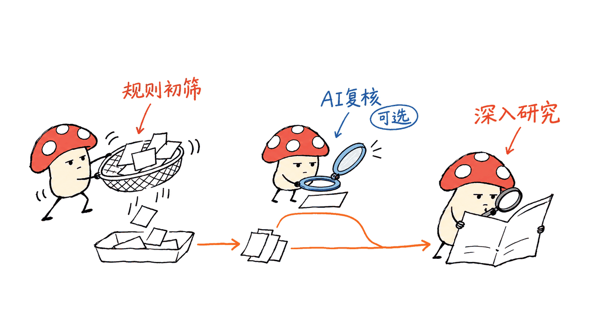
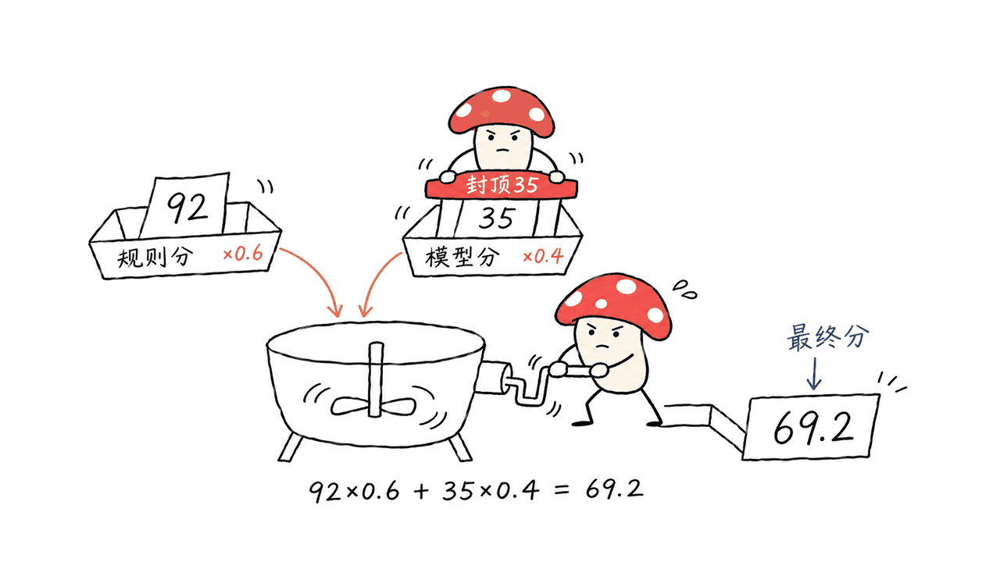

AlphaSift 把“每天看哪些股票”做成一条可回查的研究流水线：规则先筛候选，AI 可选复核，结果保存下来再跟踪。它的价值在于限制模型的职责，并让判断接受后续检验，不能据此把筛选分数等同于赚钱概率。

项目是 ZhuLinsen 的 `alphasift`，当前源码版本 0.3.0，采用 Apache-2.0。同作者的 `daily_stock_analysis`（DSA）确实是配套项目：我们在 2026 年 11 月 23 日读取 GitHub API 时，DSA 有 73,752 Stars。这个数字说明关注度，不是 AlphaSift 的收益记录。

## AlphaSift 与那个七万星项目如何分工？

DSA 适合“我已经有几个标的，帮我深入分析”；AlphaSift 处理更上游的候选发现。公开文档把 AlphaEvo 放在因子研究端，AlphaSift 放在筛选端，DSA 放在单股研究端。DSA 通过可选的 `DSA_API_URL` 接入，不是初筛的必需依赖。

这比让大模型从头讲一份市场故事更容易审查。先把市场范围、估值阈值、流动性、趋势条件写成 YAML，确定候选池；然后让模型做候选之间的解释与取舍；最后只对少量入围标的开展更贵的深度研究。每一步都有自己的输入和成本。

作者提供 12 套策略，覆盖 A 股及美、港、日、韩、台、印等市场，但覆盖深度并不相同。英文 README 明确说明，多个海外市场的 Yahoo 筛选器有市值门槛，依赖非官方端点；不能把“支持七个市场”理解为七个市场每只证券、每类公告都完整覆盖。



## “设计克制”体现在哪里？

第一层是确定性筛选。`--no-llm` 可以关闭模型排名，保留规则路线；这表示不需要模型 API Key，不表示不用联网。实时快照、日线、行业标签和新闻仍有数据依赖；没有可用本地数据时，也不会凭空变成离线系统。

第二层是受约束的语义判断。模型输出入选逻辑、风险、观察项和失效条件，而不是任意编造池外标的。若模型调用或解析失败，代码有退回筛选分数的路径。使用者应一起查看降级元数据，不能把回退结果当成已经获得模型复核。

第三层是代码执行的风险覆盖与行业分散。策略可设置行业桶硬上限，但“每桶最多一个”等约束取决于具体 YAML 配置和分类质量。把银行分成几个不同的名字，并不会自动消除它们共同承受的利率风险。

还有一个容易被宣传简化的细节：重大利空触发的 35 分上限，主要约束 `llm_score`，不是所有最终分数。源码随后把规则分与模型分按权重混合。例如规则分 92、模型分封顶 35、模型权重 0.4，混合结果仍是 69.2。它是一项可核查的降权规则，不是“风险股一定低于 35 分”，更不是保证识别所有坏消息。



## T+N 账本能证明策略有效吗？

把一次筛选保存成运行记录，再用后续交易日检验，比事后挑一张好看的上涨截图更有价值。但账本必须连同成交假设一起读。

当前使用指南写明，普通评估的默认入场口径是 `close`。显式选择 `next_open` 时，使用后续首根可用日 K 的开盘价入场，该根计为 T+1，第 N 根收盘作为计划退出价；基准按个股实际入场日和退出日对齐。缺少所需开盘价时，不能偷换成收盘价完成计算。

公开跟踪脚本又有一条版本边界：默认以 2026-11-21 为切换日，之前保留收盘口径，之后改用次日开盘并核算 A 股一字涨停不可成交情况。因此跨切换日的历史结果不能直接当作同一成交规则下的连续业绩。

作者还披露形态研究的样本量、成本、多重检验和分样本条件，目前九种形态仍标为 experimental。这种保留失败与未成熟状态的做法值得肯定；相关收益、重合度和统计结论仍是作者给出的研究结果，我们没有下载完整历史包独立复算。

我的判断是：这个项目更适合做“持续记录并质疑策略”的底座。研究还应核对退市样本、历史时点可得的基本面、公司行动、滑点、成交量限制及同一时期的调参次数。纸面跟踪没有完成这些工作之前，不能替代可执行组合的验证。


## 我们实际检查了什么？

Mycelium Protocol 固定源码提交 `d38bf412532a085aa48862255e9538249a536061`，在独立 Python 3.12 环境运行原仓库测试，未修改被测源码。第一组四个测试文件共 51 项通过，覆盖次日开盘评估、风险覆盖、MCP 和评分；模型排名测试另有 24 项通过，共 75 项。

这些测试使用合成行情、临时文件与模拟模型响应。次日开盘用例检查基准对齐、缺价、一字涨停、跌停退出延后等行为；MCP 用例包括工具列表、路径穿越拒绝、通知密钥脱敏与真实子进程的 STDIO 消息交换。它们证明这些受测分支遵守既定契约，不证明数据源长期稳定、模型能挑出赢家或部署已安全。

我们没有进行真实股票筛选、调用模型供应商、向通知渠道发消息、建立投资组合或运行完整历史回放。这里介绍的是可审计的工程设计和验证范围，不提供个股买卖建议。

## 从哪里开始比较合适？

先在隔离环境安装并查看策略，而非一上来开启所有定时推送。读懂 YAML 的硬条件、评分权重、行业桶和数据缺失处理，再运行小范围规则路线；把同一日同一候选池上的纯规则与 AI 复核分别保存，固定成交口径后持续比较。

```bash
alphasift screen dual_low --no-llm --save-run
alphasift evaluate-strategies --window 5,10,20 --entry-mode next_open --explain
alphasift serve --host 127.0.0.1 --port 8765
```

这些是官方接口示例，本次没有执行实时筛选。GitHub Actions 可安排定时运行，MCP 的十个工具用于代理查询和研究，Web 工作台用于查看结果；“只读工具”仍可能联网和写本地运行记录，不等于没有任何副作用。模型、行情与通知服务也各有成本和权限，不能把免费托管额度当成整个系统永远零成本。

## 常见问题

### 没有大模型 API Key 能用吗？

能。使用 `--no-llm` 走规则路线，DSA 也可不接。实时行情仍需要数据源，完整离线使用取决于本地数据是否齐备。

### 这是自动交易机器人吗？

不是。这里的主要输出是研究候选、解释、报告和评估记录，没有把候选名单自动变成券商订单的完整执行链路。

### 哪个数字最容易看错？

35 分是特定情况下模型评分的封顶值，最终分还会混合规则分；T+N 结果也必须区分 close 和 next_open，并确认缺价与不可成交样本如何处理。

## 来源与延伸阅读

官方仓库与许可证：https://github.com/ZhuLinsen/alphasift

当前提交的使用指南：https://github.com/ZhuLinsen/alphasift/blob/d38bf412532a085aa48862255e9538249a536061/docs/usage.md

评分实现：https://github.com/ZhuLinsen/alphasift/blob/d38bf412532a085aa48862255e9538249a536061/alphasift/ranker.py

配套单股分析：https://github.com/ZhuLinsen/daily_stock_analysis

相关工程阅读：https://blog.mushroom.cv/blog/netron-graph-source-checked-code-flow-guide/

---

> © 2026 Author: Mycelium Protocol. 本文采用 [CC BY 4.0](https://creativecommons.org/licenses/by/4.0/deed.zh) 授权——欢迎转载和引用，须注明作者姓名及原文链接，不得去除署名后以原创发布。

<!--EN-->

AlphaSift turns stock discovery into a research pipeline that can be inspected later: deterministic rules select candidates, optional AI reviews them, and saved runs are evaluated against subsequent prices. Its useful restraint is the separation of responsibilities. A screening score is not a probability of profit.

The project is ZhuLinsen/alphasift, version 0.3.0 at the inspected commit, licensed under Apache-2.0. The companion daily_stock_analysis (DSA) belongs to the same GitHub owner. Its GitHub API record showed 73,752 stars on November 23, 2026; that measures attention to DSA, not AlphaSift investment performance.

## How does AlphaSift fit beside DSA?

DSA starts with known stocks and investigates them individually. AlphaSift works upstream, discovering and comparing candidates. The author's ecosystem also places AlphaEvo in factor research. DSA is an optional L3 backend connected through DSA_API_URL, not a prerequisite for initial screening.

The separation makes the work easier to inspect. YAML defines the universe, thresholds, liquidity and trend conditions. An optional model compares the resulting shortlist, and deeper research is reserved for a smaller final set. Each stage has a distinct input and cost.

The repository supplies twelve strategies across China and six other markets, but market support does not imply identical coverage. The English README discloses market-cap floors and unofficial Yahoo screener dependencies for several non-China markets. Seven supported markets do not mean every listed security and announcement is represented.


## Where are the useful constraints?

The first stage is deterministic. The --no-llm flag disables model ranking, so a model API key is optional. It does not disable market-data dependencies or provide an offline dataset. Live snapshots, daily bars and contextual research require their own sources.

The model stage asks for structured theses, risks, watch items and invalidation conditions within the candidate pool. A model or parsing failure can fall back to screening scores. Inspect degradation metadata rather than treating fallback output as completed AI review.

Code then applies risk overlays and configurable portfolio diversification. Hard bucket caps depend on the strategy profile and classification quality; different labels can still conceal the same underlying exposure.

One important correction to a simplified marketing claim: the adverse-event cap of 35 primarily limits llm_score, not every final score. The ranker subsequently blends screening and model scores. With a screening score of 92, a capped model score of 35 and model weight 0.4, the blend remains 69.2. This is an inspectable penalty rule, not a promise that all risky candidates score below 35 or that every adverse event will be detected.


## What does the T+N ledger establish?

Saving a run before observing later prices is more informative than selecting an attractive historical chart. The entry and exit assumptions remain essential.

The current usage guide says ordinary evaluation defaults to close entry. Explicit next_open mode enters at the open of the first subsequent available daily bar, counts that entry bar as T+1, and uses the Nth bar's close as the planned exit. Benchmark dates align to the stock's actual entry and exit. Missing required opening prices must not be replaced silently with closing prices.

The public tracking script has a separate transition boundary. By default, runs before November 21, 2026 retain close entry; subsequent runs use next_open, including raw-price checks for untradable one-price limit-up entries in China. A series spanning that date is not a continuous record under one unchanged execution assumption.

The author also discloses sample-size, cost, multiple-testing and split-period requirements for pattern research. All nine current patterns remain experimental. Keeping immature or unsuccessful research visible is valuable. We did not independently recompute the author's full historical results or diversification claims.

Our assessment is that AlphaSift is a useful foundation for recording and challenging research decisions. Executable portfolio validation still needs scrutiny of delistings, point-in-time fundamentals, corporate actions, slippage, volume constraints and repeated tuning. A paper ledger alone does not supply that evidence.


## What did Mycelium Protocol actually verify?

We pinned commit d38bf412532a085aa48862255e9538249a536061 and ran original tests in an isolated Python 3.12 environment without editing the tested source. Four initial files produced 51 passing tests covering next-open evaluation, risk overlays, MCP and scoring. Another 24 ranking tests passed separately, for 75 passing tests in total.

These tests use synthetic market histories, temporary files and mocked model responses. Next-open cases cover benchmark alignment, missing prices, blocked entries and delayed exits. MCP cases include the tool catalog, path traversal rejection, notification-secret redaction and real subprocess STDIO exchanges. Passing establishes behavior in these exercised cases, not profitable selection, reliable live data or a comprehensive security audit.

We did not run live stock selection, contact model providers, send notifications, build a real portfolio or replay the full historical dataset. This article evaluates engineering boundaries rather than recommending securities.

## How should a researcher start?

Install in an isolated environment and inspect strategies before enabling scheduled notifications. Understand hard filters, scoring weights, diversification buckets and missing-data handling. Save rule-only and AI-reviewed runs for the same date and candidate pool, then compare them under fixed execution assumptions.

```bash
alphasift screen dual_low --no-llm --save-run
alphasift evaluate-strategies --window 5,10,20 --entry-mode next_open --explain
alphasift serve --host 127.0.0.1 --port 8765
```

These are documented command examples, not live runs performed for this article. GitHub Actions schedules work; ten MCP tools expose research functions; the local web workspace presents results. A read-only research tool can still fetch external data and write local run records. Model, data and notification services retain their own costs and permissions, regardless of free hosting allowances.

## FAQ

### Can it work without a model API key?

Yes. --no-llm selects the rule path, and DSA is optional. Live data still requires a source; complete offline operation depends on adequate local data.

### Does it place trades?

Its core outputs are research candidates, explanations, reports and evaluation records. It does not provide a complete brokerage order-execution pipeline.

### Which numbers need the most care?

The 35-point cap applies to a model score in specified adverse-event cases, while final scores blend components. T+N performance must distinguish close and next_open entry and disclose missing-price and untradable cases.

## Sources and related reading

Official repository and license: https://github.com/ZhuLinsen/alphasift

Pinned usage guide: https://github.com/ZhuLinsen/alphasift/blob/d38bf412532a085aa48862255e9538249a536061/docs/usage.md

Ranking implementation: https://github.com/ZhuLinsen/alphasift/blob/d38bf412532a085aa48862255e9538249a536061/alphasift/ranker.py

Companion research: https://github.com/ZhuLinsen/daily_stock_analysis

Related engineering reading: https://blog.mushroom.cv/blog/netron-graph-source-checked-code-flow-guide/

---

> © 2026 Author: Mycelium Protocol. Licensed under [CC BY 4.0](https://creativecommons.org/licenses/by/4.0/) — free to share and adapt with attribution. You must credit the author and link to the original; removing attribution and republishing as original is not permitted.
