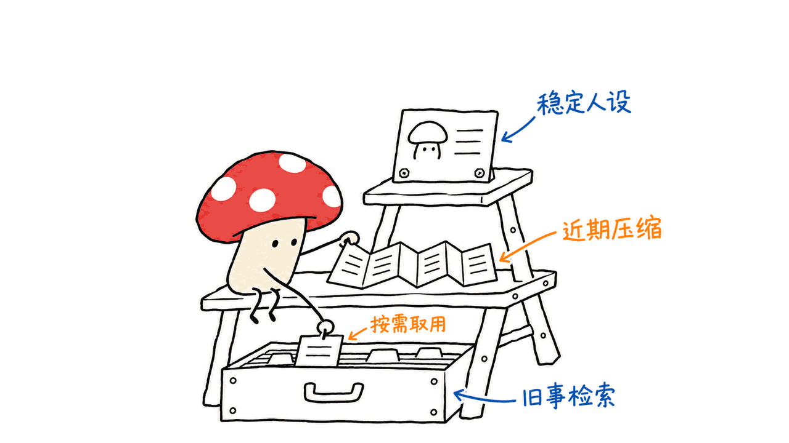
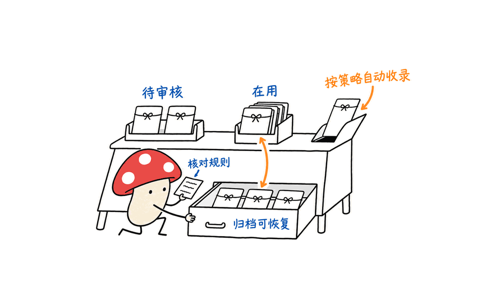

Amber Heart（琥珀之心）是一套给 AI 伴侣使用的长期记忆网关：聊天先经过它，再把人格、近期上下文和检索出的旧事组装给模型。它的价值在于把“记住、审核、调用、整理和归档”做成可管理的流程，而不只是往向量库里存聊天片段。

项目位于 lixiaomeng-eng/amber-heart-memory，采用 AGPL-3.0。本文核对了 README、配置与部分源码，并在隔离 Python 环境运行 78 项所选单元测试；没有完成数据库集成、真实模型召回、浏览器管理页或生产部署验收。

仓库：https://github.com/lixiaomeng-eng/amber-heart-memory
英文说明：https://github.com/lixiaomeng-eng/amber-heart-memory/blob/main/README.en.md

## 为什么把记忆放在聊天网关里？

它提供 OpenAI 兼容的 Chat Completions 接入地址。使用者在聊天 App 里填入记忆网关的 /v1 地址和空间访问钥匙；服务端负责保存对话、组装上下文，再转给主聊天模型。仓库另提供 /mcp，让支持该协议的客户端主动查记忆、记书签。

这样，记忆流程不必绑定某一个聊天界面。不过兼容边界仍然存在：官方接入说明要求使用 Chat Completions，关闭 Responses API。不能据此推断所有客户端、工具调用形式和流式变体都已经验证。

这也改变了数据的权威位置。客户端删掉一条消息，不代表网关里的记录和派生记忆随之删除。官方说明还指出，设置了网关人设后会替换客户端的系统提示词；客户端附带的世界书等内容也可能失效。

起标题、翻译等辅助请求最好直连另一条模型服务，否则它们也可能被当作聊天保存。工程接入时，应先明确哪些请求属于伴侣对话，再谈“透明代理”。

## 固定、短期、长期记忆分别装什么？

| 层次 | 主要内容 | 解决的问题 |
| --- | --- | --- |
| 固定记忆 | 人设、关系设定、核心画像 | 不让稳定设定被普通检索挤掉 |
| 短期记忆 | 书签、及时摘要、最近原话、近期日记 | 承接正在发生的事情 |
| 长期记忆 | 带类型、日期、主题和实体关系的卡片 | 按当前问题召回相关旧事 |

这三层不应理解成三个文件夹最终全塞进提示词。短期信息会压缩，长期信息要检索和筛选，固定信息则负责稳定设定。

卡片还区分外部现实、共同经历、梦境和想象等经历层。Mycelium Protocol 认为，这种来源与语境标记，比单纯追求“记得更多”更值得借鉴：一段虚构剧情不应在下次聊天时悄悄变成用户的现实经历。



## 三路召回和两级精排有什么作用？

关键词召回适合明确的人名、事件名和专有词；向量召回补充语义相近但没有原词的表达；图谱召回沿实体、主题和关系扩展候选。合并候选后，再通过精排模型和语言模型选择适合本轮注入的卡片。

它减少的是单一路径的盲点，并不天然保证更准。关键词可能误匹配，向量可能找来相似但无关的片段，图谱扩展又可能把一个错误关系带向更多候选。多路检索最终仍要检查相关性、冲突和信息来源。

项目为嵌入、关键词整理、精排、摘要、抽卡、日记等岗位提供独立配置。自托管的是记忆服务，不代表模型调用免费或全部离线；选用外部 API 时，相应查询或材料会交给所配置的提供商处理。

成本应按整个链路算：主聊天之外，还有逐轮检索和后台整理。可以从小规模材料开始，记录每个岗位的调用量与失败情况，再决定是否启用可选精排。本文没有调用真实模型，也不提供单轮费用或召回命中率。

嵌入模型和维度要作为数据版本管理。不同模型的向量不能直接混用；更换模型应规划全量重算，而不是只替换配置里的名字。


## 待审核是否意味着必须点确认才入库？

不是。按当前 README，夜间抽取出的卡片先进入待审核，用户可以修改、确认或拒绝；未处理的卡片默认会在约 48 小时后自动收录。源码按业务日和后台计划调度这一等待期，并不等于每张卡都有一个精确到秒的倒计时。

导入旧记录又是另一条路径：确认导入时，默认勾选“整理好后直接收录，不进待审核”。因此，不能把“有审核页面”写成“所有记忆都会经过人工审核”。部署前应分别检查日常抽卡和批量导入的收录策略。

长期维护同样需要明确语义。归档后的卡不参与日常召回，但正文与关系仍保留，可以恢复；归档不是删除。官方默认会清理较旧的聊天原话和及时摘要，但已生成的记忆卡、主题总结与日记不受同一清理规则影响。

还有一个容易误读的机制：系统会记录模型报告使用了哪些注入卡片，回复里的控制标签会被过滤，后台还有回执补判。它比“被检索到就算用过”更细，但模型报告和补判仍是代理信号，不能当成模型真正理解或正确使用记忆的独立证据。



## 工程上怎样接入和验收？

官方推荐常开的 Linux 服务器，使用 Docker Compose 部署应用与 PostgreSQL 17、pgvector，可选 Caddy 提供 HTTPS。部署文件把应用 HTTP 端口绑定在 127.0.0.1，并区分迁移所有者与应用数据库角色。安装需要准备域名、模型接口和管理密码。

下面只是官方安装入口，本次没有执行：

```bash
git clone https://github.com/lixiaomeng-eng/amber-heart-memory.git
cd amber-heart-memory
./install.sh
```

安装脚本会探测模型接口，可能产生请求和费用。建议先阅读配置示例和脚本，再填写自己的凭据；不要把工作用或私人聊天直接拿来做首次验收。

本次使用临时源码副本、Python 3.12 和独立虚拟环境，按锁定版本安装依赖。66 项所选测试覆盖配置、固定响应、导入格式、流式解析、召回辅助逻辑、部署配置和模型岗位超时等；另外 12 项检查覆盖使用回执解析与归档策略，共 78 项通过。

这些检查包含固定响应、模拟 HTTP 和合成输入，不依赖真实 API Key。它们证明了相应代码路径的行为，不证明情感理解、召回质量或完整服务可用。本机没有 Docker CLI，因此没有运行 PostgreSQL/pgvector 集成、迁移、完整网关、MCP 或浏览器验收。

仓库也明确表示，尚无公开的召回评测数字。作者的个人使用体验、模型选择与服务器容量描述应保留为作者经验，不能替换成我们的独立测量。

我的建议是用合成对话验收四件事：新偏好能否召回、旧偏好被更正后是否仍误用、拒绝或归档的材料是否按策略处理、梦境与现实是否混淆。保留原文、候选、最终注入和回复，才能定位问题来自提取、检索、筛选还是主聊天模型。

## 常见问题

### 这是一个新的聊天模型吗？

不是。它主要是记忆存储、管理、检索和聊天接入服务，主聊天和后台岗位仍使用配置的模型。它不会仅凭存储更多记录就让基座模型获得新能力。

### 自己部署，是否所有数据都留在自己的服务器？

不能这样推断。数据库可以自托管，但配置外部嵌入、整理、精排或聊天服务时，对应材料仍要发送给提供商。应按实际岗位与接口检查数据流向。

### 可以拿去商用吗？

仓库采用 AGPL-3.0，商业使用与再分发条件应按许可证原文核对，尤其是修改版通过网络提供服务时的源码提供义务。它不是 MIT 或 Apache 2.0。

核查日期：2026-11-18，源码版本与测试日志已留存。八张官方管理页截图使用作者声明的合成演示数据，本次已下载到媒体目录；封面与正文插图是概念示意，不是我们的部署截图。

配置参考：https://github.com/lixiaomeng-eng/amber-heart-memory/blob/main/.env.example
核心设计：https://github.com/lixiaomeng-eng/amber-heart-memory/blob/main/memory_core/README.md
许可原文：https://github.com/lixiaomeng-eng/amber-heart-memory/blob/main/LICENSE
相关头像工程：https://blog.mushroom.cv/blog/mesh-avatar-studio-live2d-motion-engineering-guide/

---

> © 2026 Author: Mycelium Protocol. 本文采用 [CC BY 4.0](https://creativecommons.org/licenses/by/4.0/deed.zh) 授权——欢迎转载和引用，须注明作者姓名及原文链接，不得去除署名后以原创发布。

<!--EN-->

Amber Heart is a long-term memory gateway for AI companions. Conversations pass through it so the service can combine stable persona information, recent context and retrieved memories before calling a chat model. Its useful scope is an inspectable lifecycle for capture, review, retrieval, consolidation and archiving, rather than merely storing chat fragments in a vector database.

The repository is lixiaomeng-eng/amber-heart-memory, licensed under AGPL-3.0. We reviewed its documentation and selected source paths and ran 78 selected unit tests in an isolated Python environment. We did not validate database integration, real-model recall quality, the browser dashboard or a production deployment.

Repository: https://github.com/lixiaomeng-eng/amber-heart-memory
English README: https://github.com/lixiaomeng-eng/amber-heart-memory/blob/main/README.en.md

## Why put memory in a chat gateway?

A client uses the gateway’s /v1 base URL and a space access key for OpenAI-compatible Chat Completions. The gateway stores conversation state and assembles context before forwarding a request. Its /mcp endpoint separately supports active memory lookup and bookmarks.

Compatibility is bounded: the documented setup uses Chat Completions with Responses API disabled. This does not establish compatibility with every client or streaming/tool-call variation.

The server becomes a separate authority for history. Deleting a message in the client does not delete gateway records and derived memories. A configured gateway persona also replaces the client’s system prompt, which can invalidate client-side world-book assumptions. Auxiliary title-generation or translation calls should use a separate route so they do not become companion conversation records.

## What belongs in each memory layer?

| Layer | Contents | Purpose |
| --- | --- | --- |
| Fixed | Persona, relationship settings and core profile | Preserve stable context |
| Short-term | Bookmarks, summaries, recent turns and diaries | Maintain current continuity |
| Long-term | Typed, dated cards with topics and entity relations | Retrieve relevant past context |

These are not three folders whose entire contents are always injected. Recent context is compressed and long-term cards are selected. Experience labels distinguish external reality, shared experiences, dreams and imagination. Mycelium Protocol considers those context labels useful engineering: fictional scenes should not silently become real-world user facts.


## What do three recall routes and two ranking stages add?

Keyword recall helps explicit names and terms; vector recall handles semantic similarity; graph recall expands through entities, topics and relations. Merged candidates can then pass through a document reranker and a language-model selector.

More routes do not guarantee better results. Each can introduce irrelevant candidates or propagate a mistaken relationship. Relevance, conflicts and provenance still need evaluation.

Embedding, query cleanup, ranking, summarization, extraction and diaries have separate configuration. Self-hosting the memory service does not make model inference free or offline. External providers receive the relevant inputs for their assigned roles. Measure role-level calls and failures on a small corpus before enabling every stage. No live-model cost or recall metric is claimed here.

Treat embedding model and dimension as data-version choices. Changing models requires a re-embedding plan; vectors from different models cannot be mixed merely by editing a model name.


## Does a review page mean every memory is manually approved?

No. The README says nightly extractions enter review, but unattended drafts default to automatic admission after roughly 48 hours. Source code schedules that interval using business days and background runs rather than an exact per-card timer.

Imports use another policy. Confirmation defaults to admitting successfully organized materials directly, bypassing review. Review availability should therefore not be described as mandatory human approval of all memories.

Archiving also differs from deletion. Archived cards retain content and relations and can be restored. Retention of raw messages and short summaries is separate from retention of derived cards, topic summaries and diaries.

The system records model-reported use of injected cards, filters the control markers from visible replies, and supports background judging of missing receipts. This is more specific than equating retrieval with use, but reporting and judging remain proxy signals, not independent proof of correct understanding.


## How should engineers deploy and evaluate it?

The documented deployment targets an always-on Linux host with Docker Compose, PostgreSQL 17, pgvector and optional Caddy HTTPS. The application’s HTTP port binds to loopback; migration and application database roles are separate. Setup needs a domain, provider configuration and an administrator password.

This is the official entry point; it was not executed here:

```bash
git clone https://github.com/lixiaomeng-eng/amber-heart-memory.git
cd amber-heart-memory
./install.sh
```

The installer probes model APIs and can incur usage. Read the configuration and script before supplying credentials, and use synthetic conversations for initial acceptance.

We installed pinned dependencies in a separate Python 3.12 environment. Sixty-six selected tests covered configuration, fixed responses, import formats, stream parsing, recall helpers, deployment settings and role timeouts. Twelve further checks covered usage-receipt parsing and archive policy: 78 passed in total.

These tests use fixed responses, mock HTTP and synthetic inputs. No real API key was used. Docker CLI was unavailable, so we did not run PostgreSQL/pgvector integration, migrations, the complete gateway, MCP or browser acceptance. The repository itself has no published recall benchmark. Author experience and capacity anecdotes are not our measurements.

Our proposed acceptance cases are a newly learned preference, a corrected preference, rejected/archived material, and separation of fictional from real events. Retain source text, candidates, injected context and replies to locate failures across extraction, retrieval, selection and generation.

## FAQ

### Is this a new chat model?

No. It supplies memory storage, management, retrieval and chat integration. Configured models still perform conversation and background processing; additional stored history does not change the base model’s capabilities.

### Does self-hosting keep every input on my server?

No blanket claim is justified. External embedding, ranking, writing and chat providers process their configured inputs. Inspect each role’s actual endpoint and data flow.

### Is commercial use permitted?

The project uses AGPL-3.0. Check the actual license for use, redistribution and modified network-service source obligations. It is not MIT or Apache 2.0.

Reviewed November 18, 2026. Source revision and logs are retained. Eight official dashboard screenshots use author-declared synthetic demo data and were downloaded for reference. The cover and body figures explain concepts and are not our deployment screenshots.

Configuration: https://github.com/lixiaomeng-eng/amber-heart-memory/blob/main/.env.example
Core design: https://github.com/lixiaomeng-eng/amber-heart-memory/blob/main/memory_core/README.md
License: https://github.com/lixiaomeng-eng/amber-heart-memory/blob/main/LICENSE
Related avatar engineering: https://blog.mushroom.cv/blog/mesh-avatar-studio-live2d-motion-engineering-guide/

---

> © 2026 Author: Mycelium Protocol. Licensed under [CC BY 4.0](https://creativecommons.org/licenses/by/4.0/) — free to share and adapt with attribution. You must credit the author and link to the original; removing attribution and republishing as original is not permitted.
