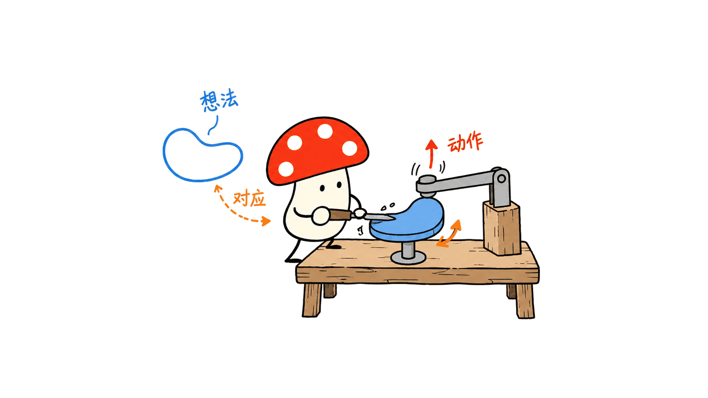
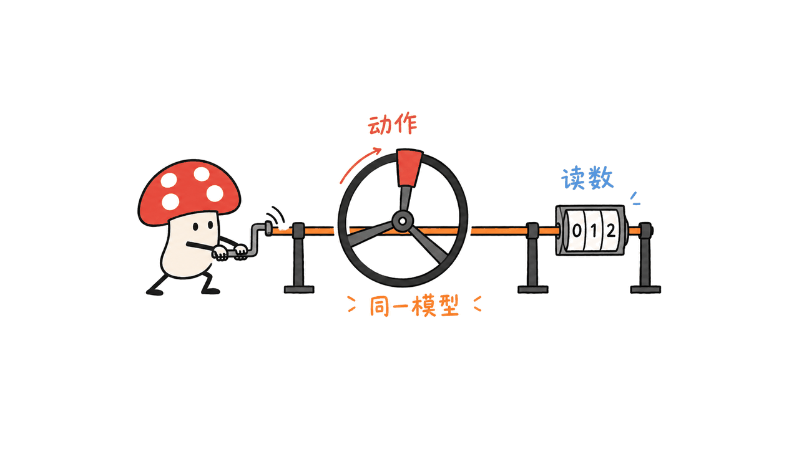
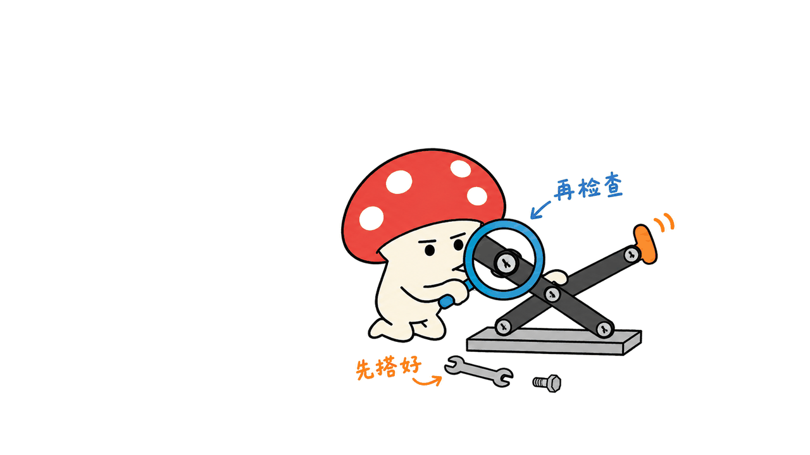

Anatomy 是一个把技术概念变成可操作机器的绘图技能，适合为文档、文章和产品页面制作交互解释图。Ryan 在 `wheresryan22/anatomy` 发布了这套面向 Claude Code 的 MIT 项目：你描述想解释的机制，Claude 设计一个物理隐喻，再写出组成它的图形与行为代码。

官网当前展示 33 个在线作品，仓库则包含八个完整示例。它的价值在于让读者操作一个会回应的对象；“输入一句想法”描述的是任务入口，不能理解成几秒钟生成最终成品。

官方作品集：https://skills.wheresryan.sh/anatomy
代码与技能：https://github.com/wheresryan22/anatomy

封面采用项目 README 中的发动机测试台与波纹水槽截图，展示 SVG 装置与 WebGL 效果的结合。原图来自 Ryan 的 MIT 仓库。

## 为什么要把概念做成机器？

普通方框图能列出部件，却常把“部件如何工作”留给读者想象。Anatomy 要求先找到一个可辨认的物件，让它的动作对应要解释的规则。

官方给出的映射包括：缓存键是否匹配，对应锁芯里的销钉是否全部对齐；一个 GPU context 服务多个 canvas，对应同一个绘图头依次访问多个工位。官网的 LRU 缓存则用书架表示，位置变化说明最近使用的条目与被淘汰的条目。

这里最值得借鉴的不是等轴外观，而是隐喻需要可检查。如果解释的是一个容量为 10 的连接池，借出、归还和等待就应该受同一个容量规则驱动，而不是让读数写“10”，画面却出现任意数量的对象。



我们的判断是：它更适合解释状态、资源分配、阈值和反馈这些有明确机制的问题。若只是罗列功能，或概念难以找到合理的物理对应，精致机器反而可能让读者记住装置而误解系统。

## 33 个作品和八个示例有何区别？

官网在 2026 年 10 月 9 日的介绍页标注 33 个在线 figure，并提供作品集入口。这是作者网站的展示数量，不能写成“仓库内置 33 套可复用模板”。

本次核对的仓库 commit 为 `dbf697a527bbf7d358668e1557cb1e35ff725d46`。README 与 SKILL.md 一致列出八个完整示例：百分表、桌面电脑、街机、发动机测试台、波纹水槽、测试架、点滴板和可转动刻度盘。

其中测试架与点滴板采用 React/Next.js；其余示例提供 Node 构建脚本和提交好的 HTML 页面。示例的体量也不同：百分表约 300 行；桌面电脑约 85 个实体；街机约 240 个实体与 15 条线缆。以上均是官方介绍的规模，不是我们重新统计的性能指标。

## 它交付的是图片还是代码？

| 模式 | 交付与作用 | 需要注意 |
| --- | --- | --- |
| SVG | 独立 HTML、内嵌样式的 SVG，或 React/Next.js 组件；呈现实体、阴影与交互 | 不是统计图表库，不提供常规坐标轴与数据序列 |
| SVG + WebGL | 火焰、水面、焦散或灯光等 shader 放在前后 SVG 层之间 | 需要浏览器 WebGL；缺失时 SVG 仍应可读 |
| 3D，beta | 转动部件每帧重新投影、着色与排序 | 实验性路径，构建及审计成本更高 |

所有模式都共享绘图 kit、相机和制作规则：部件按深度绘制，四档明暗表达体积，关键活动部件用一个强调色突出。标题、提示和实时读数放在画框周围，避免绘图内部塞满标签。

因此它与生成 PNG 的技能不同。读者拿到的是可以检查、修改和部署的源代码与页面。团队后续仍需维护状态逻辑、组件边界、浏览器兼容性和性能。

## 数字与动作如何保持一致？

项目的核心要求是：运动、实时读数、无障碍描述和说明文字应来自同一个小模型。百分表中，测量头接触不同高度的量块，指针和数值都根据对应高度改变。

这比各自写一段动画与一段文案更稳妥。独立维护两套值时，修改容量或阈值很容易只改到一边；把规则集中到纯函数或小模块，能让视觉行为与读数一起更新。



但一致性仍不是正确性的全部。程序可以一致地实现一个错误公式。使用前要先给出真实数量、单位、阈值和状态转换，再判断这台“解释机器”是否忠实表达它们。

## 本地验证了什么？

我们在本机 Node.js `v26.10.0` 环境中重建了官方百分表示例的明暗两种 HTML。重建后对照仓库，页面没有产生差异；不需要安装项目 npm 依赖。

随后使用仓库自带的 headless Chrome 工具运行页面。浅色、减少动画模式下，`Home` 回到量块 1，读数为 18.0px；`End` 移到量块 3，读数为 10.0px；再按 `ArrowRight`，移到量块 2，读数为 14.0px。第二量块的 `aria-valuetext` 与可见读数一致。这里的 px 是示例的模型尺寸，不能当作实际传感器的毫米精度。

桌面截图检查未发现横向溢出，控制台无错误；另检查了 390px 宽的深色页面，同样未发现横向溢出或控制台错误。这证明已提交的小示例可以构建并响应操作，不能证明 Claude 从零生成任意新图都同样正确。我们也没有跑发动机的完整几何审计、全部 WebGL 检查或 3D 的全角度审计。

你可以在这份保留 MIT 许可的官方示例镜像中亲自操作百分表：
https://blog.mushroom.cv/explainers/anatomy-dial-indicator.html

请求动作、浏览器输出及截图已保存。对于项目声称的“几何审计证明”，本文只介绍其目的：发现穿插、端点脱离支座或深度排序错误；没有把作者对复杂示例的检查结果当作本次实测。

## 如何安装与写提示词？

用户素材里的安装命令末尾有一个 `|`，完整命令不需要它。面向个人 Claude Code 的官方示例是：

```bash
npx skills add wheresryan22/anatomy -g -a claude-code
```

仅为当前项目安装时，README 给出的命令是：

```bash
npx skills add wheresryan22/anatomy
```

随后可以这样描述任务：

```text
/anatomy explain how a connection pool works:
10 connections, requests borrow and return them;
new requests wait when all 10 are busy.
interactive, standalone HTML, light theme
```

提示词先写要解释的规则，再写是否交互、输出格式和主题。如果需要 shader 或真正转动的部件，额外指定 `WebGL` 或 `3D`。这里的连接池提示只是建议任务，本文未把它写成已生成的作品。

绘图 kit 与构建脚本要求 Node.js 20.10+；README 另外指出，skills CLI 1.7.1 要求 Node.js 22.20 或更新版本。不要把这两个依赖边界合并。Chrome/Chromium 用于截图与检查，React 18+ 只在 React 输出时需要。

“无需 API key、无 npm 依赖”主要描述该 kit 的执行方式；它不意味着 Claude Code 的模型使用免费或离线。

## 最容易低估的成本是什么？

官方把任务分为三档：Figure，40–80 个部件，估计 30–90 分钟；Hero，80–150 个部件，估计 2–4 小时；Epic，整车、建筑或工厂级多系统，6 小时以上。它们是作者的工作预算，不是我们的计时保证。

耗时主要来自部件清单、世界坐标、构图、遮挡顺序、几何审计和局部截图检查。真正的 3D 更贵：README 举例称 30 个部件的完整 orbit audit 就需 15–20 分钟，复杂场景不能据此默认有流畅性能。



如果目标是让读者理解缓存淘汰或连接等待，建议先做一个 SVG 机制，确认读者能用它回答关键问题，再增加 shader 或 3D。精细部件数量是制作约束；学习效果还需要用真实读者的理解结果检验。

这也解释了 Anatomy 值得关注的地方：它把 AI 配图从“生成一张好看图片”推进到“编写一个能操作、能检查的解释对象”。适合投入到反复使用的技术文档与教学材料，也要给实现和验证留足预算。

## 常见问题

### Anatomy 是绘图模型吗？

它是 Claude Code 的 Agent Skill，包含制作指令、绘图库与示例。绘图和行为由代码实现，不是一个单独下载运行的图像生成模型。

### 33 个 figure 都在 GitHub 仓库里吗？

不是。33 是官网当前在线作品集数量，仓库 README 列出八个完整示例。下载仓库不等于取得作品集的全部实现。

### 可以直接用于 React 页面吗？

官方提供 React/Next.js 组件路径与两个相关示例。静态绘图和客户端行为需要按组件边界接入，并核对自身构建与浏览器环境。

来源，核对日期 2026-10-11：
https://github.com/wheresryan22/anatomy
https://skills.wheresryan.sh/anatomy
https://github.com/wheresryan22/anatomy/blob/main/SKILL.md
https://github.com/wheresryan22/anatomy/blob/main/LICENSE

---

> © 2026 Author: Mycelium Protocol. 本文采用 [CC BY 4.0](https://creativecommons.org/licenses/by/4.0/deed.zh) 授权——欢迎转载和引用，须注明作者姓名及原文链接，不得去除署名后以原创发布。

<!--EN-->

Anatomy is a drawing skill that turns technical concepts into interactive machines for documentation, articles and product pages. Ryan's MIT-licensed `wheresryan22/anatomy` project targets Claude Code: describe the mechanism, let Claude invent a physical metaphor, and receive geometry and behavior as code.

The official website currently showcases 33 live figures, while the repository includes eight complete examples. A one-line idea is the entry point to a build process, not a promise of a finished artifact in seconds.

Gallery: https://skills.wheresryan.sh/anatomy
Repository: https://github.com/wheresryan22/anatomy

The cover uses Ryan's official README images of a rocket-engine test stand and ripple tank, combining SVG apparatus with WebGL effects. The images come from the MIT repository.

## Why turn a concept into a machine?

A box diagram names components but often leaves their behavior to the reader's imagination. Anatomy asks for a recognizable object whose movement embodies the rule being explained.

Official examples map cache-key matching to aligning the pins in a lock, and one GPU context serving multiple canvases to one plotter head visiting multiple stations. The website's LRU explanation uses a bookcase to show recency and eviction through position.

Our interpretation is that the useful part is the checkable mapping. For a pool of ten connections, borrowing, returning and waiting should obey the same capacity model. A readout saying ten beside arbitrarily many moving objects would undermine the explanation.


This approach suits state transitions, allocation, thresholds and feedback. A beautiful machine can mislead when its physical analogy does not faithfully represent the actual system.

## How are 33 gallery figures different from eight examples?

The official introduction dated October 9, 2026 states that its online collection has 33 live figures. That is a website showcase count, not a claim that the repository ships 33 reusable templates.

We checked commit `dbf697a527bbf7d358668e1557cb1e35ff725d46`. Its README and SKILL.md list eight complete examples: dial indicator, desk computer, arcade cabinet, Raptor engine, ripple tank, test rig, spot plate and turning dial.

Test rig and spot plate use React/Next.js. The other examples provide Node build scripts and committed HTML pages. Their scale varies: the publisher describes roughly 300 lines for the dial example, 85 solids for the desktop computer, and 240 solids plus 15 cables for the arcade cabinet. These are attributed size descriptions, not our performance measurements.

## Is the output an image or a program?

| Mode | Output and purpose | Constraint |
| --- | --- | --- |
| SVG | Standalone HTML, styled SVG, or React/Next.js components with solid geometry and interaction | It is not a statistical chart library |
| SVG + WebGL | Shader effects such as flames, water or light placed between back and front SVG layers | Requires WebGL; SVG should remain readable without it |
| 3D, beta | Moving parts re-projected, shaded and sorted every frame | Experimental, with greater build and audit costs |

All modes share a kit and camera. Depth ordering produces correct occlusion; four shading tones express volume; one accent identifies the subject to watch. Titles, hints and readouts sit around the frame rather than crowding the machine itself.

Unlike a PNG-generation workflow, this delivers source and a page that can be inspected, changed and deployed. A team still owns the state logic, integration, compatibility and performance work.

## How do movement and numbers stay consistent?

The project's central requirement is that motion, live values, accessibility text and captions read from one small model. In the dial example, the plunger contacts blocks of different heights, and the needle and readout respond to those heights.

A shared model is less fragile than maintaining separate animation and caption values. Updating a threshold or capacity should update the visual behavior and readout together.


Consistency does not establish scientific correctness. A program can consistently implement the wrong formula. Supply the true quantities, units, thresholds and state transitions before judging the metaphor.

## What did we verify locally?

On Node.js `v26.10.0`, we rebuilt the official dial-indicator HTML in both themes without installing npm dependencies. The rebuilt pages produced no difference against the repository versions.

Using the repository's headless Chrome tools, we operated the light page under reduced motion. `Home` selected block one at 18.0px; `End` selected block three at 10.0px; `ArrowRight` then selected block two at 14.0px. For block two, `aria-valuetext` matched the visible readout. These pixel units belong to the example model, not a claim of physical measurement accuracy.

The desktop capture reported no horizontal overflow or console errors. We also checked a dark page at a 390px viewport, retaining the browser log. This validates rebuilding and operating one committed example, not Claude's ability to generate an arbitrary new figure correctly.

We did not run the complete engine geometry audit, all shader checks or a full 3D orbit audit. The publisher's audit targets intersections, unattached endpoints and depth-order errors; its results on complex examples remain publisher evidence rather than our own reproduced measurement. Try the official example mirrored with its MIT notice:
https://blog.mushroom.cv/explainers/anatomy-dial-indicator.html

Actions, screenshots and console output have been retained.

## How do you install and prompt it?

The trailing pipe in the submitted command is unnecessary. The official user-level Claude Code installation is:

```bash
npx skills add wheresryan22/anatomy -g -a claude-code
```

For a project installation:

```bash
npx skills add wheresryan22/anatomy
```

A useful prompt describes the rule before the drawing:

```text
/anatomy explain how a connection pool works:
10 connections, requests borrow and return them;
new requests wait when all 10 are busy.
interactive, standalone HTML, light theme
```

Specify output location, interaction and theme; add `WebGL` or `3D` when needed. This connection-pool prompt is a suggested task, not a figure we generated during this review.

The kit requires Node.js 20.10+. Separately, the README states that skills CLI 1.7.1 needs Node.js 22.20 or later. Chrome/Chromium powers checks, and React 18+ is needed only for React output. The kit's no-API-key and no-npm-dependency statements do not make Claude Code model use free or offline.

## What does the production budget look like?

The publisher estimates 30–90 minutes for a Figure with 40–80 parts, 2–4 hours for a Hero with 80–150 parts, and six hours or more for a multi-system Epic. These are workflow budgets, not timings we reproduced.

Parts lists, layout, occlusion, audits and close-up review account for much of the work. True 3D can be expensive: the README reports 15–20 minutes for a complete orbit audit with 30 parts. A complex scene also cannot be assumed to run smoothly merely because a simpler example does.


For cache eviction or connection waiting, start with one SVG mechanism and test whether readers can answer the intended question. Add shaders or 3D after the explanatory mapping works. Part count is a production constraint; understanding needs validation with real readers.

Anatomy makes AI illustration into the authoring of an inspectable, operating explanation object. That suits reusable documentation and teaching materials, provided implementation and verification receive a realistic budget.

## FAQ

### Is Anatomy an image model?

It is an Agent Skill for Claude Code, including instructions, a drawing kit and examples. Code produces the geometry and behavior; it is not a separately downloaded image-generation model.

### Are all 33 figures included in GitHub?

No. Thirty-three is the current online collection count. The README lists eight complete repository examples.

### Can it be used in React?

The project provides a React/Next.js path and two related examples. Integrate static geometry and client interaction at appropriate component boundaries and verify your own environment.

Sources checked on October 11, 2026:
https://github.com/wheresryan22/anatomy
https://skills.wheresryan.sh/anatomy
https://github.com/wheresryan22/anatomy/blob/main/SKILL.md
https://github.com/wheresryan22/anatomy/blob/main/LICENSE

---

> © 2026 Author: Mycelium Protocol. Licensed under [CC BY 4.0](https://creativecommons.org/licenses/by/4.0/) — free to share and adapt with attribution. You must credit the author and link to the original; removing attribution and republishing as original is not permitted.
