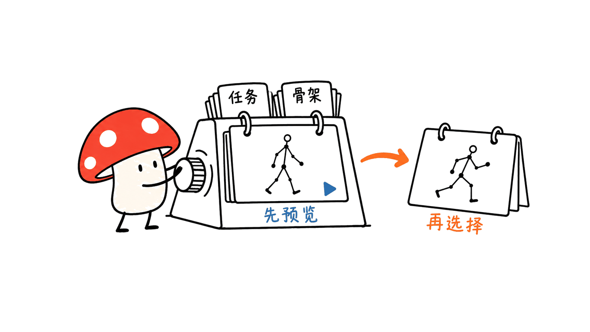
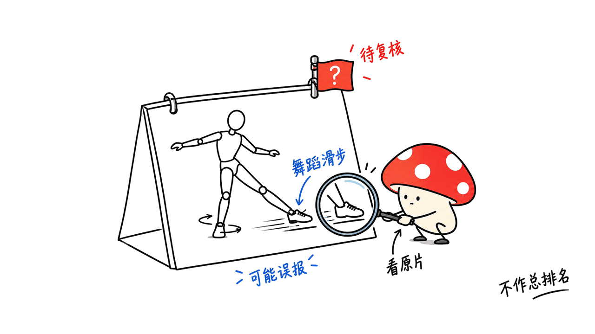

awesome-animation-datasets 把分散的动作数据集整理成可比较的清单，并提供浏览器里的短片预览。对动画、角色控制和动作生成研究来说，它能帮助先看运动是否符合任务，再决定去哪个原始数据源申请或下载。

仓库是 Shimingyi/awesome-animation-datasets，在线界面是 Hugging Face 的 myshi/motion-viewer。本文固定提交 `4d4abf35b33f2b5a429671b668d83d9973da1750`，核对目录、数据 schema、质量结果 JSON 和预览生成说明；未重新下载各数据集或运行质量指标。

仓库：https://github.com/Shimingyi/awesome-animation-datasets

在线预览：https://huggingface.co/spaces/myshi/motion-viewer

直接打开应用：https://myshi-motion-viewer.static.hf.space/

## 44 个数据集，2,355 小时怎么理解？

固定版本的主列表写有 44 个数据集、2,355 小时动作和 278,246 个片段；另有 7 个、约 1,179 小时的谨慎使用项，不计入主列表。人体、动物、物体与机器人同在清单中，不能把所有时长都看成人体角色训练数据。

时长还区分原始记录与重新标注、重定向的派生版本，尽量避免重复累加；镜像副本也不重复计入。多人同场采集按每个人的运动时间计算，一小时双人动作可以计为两个人时。不同资源的时长来自论文、主页或作者的测量，不一定采用同样的原始统计方法。

这让它比单纯堆链接更方便，但 44 个条目也不等于 44 份统一许可、统一骨架、统一质量的可直接混训资产。



## 预览能做什么，不能代替什么？

Motion Viewer 是 three.js 静态网页，可用骨架、胶囊、SMPL/SMPL-X 身体或带纹理的绑定网格显示动作。文档支持最多六片对照、跟随关节、绘制轨迹、调整上轴与放到地面。

线上每个数据集展示约十个短例子。维护者会截取片段、重采样到不超过 30fps、处理开头 T-pose 等情况，生成供浏览的材料。因此预览足以发现明显的滑步或动作风格，却不能证明全库质量，也不一定保留原始采样率和导出状态。

“放到地面”和去掉根节点水平运动是查看辅助。尤其在审查漂浮、根漂移时，应保留原始参考再切换这些选项，避免显示调整掩盖问题。

本次对 Space 页面及其直接静态应用做了访问核对，直接应用返回 200，并读到播放、循环、速度、原地和贴地控件。没有据此声称已实际播放所有数据集、验证全部网格或六路对照性能。

## 九项质量红旗是在打总分吗？

不是。2026 年 10 月 20 日的结果文件包含 45 个人体数据集的检查信息，这个范围与主列表总数不同。文档方法是从完整发布中随机抽取约 100 个十秒窗口，统一到 30fps、米制世界关节，再用身体分段质量模型检查。

| 红旗 | 提醒检查的问题 |
| --- | --- |
| Residual | 动作需要多大的非物理加速度或不合理支撑 |
| Float | 承重脚是否长期离开地面 |
| Slide | 着地脚是否仍横向滑动 |
| Jitter | 高频抖动占比；低采样率数据不一定可测 |
| Drift / Pair gap / Tilt | 地面漂移、多人地面不一致和地面倾斜 |
| ROM / Self-pen | 关节不合理角度与明显自穿透 |

指标先对窗口设阈值，再看超阈值窗口占比。固定结果文件的标记比例阈值为 25%；这不是“25% 都是不合格”的统一判决，也不是跨数据集排名。部分条目的实际有效窗口数可能少于 100。

舞蹈转轴、刻意滑步、去掉根运动的数据、楼梯、斜坡、椅子或床上的动作，都可能触发误报。没有红旗也不能证明运动真实、语义标签正确，或适合你的机器人动力学约束。



质量结果：https://github.com/Shimingyi/awesome-animation-datasets/blob/4d4abf35b33f2b5a429671b668d83d9973da1750/docs/assets/quality.json

## 代码开源，动作数据就能商用吗？

不能这样推导。仓库代码是 MIT，清单和生成页面是 CC BY 4.0；被链接的数据集继续使用各自原有许可。在线例子也注明仅供非商业研究和参考，不是在统一重新授权全部动作数据。

例如，仓库的 LAFAN1 元数据标注 CC BY-NC-ND 4.0，`commercial: false`。最终使用仍要回到原始作者的当前条款，检查训练、修改、输出分发和商业项目是否允许。把 MIT 写在自己的工具仓库，不能覆盖上游数据或身体模型的限制。

## 给工程团队的一套选数流程

我的建议是先写清任务：语音手势、长时行走、多人交互、手指细节还是机器人模仿。再用四个条件缩小候选：表示格式与骨架、动作类型、标注和采样率、实际使用许可。

第三步看原始片段与红旗原因，抽查几个常见动作和极端动作。第四步用小批量接入自己的管线，核对上轴、单位、根运动、关节映射与帧率；通过后再考虑全库转换和训练。

仓库还提供本地 motion vault 接入路线，可把自己的 BVH、AMASS npz、HumanML3D 等转换到统一浏览存储。这是方便审查的工具链，不代表转换后自动获得训练所需的统一语义和物理正确性。

```bash
python -m tools.vault.ingest /data/lafan1 lafan1 --root ~/motion_vault
python -m tools.vault.server --root ~/motion_vault
```

命令来自官方文档，需要先配置仓库环境和合法取得的数据；本次未执行导入。我们实际核对了质量 JSON 的 45 个条目与九项阈值，不能把读取作者结果写成重跑 45 个数据集。


我的判断：这个项目最有价值的是把“找数据、看样子、查质量和查许可”连到一起。它缩短选型过程，但不会替代原始数据验证，也不应该被包装成一个通用动作质量排行榜。

元数据规范：https://github.com/Shimingyi/awesome-animation-datasets/blob/4d4abf35b33f2b5a429671b668d83d9973da1750/data/SCHEMA.md

预览制作方法：https://github.com/Shimingyi/awesome-animation-datasets/blob/4d4abf35b33f2b5a429671b668d83d9973da1750/docs/EXAMPLES.md

相关的程序化视频制作工具介绍：https://blog.mushroom.cv/blog/onetake-envmanage-source-check/

## 常见问题

### 这是一个能直接下载全部动作的数据集吗？

不是。它是资源清单、质量审查结果与短片查看器；完整数据需从各自作者的来源获取。

### 红旗多的数据集就不能用吗？

红旗是检查线索。舞蹈、特殊地形和刻意滑步可能产生误报，应结合任务与原始片段判断。

### MIT 是否允许把所有预览拿去训练？

MIT 适用于工具代码，不替代动作数据、身体模型和预览内容的各自条款，应逐项核对授权。

---

> © 2026 Author: Mycelium Protocol. 本文采用 [CC BY 4.0](https://creativecommons.org/licenses/by/4.0/deed.zh) 授权——欢迎转载和引用，须注明作者姓名及原文链接，不得去除署名后以原创发布。

<!--EN-->

awesome-animation-datasets organizes motion resources into a comparable catalogue with short browser previews. It helps animation, character-control and motion-generation teams inspect candidate data before visiting the original source to obtain it.

The repository is Shimingyi/awesome-animation-datasets, with a Hugging Face Space at myshi/motion-viewer. This review pins `4d4abf35b33f2b5a429671b668d83d9973da1750`. We checked documentation, schema, published quality JSON and preview methodology; we did not download every dataset or recompute metrics.

Repository: https://github.com/Shimingyi/awesome-animation-datasets

Space: https://huggingface.co/spaces/myshi/motion-viewer

Direct app: https://myshi-motion-viewer.static.hf.space/

## What do the catalogue totals mean?

The pinned main list reports 44 datasets, 2,355 motion hours and 278,246 clips. Seven caution entries totaling about 1,179 hours are listed separately. The catalogue spans humans, animals, objects and robots; its aggregate hours are not all human character-training material.

It avoids counting mirrored copies and certain relabeled or retargeted derivatives twice. Motion hours are per performer: a one-hour two-person take can contribute two person-hours. Source numbers may come from papers, homepages or maintainer measurements rather than a single uniform counting method.

The list is a discovery aid, not 44 uniformly licensed, uniformly represented training sets.


## What can previews establish?

The static three.js viewer supports skeletons, capsules, SMPL/SMPL-X bodies and textured rigged meshes. Its documented controls include up to six comparisons, joint tracking, trajectories, up-axis adjustment and floor placement.

Online examples are roughly ten short clips per dataset. Maintainers crop and bake them, resample to at most 30fps and may remove a leading T-pose. These are useful visual samples, not unmodified complete releases or proof of whole-dataset quality.

Floor alignment and removing horizontal root travel can make viewing easier, but may hide the very drift or floating problem under inspection. Compare against original coordinates when auditing motion quality.

We checked the Space and direct static app. The app returned HTTP 200 and exposed playback, loop, speed, in-place and floor controls in its HTML. We did not validate playback of every dataset, all meshes or six-way performance.

## Are the nine red flags a quality leaderboard?

No. The October 20 result file contains 45 human-dataset entries, a different scope from the main catalogue total. The stated procedure samples about 100 ten-second windows from each full release, converts to world joints in metres at 30fps and uses a body-segment mass model.

The nine thresholds cover physical residual, floating, foot sliding, high-frequency jitter, floor drift, pair floor gap, tilt, range of motion and self-penetration. A metric is flagged when the share of windows above its threshold exceeds 25%; some entries have fewer valid windows.

That does not mean a universal fraction of the data is unusable. Dance pivots, deliberate sliding, root-removed releases, stairs, slopes and unseen supports can trigger false alarms. No flag also does not establish correct labels, realism or suitability for a robot's dynamics.


Quality results: https://github.com/Shimingyi/awesome-animation-datasets/blob/4d4abf35b33f2b5a429671b668d83d9973da1750/docs/assets/quality.json

## Do open tools make all motion commercially reusable?

The code is MIT; the catalogue and generated pages are CC BY 4.0. Every linked dataset retains its own license. The online excerpts are presented for noncommercial research and reference, not as a blanket redistribution license.

For example, the catalogue's LAFAN1 metadata specifies CC BY-NC-ND 4.0 and `commercial: false`. Return to each author's current terms for training, modifications, output distribution and commercial use. Tool licensing does not replace dataset or body-model licensing.

## What would an engineering selection process look like?

Define the task first: speech gestures, locomotion, interaction, fingers or robot imitation. Filter by representation and rig, action coverage, annotations and sample rate, and applicable permissions. Inspect ordinary and difficult original clips, then test a small import for axes, units, root motion, joint mapping and frame rate before converting an entire collection.

The local motion-vault tools can ingest BVH, AMASS npz and HumanML3D-style data for browsing. Normalized storage is not automatic semantic or physical compatibility. The Chinese section includes the documented ingest/server commands; we did not execute them.

Our actual data check counted 45 entries and nine thresholds in the published JSON. Reading those results is not reproducing the dataset-scale assessment.


Our assessment: connecting discovery, previews, quality warnings and licensing makes the project useful. It shortens selection, while leaving original-data validation to the team using it.

Schema: https://github.com/Shimingyi/awesome-animation-datasets/blob/4d4abf35b33f2b5a429671b668d83d9973da1750/data/SCHEMA.md

Preview method: https://github.com/Shimingyi/awesome-animation-datasets/blob/4d4abf35b33f2b5a429671b668d83d9973da1750/docs/EXAMPLES.md

Related programmatic video tooling: https://blog.mushroom.cv/blog/onetake-envmanage-source-check/

## Frequently asked questions

### Can I download all full datasets here?

No. This is a catalogue, review material and a short-example viewer. Obtain full data from the original authors.

### Do many red flags make a dataset unusable?

Not necessarily. Interpret them against original clips and the task, accounting for deliberate motion and terrain-related false alarms.

### Does MIT authorize training on every preview?

MIT covers the tool code. Dataset, body-model and preview terms need separate review.

---

> © 2026 Author: Mycelium Protocol. Licensed under [CC BY 4.0](https://creativecommons.org/licenses/by/4.0/) — free to share and adapt with attribution. You must credit the author and link to the original; removing attribution and republishing as original is not permitted.
