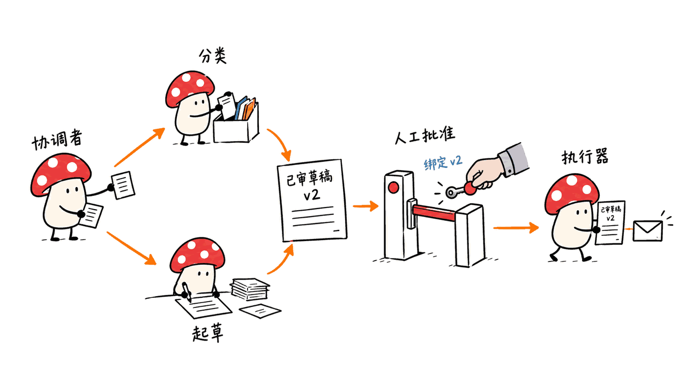
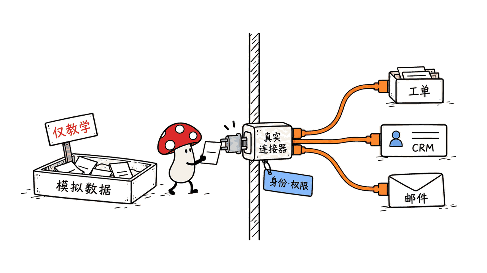
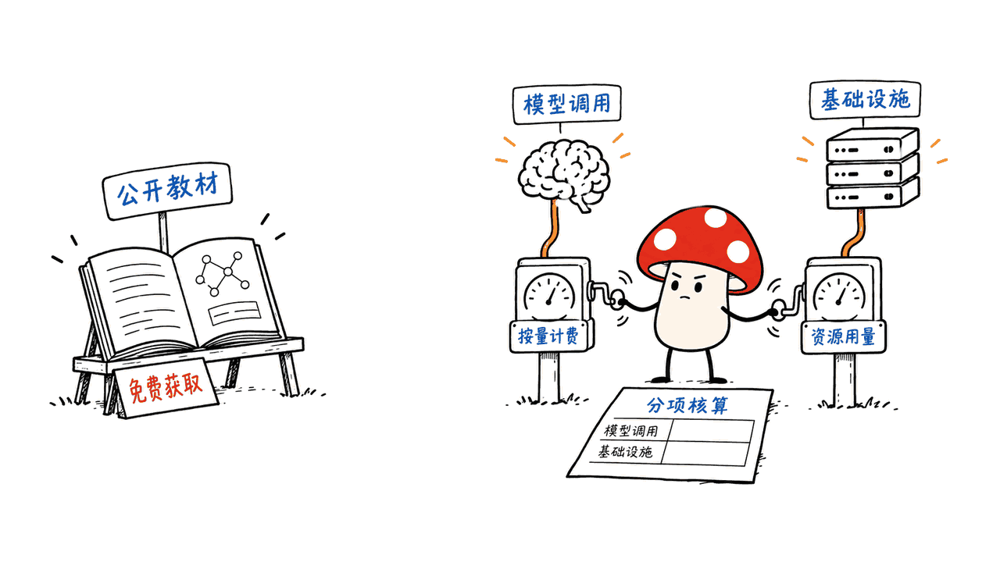

Anthropic 的官方工作坊可以用来学习业务 agent：从工具调用、专长子代理和记忆开始，再把一个具体流程接进真实系统。教材公开可获取，但模型调用与部署仍有成本，不能把它概括成“免费搭好一家无人公司”。

截至 2026-10-15，我们找到了官方活动公告、具体 workshop 页面和两个官方源码仓库；没有找到与素材中“发布用于构建自动化公司的工作坊”这句话完全对应的官方公告。下面据已核实的内容，整理介绍与工程落地路径。

## 官方出处在哪里？

最直接的官方新闻入口，是 2026 年 3 月 18 日发布的 Code with Claude 三城活动公告。官方活动 FAQ 说明线下参加和直播免费；旧活动日期不应写成今天的新发布。

官方公告：https://claude.com/resources/articles/code-with-claude-san-francisco-london-tokyo
活动与回放入口：https://claude.com/code-with-claude

一个能具体核实的课程是 Build a production-ready agent with Claude Managed Agents，旧金山场日期为 2026-05-06，讲师 Michael Cohen，来自 Anthropic。它介绍部署、调试和监控 agent，不是“经营一家自动化公司”的保证。

官方课程页面：https://claude.com/code-with-claude/session/sf-build-a-production-ready-agent-with-claude-managed-agents

还有两套互相关联但运行方式不同的官方材料：

| 材料 | 适合学什么 | 使用边界 |
|---|---|---|
| `anthropics/agent-sdk-workshop` | 本地 Python 程序中的工具、子代理、hooks 和记忆 | 示例工具基于模拟数据，模型调用需要访问凭据 |
| `anthropics/cwc-workshops` | Code with Claude 的多种实践，包括托管多 agent、评测与业务工作台 | README 明确写着不维护、不接受贡献；样例不是生产支持承诺 |

SDK 工作坊：https://github.com/anthropics/agent-sdk-workshop
Code with Claude 材料：https://github.com/anthropics/cwc-workshops

两仓库均提供 Apache 2.0 许可。本文分别核对提交 `a273fbe2b3776d84cf29f025927d71dcc0982c9f` 和 `068b84bb03d2ae87c51edb2837dda25c84c1d686`，后续文件与接口可能变化。

## 教材里的“协作”是怎么发生的？

SDK 工作坊让同一个任务逐步增加能力：基础聊天，然后开放工具，再启用专长子代理，最后增加跨会话记忆。它通过配置开关展示，质量变化不只来自换模型，也来自上下文、工具和执行方式。

子代理不是持续在线的完整部门。主代理通过委派调用启动它们，子代理在自己的上下文里处理明确任务，再返回结果。跨会话记忆则需要持久化与读取机制，不能与当前聊天里记住上一句话混为一谈。

教材还给出六类练习场景，包括业务简报、客服、SRE 和客户续约分析。我们离线运行了原仓库的 `python workshop breakout`，可以列出六个场景；没有调用工作坊的模型接口，也没有验证真实业务系统集成。

SDK 工作坊 FAQ：https://github.com/anthropics/agent-sdk-workshop/blob/main/docs/FAQ.md
业务练习说明：https://github.com/anthropics/agent-sdk-workshop/blob/main/02-breakouts/README.md

## 第一步：先跑固定版本的业务练习

下面选择客服流程。它的交付物容易检查：一张工单的分类、证据、回复草稿，以及是否需要升级处理。

```bash
git clone https://github.com/anthropics/agent-sdk-workshop.git
cd agent-sdk-workshop
git checkout a273fbe2b3776d84cf29f025927d71dcc0982c9f
python3 -m venv .venv
source .venv/bin/activate
pip install -r requirements.txt
cp .env.example .env
# 在本地编辑 .env，配置自己的 ANTHROPIC_API_KEY
python workshop check
python workshop breakout
python workshop breakout customer-support
```

Windows 可以用虚拟环境对应的 Python 运行 `workshop`。最后一条命令会运行 agent，可能产生 API 费用；前面的离线场景列表不代表模型或 CRM 已经接通。这里的模型运行命令来自教材，我们没有执行付费调用。

仓库要求 Python 3.10+，依赖写的是 SDK 最低版本而非完整锁定版本。实际试点应记录 Python、SDK 和模型 ID，保存依赖清单，再验证当前账号可访问的模型。`check` 是环境检查，不是业务验收。

## 第二步：明确谁读什么、谁交付什么

客服样例启用 `support`、`knowledge`、`memory` 三类工具，以及 `classifier` 和 `writer` 两个子代理。它会查客户和工单、检索知识库、准备处理意见；涉及退款、账户修改或工程处理时，应升级处理。

建议把试点的工作约定写成下面这样。这是我们的工程设计建议，不是仓库已经实现的完整流程状态机。

| 环节 | 输入 | 输出 | 可检查条件 |
|---|---|---|---|
| 查询 | 工单 ID、租户与操作者身份 | 工单与客户资料 | 返回版本、来源和访问范围 |
| 分类 | 工单与知识库依据 | 分类、理由、升级标记 | 不能凭空承诺退款或修复期限 |
| 起草 | 已确认事实与处理规则 | 回复草稿、引用依据 | 缺少证据时明确标出 |
| 审阅 | 草稿与拟执行动作 | 批准或退回 | 批准绑定具体动作和内容版本 |
| 执行 | 已批准的动作 | 外部系统回执 | 留存请求 ID，可追踪重试 |

主代理负责交接与汇总。不要让分类器自己拿到发信权限，也不要把“writer 写好了”直接作为发送条件。角色名只是说明，真正的权限要在工具和后端执行器中实现。



样例配置：https://github.com/anthropics/agent-sdk-workshop/blob/main/02-breakouts/customer-support/config.py

## 第三步：把模拟工具换成真实连接器

FAQ 明确说明，工具使用模拟数据是为了教学，让参与者先学习 SDK 模式。演示里能查日历、客户和工单，不代表已经连接公司的真实系统。



迁移时先保留相近的工具输入输出，再替换内部实现。例如 `get_ticket` 应通过服务端凭据查询指定租户的工单，而不是让模型决定任意数据库、账号或访问令牌。

工具结果最好包含稳定 ID、数据版本、来源及采集时间；失败要有明确类型，区分无权限、未找到、限流和临时故障。这样主代理才能决定停止、追问或稍后重试。

先接只读查询，再开放内部草稿或备注，最后才考虑外发邮件和账户变更。每一步都应能对照原业务系统确认结果，而不是只看模型最终说“完成了”。

工具实现：https://github.com/anthropics/agent-sdk-workshop/blob/main/02-breakouts/_shared/tool_library.py

## 第四步：补上教学代码没有替你完成的控制

源码中有一个必须注意的设置：引导示例和共享 runner 使用 `permission_mode="bypassPermissions"`。这便于在可控练习中运行，不应携带真实业务凭据后直接原样部署。

我们的建议是把允许执行的操作与授权检查写到代码里。模型可以提议发信，但执行器只有在批准记录、收件人和正文版本相符时才发送。SDK hooks 可以参与检查与记录，后端自身仍需拒绝未经授权的调用。

还要处理重复执行：保存 `request_id`、外部资源 ID、操作状态和回执；重试使用外部服务支持的幂等键。若超时发生在外部服务已执行之后，先查询回执再决定重试，不能把“没收到成功响应”直接当作“没执行”。

`MAX_TURNS` 限制轮数，不等于美元预算。为每个任务设置超时、成本额度和并发限制，记录模型版本、工具事件及费用；达到限制时停止新调用并保留状态。

共享 runner：https://github.com/anthropics/agent-sdk-workshop/blob/main/02-breakouts/_shared/agent_base.py

## 第五步：用固定案例验收，再逐步自动化

先让 agent 生成草稿，由人照常处理，比较结果。我们的试点建议是准备一组固定样例，覆盖普通问题、知识库缺失、退款诉求、权限错误、重复请求和工具超时。

分别衡量事实与引用是否正确、升级判断是否合适、有没有越权动作、单工单费用及耗时。多 agent 也有额外通信和调用成本；只有在更清晰的分工带来可观察收益时，才继续拆角色。

再逐步扩大：只读查询，接着内部草稿，再到经过审批的外部动作。将“生成了答案”“执行器记录了成功”“业务系统里确实发生了预期变化”分开检查。这些建议需要按自己的业务实现，不是教材自带的生产保证。

## 托管多 agent 路线有什么不同？

CWC 的 Deal Desk 样例更接近团队工作台：协调者并行委派四个研究子代理，使用共享记忆和 MCP 连接，并在界面中处理需要确认的工具调用。案例公司与财务数据是虚构的。

这条路线基于 Claude Managed Agents；账号权限、环境和资源配置应按当前官方文档准备。它与本地 Agent SDK 的入口和 API 不同，不能把其中一个目录的运行步骤直接套到另一个目录。

Deal Desk：https://github.com/anthropics/cwc-workshops/tree/main/production-ready-agent

Mycelium 的判断是，这些材料最值得学的是如何把一项业务交付拆成可调用工具、明确分工、可检查结果和持续评测。先让一条真实流程可靠运行，再讨论如何组成更大的自动化组织。

相关背景：https://blog.mushroom.cv/blog/raven-multi-agent-harness/

## 常见问题

### 这是“100% 免费的自动化公司”吗？

已核实的是免费活动与公开教材，不是无限免费模型服务。SDK 示例需要模型访问，实际部署还可能包含计算、存储及外部业务服务费用。



### 官方公告和素材里的说法完全对应吗？

目前未找到确切对应。本文给出的是可核实的官方活动、课程及仓库，没有把相似来源写成某个不存在或尚未定位的发布公告。

### 可以把练习工具直接接到生产账户吗？

应先实现真实连接器、身份权限、动作审批、重试及验收。教材主要展示 SDK 模式，模拟数据跑通不能替代真实系统集成测试。

---

> © 2026 Author: Mycelium Protocol. 本文采用 [CC BY 4.0](https://creativecommons.org/licenses/by/4.0/deed.zh) 授权——欢迎转载和引用，须注明作者姓名及原文链接，不得去除署名后以原创发布。

<!--EN-->

Anthropic's official workshops teach business agents through tools, specialist delegation and memory. They provide useful starting points for one real workflow, while inference and deployment still have costs. Free teaching materials do not establish a free autonomous company.

As of October 15, 2026, we verified official event news, a specific workshop session and two official repositories. We did not identify an announcement matching the supplied “workshop to build an automated company” claim exactly.

## Where are the official sources?

Anthropic's March 18, 2026 announcement covers Code with Claude in three cities. The event FAQ says attendance and livestream access are free; these historical dates are not a new October release.

Official news: https://claude.com/resources/articles/code-with-claude-san-francisco-london-tokyo
Event and recordings: https://claude.com/code-with-claude

The San Francisco session Build a production-ready agent with Claude Managed Agents, taught by Anthropic's Michael Cohen on May 6, 2026, covers deployment, debugging and monitoring. It does not promise to operate a company.

Session: https://claude.com/code-with-claude/session/sf-build-a-production-ready-agent-with-claude-managed-agents

| Materials | Learning focus | Boundary |
|---|---|---|
| `anthropics/agent-sdk-workshop` | Python tools, subagents, hooks and persistent memory | Mock business tools; model access required |
| `anthropics/cwc-workshops` | Code with Claude exercises, including managed multi-agent workflows | Explicitly not maintained or accepting contributions |

https://github.com/anthropics/agent-sdk-workshop
https://github.com/anthropics/cwc-workshops

Both provide Apache 2.0 licenses. Reviewed commits are `a273fbe2b3776d84cf29f025927d71dcc0982c9f` and `068b84bb03d2ae87c51edb2837dda25c84c1d686` respectively.

## How does collaboration work in the exercises?

The SDK exercise progressively enables tools, specialist subagents and cross-session memory around one task. Delegated workers receive focused instructions and return results in separate contexts; they are not continuously operating departments. Persistent memory requires storage and recall beyond an active chat.

We ran the original offline `python workshop breakout` entry point and verified that it lists six scenarios. We did not invoke the workshop model API or validate live business integrations.

FAQ: https://github.com/anthropics/agent-sdk-workshop/blob/main/docs/FAQ.md
Exercises: https://github.com/anthropics/agent-sdk-workshop/blob/main/02-breakouts/README.md

## Step 1: start from a pinned exercise

Customer support provides inspectable outputs: a classification, evidence, a draft response and an escalation decision.

```bash
git clone https://github.com/anthropics/agent-sdk-workshop.git
cd agent-sdk-workshop
git checkout a273fbe2b3776d84cf29f025927d71dcc0982c9f
python3 -m venv .venv
source .venv/bin/activate
pip install -r requirements.txt
cp .env.example .env
# Edit .env locally and supply your own ANTHROPIC_API_KEY
python workshop check
python workshop breakout
python workshop breakout customer-support
```

On Windows, use the virtual environment's Python executable. The final command runs the agent and can incur API charges; it was not executed for this article. The workshop requires Python 3.10+ and minimum dependency versions rather than a complete lockfile. Record the interpreter, SDK and accessible model IDs for your trial. An environment check is not business acceptance testing.

## Step 2: specify handoffs and outputs

The support configuration combines support, knowledge and memory tools with classifier and writer subagents. It looks up tickets and customers, searches the knowledge base and prepares a response or escalation. Refunds, account changes and engineering work require escalation in the sample's instructions.

Our proposed production contract separates query, classification, drafting, review and execution. Each step should return evidence and a versioned artifact; approval must bind to the proposed action and content version. The executor then records the external receipt.

These are engineering recommendations, not a complete workflow state machine already supplied by the repository. Role descriptions alone do not enforce permissions.


Sample configuration: https://github.com/anthropics/agent-sdk-workshop/blob/main/02-breakouts/customer-support/config.py

## Step 3: replace mock tools with real connectors

The FAQ explicitly says business tools use mock data for teaching. Calendar or ticket demonstrations therefore do not establish a working connection to your organization.


Retain useful input/output contracts while replacing implementations. A ticket lookup should use server-side credentials scoped to the authenticated tenant. Return stable IDs, versions, sources and timestamps. Distinguish permission failures, missing resources, rate limits and transient faults.

Begin with reads, add internal drafts, and only then consider external messages or account changes. Verify changes in the business system rather than trusting the final model response.

Tool library: https://github.com/anthropics/agent-sdk-workshop/blob/main/02-breakouts/_shared/tool_library.py

## Step 4: implement authorization, retries and budgets

The guided agent and shared runner set `permission_mode="bypassPermissions"`. That is a teaching configuration, not a production policy to reuse with real credentials.

Enforce actions in code: a mail executor should require approval matching the recipient and draft version. Hooks can assist checks and logging, while the backend independently refuses unauthorized requests.

Persist request IDs, resource IDs, states and receipts. Use provider-supported idempotency keys. After a timeout that may follow successful execution, query the receipt before retrying.

`MAX_TURNS` bounds rounds rather than dollars. Add time, cost and concurrency limits, record tool events and model versions, and stop new work when a limit is reached.

Runner: https://github.com/anthropics/agent-sdk-workshop/blob/main/02-breakouts/_shared/agent_base.py

## Step 5: evaluate before expanding automation

Start with drafts reviewed by people. Use fixed cases for ordinary questions, missing evidence, refund requests, access failures, duplicate requests and timeouts. Evaluate groundedness, escalation, unauthorized actions, cost and latency separately.

Additional agents introduce coordination and inference costs. Expand roles only when the task benefits. Distinguish an answer being generated, an execution receipt being recorded and the expected business change being observed. These controls must be implemented for the actual integration.

## How does the managed route differ?

CWC's Deal Desk sample has a coordinator, four parallel research subagents, shared memory, MCP integration and confirmations in its UI. Its companies and financials are fictional.

This uses Claude Managed Agents, with separate account, resource and environment requirements. Its API and setup are different from the local Agent SDK exercise. The repository's maintenance notice still applies.

https://github.com/anthropics/cwc-workshops/tree/main/production-ready-agent

Mycelium's practical takeaway is to organize one deliverable around callable tools, explicit responsibilities, reviewable outputs and evaluation. A reliable workflow is a concrete starting point for broader organizational automation.

Related: https://blog.mushroom.cv/blog/raven-multi-agent-harness/

## Frequently asked questions

### Is this a completely free autonomous company?

The verified free elements are the event and materials. Model inference, infrastructure and business services may still cost money.


### Did the supplied claim match an exact official announcement?

We did not locate an exact match. The article identifies the official sources that were verified and does not invent a release announcement from similar material.

### Can the exercises be attached directly to production accounts?

First implement connectors, identity, permissions, approvals, retry handling and acceptance tests. Mock-data demonstrations do not validate those integrations.

---

> © 2026 Author: Mycelium Protocol. Licensed under [CC BY 4.0](https://creativecommons.org/licenses/by/4.0/) — free to share and adapt with attribution. You must credit the author and link to the original; removing attribution and republishing as original is not permitted.
