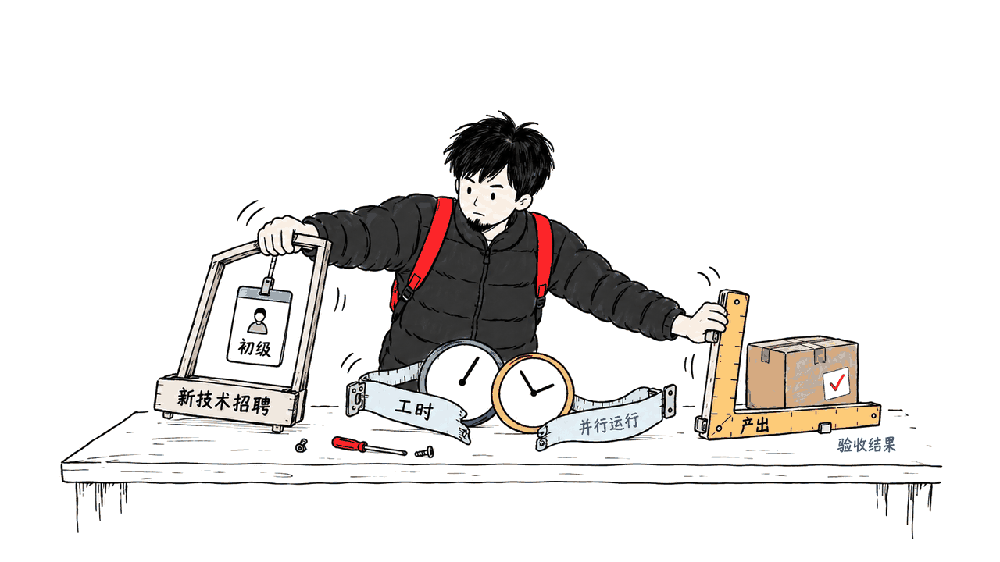
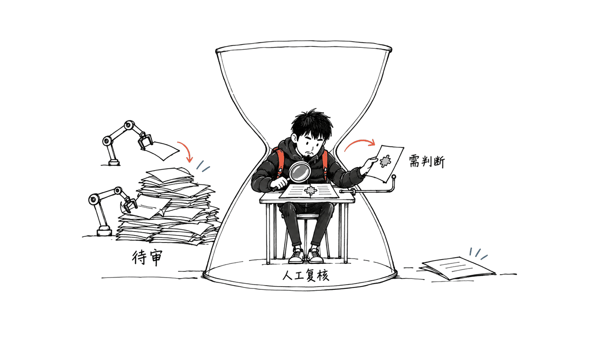
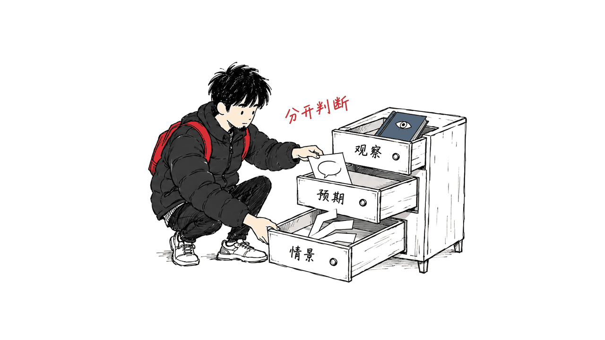

Anthropic这两份报告研究的是AI与就业：一份观察公司已经发生的组织变化，另一份调查人们相信未来会发生什么。把它们一起读，能帮助团队重新设计招聘、交付与培养；但不能据此给整个社会的岗位消失时间表下定论。

## 找到的两份原始报告是什么？

两份均发布于2026年10月16日。官方联合介绍明确把它们配成一组，所以不应把2025年的内部工程师调查当成这次的第二份报告。

| 报告 | 核心问题 | 阅读时的关键区别 |
|---|---|---|
| How Employment is Changing at Anthropic | 工作与招聘如何变化 | 公司内部观察与研究估计 |
| The AI Expectations Gap | 员工与公众如何看未来 | 问卷回答与模型情景 |

就业报告：https://www.anthropic.com/research/employment-at-anthropic

预期报告：https://www.anthropic.com/research/ai-expectations-gap

联合介绍：https://www.anthropic.com/research/expectations-for-the-future

以下是我们对原文的独立解读。数据来自报告，管理建议来自我们的分析；没有取得内部微观数据，也没有重跑作者的统计模型。

## 就业报告：招聘入口与工作分工发生了什么？

报告结合内部记录、AI使用和招聘评分卡，并辅以17次员工访谈；评分卡中对自主性与判断的讨论增多。技术部门新聘人员中，初级员工占比从27%降至9%。Agent工时与人类工时之比到8月达6∶1；前者汇总运行时间，后者按每人每周40小时估算。

这组材料最值得追问的是“分母”。招聘占比下降，可能来自初级招聘放慢，也可能伴随其他层级更快扩张；单凭比例，不能算出少招了多少人。6∶1则允许多个Agent并行运行，不能翻译成六个等效员工，更不能据此宣称生产率提高六倍。

我的判断是：对求职者，招聘入口变化比“某个职业是否彻底消失”更值得监测。一个行业可以继续增长，同时减少提供给新人的练手机会。企业如果把基础任务交给AI，就需要主动安排替代的学习路径，而不能默认新人会在工作中自然积累经验。

可以把培养任务改成：解释一份AI生成方案的取舍，找出一个缺陷，设计验证，再对交付负责。这样训练的是判断与反馈能力。这个建议来自我们对学习过程的推理，不是报告已经验证有效的培训方案。

## 如何区分产出增加与AI的因果作用？

就业报告观察到产出上升，也比较了同一员工采用工具前后的变化；作者明确提醒，工具采用不是随机的。部分代码质量检验使用删除、回退等代理指标。

因此，至少要分开三个问题：东西做得更多了吗，客户得到的结果更好了吗，变化有多少由AI造成？公司需求增长、项目类型变化和员工主动选择工具，都可能同时影响观察结果。控制一些差异有帮助，但不会自动把研究变成随机实验。

对于自己的团队，比追求“代码增加几倍”更实用的做法，是同时记录交付周期、验收通过率、返工、缺陷和客户结果。还应记录审核耗时。否则，生成环节看起来越来越快，瓶颈可能只是转移到了另一批人身上。

## 人的注意力为何成为组织设计问题？

我把工作流拆成四步：提出任务、生成候选、验证结果、承担后果。如果生成速度上升，而验证能力不变，等待审核的队列就会增长。增加Agent数量可能进一步放大这个队列。

一个可执行的改法，是让每次交付附带三样东西：结论、可检查的证据、需要人判断的例外。低风险且验收条件明确的任务，可以逐步自动通过；边界不清、影响较大的任务，则保留人工决策与回滚路径。

这也改变招聘题的设计。与其只问候选人能否快速生成一份答案，可以给出一份含缺陷的AI产物，请他识别问题、说明证据、决定是否上线。评价标准应事先写清楚，避免把表达流利误当成判断可靠。

## 预期报告：员工更相信AI，意味着他们一定更准吗？

第二份报告8月问卷的自身工作问题，有效样本为2,278名美国在职者和1,147名员工：前者加权、后者未加权，双方答题形式也不同。对2030年自身现有工作可由AI完成的平均估计，员工为75%，美国在职受访者为28%。这是预期，不是能力测量。

这类差距很重要，但不能直接当作未来结果。不同职业的任务结构、工具接入、组织支持与利益关系不同。一个人频繁使用强工具，可能更了解它的潜力；也可能更习惯把周围的条件视为普遍条件。问卷本身无法决定这两种解释各占多少。

还有一个容易混用的层次：受访者相信技术能做某项任务，不等于企业会立即采用，更不等于会减少同等比例的员工。需求、责任、客户偏好、培训和流程，都位于能力与用工之间。

报告还将问卷输入经济模型形成GDP情景。阅读这类结果时，要同时问“输入是谁的判断”和“模型增加了哪些假设”。模型能帮助检验观点之间是否一致，但不会把主观输入变成已经发生的经济事实。

## 把两份报告放在一起，普通团队该怎么做？

我的综合判断是：用第一份报告提出工作流假设，用第二份报告检查自己对未来的假设。两者都应回到本团队可以观察的任务上，而不是直接套用一家前沿实验室的比例。

可以用一个小范围试点开始：

1. 选一个任务族，事先定义完成标准和失败代价。
2. 记录当前人工交付、复核和返工时间，保留基线。
3. 接入Agent后，按同样标准验收，记录新增审核工作。
4. 分开讨论已观察结果与对下一阶段能力的预期。
5. 若减少基础任务，明确新人如何训练、受影响员工如何转岗。

把这些记录用于改善流程，能比单独追踪Token数量更接近业务问题。对员工，值得积累的是可展示的案例：你如何发现问题、选择验证方式、修正方案并承担交付，而不只是使用过多少工具。

相关模型背景解读：https://blog.mushroom.cv/blog/anthropic-ai-economic-scenarios-us-2030/

## 常见问题

### 这两份报告证明AI让就业总量下降了吗？

不能这样推出。单家公司内部记录、非随机采用工具的比较，以及公众和员工的预期，分别有不同的解释范围。

### 6∶1意味着一个人能替代六个人吗？

不能。它比较运行时间与估算工时，没有把任务质量、并行计算或业务价值转换成等效人力。

### 新人最值得补什么？

建议练习任务定义、验证和复盘，同时保留必要的领域基础。这是本文提出的行动方向，不是两份报告给出的就业保证。

封面采用Anthropic就业报告的官方主题图，图像权利归原权利人。

---

> © 2026 Author: Mycelium Protocol. 本文采用 [CC BY 4.0](https://creativecommons.org/licenses/by/4.0/deed.zh) 授权——欢迎转载和引用，须注明作者姓名及原文链接，不得去除署名后以原创发布。

<!--EN-->

Anthropic's two reports address different questions: how employment is changing inside the company, and what employees and the public expect AI to do next. Read together, they can inform organizational experiments without providing a timetable for economy-wide job losses.

## Which reports are these?

Both appeared on October 16, 2026, and are explicitly paired in the official announcement:

How Employment is Changing at Anthropic: https://www.anthropic.com/research/employment-at-anthropic

The AI Expectations Gap: https://www.anthropic.com/research/ai-expectations-gap

Joint introduction: https://www.anthropic.com/research/expectations-for-the-future

The first concerns observed workplace changes; the second concerns beliefs and model scenarios. Our recommendations below are independent analysis. We did not access internal microdata or re-estimate the authors' models.

## What changes at the hiring entrance?

The employment study combines internal records with 17 interviews; autonomy and judgment appeared more in hiring assessments. Junior positions' share of technical hires fell from 27% to 9%. Agent hours reached six times estimated human hours; the human denominator assumes 40 hours weekly per employee. Adoption was non-random, and some quality checks used deletion/reversion proxies.

A falling hiring share alone does not identify the absolute number of missing hires. Parallel agent runtime is also different from equivalent productive labor.

Our inference is that entry opportunities deserve attention even when an industry grows. If routine work becomes automated, organizations need an explicit learning path. One proposal is to train newcomers to explain trade-offs, find defects, design verification and own delivery. That is a training hypothesis, not a demonstrated intervention from the study.

## How should teams assess productivity?

Output volume, customer value and causal attribution are separate questions. Demand growth, project mix and employee tool choices can affect observed outcomes together. Statistical controls do not automatically turn observational evidence into a randomized experiment.

For a team-level evaluation, measure acceptance, rework, defects, customer results and review time alongside delivery speed. Otherwise a faster generation stage may simply move waiting time elsewhere.

## Why can attention become the bottleneck?

Our workflow decomposition has four steps: specify, generate, verify and accept responsibility. If generation grows faster than verification, the review queue expands. Adding agents can enlarge that queue.

A proposed delivery contract includes a conclusion, inspectable evidence and exceptions requiring judgment. Automate acceptance gradually where risk is low and criteria are clear; retain decisions and rollback paths where boundaries are uncertain.

Hiring exercises can reflect this responsibility. Give candidates a flawed AI-generated artifact and ask them to identify problems, support their conclusions and decide whether to ship. Establish a rubric so fluent presentation is not mistaken for reliable judgment.

## Does the expectations gap establish who is right?

The August survey’s own-work question includes 2,278 employed US respondents and 1,147 staff in Figure 5, weighted and unweighted respectively. Staff used sliders; public responses used range midpoints. Staff expected AI could do an average 75% of their current work by 2030, versus 28% among employed US respondents. These are beliefs, not capability measurements.

Differences in occupations, access, organizational support and incentives matter. Frequent exposure might reveal genuine potential, while also making unusual local conditions seem universal. The survey alone cannot resolve those explanations.

Technical capability, adoption and employment decisions are different stages. Demand, responsibility, customer preferences and training connect them. The report also maps responses into GDP scenarios; model output retains assumptions about both inputs and economic mechanisms. It does not convert expectations into realized economic outcomes.

## What should an ordinary organization do?

Use the employment study to form workflow hypotheses, and the expectations study to examine future assumptions. Test both against tasks in your own organization rather than importing the lab's percentages.

Choose one task family and define acceptance and failure costs. Record manual delivery, checking and rework as a baseline. Introduce agents, apply the same acceptance criteria and count additional oversight. Discuss measured outcomes separately from expected next-stage capabilities. If foundational tasks disappear, specify how newcomers learn and how affected employees transition.

Employees can build evidence-rich examples of defining a task, detecting failure, validating a result and improving delivery. Tool familiarity becomes more useful when linked to that record of judgment.

Related model analysis: https://blog.mushroom.cv/blog/anthropic-ai-economic-scenarios-us-2030/

## FAQ

### Do the reports prove aggregate job losses?

No. Internal observations, non-random adoption and surveys have different inferential limits.

### Does six-to-one imply six replacement workers?

No. Runtime and assumed working hours are not equivalent labor or business value.

### What should newcomers practice?

Our proposal emphasizes task definition, verification and reflection, supported by domain fundamentals. It is not an employment guarantee.

Cover: official Anthropic employment-report artwork; image rights remain with its owner.

---

> © 2026 Author: Mycelium Protocol. Licensed under [CC BY 4.0](https://creativecommons.org/licenses/by/4.0/) — free to share and adapt with attribution. You must credit the author and link to the original; removing attribution and republishing as original is not permitted.
