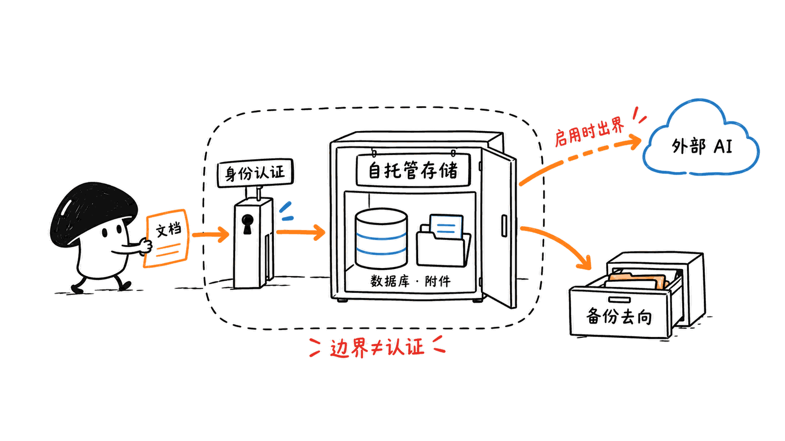

AppFlowy可以作为企业协作和知识库的候选，但“开源Notion替代品，部署一次就能收费”遗漏了关键条件：当前官方自托管服务端走商业许可，不能把客户端开源许可直接套到整套系统上。

本文核对于2026年10月24日。素材中的单项目5,000—20,000没有注明币种，也没有给出合同、服务范围或成交来源；本文不把它当作官方报价或市场均价，而是分析实施服务需要交付什么、怎样估算成本。

## 先找对仓库：开源和自托管不是同一个开关

用户提供的主仓库仍是正确入口：
https://github.com/AppFlowy-IO/AppFlowy

它定位为带AI能力的协作工作区，围绕文档、项目、数据库视图和团队知识组织展开。但客户端、历史服务端与最新商用分发必须分别核对。

| 入口 | 当前状态 | 对服务商的意义 |
|---|---|---|
| AppFlowy主仓库 | 公开客户端工程，仓库标注AGPL-3.0 | 开源不等于任意修改后闭源分发，须核对所用代码许可 |
| AppFlowy-Cloud | 已归档；GitHub显示2026-09-11归档 | 历史代码不能当作当前官方生产服务端 |
| AppFlowy-SelfHost-Commercial | 当前自托管Compose、部署文件与商用协议入口 | 可以取得部署材料，不代表取得完整服务端源码或转售权 |

旧Cloud README明确要求新部署及升级转向SelfHost-Commercial，称当前服务端镜像来自持续维护的闭源商业代码库。继续部署旧代码并非被技术上禁止，但维护、安全修复、客户端兼容和迁移责任都需要自己承担，不能宣称它与最新官方服务等价。

历史与当前入口：
https://github.com/AppFlowy-IO/AppFlowy-Cloud
https://github.com/AppFlowy-IO/AppFlowy-SelfHost-Commercial


## 收实施费，是否等于可以转卖软件？

不是。当前商业协议将使用授权限定为内部业务用途，并按服务器或机器授权；对软件复制、修改、分发等行为设有限制，也明确限制许可证转售与定制客户端。不能因为Compose在GitHub公开，就承诺“改个Logo，作为自己的SaaS卖出去”。

更适合作为商务讨论起点的结构是：客户作为软件及基础设施的权利与账户主体，服务商单独约定需求分析、部署、迁移和运维。**这是一种合同结构建议，不是对第三方实施服务已经获准的法律结论。** 接单前应向许可方确认实际服务模式、代运维权限和是否需要合作伙伴协议，不能用“收的是人工费”自动绕开授权范围。

协议原文：
https://github.com/AppFlowy-IO/AppFlowy-SelfHost-Commercial/blob/main/SELF_HOST_LICENSE_AGREEMENT.md

官方当前自托管免费层也不是无限团队版：每实例一个用户席位，另可向选定页面邀请最多三个Guest Editors。访客协作范围与正式成员不同，不能拿来承诺一家公司的所有员工免费使用。所需席位和功能应以实际套餐、管理面板及书面报价核对。

自托管套餐入口：
https://appflowy.com/docs/Self-hosted-Plans-and-Pricing

本文可读取的套餐页面没有展开完整金额表，因此不拼接一个未经确认的自托管价格。官网Cloud页面的每成员价格属于另一部署方式，也不能直接填进自托管项目预算。

## “数据在自己服务器上”解决了哪些问题？

自托管把部署位置、认证接入、存储配置和备份操作的控制权交给组织，有利于明确数据边界；它也把管理这些边界的责任带回来。

律所可以先用内部制度、脱敏模板和项目方法库试点，医疗机构可以先验证不含患者数据的流程文档。这里是试点场景建议，不是声称这些行业客户已经采用或已经获得某种认证。涉及敏感资料时，应由机构按适用要求确认处理方式，产品名称和部署地址本身不构成合规证明。

需要画清的数据流至少有：客户端到服务端、数据库与附件、身份与邮件、备份副本，以及AI检索或生成所连接的模型服务。如果启用外部模型、云存储或第三方连接，内容可能流出自建服务器；需要逐项核查配置和请求，而不是仅凭“自托管”推断全链路离线。

验收也要落到行为：离职账号能否失去访问权，页面分享是否超范围，恢复后附件能否打开，模型调用是否按约定路由。本文没有执行生产安全测试，也没有评估机构合规性。



## 我们实际检查到了什么部署结构？

我们下载并解析了当前官方`docker-compose.yml`，识别出12个服务定义，涵盖Nginx、PostgreSQL/pgvector、Redis、MinIO、GoTrue、Cloud、Admin、AI、Worker、Search、Backup和Web。Backup被标为可选`backup` profile。这个结果来自配置解析，不是启动成功或恢复成功的证明。

这意味着交付对象是一个有状态的协作系统，不能用“容器都绿了”代替验收。至少需要分别管理文档数据库、附件、认证配置和恢复所需元数据；AI与索引也有自己的资源消耗和故障模式。

官方文档已有可选备份、审计和连接配置指南。是否能使用某项能力、启用后记录什么、保留多久及能否恢复，都应在选定版本和套餐上验证。尤其不要把看到一个名为Backup的容器写成“已经异地备份、可以随时恢复”。

这里适合先运行只读配置校验，而不是立即把演示环境暴露到公网：

```bash
git clone https://github.com/AppFlowy-IO/AppFlowy-SelfHost-Commercial
cd AppFlowy-SelfHost-Commercial
cp deploy.env .env
# 按官方指南设置域名、凭据、邮件、存储和所用版本后，检查配置
# 下列命令仅解析配置，不启动容器：
docker compose config --quiet
docker compose config --services
```

本文没有安装Docker、拉取镜像、启动容器或连接真实业务数据。也没有据此推定并发容量、服务器最低配置或迁移兼容性。

官方部署指南：
https://appflowy.com/docs/Step-by-step-Self-Hosting-Guide---From-Zero-to-Production

## 实施服务应该交付什么？

可以按成果把工作分成四段，而不是按“一次安装”收费。

| 阶段 | 应交付的成果 | 可检查的验收方式 |
|---|---|---|
| 需求与选型 | 版本、许可、数据类别、成员与访客范围、责任边界 | 客户确认清单，说明哪些功能尚未验证 |
| 环境与试点 | 独立环境、认证与存储配置、测试账号 | 登录、权限隔离、分享及退出流程逐项演示 |
| 迁移与恢复 | 代表性文档和附件样本、导入差异、备份恢复记录 | 抽样核对结构与附件，在隔离环境恢复 |
| 培训与交接 | 管理手册、账号归属、版本清单、故障和退出流程 | 客户管理员独立完成一次授权与恢复演练 |

迁移要先用代表性样本验证：Notion数据库、嵌套页面、附件和外链不是同一种对象，不能默认一键无损。敏感内容应先用脱敏样本，确认流程后再约定正式迁移窗口。

运维月费则应列出包含的工作量：例行更新、失败备份跟进、告警处理、定期恢复抽查和约定响应时间。重大升级、历史坏数据、额外集成和全天候值班，适合单独定义范围。上游软件支持与本地实施商运维是两份责任，不能相互替代。


## 5,000—20,000能不能成立？先做成本表

目前只能把这个区间视为素材中的业务设想。它既没有币种，也没有客户数量、范围和续费资料，不支持“一个项目必赚这么多”的结论。

一种可复核的报价方法是：

```text
项目报价 = 实施工时 × 工时单价
         + 明列的第三方成本
         + 测试与返工预算
         + 约定利润
月度服务费 = 计划运维工时 + 值班与响应责任 + 另约成本
```

举一个纯假设的人民币成本例子：40小时×200元/小时=8,000元人工，加500元测试环境和1,500元返工预算，交付成本为10,000元，尚未包含利润、税费及另行采购的软件许可。这不是行情、销售承诺，也不意味着20,000元的任何项目都值得接；如果需要大量迁移或严格值班，成本会不同。

软件订阅、客户服务器、模型调用和服务商劳动最好分项列示，由合同明确谁采购、谁持有账户、谁承担超额用量。如果采用服务商代付，也要先确认许可证允许的安排，而不是先收款再补授权。

对小团队而言，更稳妥的切入点是范围清楚的一次试点，拿到可复核的迁移和恢复结果，再讨论长期服务。能卖的价值是组织真正接得住的系统，而不是“开源”两个字带来的授权想象。

## 常见问题

### AppFlowy现在完全不开源了吗？

不能这样说。公开客户端、历史AGPL服务端代码与当前闭源商业服务端并存，必须按组件及所用版本分别判断。

### 自托管是否自动满足律所或医疗机构的要求？

不会。部署位置只是一个条件，权限、数据流、恢复、合同和机构自己的适用要求仍需核实；本文没有做合规认证。

### 可以直接复制5,000—20,000作为报价吗？

不应如此。先确认币种、许可、交付范围、工时与维护责任；该区间没有在本次资料中得到可靠成交验证。

---

本文原文：https://blog.mushroom.cv/blog/appflowy-self-host-services/

> © 2026 Author: Mycelium Protocol. 本文采用 [CC BY 4.0](https://creativecommons.org/licenses/by/4.0/deed.zh) 授权——欢迎转载和引用，须注明作者姓名及原文链接，不得去除署名后以原创发布。

<!--EN-->

AppFlowy is a candidate for self-hosted collaboration and knowledge management, but its open client license does not describe the whole current server offering. An implementation business needs to distinguish components, permissions and deliverables before pricing the work.

Checked October 24, 2026. The supplied 5,000–20,000 project range has no currency, contract scope or transaction evidence. We treat it as a business hypothesis, not a verified market rate.

## Which repository should an implementer use?

Main client: https://github.com/AppFlowy-IO/AppFlowy
Legacy server: https://github.com/AppFlowy-IO/AppFlowy-Cloud
Current deployment distribution: https://github.com/AppFlowy-IO/AppFlowy-SelfHost-Commercial

The client repository is marked AGPL-3.0. The legacy Cloud repository is archived, with GitHub showing September 11, 2026. Its README directs new deployments and upgrades to SelfHost-Commercial, whose images come from the maintained closed-source commercial server.

Public Compose files provide deployment material, not the complete current server source. Running legacy code also does not establish feature, security-update or client compatibility parity with the maintained distribution. A provider choosing that route takes on its own maintenance and integration work.


## Is selling implementation the same as reselling the software?

No. The current agreement limits its grant to internal business purposes on a per-server/per-machine basis. It restricts distribution and modifications, and explicitly disallows license resale and custom clients. A public GitHub repository is therefore insufficient grounds for a white-label SaaS offer.

A possible contract structure places software and infrastructure accounts with the customer and defines the implementer's migration, configuration and support work separately. That is a proposal for discussion, not a determination that every third-party service arrangement is authorized. Confirm the intended delivery and administration model with the licensor, including any partner agreement required.

Current terms: https://github.com/AppFlowy-IO/AppFlowy-SelfHost-Commercial/blob/main/SELF_HOST_LICENSE_AGREEMENT.md

The documented free tier provides one user seat per instance and up to three page-scoped guest editors. Guests are not interchangeable with full members. Verify the required seats and features against the actual plan and written quote.

The accessible self-hosted pricing page did not expose a complete amount table. Cloud per-member pricing is a different offering and should not be copied into a self-hosting budget.

Pricing entry: https://appflowy.com/docs/Self-hosted-Plans-and-Pricing

## What does owning the server actually change?

Self-hosting gives an organization control over deployment, authentication, storage and backups, while also giving it responsibility for operating them.

A law firm could start with internal policies and anonymized templates; a healthcare organization could begin with process documents containing no patient data. These are suggested pilot scenarios, not documented customer cases or compliance certifications.

Map client traffic, databases, attachments, identity, email, backup destinations and AI services. External models, storage or connectors may carry content beyond the self-hosted server. Configuration and observed requests, rather than a deployment label, determine that boundary.

Useful acceptance behaviors include access removal after an employee leaves, appropriate sharing scope, readable attachments after recovery and the agreed AI routing. We did not conduct a production security test or assess institutional compliance.


## What did we inspect locally?

We downloaded and parsed the official Compose file. It defines twelve services: Nginx, PostgreSQL/pgvector, Redis, MinIO, GoTrue, Cloud, Admin, AI, Worker, Search, Backup and Web. Backup uses the optional `backup` profile. This is configuration inspection, not a successful deployment or restore.

Treat the system as stateful infrastructure. Database contents, attachments, authentication configuration and recovery metadata need coordinated handling. Indexing and AI add their own dependencies and failure modes.

The project supplies backup, audit and connection guides. Availability, configuration, retention and recovery still need validation for the selected version and plan. A container named Backup does not prove an off-site copy exists or can be restored.

Start with read-only configuration checks after following the official setup instructions:

```bash
git clone https://github.com/AppFlowy-IO/AppFlowy-SelfHost-Commercial
cd AppFlowy-SelfHost-Commercial
cp deploy.env .env
# Configure domain, credentials, mail, storage and versions first.
# These commands parse configuration without starting services.
docker compose config --quiet
docker compose config --services
```

We did not install Docker, pull images, start containers or connect production data. No throughput, minimum server size or migration-compatibility result is claimed.

Guide: https://appflowy.com/docs/Step-by-step-Self-Hosting-Guide---From-Zero-to-Production

## What should a paid implementation deliver?

| Phase | Deliverable | Acceptance evidence |
|---|---|---|
| Discovery |Version, license, data categories, seats and responsibility boundaries|Customer-approved scope with unresolved capabilities identified|
| Pilot |Isolated environment, storage/authentication configuration and test accounts|Login, permissions, sharing and exit behavior demonstrated|
| Migration and recovery |Representative documents/attachments, import differences and recovery records|Sample comparison and an isolated restore|
| Handover |Administrator instructions, account ownership, versions and exit procedure|Customer administrator independently exercises access and recovery|

Test representative imports before promising a lossless migration. Databases, nested pages, attachments and links need different checks. Use sanitized examples before agreeing a sensitive-data migration window.

A maintenance agreement should define scheduled updates, backup-failure handling, monitoring, restore sampling and response hours. Major upgrades, historical corruption, integrations and continuous on-call coverage need explicit scope. Upstream product support and local operations are separate responsibilities.


## How can a small provider estimate a price?

Use scoped labor, third-party charges, testing/rework allowance and margin. Monthly fees should reflect planned work and response obligations, rather than an undefined promise to handle everything.

For illustration only, assume 40 hours at CNY200/hour: CNY8,000 labor, plus CNY500 for a test environment and CNY1,500 rework allowance gives CNY10,000 delivery cost before profit, tax and separately procured software licenses. This is invented cost arithmetic, not a market price, sales promise or proof that a CNY20,000 contract is profitable.

Itemize software subscriptions, customer infrastructure, AI usage and professional labor. Specify who buys them, holds the accounts and pays excess usage. Any arrangement in which the provider pays or manages licenses must fit the applicable permissions.

A bounded pilot with demonstrated migration and recovery is a more useful first offer than an unqualified “open-source deployment” package. The customer's ability to operate the result is a concrete service outcome.

## FAQ

### Has all of AppFlowy become closed source?

No. Public clients, historical AGPL server code and the current commercial server coexist. Check each component and version separately.

### Does self-hosting automatically satisfy legal or healthcare requirements?

No. Location is one factor; access, data flows, recovery, contracts and applicable organizational requirements also matter. We performed no compliance certification.

### Can I copy the 5,000–20,000 range into a quote?

Not without specifying currency, scope, software rights, effort and maintenance obligations. We found no reliable transaction evidence for that range.

---

Original article: https://blog.mushroom.cv/blog/appflowy-self-host-services/

> © 2026 Author: Mycelium Protocol. Licensed under [CC BY 4.0](https://creativecommons.org/licenses/by/4.0/) — free to share and adapt with attribution. You must credit the author and link to the original; removing attribution and republishing as original is not permitted.
