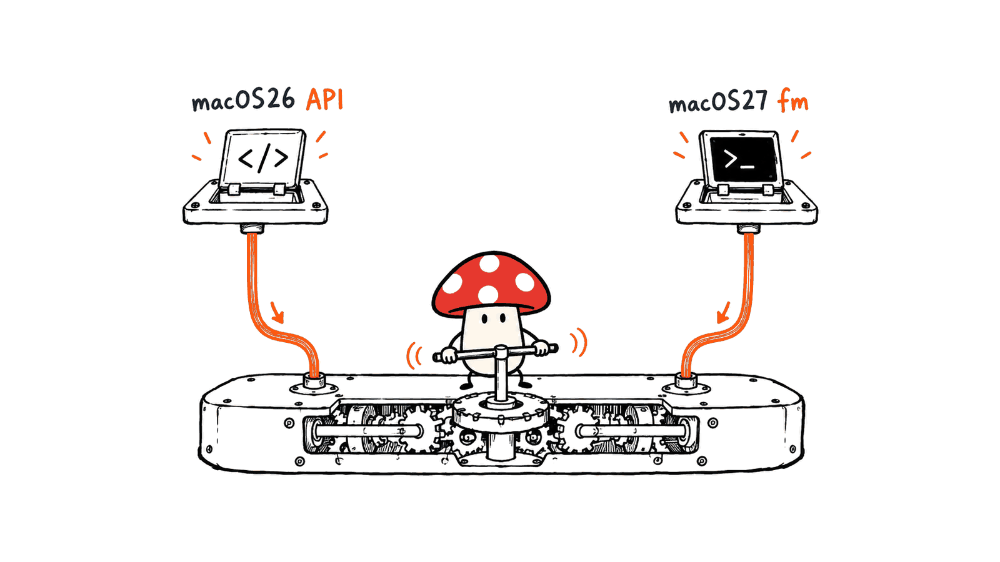

macOS 27 自带的 `fm` 能让你直接从终端调用苹果端侧模型，无需另外购买聊天订阅或填写云端 API Key。不过，“电脑有 Apple Intelligence”和“系统已经有 fm”是两件事；首次模型下载、设备与地区支持也有前提。

本文核对于 2026 年 10 月 25 日。Mycelium Protocol 查阅了苹果官方文档、WWDC 演示与官方 Python SDK，并在 M4、16GiB、macOS 26.6.2 上做了底层 Swift 接口的功能验证。本机没有 `fm`，所以本文不会把这次生成写成 macOS 27 CLI 实测，也不提供未经测量的速度排名。

## fm 是苹果自带的，还是需要安装的开源项目？

苹果在 WWDC26 的第 334 场明确介绍：`fm` 随 macOS 27 预装，用于直接试提示词和编写自动化脚本。它是 Foundation Models 的命令行入口，不是需要先装 Ollama、下载一个 GGUF 再运行的路线。

要分清三个层次：

| 层次 | 作用 | 应怎样理解版本要求 |
|---|---|---|
| 系统端侧模型 | Apple Intelligence 的本地推理能力 | 设备、系统、语言和地区共同决定可用性 |
| Foundation Models 框架 / SDK | 供 Swift、Python 程序访问模型 | Swift 框架在上一代系统已提供；官方 Python SDK 当前 README 要求 macOS 26.0+ |
| `fm` CLI | 在终端聊天、单次生成及组织脚本工作流 | 苹果明确从 macOS 27 开始预装 |

因此，macOS 26 上找不到 `fm`，不等于电脑不能调用苹果端侧模型。反过来，终端出现了一个叫 `fm` 的程序，也应确认它是否为苹果的系统工具，避免与同名第三方命令混淆。

官方开放的 Python SDK 仓库是：
https://github.com/apple/python-apple-fm-sdk

它采用 Apache 2.0 许可，但这不等于苹果系统模型的权重也采用 Apache 许可，或可以自由导出、修改和再分发。本篇介绍的是系统能力与开发入口，不把它包装成一款开放权重模型。



## M1 能用吗？需要多少内存和空间？

苹果当前支持页面把 M1 及之后的 Mac 列在 Apple Intelligence 兼容设备中，另列 MacBook Neo。但基础兼容不代表所有机型拥有相同的模型变体、上下文和功能，也不是对任何 M1 的速度保证。

对于 `fm`，首先核对 macOS 27。然后确认系统的 Apple Intelligence 已可用、所需模型资源已下载，以及设备语言和 Siri 语言满足支持条件。实际入口随系统版本变化，以当前系统设置与工具返回状态为准。

苹果最新页面给出的存储口径是：M3 及之后、至少 12GB 统一内存的 Mac，Apple Intelligence 资源最多需要 14GB 存储；其他兼容设备最多 8GB。这里的 8GB / 14GB 是存储占用口径，不是 fm 的最低 RAM，也不是模型参数文件的精确大小。升级期间占用还可能暂时更高。

地区条件也不能省略。当前官方页面说明，中国大陆购买的支持设备仍不能使用 Apple Intelligence；其他地区购买的设备，在中国大陆且 Apple Account 地区也为中国大陆时同样受限。能否启用应查当前官方页面，而不是只看芯片型号。

没有必要为了读这篇文章就升级系统。先检查当前设备，备份并评估软件兼容性后，再决定是否升级。

官方要求：
https://support.apple.com/en-us/121115

## 第一次从终端调用，应该怎样操作？

下面是供 macOS 27 用户使用的步骤，本机没有执行这些 CLI 命令。

先确认环境：

```bash
sw_vers
uname -m
command -v fm
```

核对工具来自系统后，尝试查看其提示。若它要求先接受 Foundation Models CLI 条款，应由设备使用者阅读并自行决定是否接受。素材中的命令是：

```bash
sudo /usr/bin/fm license
```

这是管理员级的许可确认步骤，不是下载模型或“解锁收费 AI”的命令。社区开发者保存的 CLI 实机帮助记录说明，它会交互式展示并确认条款，而且同意状态适用于整台机器。本文没有替用户接受这些条款。

然后检查模型状态，再运行一个短提示：

```bash
/usr/bin/fm available
/usr/bin/fm respond "请用一句简体中文解释什么是 AI Agent。"
```

如果模型尚未就绪，先处理系统给出的原因，不要连续重试生成。确认资源下载完成后，可以再试交互聊天：

```bash
/usr/bin/fm chat
```

苹果官方演示了 `respond` 和 `chat`。`license`、`available` 的具体提示与参数，还应对照本机版本的帮助；社区捕获记录来自特定构建，不应当作所有未来版本的固定协议。授权完成后可查看：

```bash
/usr/bin/fm --help
/usr/bin/fm respond --help
```

社区原始帮助捕获，仅作为版本相关操作参考：
https://github.com/llostinthesauce/fm-guide/blob/main/docs/cli-reference.md

## “不联网、没有 Token 账单”到底指哪条路径？

对系统端侧模型而言，模型就绪后的推理可以在本地完成，不需要外部聊天服务的 API Key，也没有第三方按 Token 收费的接口账单。它仍会消耗本机内存、电力与存储；首次下载和系统资源更新也不能理解为从来不需要网络。

Foundation Models 的范围更大。苹果官方 WWDC 演示还展示了 Private Cloud Compute（PCC）路径：它使用服务器模型，需要联网，受可用性与使用限额约束。框架也能连接第三方提供商，而第三方的计费与数据处理由对应服务决定。


这里还有版本差异：WWDC 展示过某个选项，不代表你的正式版、测试版、账号或地区一定提供它。因此本文不让读者照抄 `--model pcc` 作为本地上手步骤。先看当前工具实际列出的能力；需要严格本地处理时，明确使用端侧路径，不要静默回退云端。

苹果当前支持文档也明确说明，部分服务器侧功能有每日限额，未来扩大访问可能收费。不能把端侧无按量账单，扩展成所有 Apple Intelligence 服务永远无限免费。

本次我们通过明确的 `SystemLanguageModel.default` 生成了文本，没有做断网或网络流量审计。功能验证支持“端侧接口在这台机器上可调用”，不应被写成一次完整的数据流安全审计。

## 本机到底验证了什么？

在 M4、16GiB、macOS 26.6.2 上：

| 检查 | 实际结果 | 能得出的结论 |
|---|---|---|
| `command -v fm` | 未找到命令 | 本机没有 macOS 27 的内置 CLI |
| Swift 导入 `FoundationModels` | 成功 | 当前开发环境可以访问框架 |
| `SystemLanguageModel.default.availability` | `available` | 系统报告端侧模型就绪 |
| 单次中文生成 | 成功返回非空回答 | 底层端侧模型可调用；不是 CLI 或质量基准测试 |

输入是“请用一句简体中文解释什么是 AI Agent。”，实际返回：

> AI Agent是一种能够自主执行任务、学习从环境中获取信息并做出决策的计算机系统。

这句输出不是我们对 Agent 的完整定义。一次简单回答也不能证明模型会可靠使用工具、长期自主执行任务，或足以替代更大的编程模型。

复核 availability 的 Swift 代码如下，前提是已经安装可用的 Swift / Apple SDK 开发环境：

```swift
import Foundation
import FoundationModels

let model = SystemLanguageModel.default
print(model.availability)
print(model.isAvailable)
```

我们还保存了生成程序、系统版本、提示词与原始响应。没有进行吞吐量、首 Token 延迟、长文本准确率或断网测试，也没有替用户安装 macOS 27。

## 从聊天到脚本，真正有价值的用法是什么？

最适合先试的是短文本改写、分类、字段提取和内容整理。比如先用一条命令生成邮件草稿：

```bash
/usr/bin/fm respond "把这句话改写成礼貌的工作邮件，只输出正文：请在周五前确认预算。"
```

需要保存结果时，可以使用普通 shell 重定向；先选一个不会覆盖重要文件的新输出路径：

```bash
/usr/bin/fm respond "给一次30分钟的项目复盘拟三个议题。" > ./meeting-draft.txt
```

这只是文本生成，不会替你发邮件或执行操作。苹果 WWDC 演示过更进一步的文件整理：模型分类草稿与最终稿，程序再依据结构化结果处理文件。但复制到真实业务时，需要把判断与执行分开。


推荐按三个阶段推进：

1. 先输出建议，只处理短的合成材料，查看失败与拒答情况。
2. 要让程序读取结果，再研究 `fm schema object` 与 `respond --schema`。不要只在提示词中说“给 JSON”，就假定输出永远符合业务结构。
3. 对文件移动等动作，验证路径、限制在指定目录、处理重名，并先展示计划再执行。结构化输出解决格式，不替代事实核对与业务授权。

上下文长度也不是无限的。苹果提供 `contextSize` 查询能力；官方不同系统示例给出过不同大小，因此不要把旧版 4K 或新版某台设备的 8K 写死为全体 Mac 的共同值。输入、指令、历史与输出都需要预算。长文档应分段、检索或做适合任务的压缩，而不是把整个资料库直接塞进一次请求。

上述 CLI 示例是参考用法，未在这台 macOS 26 机器上执行；不要将其与前面的真实 Swift 功能验证混淆。

## 开发者还有哪些官方入口？

Swift 应用可直接使用 Foundation Models。Python 用户则可以查阅官方 `apple/python-apple-fm-sdk`，当前 README 列出的前提包括 macOS 26.0+、Xcode 26.0+、Python 3.10+，以及兼容且可用的 Apple Intelligence 环境。

SDK 支持生成、流式输出和结构化结果等开发流程，但开源 SDK 不是权限、地区或系统资源检查的替代品。本文没有安装 Python SDK；对比本地模型、SDK 版本与应用需求之后再选择入口即可。

对于已经使用 MLX、llama.cpp 的人，fm 的优势是系统模型由操作系统管理，脚本接入简单；相应代价是模型选择、权重控制、量化和版本固定不像开放权重运行时那样自由。这是两条不同的工程路线。

本站相关背景：
https://blog.mushroom.cv/blog/wwdc26-mlx-local-agentic-ai-mac-engineering-guide/

## 常见问题

### macOS 26 没有 fm，能用同一个模型家族吗？

可以通过受支持的框架或 SDK 路径尝试。我们已在 macOS 26.6.2 上完成一次 Swift 生成，但这不保证系统模型变体与 macOS 27 完全一致。

### 我需要买 API Key 或下载第三方 fm 安装包吗？

调用系统端侧模型无需外部服务 API Key。官方 fm 随 macOS 27 预装；不要为同名第三方工具付费就以为装上了苹果 CLI。

### 它能替代联网搜索、长上下文编程助手吗？

不能从内置、免费或离线这几个条件推出这种结论。最新信息需要可靠的信息来源，复杂编程与长任务需要独立验证；fm 更适合先作为操作系统中的一个小型推理组件。

官方资料：
https://developer.apple.com/foundation-models-framework/
https://developer.apple.com/videos/play/wwdc2026/334/
https://developer.apple.com/videos/play/wwdc2026/319/
https://support.apple.com/en-us/121115
https://github.com/apple/python-apple-fm-sdk

本文原文：https://blog.mushroom.cv/blog/apple-foundation-models-fm-cli/

---

> © 2026 Author: Mycelium Protocol. 本文采用 [CC BY 4.0](https://creativecommons.org/licenses/by/4.0/deed.zh) 授权——欢迎转载和引用，须注明作者姓名及原文链接，不得去除署名后以原创发布。

<!--EN-->

macOS 27 includes `fm`, a terminal entry point to Apple's on-device language model. Local inference does not require a separate chatbot subscription or a cloud API key. However, having Apple Intelligence, having the `fm` executable, and having a ready model are separate conditions.

Mycelium Protocol checked primary Apple documentation and its Python SDK on October 25, 2026. On an M4 with 16GiB running macOS 26.6.2, we successfully generated Chinese text through Swift. This machine has no `fm`; our check is not a macOS 27 CLI test or a performance benchmark.

## What ships with macOS, and what is open source?

Apple's WWDC26 session 334 introduces `fm` as preinstalled with macOS 27. The Foundation Models framework already existed in the previous generation. The official Python SDK currently lists macOS 26.0+.

| Layer | Purpose | Version distinction |
|---|---|---|
| System model | On-device Apple Intelligence inference | Readiness depends on hardware, OS, language and region |
| Framework / SDK | Swift and Python access | Can exist without the new CLI |
| `fm` | Terminal prompting and automation | Preinstalled starting with macOS 27 |

The official Python repository is Apache 2.0:
https://github.com/apple/python-apple-fm-sdk

An open SDK is not an open-weight model release. Its license does not grant arbitrary export, modification or redistribution of Apple's system weights. Verify that any executable named `fm` is Apple's system command, rather than an unrelated third-party utility.


## Can an M1 Mac use it?

Apple's current support page includes M1 and later Macs, plus MacBook Neo. Baseline eligibility does not establish identical features, model variants, context budgets or performance across devices.

For this CLI, start with macOS 27, then check Apple Intelligence readiness and model resources. Supported device and Siri language settings matter, as do region restrictions. Apple's current page says supported devices purchased in mainland China cannot use Apple Intelligence; devices purchased elsewhere are also restricted when both location and Apple Account region are mainland China.

The current storage figures are up to 14GB for M3-or-later Macs with at least 12GB unified memory, and up to 8GB for other eligible devices. These are Apple Intelligence storage figures, not minimum RAM requirements or exact model-file sizes. Update-time usage can temporarily be higher. Evaluate backups and software compatibility before deciding to upgrade an existing machine.

https://support.apple.com/en-us/121115

## How do you try the CLI?

These steps are for an eligible macOS 27 installation. We did not run them on our macOS 26 machine.

```bash
sw_vers
uname -m
command -v fm
```

After confirming the system tool, follow its messages. If it requires acceptance of its legal notice, the device user should read it and decide whether to agree:

```bash
sudo /usr/bin/fm license
```

This is a privileged license-confirmation step, not a paid-feature unlock or model download. A community developer's captured help documents an interactive, machine-wide acceptance gate. We did not accept these terms for the user.

Then check readiness and submit a short prompt:

```bash
/usr/bin/fm available
/usr/bin/fm respond "Explain an AI agent in one sentence."
/usr/bin/fm chat
```

Resolve reported readiness problems before repeating generation. Apple demonstrates `respond` and `chat`; exact license and availability behavior should be checked against the installed build. Once any required license step is complete, inspect help:

```bash
/usr/bin/fm --help
/usr/bin/fm respond --help
```

Community firsthand help capture, tied to a particular build:
https://github.com/llostinthesauce/fm-guide/blob/main/docs/cli-reference.md

## Does no API bill mean everything is offline and unlimited?

Once resources are ready, the on-device model can perform inference locally without an external service key or per-token cloud charge. It still consumes storage, memory and electricity. Initial resource downloads and later updates can require networking.

The broader framework also supports server models. Apple's WWDC material demonstrates Private Cloud Compute, which requires networking and has availability and usage limits. Third-party providers have their own billing and data-handling policies.


A demonstrated WWDC option need not exist on every shipping build, account or region. We therefore do not make `--model pcc` part of the local setup path. Inspect the actual installed capabilities, select the on-device route when locality is required, and avoid silent cloud fallback.

Apple's current support page also describes daily limits for certain server-side features and possible paid expanded access in the future. Local inference without a token bill is not a promise that every Apple Intelligence service is permanently free and unlimited.

## What did our Mac actually verify?

| Check on M4 / 16GiB / macOS26.6.2 | Actual result |
|---|---|
| `command -v fm` | No executable found |
| Import `FoundationModels` in Swift | Successful |
| Default system-model availability | `available` |
| One Chinese generation | Returned a nonempty Chinese answer |

The prompt asked for a one-sentence explanation of an AI agent. The generated answer described a computer system that autonomously executes tasks, learns information from its environment and makes decisions. That answer is not a full definition, nor proof of reliable autonomous tool use.

Availability can be inspected with a working Swift / Apple SDK development environment:

```swift
import Foundation
import FoundationModels

let model = SystemLanguageModel.default
print(model.availability)
print(model.isAvailable)
```

We saved the generation program, OS version, prompt and raw output. We did not measure throughput, first-token latency or long-document accuracy, run a disconnected-network test, or audit network traffic. Explicitly selecting `SystemLanguageModel.default` establishes which documented interface was called; it is not a complete security audit. No OS upgrade or Python SDK installation was performed.

## How can it become a useful scripting component?

Start with short rewriting, classification and extraction tasks. For example:

```bash
/usr/bin/fm respond "Rewrite politely for a work email: Please confirm the budget by Friday."
```

A normal shell redirect can save a draft. Choose a fresh output path to avoid overwriting an important file:

```bash
/usr/bin/fm respond "Suggest three agenda items for a 30-minute project retrospective." > ./meeting-draft.txt
```

Neither command sends mail or takes business actions. These are reference examples, not commands tested on our macOS26 machine.

Apple demonstrates a more advanced file-sorting workflow with structured model output. A practical implementation should keep judgment separate from execution:


1. Generate proposals from short synthetic materials and inspect failures first.
2. For machine-readable results, examine `fm schema object` and `respond --schema`. Merely requesting JSON in prose does not establish a reliable business schema.
3. Validate paths, restrict operations to a defined directory, handle collisions and show a plan before moving files. Valid structure does not guarantee factual correctness or permission to act.

Context is finite. Apple's `contextSize` API lets applications query a budget; official examples differ across OS generations and device capabilities. Do not hard-code an old 4K figure or another device's 8K as universal. Instructions, input, conversation history and output all need room. Split or retrieve long source material instead of pasting an entire knowledge base.

## Which official developer route should you choose?

Swift apps can call Foundation Models directly. The official Python SDK README lists macOS26.0+, Xcode26.0+, Python3.10+ and an eligible Apple Intelligence environment. It supports generation, streaming and structured responses, but an open SDK does not bypass OS, region or resource requirements.

Compared with MLX or llama.cpp, `fm` offers an OS-managed model and a simple scripting entry point. Open-weight runtimes offer different control over model choice, quantization and version pinning. Choose based on those engineering requirements.

Related background:
https://blog.mushroom.cv/blog/wwdc26-mlx-local-agentic-ai-mac-engineering-guide/

## FAQ

### Can macOS26 access the same model family without fm?

Supported framework or SDK paths can work. Our macOS26.6.2 Swift generation succeeded, but this does not imply an identical model variant on macOS27.

### Do I need a paid key or a third-party fm installer?

The on-device system model does not need an external service key. Apple's CLI ships with macOS27; a similarly named third-party package is not necessarily that tool.

### Does it replace web search or a long-context coding agent?

Built-in, local and free do not establish those capabilities. Current facts require dependable sources; complex programming and long tasks require separate evaluation. Start by treating fm as a small inference component in the operating system.

Primary sources:
https://developer.apple.com/foundation-models-framework/
https://developer.apple.com/videos/play/wwdc2026/334/
https://developer.apple.com/videos/play/wwdc2026/319/
https://support.apple.com/en-us/121115
https://github.com/apple/python-apple-fm-sdk

Original article: https://blog.mushroom.cv/blog/apple-foundation-models-fm-cli/

---

> © 2026 Author: Mycelium Protocol. Licensed under [CC BY 4.0](https://creativecommons.org/licenses/by/4.0/) — free to share and adapt with attribution. You must credit the author and link to the original; removing attribution and republishing as original is not permitted.
