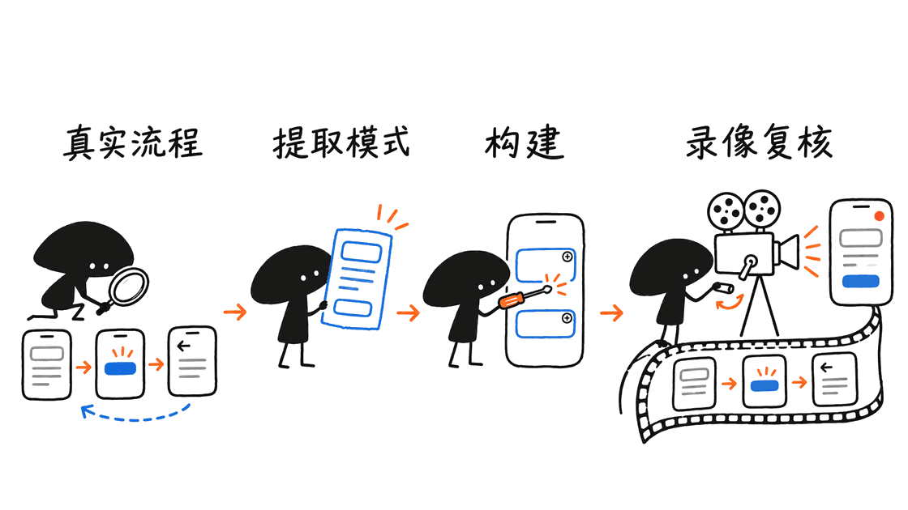
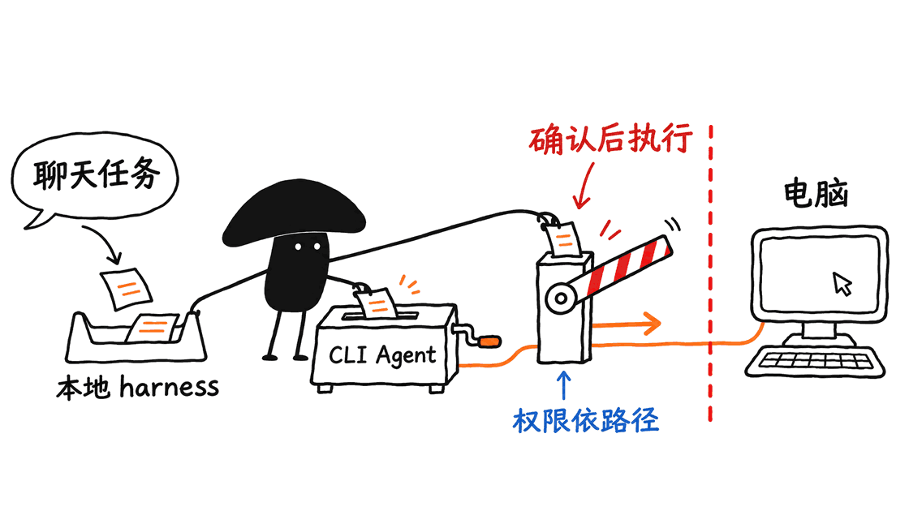
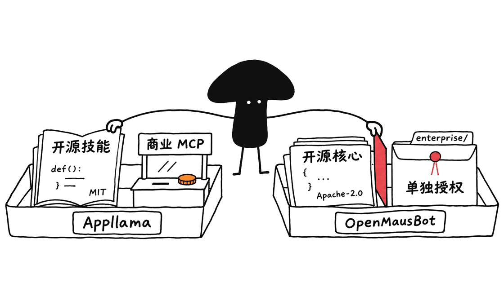

Appllama Skills 把移动 App 开发中的设计研究、原生交互和模拟器验收写进 Agent 的工作方法；OpenMausBot 则把多个 Agent、电脑操作与审批放进聊天式工作台。它们解决不同问题：前者约束界面如何做，后者组织任务如何执行，不能当成彼此的开源替代。

两份素材放在一起，恰好说明 AI 软件工具正在分化的两个方向：一类补上专业工作的质量标准，另一类提供能持续做事的运行环境。**能运行、看起来好、交互正确，是三项需要分别验证的结果。**

## Appllama 开源的究竟是什么？

官方仓库 `Appllama/appllama-skills` 提供两个 MIT 授权的 Skill。`appllama-usage` 负责使用 Appllama MCP 研究真实 App 的屏幕、流程和控件；`appllama-app-design-skill` 则负责 Expo / React Native 的实现与验收。本次快照的技能版本分别为 1.1.0 与 1.3.0。

这不是训练好的设计模型，也不是安装后立即得到漂亮页面的组件库。Skill 是给支持技能机制的 Agent 读取的工作规范；效果仍取决于模型、项目依赖、可访问的参考资料和实际验证工具。

设计 Skill 可以脱离 Appllama MCP 单独使用。需要特别区分：开源的是这套方法与文档，不是整个商业 App 截图库及其服务端。README 说明 MCP 访问属于 Pro，除查询余额的 `get_credits` 外，调用会消耗额度。MIT 许可证也不授予 Appllama 品牌和商标使用权。

从项目目录安装全部技能：

```bash
npx skills@latest add appllama/appllama-skills
```

如果只需要设计规范，可只安装：

```bash
npx skills@latest add appllama/appllama-skills --skill appllama-app-design-skill
```

这里介绍的是安装方式，本次没有把第三方技能装进现有工作环境，也没有登录付费 MCP。

## 为什么它强调研究流程，而不只是参考截图？

高收入 App 的单张界面只展示一个状态，无法解释用户怎么到达这里、怎样取消，以及完成购买后还能不能返回旧状态。Appllama 的方法先研究同类产品的完整旅程，再提取信息层级、布局骨架、控件选择和主操作位置。

它要求学习模式，而不是逐像素复制。其 Skill 同时出现“实现前研究 20—30 张屏幕”和“每类屏幕至少 10 个参考”的不同范围要求，适合视为工作检查标准，不应宣传成一个科学证明过的最佳样本数。

设计规范涉及语义颜色、明暗主题、平台控件、字阶、安全区域与触控反馈；导航则强调 push、replace、sheet 和 overlay 的语义。比如登录或购买成功后，不应通过返回手势再次进入已经失效的旧状态。这是状态和路由设计，不是增加圆角就能修复的问题。

Skill 把 Apple HIG 作为重要参照，也要求考虑 Android 返回键与平台行为。它不代表 Apple 官方认证；其中具体 Expo API 和依赖写法仍需结合项目 SDK 版本核对。



## “好看”的验收，为什么必须包含动态过程？

设计 Skill 要求在模拟器中录制完整流程，既正常速度观看，也逐帧检查。它覆盖页面进退、手势中断、弹层取消、键盘出现、长内容滚动，以及明暗主题切换。静态截图很容易漏掉错误主题闪帧、输入框被遮挡和返回路径失效。

它还要求加载、空、错误状态，大字号、触控目标与降低动态效果设置。关于 60fps 的要求属于技能定义的交付标准，其中最终检查明确涉及较慢受支持设备的 release 构建；不能只看模拟器录像，就声称真实设备性能已经达标。

这种方法的价值是把“感觉还不错”拆成可检查的问题。执行时还需要按产品阶段设置验收范围：原型可先验证关键路径，正式交付再补设备矩阵和辅助功能检查。不能把 Skill 写下的目标自动当成项目已经实现的结果。

## OpenMausBot 负责的是什么？

`milind-soni/OpenMausBot` 是另一套独立项目，官方把它定位为 Grok Bot 的开源替代。它也叫 MausBot，早期名称是 OpenGrokBot；不是 Appllama 的替代品，也没有证据表明两者已经完成一键集成。

它把 Bot 表现成聊天联系人，底层使用已安装并登录的 `claude`、`codex`、`grok` 等 CLI。一个监听回环地址的 harness 管理 Agent 进程，默认将对话、事件和密钥等存入 `~/.openmausbot`。本次源码包版本为 0.1.141。

“本地运行”并不代表所有推理都在本机。CLI 使用云端模型时，仍会向对应服务发送相关输入；已有订阅、API 和第三方资源的费用也不会因为换了桌面界面而消失。

它提供电脑操作入口，包括云端 Linux 桌面、隔离的本地 VM，以及部分平台上需明确启用的宿主机操作。当前 README 说明 macOS 和 Ubuntu Xorg 可以选择启用宿主机控制，Ubuntu Wayland 的宿主机控制仍禁用。不要把这些平台与权限条件省略成“所有电脑都能随便控制”。

通过 Composio 连接其他服务是另一种执行路径，不能与视觉点击混为一谈。云电脑与外部连接器还各有凭证、权限和可能的费用。



## 开源代码与可用服务之间，有哪些边界？

| 项目 | 可审阅或使用的开源部分 | 需要单独确认的部分 |
| --- | --- | --- |
| Appllama Skills | 两个 MIT Skill、研究和设计方法 | 商业图库 MCP、额度、参考图像权利和品牌 |
| OpenMausBot | Apache-2.0 核心、桌面与本地 harness | `enterprise/` 单独许可证、云电脑、外部 CLI 和连接器条件 |

OpenMausBot 的 `LICENSING.md` 明确指出：`enterprise/` 是 source-available，不适用核心 Apache-2.0。开发测试与生产、第三方托管或白标的授权条件不同。文档说明移除该目录仍保留普通开源独立运行，但这不意味着可以绕开已配置的托管登录权限。

审批也不是一个永远不变的承诺。用户选择的信任级别、工具适配与具体执行路径共同决定哪些操作需要确认。本次检查的是少量审批协调与链接边界的实现，没有对所有电脑操作和外部服务做安全审计。



## 如果要用它们做 App，工程上怎样安排？

可以借鉴两者分别强调的方法，但整合方案需要自行实现并验证。比较稳妥的起点，是给一个小型 Expo 项目写出固定范围：一个主流程、明确的状态集合、参考来源、产物目录和完成条件。

设计阶段先用 Appllama 的规范输出研究结论：借鉴哪些模式、哪些内容不适合本产品、每个页面的返回行为是什么。参考资料不能仅以“竞争对手也这样做”作为正确性依据，仍要检查实际用户目标。

实现阶段让编码 Agent 按当前项目版本完成代码，记录依赖变化和测试命令。OpenMausBot 若承担调度或操作入口，应先确认工作目录、CLI 身份、电脑类型和审批范围；它不会自动替代 Xcode、iOS Simulator、Android 工具链或真实设备测试。

验收阶段保存可复核的产物：页面状态清单、完整流程录像、性能测量、修改记录和未解决问题。至少检查取消、错误恢复、重复点击、键盘与返回路径。发布和购买等对外操作应作为明确步骤处理，不能从一张漂亮截图推断整条链路都成功。

## 本次实际验证到了哪里？

本次读取了两个仓库的 README、技能正文、模拟器要求和许可证，以及 OpenMausBot 的验证说明和相关测试。固定快照为 Appllama `dd5caaec3d5d50ad7fc0324da238119c6b7c3707`，OpenMausBot `e7317a7fd23495ce6cb159279aa0ef9b8f086b06`。

在本机运行了 OpenMausBot 现有的三个 Node 测试文件：可信审批模式协调、应用 frame 导航边界、聊天深链解析，共 28 项通过、0 失败。它们包含模拟进程与输入检查，不能证明真实云电脑、完整 Electron 界面或所有授权路径已经通过测试。

本次没有运行真实模型会话、连接商业 MCP、启动云电脑或 VM，也没有生成并安装手机 App。因此，本文给出的是源码与方法分析，不把项目宣传中的成品质量写成本次实测。

这两类项目值得关注的共同点，是把代码生成之外的工作摆到台面上：设计需要参照与验收，持续执行需要状态、环境和权限。工具是否值得保留，最终仍取决于一次完整任务中减少了多少返工，而不是角色数量或安装命令有多短。

## FAQ

### Appllama Skills 完全免费使用吗？
开源 Skill 是 MIT 授权，设计 Skill 可以独立使用；Appllama 商业图库 MCP 则有账号、套餐和额度条件。

### OpenMausBot 是 Appllama 的开源替代吗？
不是。两者定位不同，本文也没有验证它们之间存在现成集成。

### 通过 28 项测试，是否说明可以安全控制真实电脑？
不能。测试只覆盖三个指定文件中的行为，没有完成真实电脑操作的端到端验证。

## 一手来源

Appllama Skills：https://github.com/Appllama/appllama-skills

设计 Skill：https://github.com/Appllama/appllama-skills/blob/main/skills/appllama-app-design-skill/SKILL.md

OpenMausBot：https://github.com/milind-soni/OpenMausBot

授权边界：https://github.com/milind-soni/OpenMausBot/blob/main/LICENSING.md

官方验证流程：https://github.com/milind-soni/OpenMausBot/blob/main/docs/verification/README.md

---

> © 2026 Author: Mycelium Protocol. 本文采用 [CC BY 4.0](https://creativecommons.org/licenses/by/4.0/deed.zh) 授权——欢迎转载和引用，须注明作者姓名及原文链接，不得去除署名后以原创发布。

<!--EN-->

Appllama Skills defines a method for researching, building and verifying mobile interfaces. OpenMausBot is a separate chat-style agent workspace with computer and approval capabilities. They address different problems: interface quality and task execution. They are neither replacements for each other nor a verified integrated stack.

## What does Appllama actually open-source?

The repository provides two MIT skills. `appllama-usage` guides research through the Appllama MCP; `appllama-app-design-skill` defines Expo and React Native implementation and verification standards. Their inspected versions are 1.1.0 and 1.3.0.

These are agent instructions, not a trained design model or a ready-made component library. The design skill works independently of the MCP. The reference-screen service is separate: the README places MCP access in Pro, with credits for calls other than the free balance query. Open instructions do not mean an open commercial screenshot dataset, and the license does not grant trademark rights.

Install both from a project directory:

```bash
npx skills@latest add appllama/appllama-skills
```

Or select only the independent design skill:

```bash
npx skills@latest add appllama/appllama-skills --skill appllama-app-design-skill
```

These commands are documented installation paths; no third-party skill was installed into the existing environment during this review.

## Why study complete flows?

A successful screen hides the journey around it: arrival, cancellation, errors and what happens after a purchase. Appllama emphasizes studying real flows and extracting information hierarchy, layout, controls and primary actions rather than copying pixels.

The skill uses research targets of 20–30 screens before implementation and at least 10 references per screen type in its completion checklist. Those are workflow standards at different scopes, not scientifically validated optimum sample sizes.

Its implementation guidance covers semantic colors, light and dark themes, native controls, typography and safe areas. Navigation differentiates push, replace, sheets and overlays. A successful login or purchase should not allow a back gesture to re-enter an obsolete state. Such behavior depends on state and routing, not cosmetic polish alone.

Apple HIG is a reference, not an Apple certification. Concrete Expo APIs and dependency assumptions still need checking against the project’s SDK version and Android behavior.


## A screenshot is not a complete acceptance test

The skill requires recording whole simulator flows and watching them both normally and frame by frame. It includes back navigation, cancelled gestures, sheets, keyboard transitions, scrolling and theme changes. These expose flashes, hidden inputs and broken navigation that still images can conceal.

It also calls for loading, empty and error states, larger text, touch targets and reduced motion. Its 60fps requirement is a delivery target; the final checklist includes a release build on the slowest supported device. Simulator video alone cannot establish real-device performance.

The useful contribution is an explicit review method. Prototype and production acceptance scopes should be defined separately, and written standards must not be presented as measured results.

## What does OpenMausBot provide?

OpenMausBot positions itself as an independent open-source Grok Bot alternative. Also called MausBot and formerly OpenGrokBot, it is unrelated to Appllama. The inspected package version is 0.1.141.

Bots appear as chat contacts, while installed CLI engines such as Claude, Codex and Grok run underneath. A loopback harness manages agent processes, with local transcripts, events and credentials under `~/.openmausbot` by default. Cloud inference still sends relevant input to providers, and existing subscriptions and external-service charges remain separate.

Computer options include a cloud Linux desktop, a local VM and opt-in host control on supported platforms. The README currently permits host control on macOS and Ubuntu Xorg while disabling it on Ubuntu Wayland. Those conditions should remain attached to any claim about computer access. Composio connectors offer another tool path, distinct from visual clicking.


## Open code and available services have different boundaries

Appllama’s MIT skills do not include unlimited reference-library access. OpenMausBot’s Apache-2.0 core also has an explicit exception: `enterprise/` is source-available under its own license. Development and evaluation differ from licensed production use, third-party hosting and white-labeling.

The licensing document says ordinary standalone OSS operation remains after removing that directory, while configured hosted sign-in authority must not be bypassed. The blanket phrase “everything is Apache-2.0” would therefore be inaccurate.

Approval behavior depends on the chosen trust level, tools and execution path. The narrow tests run here do not constitute an audit of all computer or connector operations.


## A practical mobile-app workflow

Start with a small Expo project and a written scope: one principal flow, required states, reference sources, output paths and acceptance criteria. Use Appllama’s method to explain which patterns were adopted and why; commercial popularity alone is not proof of suitability for the actual users.

Let the coding agent implement against the project’s current dependencies, recording changes and test commands. If OpenMausBot supplies the execution interface, establish its workspace, CLI identity, computer type and approval scope first. It does not replace Xcode, iOS Simulator, Android tooling or real-device tests.

Keep a state checklist, complete-flow recordings, measured performance, change history and unresolved issues. Exercise cancellation, failures, repeated taps, keyboard behavior and back navigation. Treat external publication and purchasing as explicit workflow steps. This is a proposed evaluation arrangement, not a tested integration between the projects.

## What was checked here?

Both READMEs, skill instructions, simulator requirements, licensing and relevant verification material were inspected at Appllama commit `dd5caaec3d5d50ad7fc0324da238119c6b7c3707` and OpenMausBot commit `e7317a7fd23495ce6cb159279aa0ef9b8f086b06`.

Three existing Node test files passed 28 checks with zero failures: trusted approval-mode coordination, app-frame navigation boundaries and chat deep-link parsing. These include fake-process and input cases, not complete Electron, cloud-computer or authorization coverage.

No live model session, commercial MCP connection, cloud computer, local VM or generated mobile app was exercised. The analysis separates documented requirements from demonstrated behavior. The practical question is whether a complete task produces fewer defects and less rework, not how many agents can be displayed at once.

## FAQ

### Are Appllama Skills entirely free?
The MIT instructions are open, and the design skill can run independently. Commercial MCP library access has separate account, plan and credit conditions.

### Is OpenMausBot an alternative to Appllama?
No. Their functions differ, and no ready-made integration was verified here.

### Do 28 passing checks establish safe real-computer control?
No. They cover three focused test files, not end-to-end computer operation.

## Primary sources

Appllama: https://github.com/Appllama/appllama-skills

Design skill: https://github.com/Appllama/appllama-skills/blob/main/skills/appllama-app-design-skill/SKILL.md

OpenMausBot: https://github.com/milind-soni/OpenMausBot

Licensing: https://github.com/milind-soni/OpenMausBot/blob/main/LICENSING.md

Verification: https://github.com/milind-soni/OpenMausBot/blob/main/docs/verification/README.md

---

> © 2026 Author: Mycelium Protocol. Licensed under [CC BY 4.0](https://creativecommons.org/licenses/by/4.0/) — free to share and adapt with attribution. You must credit the author and link to the original; removing attribution and republishing as original is not permitted.
