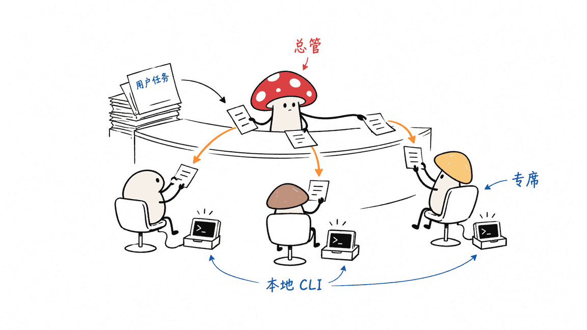
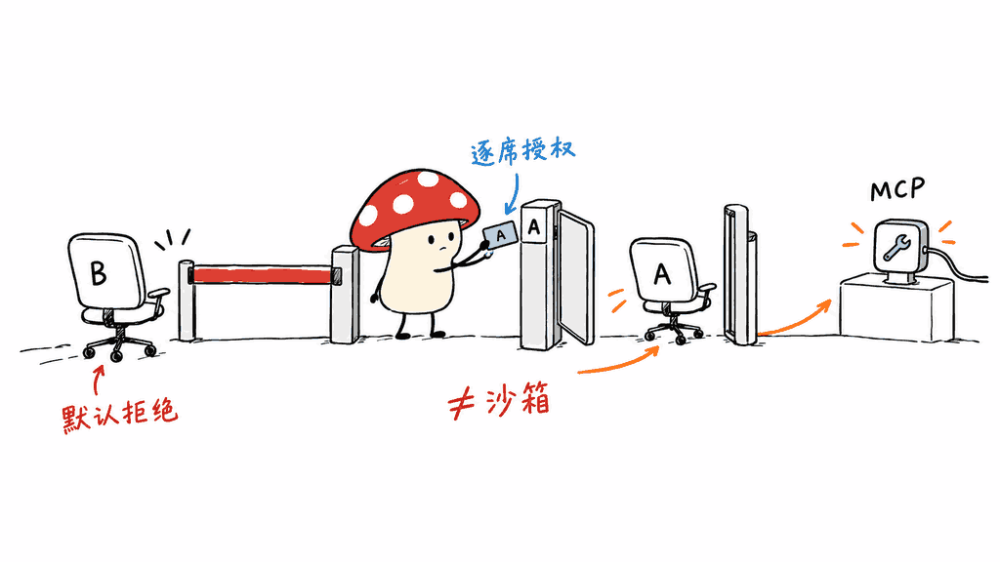
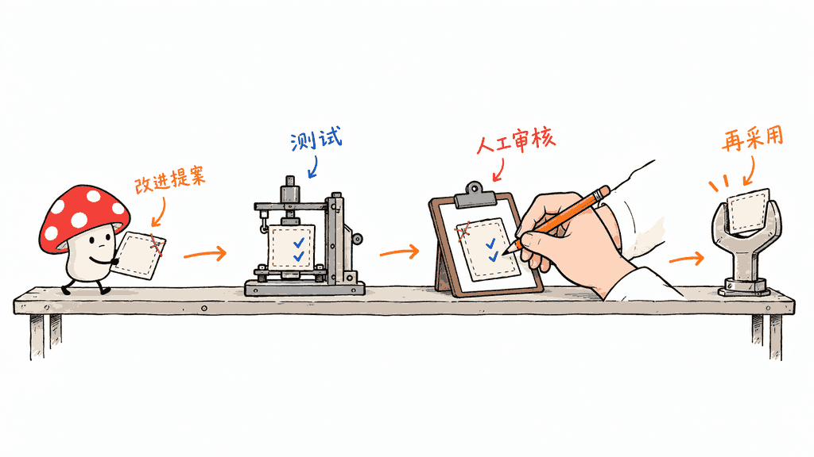

ArchonOS 是把任务分派、编程助手、工具授权和任务产物放在一起的个人与小团队工作台。它运行在本地机器上，通过已有的命令行助手执行任务，而不是提供一套新的大模型。

公开仓库为 dmquant/archonos-pub，MIT 许可，本次获取的 package.json 版本为0.1.004。本文审阅公开源码与文档，运行了14项模块测试；没有连接个人模型账号、真实MCP服务或Cloudflare账户，也没有复现完整部署。

本次远程分支列表只返回main，研究对应提交为a4f4873a9037dc08374232b03a1f458cab3dee45；没有假定另一个pub分支已公开或与此一致。

源码：https://github.com/dmquant/archonos-pub
本文原文：https://blog.mushroom.cv/blog/archonos-local-agent-workbench/

## “智能操作系统”具体是什么？

这里的OS是应用层工作台的产品定位，并不替代macOS或Linux内核。默认入口是Chief of Staff参谋长角色，由它把请求路由给代码、研究、运维等专业席位；席位再调用本机claude、codex、agy或opencode等CLI。



它想连接的是一条完整链路：请求进入聊天界面，选择执行角色和工具，生成报告或可交互Canvas，再对现有产物继续修改。对于经常在多个助手之间切换的人，价值是让“谁做了什么、使用哪些工具、产物改到哪一版”更容易追踪。

但界面能打开、角色能展示、演示产物能生成，并不等于真实模型任务已成功。官方Quickstart明确提到，没有CLI时也有确定性的回退内容用于探索界面。验收时应核对实际执行引擎、退出状态和输出文件，避免把回退演示当成模型能力。

## 工具授权与执行隔离是一回事吗？

不是。仓库把MCP注册、席位授权、人工确认和策略账本拆成模块，官方设计要求未授权工具默认拒绝。secret://句柄是凭证引用方式，不是自动完成密钥管理或隔离的证明。



本次运行上游archon-ledger的10项Python测试、archon-canvas的4项Node测试，均通过。后者包含范围、结构、无效计数、不可变冲突以及视图元数据不携带凭证等检查。测试证据仅覆盖这些模块，没有验证全部107项宣称，也没有执行真实工具调用或做渗透测试。

工具是否允许调用，与子进程是否能读取某目录、执行命令或访问网络，是不同层面的问题。生产接入需要再核对操作系统权限、工作目录、运行账号及客户端自身授权设置，不能把default-deny标签理解成完整沙箱。

## Canvas与技能改进如何落地？

Canvas把产物与修订历史连接起来，界面支持引用产物后继续修改。仓库设计使用哈希与修订门禁来约束提交顺序。它有助于追踪变化，但哈希只能说明内容身份，不能保证报告事实正确、代码可靠或操作安全。

RSI是另一组技能评估与改进流程。README描述周期检查和技能迭代；这不等于模型权重自动升级，也没有在本次验证中证明长期自主改进收益。



更可控的做法是把改进流程当作建议生成器：在测试副本中产出候选，比较改动与任务结果，保留批准和回滚步骤，再决定是否用于正式环境。这是本文的工程建议，不是宣称所有保护已经由项目完整实现。

## 如何正确开始安装？

官方Quickstart要求Node.js20及以上、Python3.10及以上；完整测试脚本还调用Bun。源码是Web/Node/Python应用，Mac并不因此必须具备能容纳某个本地大模型的统一内存；如果CLI连接远程模型，推理仍在上游发生。本次没有给出最低内存实测。

README的克隆地址正确，但紧接着的cd目录名不匹配；Quickstart还有your-org占位地址。应改为：

```bash
git clone https://github.com/dmquant/archonos-pub.git
cd archonos-pub
npm install
npm run init
npm start
```

本地界面默认地址为http://127.0.0.1:8790。注意package.json包含postinstall初始化：npm install并非只下载依赖，还可能创建配置并发现已有CLI或MCP信息。先在隔离工作目录审阅scripts/archon-init.mjs，再接入日常环境。

上面是修正后的安装路径，不是本文已执行的完整安装记录。CLI程序本身也应单独安装和验证。本次没有运行初始化程序，以免扫描或改动现有个人配置。

## “本地运行”是否意味着完全离线？

工作台部署本地，与推理和数据完全离线不同。CLI可能连接云模型，前端也应检查实际资源依赖。另一个可选方案使用Cloudflare Worker、R2和本机同步守护进程，把远程请求交给本地机器执行，再返回结果。

审阅同步脚本可见远程HTTP请求和状态同步路径，因此启用该模式后应明确哪些任务、消息和产物会离开本机。README的加密同步表述不能代替对密钥归属、存储加密与端到端加密的分别核验；本文没有做密码学审计。

## 常见问题

### 可以把现有Claude或Codex会话无损搬进去吗？

仓库描述会话连续性，但本次模块测试不能证明跨客户端的完整状态迁移。先用小任务验证工具结果、历史上下文与产物关联。

### 测试通过就可以放心接管正式项目吗？

不可以这样推断。建议从只读研究或非关键代码副本开始，再验证一次授权拒绝、一次产物修订和一次失败恢复。

### 它适合谁？

适合愿意审阅配置、需要把多CLI和任务产物集中管理的开发者或小团队。目前应按早期工程项目评估，而不是把宣传中的自主能力当成交付承诺。

## 判断与资料

ArchonOS的意义是把模型调用之外的任务治理摆到同一界面：入口路由、工具权限、修订记录、技能候选都有明确落点。能否节省真实工作量，要通过自己的任务闭环确认；“交给编程助手可以修好”也不能替代维护责任与验收。

相关：模型连接管理可以对照Magpie理解：https://blog.mushroom.cv/blog/magpie-multi-agent-model-gateway/

官方资料：https://github.com/dmquant/archonos-pub/blob/main/docs/en/QUICKSTART.md
https://github.com/dmquant/archonos-pub/blob/main/docs/en/ARCHITECTURE.md
https://github.com/dmquant/archonos-pub/blob/main/package.json

> © 2026 Author: Mycelium Protocol. 本文采用 [CC BY 4.0](https://creativecommons.org/licenses/by/4.0/deed.zh) 授权——欢迎转载和引用，须注明作者姓名及原文链接，不得去除署名后以原创发布。

<!--EN-->

ArchonOS is an application-level workbench for task routing, coding assistants, tool permissions and versioned artifacts. It uses existing local CLI engines rather than supplying a new language model.

The remote branch listing exposed only main at commit a4f4873a9037dc08374232b03a1f458cab3dee45. This review does not assume a separate pub branch is publicly available.

Repository: https://github.com/dmquant/archonos-pub
Original article: https://blog.mushroom.cv/blog/archonos-local-agent-workbench/

The retrieved public edition is MIT-licensed and reports version0.1.004 in package.json. We reviewed its documentation and ran14 upstream module checks. We did not initialize personal configuration, connect model accounts or MCP servers, or validate a full deployment.

## What does its “operating system” organize?

A Chief of Staff seat receives requests and routes them to specialist seats. These can invoke installed claude, codex, agy or opencode tools. Chat and Canvas then connect task requests with revisable artifacts. This is an application workbench, not a replacement operating-system kernel.


The official Quickstart explicitly describes deterministic fallbacks when no CLI is installed. An interface or demonstration artifact therefore does not prove that a model executed a real task. Check the selected engine, exit state and output files.

## Does default-deny imply a complete sandbox?

No. MCP registration, per-seat grants and policy checks address authorization. Filesystem permissions, process isolation and outbound network access are separate concerns. A secret:// handle is a credential reference, not proof of comprehensive secret management.


All10 Python archon-ledger tests and4 Node archon-canvas checks passed. The Canvas checks cover scope, schema, invalid counters, immutable conflicts and credential-free view metadata. This does not reproduce the claimed107-test suite, actual MCP execution or a security audit.

## What do artifact revisions and RSI establish?

Canvas associates artifacts with revision lineage and validation gates. Hashes identify content; they do not establish factual accuracy or safe execution. The documented RSI workflow concerns skill eligibility and improvement, not proven autonomous model-weight upgrades.


Our recommendation is to generate candidates in a disposable project, compare task outcomes and changes, retain approval and rollback records, then decide whether to promote them. This is engineering advice, not a claim that every safeguard is implemented.

## How should installation begin?

The Quickstart requires Node.js20+ and Python3.10+. The complete test script also invokes Bun. Memory required for local model inference depends on the selected engine and model; no minimum Mac RAM was measured here.

The README clone command and following directory disagree, while the Quickstart retains a placeholder repository. The corrected sequence is:

```bash
git clone https://github.com/dmquant/archonos-pub.git
cd archonos-pub
npm install
npm run init
npm start
```

The local console defaults to http://127.0.0.1:8790. package.json has a postinstall initializer, so installing can do more than fetch dependencies: review scripts/archon-init.mjs before allowing configuration creation and discovery of existing clients or MCP information. We did not execute initialization against personal configuration. The commands above are corrected instructions, not an installation transcript.

## Is local deployment fully offline?

Not necessarily. A CLI may call a remote model. The optional Cloudflare Worker/R2 bridge exchanges tasks, state and outputs with a local daemon. The synchronization script contains remote HTTP calls; review the actual data path before enabling it.

Claims of encrypted synchronization require separate verification of transport protection, storage encryption, key ownership and any end-to-end guarantees. No cryptographic audit was performed.

## FAQ

### Can existing client sessions be migrated losslessly?

The module checks do not establish universal session migration. Test tool results, history and artifact associations in a small workflow.

### Are passing tests enough for production access?

No. Start with read-only work or a noncritical repository copy. Verify a denied grant, an artifact revision and failure recovery.

### Who should evaluate it?

Developers and small teams comfortable reviewing configuration and early-stage software, especially those managing several CLI engines and task artifacts.

## Assessment and sources

The interesting contribution is an explicit place for routing, authorization, revisions and skill candidates around model calls. Real value depends on a tested task loop. A coding assistant's ability to repair a problem does not replace maintenance ownership.

Related gateway review: https://blog.mushroom.cv/blog/magpie-multi-agent-model-gateway/

Official references:
https://github.com/dmquant/archonos-pub/blob/main/docs/en/QUICKSTART.md
https://github.com/dmquant/archonos-pub/blob/main/docs/en/ARCHITECTURE.md
https://github.com/dmquant/archonos-pub/blob/main/package.json

> © 2026 Author: Mycelium Protocol. Licensed under [CC BY 4.0](https://creativecommons.org/licenses/by/4.0/) — free to share and adapt with attribution. You must credit the author and link to the original; removing attribution and republishing as original is not permitted.
