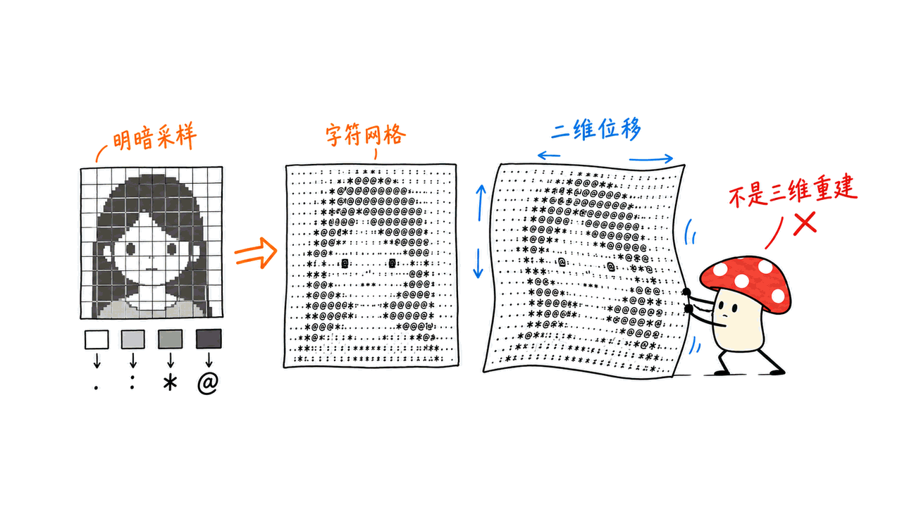
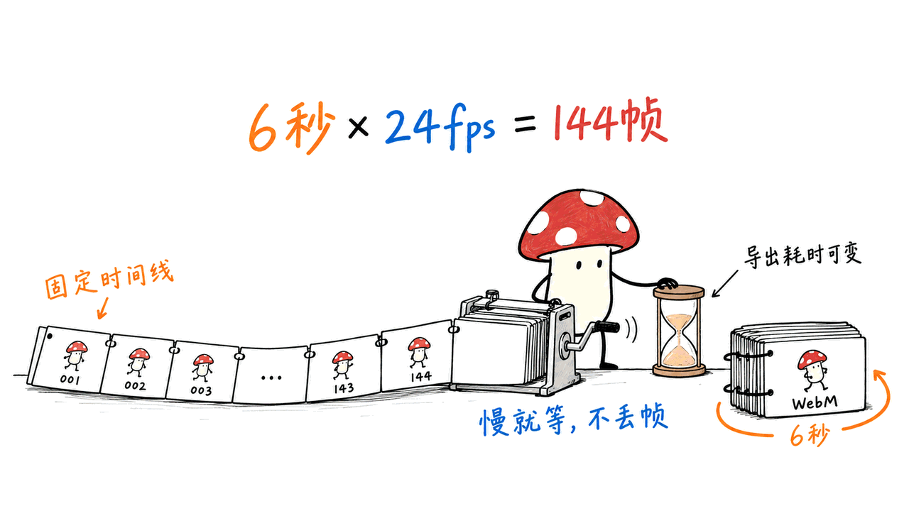

ASCII Portrait Studio 能在浏览器里把照片转成会动的字符画，导出静态 PNG 或六秒循环 WebM。官方仓库是 Ethannju/ascii-portrait，代码采用 MIT，演示图片另有来源说明；本次 API 快照为 19 星。

它的价值是把一段视觉制作流程装进网页：选图、分割主体、把明暗换成字符、加位移与运动、导出视频。它不需要调用大模型生成每一帧，也不进行三维重建。以下依据 2026 年 10 月 20 日固定版本资料。

仓库：https://github.com/Ethannju/ascii-portrait
在线版：https://ethannju.github.io/ascii-portrait/
源码版本：3499a60c6fc67ff8b7d86e4c41e7b7607b850b39

## 照片为什么能变成会动的字符画？

第一步是采样：把图像分成网格，用每个格子的亮度选择字符。项目提供 19 或 27 级字符集，稀疏字符对应较亮或较暗的区域，具体显示取决于渲染配置；字符可以保留原图颜色，也可使用单色、绿色、琥珀色、钴蓝等配色。

接着，TensorFlow.js 与 MediaPipe Selfie Segmentation 在浏览器中区分人物和背景。如果分割不可用，项目回退到整张图。随后用亮度构造二维位移场，通过 WebGL 产生形变，再叠加字符运动。这种空间感来自图像变形，不是重建出一个能自由转动的真实三维头部。



输入质量往往比调参更关键。官方建议主体大、背景简洁、明暗对比明显的图片；低反差自拍或复杂背景会让细节混成噪声。先选好照片，再调网格密度与配色，比一开始就增加运动强度更有效。

## 六秒视频怎样保证循环时间？

项目通过固定时间线渲染帧，用 WebCodecs 编码为每秒 24 帧的 WebM。六秒对应 144 帧，目标是在机器较慢时延长导出耗时，而不是跳过本应输出的帧。不要把这个设计解读为任何电脑都能实时导出。

实际播放、编码器支持和视频封装是不同环节。README 记录了在 macOS 的 Chrome 154、Safari 26.4 上测试视频导出；这是维护者的兼容说明，不是我们在所有浏览器上复测过的承诺。其他环境可以先用 PNG 导出验证基础链路。



我们的验证使用固定版本、未修改的上游测试。运行了 motion-export、runtime、select 与 server 四组回归检查；前几组使用合成浏览器或编码器原语，服务端组实际建立本地 HTTP 服务检查静态资源与边界。运动导出、编辑器状态、选择器三组分别通过 52、43、30 个场景；服务端测试运行器报告 11 项通过、0 失败。

第一次只下载代码时，服务端测试因缺少演示图片而失败；补齐同版本官方静态资源后重跑。这属于测试目录准备不完整，不能写成产品故障。我们没有用真实人像完成浏览器端分割或真实 WebCodecs 视频导出，也没有测量画质与速度。

## 如何在自己电脑启动？

官方要求 Node.js 22 或更新版本，无需安装 npm 依赖或执行构建。命令如下：

```bash
git clone https://github.com/Ethannju/ascii-portrait.git
cd ascii-portrait
npm run dev
```

打开 http://127.0.0.1:4173 ，先选内置样例，再试一张自己有权使用的照片。先导出 PNG，检查主体是否完整、字符是否可读、背景是否干净，再增加轻微运动并尝试六秒视频。

若视频导出不可用，先核对 WebCodecs 和编码器支持，不能仅凭动画预览正常就判断视频编码一定可用。README 建议贡献代码前执行 `npm test`；我们此次只运行上述四组专项测试，没有把它们说成完整发布检查。

## “照片不上传”是否等于完全离线？

照片在浏览器中处理，但首次人物分割会从 CDN 加载相关库或模型。你可以把“图像不提交给服务端处理”和“页面没有任何网络请求”分开理解。

照片及设置会保留在当前浏览器的本地存储中，用于下次恢复。在公共或共享电脑上，需要主动使用界面的 Clear local data。关闭标签页不等于清除了本地照片。


还有一个容易混淆的环节：官方给出了先用外部图像 AI 改善布光的可选建议。若你选择把照片交给外部图像服务，那一步有自己的数据边界，并不因为后续字符渲染在本地就变成全程本地。

## 谁适合用，哪些期待需要调整？

它适合个人主页视觉、创意头像、演示背景和短循环素材。它把既定渲染流程做成工具，不是视频大模型，也不是给任何普通照片补出完整空间结构的重建系统。

建议用实际发布平台验收：检查 WebM 是否被目标平台接受、循环接缝是否自然、缩小后人物是否仍可辨认。若平台需要其他容器，另行转码并检查结果；不能把改扩展名当作格式转换。

代码许可证为 MIT。内置演示图是合成图片，项目在 ASSET-LICENSE.md 与 PROVENANCE.md 中解释了来源和授权边界；其中机甲不代表任何第三方品牌背书。使用别人的照片仍须获得相应许可。本文封面采用仓库公开的合成机甲样例，并非真实设备照片。素材声明与来源记录保留在：https://blog.mushroom.cv/media-notices/ascii-portrait/ASSET-LICENSE.md 和 https://blog.mushroom.cv/media-notices/ascii-portrait/PROVENANCE.md

## 常见问题

### 需要独立显卡或付费模型 API 吗？

这个工作流主要使用浏览器图像渲染与分割，不靠付费大模型逐帧生成。实际可用性仍取决于浏览器、WebGL 和编码器支持；我们没有给出硬件性能保证。

### 它会生成三维模型吗？

不会。当前流程是字符采样与二维位移，不输出可编辑的三维网格，也不保证新的观察角度符合真实几何。

### 本地运行以后能彻底断网吗？

默认首次分割仍有 CDN 依赖。要做隔离网络部署，应另行准备并验证本地库与模型资源；本文没有完成这样的部署。

## 来源与延伸阅读

官方说明：https://github.com/Ethannju/ascii-portrait/blob/3499a60c6fc67ff8b7d86e4c41e7b7607b850b39/README.md
素材说明：https://github.com/Ethannju/ascii-portrait/blob/3499a60c6fc67ff8b7d86e4c41e7b7607b850b39/ASSET-LICENSE.md
编码实现：https://github.com/Ethannju/ascii-portrait/blob/3499a60c6fc67ff8b7d86e4c41e7b7607b850b39/motion-export.js
相关工程阅读：https://blog.mushroom.cv/blog/lemo-opuscar-code-video-skill/

核验日期：2026-10-20。正文配图为机制说明，非软件运行截图；专项回归通过不等于真实浏览器成片实测。

---

> © 2026 Author: Mycelium Protocol. 本文采用 [CC BY 4.0](https://creativecommons.org/licenses/by/4.0/deed.zh) 授权——欢迎转载和引用，须注明作者姓名及原文链接，不得去除署名后以原创发布。

<!--EN-->

ASCII Portrait Studio turns a photo into animated character art in a browser, with PNG stills and six-second WebM loops. The official repository is Ethannju/ascii-portrait; its code is MIT-licensed, with a separate demo-asset notice. Our API snapshot shows 19 stars.

This is a packaged rendering workflow rather than a model that generates every frame. It samples brightness, separates a subject where possible, applies two-dimensional displacement, animates glyphs, and exports the result. It does not reconstruct a 3D head.

Repository: https://github.com/Ethannju/ascii-portrait
Online studio: https://ethannju.github.io/ascii-portrait/
Pinned source: 3499a60c6fc67ff8b7d86e4c41e7b7607b850b39

## How does a photo become moving character art?

The image is sampled on a grid. Each cell's brightness selects a glyph from a 19- or 27-level character set. Glyphs can retain the image's color or use monochrome, green, amber, and cobalt palettes.

TensorFlow.js and MediaPipe Selfie Segmentation separate the subject in the browser. When segmentation is unavailable, the whole image is used. A brightness-derived 2D field then displaces the image through WebGL, with animated glyphs layered over it. Apparent depth is not a reconstructed mesh.


Input lighting matters. A large subject, simple background, and clear contrast are better starting points than a flat selfie or busy scene. Tune grid density and color before increasing motion strength.

## What makes the six-second loop predictable?

The exporter renders a fixed timeline and encodes a 24 fps WebM with WebCodecs. Six seconds means 144 frames. The intended behavior on slower computers is to wait longer rather than skip timeline frames; this is not a real-time performance guarantee.

Preview rendering, codec availability, and container construction are separate concerns. The maintainer reports testing video export on macOS Chrome 154 and Safari 26.4. We did not independently reproduce that compatibility matrix. PNG is a useful first check elsewhere.


We ran the pinned, unmodified upstream motion-export, runtime, select, and server regression groups. The first groups use synthetic browser or codec primitives; the server group starts a real local HTTP server and checks resource handling and boundaries. Motion, runtime, and select groups passed 52, 43, and 30 scenarios respectively; the server runner reported 11 passes and zero failures.

An initial code-only download lacked the required demo images, so server checks failed. We fetched the matching official static resources and reran the checks. That was incomplete test-fixture preparation, not evidence of an application defect.

We did not perform real-photo segmentation in a browser, export video using a real WebCodecs encoder, or measure visual quality and speed. These targeted tests are also not the complete release check invoked by `npm test`.

## How do you start locally?

The documented requirement is Node.js 22 or later. There are no npm dependencies to install and no build step:

```bash
git clone https://github.com/Ethannju/ascii-portrait.git
cd ascii-portrait
npm run dev
```

Open http://127.0.0.1:4173 and start with a bundled demo. Then try a photo you have permission to use. Export a PNG before adding subtle motion and testing the video path.

If video export is unavailable, inspect WebCodecs and codec support. A working animated preview does not establish encoder availability. Validate the final file in its destination platform, including looping and legibility at small sizes. Convert formats properly if necessary; changing the filename extension is not conversion.

## Does local photo processing mean no network access?

The photo is processed in the browser, but the segmentation libraries or model are downloaded from a CDN on first use. Keeping image computation on-device is different from making no network requests.

The current browser stores the last photo and settings for restoration. Use Clear local data on shared machines. Closing a tab does not clear the saved image.


The README also suggests optional external AI relighting. Sending a photo to such a service introduces a separate data boundary. Subsequent local ASCII rendering does not make that earlier step local.

## When is it useful?

It suits profile visuals, creative portraits, presentation backgrounds, and short looping assets. It does not output editable geometry or guarantee correct new viewpoints.

Code is MIT-licensed. Demo images are synthetic and have provenance and licensing notices; the mecha artwork is not a third-party endorsement. User photos require their own permissions. This article's cover adopts the project's public synthetic mecha sample, not a photograph of real equipment. Preserved notices: https://blog.mushroom.cv/media-notices/ascii-portrait/ASSET-LICENSE.md and https://blog.mushroom.cv/media-notices/ascii-portrait/PROVENANCE.md

## Frequently asked questions

### Does it require a paid model API?

The core workflow uses browser rendering and segmentation rather than paid frame generation. Browser, WebGL, and encoder compatibility still matter; no hardware performance guarantee is established here.

### Does it produce a 3D model?

No. It uses character sampling and 2D displacement, not editable reconstructed geometry.

### Can the default local setup run fully air-gapped?

First-use segmentation still has CDN dependencies. An isolated deployment needs separately prepared and verified local libraries and model assets; we did not implement that deployment.

## Sources

README: https://github.com/Ethannju/ascii-portrait/blob/3499a60c6fc67ff8b7d86e4c41e7b7607b850b39/README.md
Asset notice: https://github.com/Ethannju/ascii-portrait/blob/3499a60c6fc67ff8b7d86e4c41e7b7607b850b39/ASSET-LICENSE.md
Exporter: https://github.com/Ethannju/ascii-portrait/blob/3499a60c6fc67ff8b7d86e4c41e7b7607b850b39/motion-export.js
Related engineering reading: https://blog.mushroom.cv/blog/lemo-opuscar-code-video-skill/

Checked October 20, 2026. Body figures explain mechanisms rather than show an application session. Targeted regression checks are not a real-browser production test.

---

> © 2026 Author: Mycelium Protocol. Licensed under [CC BY 4.0](https://creativecommons.org/licenses/by/4.0/) — free to share and adapt with attribution. You must credit the author and link to the original; removing attribution and republishing as original is not permitted.
