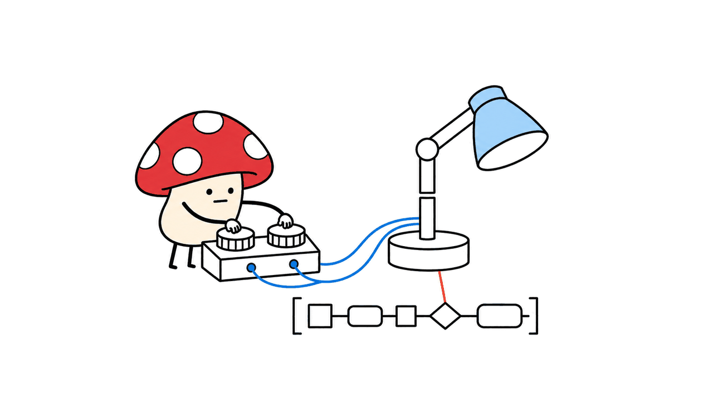

Awesome-3D-Coding 帮开发者查找“用程序创建和编辑三维内容”的论文、数据与工具；它的实用价值，是把不同交付物与验收方式放在同一张研究地图上。

仓库是 https://github.com/jweihe/Awesome-3D-Coding 。Mycelium Protocol 固定提交 `69b232ad5697032f860157a8125ee7e5ba1cdc51` 核对，清单自身使用 MIT 许可。它不是一个新模型、统一 SDK 或安装后即可工作的建模 Agent，所链接项目的许可证和运行要求需要分别确认。

## 它整理的“3D Coding”是什么？

这里的关键不是让 AI 输出一张三维效果图，而是让结果具有可执行的构建过程：Blender Python 创建场景，CadQuery 或其他 CAD 表示构建实体，Three.js 程序生成可交互世界，URDF 描述部件与关节。

程序形式提供了后续修改的入口。设计者可能直接改灯罩半径、零件厚度或关节范围，再重新生成。但“结果由代码生成”并不自动代表结构清楚：一大段硬编码顶点同样是代码，却未必方便编辑。

因此，阅读论文时应先问输出是什么，再问哪些参数和部件能够独立修改。展示视频漂亮，只回答了外观的一部分问题；能否交付可维护的项目文件，是另一个问题。

## 清单怎样读，才不会变成收藏夹？

本次脚本按 README 中以 `| **` 开头的表格数据行统计：基准 22 行、数据集 18 行、方法与表示 20 行、建模系统 19 行，另有指标、工具和相关清单，共 90 行。这是此提交的目录统计，不是 90 篇独立论文，也不是 90 个已经验证可用的开源项目。

比较有效的读法，是从自己的交付物反向选择入口：

| 你要交付什么 | 优先阅读 | 首先验收什么 |
|---|---|---|
| 可修改的商品或游戏资产 | Blender 程序生成与编辑 | 文件可打开、部件可改、多视角结果一致 |
| 带尺寸和孔位要求的零件 | 参数化 CAD 与 CADTests | 实体有效、尺寸与拓扑满足规格 |
| 可操作的浏览器场景 | Three.js 世界与交互评测 | 操作是否触发正确状态变化 |
| 带活动部件的对象 | 关节表示与建模系统 | 链接结构、关节关系及运动是否合理 |

这四条路线并非互斥，但初始验收重点不同。先确定一种交付物和一套验收条件，比同时部署十几个项目更容易看清工具能解决什么问题。

## “能跑”“像”和“正确”为什么要分开？

我们抽查了清单链接的三个官方仓库，分别代表资产、工程实体和交互世界。

3DCodeBench 面向程序化对象建模，其官方说明覆盖 212 个资产类别，评估包括执行情况、几何和渲染外观。脚本成功退出只能说明运行完成；物体缺一条腿、背面空洞或相机刻意遮挡，都可能逃过这层检查。

CADTestBench 则把文字规格转成对生成实体的可执行测试。它强调，一个设计要求可能允许多种合法形状，仅与某个参考模型计算几何距离，可能惩罚有效设计变体，却放过尺寸或拓扑上的错误。因此，“与参考相似”和“满足设计要求”不是同一目标。

WorldCoder-Bench 的 StateProbe 在沙箱浏览器执行程序，探测状态及其变化。门画在正确位置，不代表能打开；按钮有高亮，也不代表点击后真的改变了场景。截图只能检查可见画面，交互必须通过动作与状态一起验收。

这些差异意味着，跨基准的分数不宜直接排成一张“谁最强”的总榜。输入信息、生成预算、运行时、相机和评判规则不同，测到的能力就不同。

## 两百万条数据，是两百万个独立模型吗？

清单收录的 3DCodeVerse-2M 提供了一个值得借鉴的统计口径。官方数据卡将合并文本拆分标为 2,028,286 行，单位是程序与描述类型的组合。同一程序可以对应不同描述，所以不能把行数直接改写成独立 3D 资产数量。

它跨越 Blender Python、CadQuery、OpenSCAD、Three.js、GLSL 和 URDF；这些程序需要不同的执行环境与验收器。把它们统一放进“代码生成”训练集，不会自动消除依赖、版本、相机、单位制和数据许可差异。

数据卡标注 CC BY-NC-SA 4.0，并要求尊重来源许可，还涉及申请访问。清单的 MIT 许可不会替换这份数据卡的条款。工程上应逐项记录来源、样本单位、运行时、可编辑结构与评估信息，再决定哪些数据适合自己的用途。

## 工程师如何借鉴这张地图？

先写一份小而明确的任务书。例如“生成一盏可调灯罩半径和灯杆高度的台灯”，验收时不仅看渲染图，还修改一次半径，重新执行，检查其他部件是否按预期保留。对 CAD 任务则把孔径、厚度、连通性等条件直接列出来。

接着建立执行反馈闭环：保存任务、生成代码、运行日志、导出文件、固定视角渲染与验收结果。Agent 每次修改后，都重新检查受影响的性质。这是从“不断让模型猜”走向“让失败定位到可修改程序”的关键。

最后控制比较条件。至少固定运行时版本、输入资源、调用预算、重试次数和评估设置；把执行失败与质量不达标分开统计。评估器本身也可能有盲区，需要人工检查代表性失败案例。

这是根据清单与抽查资料提出的工程路线，不是已经证明某个 Agent 提升了多少效率。本次没有安装 Blender、CAD 内核或 Unreal，也没有运行这些基准或复现其模型排名。

## 怎样贡献一个真正有用的条目？

仓库的 `how-to-PR.md` 不仅要求“贴链接”，还要求按任务选表、描述生成的程序或可编辑结构，并链接论文、作者代码或数据等一手来源。数据集要写统计单位和单个样本内容；基准要说明执行之后到底检查什么。

当前表格还要求带来源链接的 `YYYY-MM` 发布月份，按各表中的月份倒序插入。已有项目应更新原行，而不是换一个名字重复收录。读者按照这些要求补充遗漏项目，通常比只留下一个宣传标题更有价值。本次没有向上游提交 PR。

## FAQ

### 这个仓库可以直接运行建模吗？

不能。它是研究与工具索引，需要到具体项目核对代码、模型、数据与执行环境。收录不等于作者替所有项目做了兼容性保证。

### Chamfer 距离越低，就越符合需求吗？

不一定。它衡量采样表面的接近程度，不能单独证明尺寸规格、结构可编辑性或交互行为正确。相机相关的视觉相似度也有不同盲区。

### 本文核验覆盖到哪里？

已抓取完整清单、贡献说明、许可和配图，统计表格行，并抽查四份官方项目或数据说明。没有检查所有链接，也未逐篇审计论文、部署全部项目或复现分数。

一手资料：

- 研究清单：https://github.com/jweihe/Awesome-3D-Coding
- 贡献说明：https://github.com/jweihe/Awesome-3D-Coding/blob/69b232ad5697032f860157a8125ee7e5ba1cdc51/how-to-PR.md
- 资产建模评测：https://github.com/gaoypeng/3dcodebench
- CAD 需求评测：https://github.com/dimitrismallis/CADTestBench
- 交互世界评测：https://github.com/shuolucs/WorldCoder-Bench
- 数据卡：https://huggingface.co/datasets/3dcodeverse/3dcodeverse-2m

---

> © 2026 Author: Mycelium Protocol. 本文采用 [CC BY 4.0](https://creativecommons.org/licenses/by/4.0/deed.zh) 授权——欢迎转载和引用，须注明作者姓名及原文链接，不得去除署名后以原创发布。

<!--EN-->

Awesome-3D-Coding maps research, datasets and tools for creating and editing 3D content through executable programs. Its practical value is connecting the artifact you need with the evaluation it requires.

The repository is https://github.com/jweihe/Awesome-3D-Coding. Mycelium Protocol inspected commit `69b232ad5697032f860157a8125ee7e5ba1cdc51`. The collection uses the MIT license. It is a curated index, not a new model, unified SDK or ready-to-run modeling agent. Linked resources have separate terms and runtime requirements.

## What does 3D coding mean here?

The output is more than an attractive image. Blender Python builds scenes, parametric CAD programs construct solids, Three.js creates interactive worlds, and URDF represents links and joints. Programs expose a construction process that developers can inspect and revise.

However, code alone does not guarantee editability. Thousands of hard-coded vertices are executable too, yet changing a named part or design dimension may remain difficult. Ask what representation a method produces and which parameters or components can be changed independently.

A polished video demonstrates only part of the result. Delivering a project that another person can maintain is a different requirement.

## How should engineers navigate the collection?

We counted Markdown table data rows beginning with `| **` in the pinned README: 22 benchmark rows, 18 dataset rows, 20 method and representation rows, and 19 modeling-system rows. Including metrics, tools and related collections, there are 90 rows. These are directory entries, not 90 unique papers or 90 independently verified working projects.

Start with the deliverable rather than the most impressive demonstration.

| Deliverable | Useful starting point | First acceptance checks |
|---|---|---|
| Editable product or game asset | Blender generation and editing | Opens correctly, supports component edits, holds across views |
| Dimensioned engineering part | Parametric CAD and CADTests | Valid solid and required geometric or topological properties |
| Interactive browser scene | Three.js worlds | Actions cause the specified state transitions |
| Articulated object | Joint-aware modeling systems | Link structure, joint relationships and plausible motion |

These routes can overlap. Choosing one deliverable and explicit acceptance criteria first makes an initial evaluation more informative than attempting many installations at once.

## Why separate execution, resemblance and correctness?

We checked three linked official repositories representing assets, engineering solids and interactive worlds.

3DCodeBench describes procedural modeling across 212 asset categories. Its evaluation addresses execution, geometry and rendered appearance. A successful script can still produce incomplete geometry or hide defects behind a convenient camera angle. Exit status is only one layer of acceptance.

CADTestBench instead checks whether a generated solid satisfies requirements derived from a textual brief. A specification may admit multiple valid designs. Similarity against one reference can penalize legitimate alternatives while overlooking a required dimension or topology. Looking similar and meeting the specification are different objectives.

WorldCoder-Bench uses StateProbe to execute programs in a sandboxed browser and probe runtime states and transitions. A visible door need not open, and a highlighted button need not change the world. Interactive behavior must be checked through actions and resulting state, not screenshots alone.

Consequently, scores from these evaluations do not form a universal ranking. Input access, generation budgets, runtimes, camera settings and judges change what is being measured.

## Does two million rows mean two million unique assets?

The 3DCodeVerse-2M dataset card reports 2,028,286 rows in its merged text split. Its counting unit combines a program with a caption type. Multiple descriptions can correspond to the same program, so row count is not a count of unique 3D models.

The corpus spans Blender Python, CadQuery, OpenSCAD, Three.js, GLSL and URDF. Each representation needs an appropriate runtime and evaluator. Grouping them as code generation does not remove differences in dependencies, versions, cameras, units or licensing.

The dataset card identifies CC BY-NC-SA 4.0, requires respecting source licenses and includes access-request conditions. The index's MIT license does not replace those terms. Record source, sample unit, runtime, editable structure and evaluation information before selecting data for a particular use.

## What workflow is worth borrowing?

Begin with a small brief: for example, a lamp with independently adjustable shade radius and stem height. Acceptance should include changing a parameter and rerunning the program, checking that the intended change occurs while other properties remain intact. CAD tasks should express dimensions, holes, thickness and connectivity explicitly.

Keep the instruction, generated code, execution logs, exported artifact, fixed-view renders and acceptance results together. After each agent edit, rerun checks for the affected properties. The aim is to turn a failure into evidence about a program that can be revised.

For comparisons, fix runtime versions, input resources, budgets, retry counts and evaluation settings. Report execution failures separately from quality failures, and manually inspect representative cases for evaluator blind spots.

This is our proposed engineering approach based on the collection and sampled primary sources. We installed no Blender, CAD kernel or Unreal environment and ran none of these benchmarks. We did not reproduce a model ranking or measure a productivity improvement.

## What makes a useful contribution?

The repository's contribution guide asks for a primary source and an explanation of the program or editable structure produced. Dataset entries should state their counting unit and describe a sample. Benchmark entries should explain what is checked after execution.

Current tables also require a sourced `YYYY-MM` release date and descending month order. Update an existing entry rather than duplicating the same work under another name. These details make a contribution more useful than a promotional title and a link. We submitted no upstream pull request during this review.

## FAQ

### Can this repository perform modeling directly?

No. It is a research and tool index. Follow each resource to verify its code, models, data and runtime. Inclusion is not a compatibility guarantee.

### Does a lower Chamfer distance prove that a design is correct?

No. Surface similarity alone does not establish compliance with dimensions, editability or correct interaction. Render-based similarity has additional camera-dependent limitations.

### What did this review verify?

We retrieved the collection, contribution guide, license and images, counted table entries and checked four official project or dataset descriptions. We did not validate every link, audit every paper, deploy every project or reproduce benchmark scores.

Primary sources:

- Collection: https://github.com/jweihe/Awesome-3D-Coding
- Contribution guide: https://github.com/jweihe/Awesome-3D-Coding/blob/69b232ad5697032f860157a8125ee7e5ba1cdc51/how-to-PR.md
- Asset evaluation: https://github.com/gaoypeng/3dcodebench
- CAD requirement evaluation: https://github.com/dimitrismallis/CADTestBench
- Interactive-world evaluation: https://github.com/shuolucs/WorldCoder-Bench
- Dataset card: https://huggingface.co/datasets/3dcodeverse/3dcodeverse-2m

---

> © 2026 Author: Mycelium Protocol. Licensed under [CC BY 4.0](https://creativecommons.org/licenses/by/4.0/) — free to share and adapt with attribution. You must credit the author and link to the original; removing attribution and republishing as original is not permitted.
