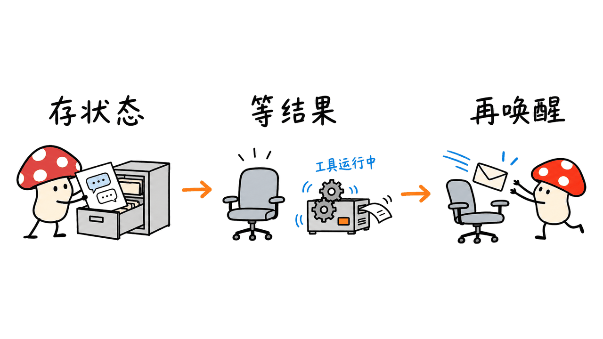
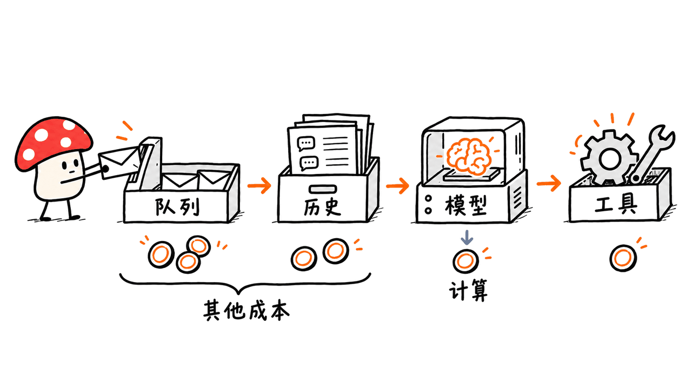

Infinity 是一种让 Agent 在等待工具结果时交出执行资源的运行时。它适合审批、长构建和外部事件驱动的工作流，但“7.5 万 Agent 放进树莓派内存”是模拟负载的容量换算，不是树莓派同时运行 7.5 万次真实模型推理。

AWS 于 2026 年 10 月 23 日以 Apache 2.0 许可发布这个早期研究项目，来自 AWS 与加州大学伯克利分校合作的 Hydro。Mycelium Protocol 核对了官方文章、Rust 仓库和部署文档，并在本机执行了四个上游测试。下文区分官方测试、我们实际验证的行为，以及尚需业务验收的能力。

官方仓库：
https://github.com/hydro-project/infinity

项目与文档：
https://infinity.hydro.run/

发布原文：
https://aws.amazon.com/blogs/opensource/introducing-infinity-a-runtime-for-extreme-agent-concurrency/

封面采用 AWS 原文的官方事件线程示意图，等比排版以保留完整流程。该图版权归其原权利方；本文的 CC 许可适用于原创文字和原创插图，不改变官方素材的权利状态。

## 7.5 万 Agent，是怎样测出来的？

先把官方口径完整摊开：

| 项目 | AWS 原文与仓库给出的条件 |
|---|---|
| 实际处理器 | AMD EPYC 9R14，单线程 |
| Agent 数量 | 80,000 |
| 每个 Agent 的轮数 | 20 轮，每轮两次 completion |
| 总 completion 数 | 320 万次 |
| 模型 | 进程内模拟模型，不是实际大模型推理 |
| 每次流式 completion | 约 1.2KB 的固定形状输出 |
| 存储 | 内存存储 |
| 采样对象 | 一波 Agent 完成轮次后、处于空闲状态的进程 RSS |
| 内存量级 | 每个空闲 Agent 约 100KB，主要为对话历史 |
| 树莓派说法 | 根据上述增长率，换算约 75,000 个能放入 8GB |

这不是只看一句宣传语就能推出的生产容量。仓库中的 `agent_scale.rs` 明确构造固定形状的流式模型输出；模拟工具也直接返回预制结果，没有为这些 Agent 真正执行一次次构建与测试。

因此，这个实验衡量的是特定历史长度下的运行时及状态开销，不是推理吞吐量、真实工具吞吐量、端到端时延，或树莓派实机性能。我们没有复现这组规模测试。

实际业务中，长日志、文件内容、代码 diff 和多模态资源都可能改变状态大小。外部工具和模型还会消耗自己的资源。不能把 100KB 当作所有 Agent 的固定内存配额。

可复查的官方基准源码：
https://github.com/hydro-project/infinity/blob/341f6c2d3a32632489c918535a60805089ea0fe1/crates/infinity-agent-core/examples/agent_scale.rs


## 它保存的是整个进程，还是一段对话？

Infinity 借鉴无栈协程的思路：把继续执行所需的信息显式保存，而不是让每个 Agent 带着一个完整进程长期等待。

运行时按执行片（slice）处理任务：消息到达后加载历史与执行状态，完成模型调用，保存新增回合，派发异步工具，然后交出控制权。工具完成后，把结果作为一条新消息送回队列，再启动下一片执行。

这里恢复的是基于对话与运行时状态的 Agent 循环，不是自动快照任意 Python 进程、浏览器内存、文件系统或 GPU KV Cache。已有 Agent 和工具通常需要接入它的 API 与消息机制，不能假定加一个装饰器就能原样迁移。



外部工具也没有被“冻住”。构建服务可以继续运行，审批系统可以等待人处理，完成后通过回调送回结果。Infinity 优化的是 Agent 等待这一结果的方式，不会把外部工作本身变成零成本。

### 本地模式和 serverless 模式有哪些差别？

本地嵌入模式用 `AgentSystemBuilder::new_local(...).start()` 管理会话，消息、存储和模型适配器可以共用进程。它避免给每个会话配一套独占进程，但本地进程和内存存储仍然存在。

尤其是在当前固定版本中，本地驱动在工具结果尚未回来时仍保持存活。上游测试 `driver_stays_alive_waiting_for_tool_result` 明确检查了这一点。它是轻量任务，不代表在忙等，但也不能描述成此时完全没有任何内存状态。

step 模式则由平台调用 `AgentSystem::step(...)` 处理一批输入，不靠常驻后台任务驱动。配合外部持久存储与队列，函数执行完即可返回；下一批消息可以交给另一个实例处理。这才是“等待期间可以不保留一次函数执行”的关键路径。

另外，快速的内置操作可以同步执行后继续当前片，并非所有工具都必须结束执行片。文章里的“挂起”是一种运行时调度机制，不是把操作系统或整台机器休眠。

官方架构文档：
https://infinity.hydro.run/docs/infinity-runtime/architecture

## AWS 参考部署由哪些组件组成？

参考架构使用一条 SQS FIFO 输入队列。用户输入、工具结果、订阅事件和定时唤醒统一进入队列；会话标识对应消息分组，让同一会话按序处理，不同会话分别并发。

Lambda 加载 Aurora DSQL 中的历史，通过 Bedrock 请求模型，派发工具并保存状态。官方发布文章还说明，去重状态保存在 DynamoDB。工具以独立服务运行，结果经 RAP Receiver 返回输入队列。

| 组件 | 解决的问题 | 仍需承担的成本或约束 |
|---|---|---|
| Lambda 执行片 | 有消息才进行计算 | 活动执行、冷启动与执行时限 |
| SQS FIFO | 缓冲事件、按会话串行 | 请求、积压、重试与保留策略 |
| Aurora DSQL / 状态存储 | 持久化历史与恢复信息 | 存储、读写与数据治理 |
| DynamoDB 去重状态 | 识别已经处理的消息 | 状态读写与访问控制 |
| Bedrock 或其他模型提供商 | 生成下一步决策 | 模型费用、上下文与限流 |
| 独立工具服务 | 执行构建、查询等实际工作 | 工具自身的计算和外部系统费用 |

这张表是架构成本分解，不是报价或实测账单。Infinity 的 Apache 2.0 许可不意味着 AWS 服务免费。

发布文章中的 `tokio::spawn` 工具示例针对本地嵌入场景。迁移到函数执行环境时，不要假定函数返回后，进程里的临时任务还能可靠跑完长构建；参考架构已经把这类工作移到独立服务和回调链路中。

官方 serverless 指南：
https://infinity.hydro.run/docs/infinity-runtime/serverless/quickstart
https://infinity.hydro.run/docs/infinity-runtime/serverless/architecture

## RAP、MCP 与多 Agent 消息有什么关系？

Reactive Agent Protocol（RAP）把工具调用与结果交付分开：运行时发送调用，工具确认接收，稍后再把结果或订阅事件送回来。它适合没有常驻调用方连接的执行模式。

项目提供 MCP 兼容层，可以接入已有工具。不过，“MCP 工具能接进来”和“所有现有 MCP 工具自动变成可持久恢复的异步服务”不是同一件事，仍要检查桥接、连接和回调的实际生命周期。

模型接口通常围绕成对的工具调用与结果组织。Infinity 使用合成工具调用，把外部事件表达成模型能处理的会话结构。父子 Agent 的报告也通过消息传递返回；订阅事件可以在临时子线程中处理，再向父线程报告。

这让 Agent 不只会线性地“调用—等待—继续”，但事件被包装成工具结果，并不说明它可信。AWS 把事件真实性、调度优先级，以及长时间树形会话的压缩效果列为继续研究的问题。

仓库同时包含 Infinity Code，一个基于该运行时的编程 harness。它与底层 Runtime、RAP 是不同层次，本篇验证的是 Runtime 的部分行为，未测试 Infinity Code 的真实编程质量。

https://infinity.hydro.run/docs/rap/what-is-rap
https://infinity.hydro.run/docs/infinity-code/overview

## 本机验证了哪些行为？

我们固定了仓库提交 `341f6c2d3a32632489c918535a60805089ea0fe1`，在 Apple Silicon Mac 上编译并运行以下四个现有测试，没有改写运行时，也没有编写一套替代它的模拟实现。

| 上游测试 | 结果 | 验证范围 |
|---|---|---|
| `duplicate_message_returns_handled` | 通过 | 已处理消息的重复交付会被识别 |
| `step_mode_runs_single_slice` | 通过 | 一批输入能驱动一个执行片并返回事件 |
| `rebooted_session_settles_persisted_unanswered_tool_call` | 通过 | 基于相同存储重建会话后，新用户输入可处理遗留的未完成调用 |
| `driver_stays_alive_waiting_for_tool_result` | 通过 | 本地驱动等待工具回传，结果到达后继续处理 |

这些测试使用上游 mock 模型与测试存储。其中“重建会话”测试复用的是内存存储对象，不是把机器重启后从磁盘恢复。不能用它宣称已验证生产数据库、跨进程故障恢复或真实云服务的可靠性。

本次没有调用付费模型，没有创建 AWS 资源，也没有运行 80,000 Agent 的基准。测试日志和固定源码版本已保存，以上结果属于功能验证，不是性能评测。

## 从 PoC 到业务使用，建议怎样推进？

先选一个等待占比高、动作可控的工作流，例如“CI 构建完成后生成摘要，等待负责人确认”。如果任务一直密集推理，很少等待，省掉空闲进程可能不是主要收益。

建议按以下顺序验收；这是落地方案，不是本文已经执行的云部署：

1. 先用可控的模型与模拟工具，确认一条会话能在派发后退出、结果到达后继续。
2. 替换为真实模型和一项异步工具，记录状态大小、排队时间、活动执行时间与模型用量。
3. 接入持久存储与队列，注入重复消息、延迟结果、丢失回调和实例退出，检查恢复行为。
4. 为有副作用的工具设计幂等键。运行时去重不等于支付、发邮件等跨系统动作天然具备“一次且仅一次”语义。
5. 与原常驻方案比较完整成本，再决定放量。审批等待变便宜，不代表更复杂的存储和运维一定划算。



本地入门可从官方 Rust quickstart 开始。当前文档使用 `infinity-agent-core = "0.2"`、`infinity-provider-bedrock = "0.2"` 与 Tokio；它的真实模型示例需要 AWS 凭证、区域和模型访问权限。本次四个测试不需要这条付费模型路径。

```bash
cargo new my-agent
cd my-agent
```

后续依赖和完整程序应对照固定版本的官方范例，不要把 README 中省略了初始化代码的短片段当成完整可执行程序。若需要无云依赖地复查本文，按日志中的固定版本运行上述测试即可；它不等价于完整业务部署。

https://infinity.hydro.run/docs/infinity-runtime/quickstart/launching-your-first-agent

## 常见问题

### 真的可以在树莓派上运行 7.5 万个大模型吗？

不是。官方测的是模拟模型工作负载的运行时状态开销，并把结果换算到 8GB 内存。它没有把这些大模型权重或真实推理负载放进树莓派。

### 挂起之后，内存和账单都会变成零吗？

不会。历史需要保存，本地嵌入模式还会有进程及任务状态；serverless 可以释放等待中的函数执行，但模型、队列、存储和工具仍有成本。

### 这是可以直接替换现有 Agent 的成熟产品吗？

AWS 将其定位为早期研究发布。它提供清晰的 API、工具协议与参考部署，但迁移仍需适配状态、回调、身份认证和故障处理，并完成自己的业务验收。

原始素材还附带 `Pytro001/airsup-Lab`。截至核查日，该精确 GitHub 地址和 README 路径均返回 404；它不是本文已核实的 Infinity 仓库，本文没有执行其 `npx skills add` 安装命令。

相关工程背景：
https://blog.mushroom.cv/blog/nvidia-openshell-agent-runtime/

本文原文：https://blog.mushroom.cv/blog/aws-infinity-agent-runtime/

---

> © 2026 Author: Mycelium Protocol. 本文采用 [CC BY 4.0](https://creativecommons.org/licenses/by/4.0/deed.zh) 授权——欢迎转载和引用，须注明作者姓名及原文链接，不得去除署名后以原创发布。

<!--EN-->

Infinity lets an agent yield execution resources while an external tool works. It targets approval workflows, long builds and event-driven tasks. The “75,000 agents in a Raspberry Pi's memory” headline is a capacity extrapolation from a simulated workload, not 75,000 real model inferences running on a Pi.

AWS announced this Apache 2.0 early research release on October 23, 2026, as part of Hydro, a collaboration with UC Berkeley. Mycelium Protocol reviewed primary documentation and ran four upstream tests. We separate those functional checks from the vendor benchmark and production capabilities that remain untested here.

Repository:
https://github.com/hydro-project/infinity

Project and documentation:
https://infinity.hydro.run/

Announcement:
https://aws.amazon.com/blogs/opensource/introducing-infinity-a-runtime-for-extreme-agent-concurrency/

The cover uses AWS's official event-thread illustration, proportionally arranged to preserve the whole diagram. Its rights remain with its original owner; our CC license covers our original text and illustrations, not a relicensing of official source imagery.

## What did the concurrency benchmark measure?

| Item | Published condition |
|---|---|
| Processor | One thread of an AMD EPYC 9R14 |
| Agents | 80,000 |
| Turns | 20 per agent, two completions per turn |
| Total completions | 3.2 million |
| Model | In-process simulated provider |
| Each streamed completion | About 1.2KB of fixed-shape output |
| Storage | In-memory stores |
| Sampling | Process RSS after a wave finishes, with agents idle |
| Memory | Roughly 100KB per idle agent, mainly history |
| Pi claim | Extrapolation to about 75,000 agents in 8GB |

The repository's `agent_scale.rs` constructs fixed-shape streamed output. Its synthetic tool returns prepared text rather than actually running builds and tests for every agent. This measures runtime/state scaling for particular histories, not real model throughput, tool throughput, end-to-end latency or Pi hardware performance. We did not reproduce this benchmark.

Logs, file contents, diffs and multimodal references change real state sizes. Model and tool resources are separate. Treating 100KB as a universal agent budget would be misleading.

Pinned benchmark source:
https://github.com/hydro-project/infinity/blob/341f6c2d3a32632489c918535a60805089ea0fe1/crates/infinity-agent-core/examples/agent_scale.rs


## Does Infinity snapshot a process?

It applies a stackless-coroutine idea to the agent loop: explicitly retain the information needed to continue, rather than keep an entire dedicated process waiting.

A slice loads history and runtime state, runs a model completion, persists the turn, dispatches asynchronous tool work and yields. A result arrives as a new queue message and starts another slice. External tools keep doing their work; they are not themselves suspended or made free.

This is not an automatic snapshot of arbitrary Python heaps, browser memory, filesystems or GPU KV caches. Existing harnesses and tools need appropriate API and messaging integration.


### Are embedded and serverless modes identical?

The embedded `new_local(...).start()` mode shares a process, stores and providers across conversations. It avoids a dedicated process per agent, but the resident application and in-memory stores still exist.

At the pinned revision, a local driver stays alive while a tool result is pending. The upstream `driver_stays_alive_waiting_for_tool_result` test explicitly checks this. A lightweight asynchronous task is not busy-waiting, but neither is it literally zero state.

In step mode, the platform calls `AgentSystem::step(...)` for a batch. With durable external storage and queues, the function can return and a different instance can handle the next message. That is the key to releasing a function invocation during a long wait. Fast synchronous built-ins may continue in the same slice; not every tool necessarily yields.

https://infinity.hydro.run/docs/infinity-runtime/architecture

## What does the AWS reference deployment use?

SQS FIFO carries user input, results, subscriptions and timer wake-ups. Message groups serialize a conversation while separate conversations can execute concurrently. Lambda loads history from Aurora DSQL, invokes a model through Bedrock, saves state and dispatches tools. The announcement also describes DynamoDB for deduplication state. Independent tool services return results through a RAP Receiver.

| Component | Responsibility | Remaining cost or constraint |
|---|---|---|
| Lambda slices | Compute on incoming events | Active execution, cold starts and execution limits |
| SQS FIFO | Buffering and per-thread ordering | Requests, backlog, retries and retention |
| History/state stores | Recovery information | Storage, reads/writes and governance |
| DynamoDB deduplication state | Recognizing processed messages | Operations and access control |
| Model provider | Next decision | Model charges, context and quotas |
| External tools | Actual build or business work | Their own compute and service costs |

This is a cost decomposition, not a price quote or measured bill. Apache 2.0 does not make AWS services free.

The announcement's `tokio::spawn` tool example is for embedded execution. Do not assume an ephemeral in-process background task will reliably finish after a serverless function returns. The reference architecture moves such work to independent services and a callback path.

https://infinity.hydro.run/docs/infinity-runtime/serverless/quickstart
https://infinity.hydro.run/docs/infinity-runtime/serverless/architecture

## How do RAP, MCP and agent messages fit together?

Reactive Agent Protocol separates invocation acknowledgment from later results and subscription events. This supports callers that have no persistent process or open connection while waiting.

An MCP compatibility layer can connect existing tools. That does not automatically make every MCP server's lifecycle and side effects durable; inspect the bridge, connections and callbacks.

Synthetic tool calls express external events within the call/result structure model APIs expect. Child-agent reports use messaging too; subscription events can be processed in temporary child threads before a report returns to the parent. Representing an event as a tool result does not authenticate it. AWS lists event authenticity, scheduling policies and long-running conversation-tree compaction among open research questions.

Infinity Code is a coding harness on this runtime, distinct from the Runtime and RAP layers. We did not evaluate its real coding performance.

https://infinity.hydro.run/docs/rap/what-is-rap
https://infinity.hydro.run/docs/infinity-code/overview

## What did we verify locally?

We pinned commit `341f6c2d3a32632489c918535a60805089ea0fe1` and compiled the real runtime on an Apple Silicon Mac. Four existing tests passed:

| Test | Scope |
|---|---|
| `duplicate_message_returns_handled` | Recognize a redelivered processed message |
| `step_mode_runs_single_slice` | Drive a slice from input and return its events |
| `rebooted_session_settles_persisted_unanswered_tool_call` | Rebuild a session over the same stores and settle a stranded call when new user input arrives |
| `driver_stays_alive_waiting_for_tool_result` | Keep a local driver waiting, then continue on the tool result |

These use upstream mock models and test stores. The reconstructed-session test reuses in-memory store objects; it is not a machine reboot followed by disk recovery. No production database, cross-process recovery, actual cloud deployment or 80,000-agent run was verified. We made no paid model calls and created no AWS resources. Logs and the source revision are retained; this is functional validation, not a performance benchmark.

## How should a team start a PoC?

Choose a bounded, wait-heavy workflow, such as summarizing a completed CI build and requesting approval. If agents spend nearly all their time computing, idle execution may not dominate cost.

The following is a proposed rollout plan, not deployment performed here:

1. Use a controlled provider and tool to verify dispatch, yield and resumption.
2. Add one real model and asynchronous tool; measure state size, queue delay, active execution and model usage.
3. Introduce durable stores and queues, then inject duplicates, delayed results, lost callbacks and instance exits.
4. Add idempotency keys to side-effecting tools. Runtime input deduplication does not guarantee exactly-once payments or mail across systems.
5. Compare total costs with the resident design before expanding. Cheaper waiting can come with additional storage and operations work.


The official Rust quickstart currently specifies `infinity-agent-core = "0.2"`, `infinity-provider-bedrock = "0.2"` and Tokio. Its real-model path requires AWS credentials, region configuration and model access; our tests do not use that paid path.

```bash
cargo new my-agent
cd my-agent
```

Follow the complete official program and dependency setup rather than treating the README's abbreviated snippet as a standalone executable. Running the pinned tests reproduces our narrow checks, not a business deployment.

https://infinity.hydro.run/docs/infinity-runtime/quickstart/launching-your-first-agent

## FAQ

### Does the Pi hold 75,000 real language models?

No. The result concerns runtime state in a simulated-model workload, extrapolated to 8GB. It does not include those model weights or real inference on the Pi.

### Do memory and bills become zero during suspension?

No. History is stored, embedded mode retains application state, and serverless still uses paid model, queue, storage and tool services. It can release the waiting function invocation.

### Is this a mature drop-in replacement?

AWS calls it an early research release. The API, protocol and reference deployment are useful starting points, but migration requires state, callback, authentication and failure-handling work plus domain acceptance tests.

The supplied `Pytro001/airsup-Lab` GitHub and README paths returned 404 when checked. We did not treat it as the verified Infinity repository or execute its `npx skills add` command.

Related engineering background:
https://blog.mushroom.cv/blog/nvidia-openshell-agent-runtime/

Original article: https://blog.mushroom.cv/blog/aws-infinity-agent-runtime/

---

> © 2026 Author: Mycelium Protocol. Licensed under [CC BY 4.0](https://creativecommons.org/licenses/by/4.0/) — free to share and adapt with attribution. You must credit the author and link to the original; removing attribution and republishing as original is not permitted.
