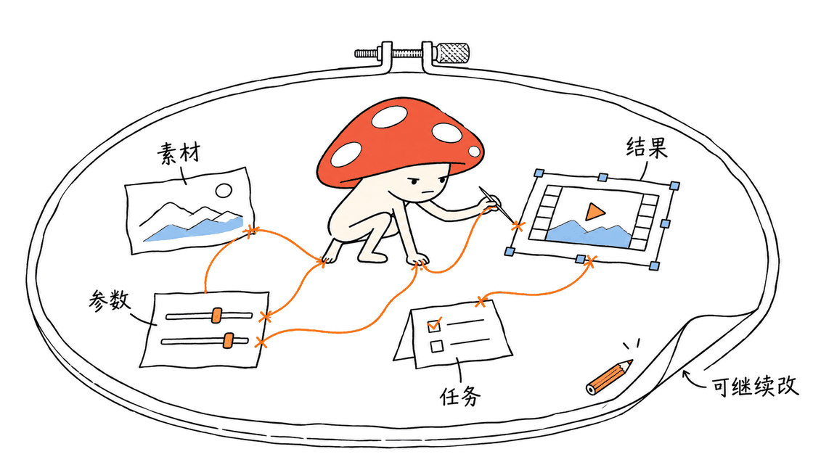
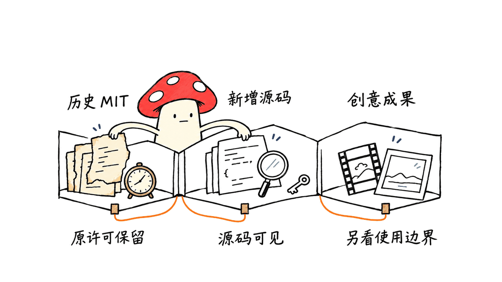
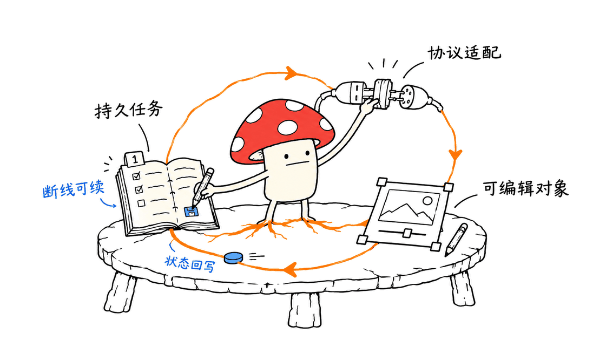

BeefTV 把 AI 创作过程组织成可编辑的画布和工作流，帮助用户保留素材、参数、任务与结果之间的关系。

官方仓库是 https://github.com/glanderness/BeefTV ，官网是 https://beeftv.app/ 。它值得研究的地方是把创作做成可继续修改的工程；同时，当前仓库的新增代码采用源码可见许可，不能把整个项目笼统称为 MIT 或 OSI 意义上的开源。

## 它和一次性生成页面有什么区别？

一次性生成通常留下输入和最终文件，下一轮调整还得重新组织素材。BeefTV 希望把人物、场景、分镜、图片、视频、配音及处理步骤留在同一个工作区。

其 README 展示了把本地帧率处理和远程视频生成串起来的工作流，也展示 Agent 在画布中建立节点与连线的案例。这些是项目提供的示例，不是本文对任意素材的一键生成测试；作者同样说明，一些最终成片步骤仍需要逐镜调整、拼接和回填。

工程价值是保留中间状态。某个镜头失败时，可以修改它的素材或参数；人物设定改变时，可以知道哪些下游节点可能受影响。工作流模板复用的是编排结构，不是对模型每次输出一致性的保证。

## “本地优先”具体指哪些部分？

仓库按前端、后端与外部服务划分职责：

| 部分 | 当前技术与职责 | 需要区分的边界 |
|---|---|---|
| 前端 | React 19、Vite、TypeScript、画布与状态管理 | 浏览器缓存不自动等于后端已保存 |
| 本地后端 | Go、Gin、GORM、SQLite | 项目、素材、持久任务和模型协议处理 |
| 外部模型渠道 | 官方、第三方或兼容的自定义渠道 | 云模型生成时，相关输入仍需发往所选渠道 |

仓库的工作约定明确要求：后端不可用时的本地缓存只能算降级；界面应区分缓存成功和服务端持久化成功。这个合同值得所有 AI 创作工具借鉴，但不是本文已经逐条验证了所有保存分支的证明。

同理，本地保存项目不代表所有 AI 计算都离线。工作台、模型服务和计费渠道是不同层。可以接入自己的服务，也要按实际协议验证媒体上传、任务状态、失败与结果取回。

## 当前许可到底允许什么？

以本次固定 commit 的 LICENSE 和英文 README 为准，许可分成历史内容和新增内容：

- 历史上已经按 MIT 发布的材料保留 MIT 权利，不被新的条款追溯收回。
- 符合范围定义的新增原创材料采用 BeefTV Source Available License 1.0。
- 当前条款允许个人研究、自托管和组织内部使用，包括内部商业工作及为客户创作内容。
- 使用工具产生并交付创意成果，与向第三方交付软件系统或提供外部服务，是不同情形。
- 出售或付费交付受覆盖软件、收费部署与定制交付，以及向第三方提供外部服务等活动，需要另行书面授权；外部服务条款也覆盖免费服务。

这些是对当前文档的边界整理，不是针对某个具体商业方案的授权。混合文件、历史提交和第三方组件仍须看各自适用范围。本文不会把“内部可商用创作”扩写成“可自由改名售卖或托管”。

源码可见仍有学习和检查价值，但与标准开源的使用与再分发自由不同。官网宣传、GitHub 可见源码和实际 LICENSE 三者，应以具体发布物和许可文本核对。

## 工程师最值得借鉴哪些设计？

第一是把任务当作持久对象，而不是只在界面保留一个加载动画。任务应有明确状态、输入、输出和失败原因，断线之后能够继续取回已有进度。仓库的文本事件流使用递增事件游标，重连位置与任务 ID 分开，这是一个实用的恢复思路。

第二是把协议差异集中在适配层。画布节点表达“生成什么”，供应商协议处理请求格式、认证和响应。若每个页面都按模型名称写分支，切换渠道与修复上游变更会越来越难。

第三是让 Agent 修改可编辑对象。生成一个节点、调整一个参数、建立一条依赖，都应落回工程状态；否则对话里“完成了”与画布、数据库、磁盘文件可能各说各话。

第四是缓存、持久化和模型上游各有真实来源。前端不该仅凭 HTTP 200 判断业务成功，也不该用一个默认结果吞掉写入失败。创作工具的可信度，往往体现在这些失败时刻，而非演示里顺利生成的那一镜。

## 我们实际核对到什么程度？

本次固定官方仓库快照，读取 README、LICENSE、项目工作约定和本地 Compose 配置。快照的 VERSION 文件为 v2.2.1；它只是所查快照的版本标记，不代表本文独立验证了所有平台的最新安装包。

按仓库工作约定运行了结构预算和死代码预算检查，两者通过。这些是静态维护约束，不能代替桌面应用、画布保存、任务恢复或真实生成测试。

本次没有启动桌面应用和开发服务，没有运行视频生成、测量内存磁盘占用，也没有做完整安全审计。因此，不给出“更轻”“更快”或“任意素材都能完成”的实测结论。

适合的下一步是用小型、可丢弃的项目验证保存与恢复，再测试一个模型渠道和一种媒体任务。确认结果、错误与费用都可追踪后，再扩展到长工作流。二次开发前先核对自己需要使用和分发的代码范围及许可。

## 常见问题

### BeefTV 当前是否整个仓库都按 MIT 开源？

不是。历史 MIT 内容保留原许可；符合范围定义的新增材料采用源码可见许可，项目 README 也明确区分了这一点。

### 本地优先是否代表云模型不接收任何素材？

不是。项目和素材可以本地组织，但使用云端生成时，相关输入依然按所选服务渠道处理。

### 本文是否实测了成片质量、应用性能或费用？

没有。本文验证了文档、配置和两项静态预算检查，生成效果与完整运行仍需单独测试。

官方仓库：https://github.com/glanderness/BeefTV
许可：https://github.com/glanderness/BeefTV/blob/main/LICENSE
英文说明：https://github.com/glanderness/BeefTV/blob/main/README.en.md
开始使用：https://github.com/glanderness/BeefTV/blob/main/QUICKSTART.md

---

> © 2026 Author: Mycelium Protocol. 本文采用 [CC BY 4.0](https://creativecommons.org/licenses/by/4.0/deed.zh) 授权——欢迎转载和引用，须注明作者姓名及原文链接，不得去除署名后以原创发布。

<!--EN-->

BeefTV organizes AI creation into editable canvases and workflows, preserving relationships between assets, parameters, tasks, and results.

Official repository: https://github.com/glanderness/BeefTV . Website: https://beeftv.app/ . Its current eligible new code is source-available; the entire project should not be described as standard MIT or OSI open source.

## What is worth studying?

The README demonstrates reusable arrangements of media processing and model generation. Its examples are author demonstrations, not our tests of arbitrary inputs or guaranteed one-click production. Some finished-film steps still require manual adjustments and assembly.

Keeping intermediate state makes failed shots and downstream dependencies easier to inspect. A workflow template preserves orchestration, not deterministic model outputs.

## Which parts are local?

The frontend uses React 19, Vite, and TypeScript. A Go/Gin/GORM/SQLite backend handles local workspace data and durable tasks. Model providers remain another layer: cloud generation sends relevant inputs to the selected service.

The repository explicitly distinguishes a browser-cache fallback from successful backend persistence. That is an important design contract, not proof that we tested every write path. Local-first storage also does not imply fully offline AI execution.

## How should the license be read?

Previously MIT-published material retains its MIT permissions. Eligible new original material is covered by BeefTV Source Available License 1.0; third-party material keeps its applicable terms.

The current text permits personal study, self-hosting, internal organizational work, and commercial creative work for clients. Delivering creative outputs is distinct from delivering or operating the covered software for another party.

Commercial resale or paid delivery of covered software, paid deployment/custom delivery, and external services require separate written authorization. The external-service restriction also covers free services. This is a summary of the pinned documents, not permission for a specific commercial arrangement.

Source visibility remains valuable for learning and inspection, but differs from standard open-source redistribution freedom. Check the actual license and component scope rather than relying on a promotional label.

## What can engineers borrow as design ideas?

Treat generation tasks as durable objects with inputs, outputs, states, and failure reasons. Keep stream replay cursors distinct from task identities, so reconnection can resume known progress.

Concentrate provider-specific formats in adapters instead of scattering model-name rules across pages. Let an agent modify editable project objects, so a conversational success message can be checked against canvas and stored state.

Keep cache, backend persistence, and upstream model results separate. HTTP 200 alone does not establish business success, and a fallback value must not conceal failed writes. These ideas transfer to creative software independently of copying covered source code.

## What did we verify?

We pinned a repository snapshot and examined its documentation, license, workspace contracts, and local Compose configuration. Its VERSION file reads v2.2.1; that does not independently establish the latest package for every platform.

Both required structure and dead-code budget checks passed. These are static maintenance checks. We did not launch the desktop app or a development server, generate media, measure disk or memory use, or perform a complete security review.

Start an evaluation with a disposable project and test save/recovery behavior, then one provider and media task. Verify outputs, errors, and spending before extending the workflow. Check the relevant code and distribution permissions before adapting software.

## FAQ

### Is the entire current repository MIT-licensed?

No. Historical MIT material remains MIT, while eligible new material follows the source-available license.

### Does local-first mean cloud models receive no assets?

No. Relevant inputs are still transmitted when cloud generation is selected.

### Did this article measure quality, performance, or cost?

No. It records document/configuration review and two static budget checks; full runtime validation remains separate.

Sources: https://github.com/glanderness/BeefTV ; https://github.com/glanderness/BeefTV/blob/main/LICENSE ; https://github.com/glanderness/BeefTV/blob/main/README.en.md ; https://github.com/glanderness/BeefTV/blob/main/QUICKSTART.md .

---

> © 2026 Author: Mycelium Protocol. Licensed under [CC BY 4.0](https://creativecommons.org/licenses/by/4.0/) — free to share and adapt with attribution. You must credit the author and link to the original; removing attribution and republishing as original is not permitted.
