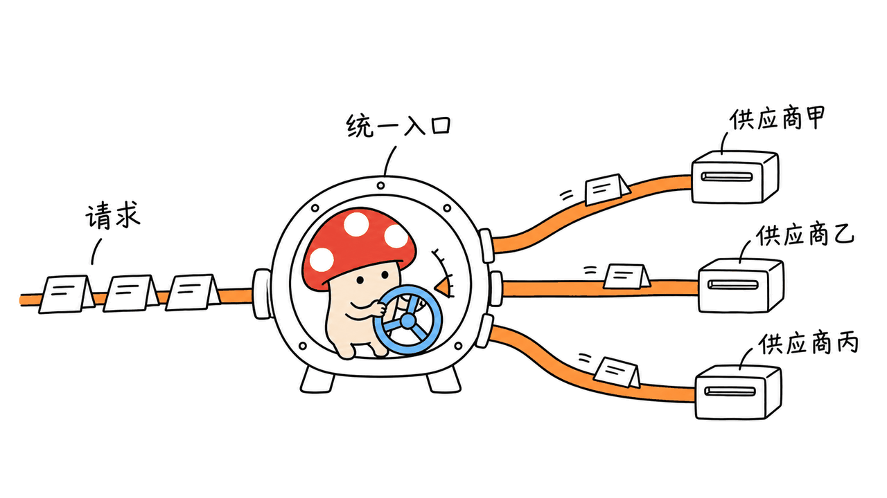
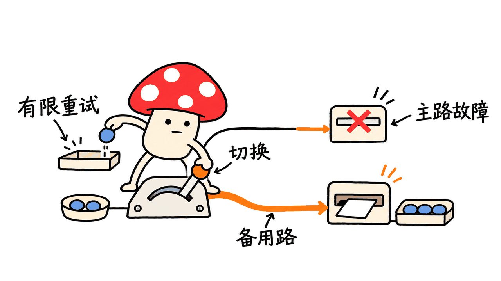
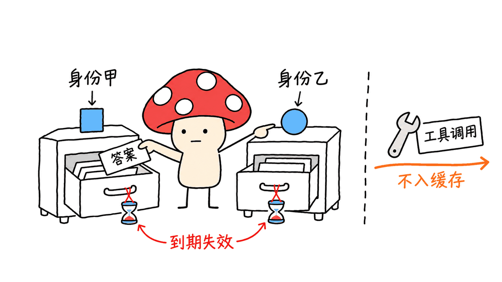

Bifrost 把应用访问多个模型供应商的入口收拢到一个网关，适合需要统一密钥、故障切换和费用归属的团队。它的价值是把重复的接入与运维逻辑集中管理，选模型和验收答案仍由业务负责。

本文讨论 Maxim 的 maximhq/bifrost，采用 Apache 2.0 许可；截至 2026 年 11 月 18 日查询约 9.7k stars。Bifrost 有同名数据库同步等项目，这里只讨论 AI 网关。

## Bifrost 放在系统的哪一层？

它位于应用与模型服务之间。业务向网关发请求，网关验证权限、选择供应商或密钥、转换协议，再返回结果和用量。官方提供 HTTP 网关与可嵌入 Go SDK，HTTP 服务附带管理界面。

仓库的模块拆分很值得借鉴：core 负责模型请求与供应商适配，framework 负责配置、日志和向量存储，transports/bifrost-http 提供 HTTP 接口，plugins 承担治理、缓存与观测，ui 是控制界面。把协议变化和业务逻辑分开，新增供应商就不必在每个应用里复制重试代码。



OpenAI 兼容接口降低了迁移成本，但不保证所有供应商的工具调用、推理参数、音视频和流式事件完全等价。建议先把应用依赖的接口列成矩阵，再验证具体模型与路由；“支持某供应商”不足以证明某个高级功能可用。

## 怎么在本机开始？

下面是适合评估的 Docker 启动方式，把宿主机端口限制在回环地址，并保留数据目录。它需要本机 Docker；本文没有启动该容器或调用真实模型。

```bash
mkdir -p ./bifrost-data
docker run --rm --name bifrost-eval \
  -p 127.0.0.1:8080:8080 \
  -v "$PWD/bifrost-data:/app/data" \
  maximhq/bifrost
```

在 http://localhost:8080 配置供应商密钥，再配置管理认证和应用使用的虚拟密钥。生产部署应把镜像固定到经过验收的版本或 digest；上面的未固定标签只用于本地评估。官方也提供 `npx -y @maximhq/bifrost` 启动方式。

给应用分发虚拟密钥，而非供应商原始密钥。创建完成后可用如下格式请求；模型名只是官方示例，须替换为账号实际可用的型号。

```bash
export BIFROST_VK='替换为自己创建的虚拟密钥'
curl http://localhost:8080/v1/chat/completions \
  -H "Content-Type: application/json" \
  -H "x-bf-vk: $BIFROST_VK" \
  -d '{"model":"openai/gpt-4o-mini","messages":[{"role":"user","content":"Say hello."}]}'
```

应用拿到统一入口后，供应商凭证留在网关侧；按应用建立不同虚拟密钥，能配置允许的模型、预算及请求或 token 限额。管理界面的身份认证与推理入口的治理都要单独核验，不能把 localhost 演示直接开放到公网。

## 故障切换能替你承担什么？

同供应商重试、同供应商换密钥、跨供应商 fallback，是三个不同动作。当前官方文档会区分临时服务错误、限流、凭证或额度问题和请求本身不合法；重试资格、次数、退避和终止条件要随部署版本核对。

一个关键细节是每个 fallback 供应商有自己的重试预算。官方示例里主供应商加两个备选、每个允许三次重试，最多可能产生十二次尝试。工程上应从用户允许的总等待时间倒推尝试预算，同时记录最终供应商、实际模型及累计成本。



我的判断是：容灾的验收标准应是“失败后业务仍然可接受”。文本恢复不代表工具 schema、视觉能力或上下文长度保持一致。已输出一半的流也不能当作可随意重新生成的整段回答；支付、发信等外部动作需要业务层保存幂等键和执行记录，模型网关不能替业务证明动作只执行一次。

## 缓存、预算和日志怎样真正省钱？

Bifrost 的响应缓存有精确匹配和语义匹配两条路径。前者可不调用 embedding，后者依赖向量检索。命中后复用的是已有答案；供应商 prompt cache 复用输入前缀，仍要调用模型并计费，两者要分别核算。

当前官方文档明确要求请求携带缓存键，或配置默认缓存键，否则跳过缓存；默认还按身份隔离，且工具调用响应默认不缓存。不要仅凭“装了插件”就判断已命中，更不要为了提高命中率随意关闭身份隔离。

对库存、账户状态、权限和时效性信息，先明确什么条件下旧答案失效。建议从低风险、可复用的静态问答开始，给租户与业务数据版本划分缓存边界，逐步检查命中率、错误复用率和失效行为。



预算控制也需要看计价表、用量回传、并发和统计时延。把网关预算作为一层控制，同时给供应商账号设置费用上限。请求日志则应核对是否保存正文、工具参数和敏感信息，再决定保留时间与访问范围。自托管控制了网关部署位置，模型、向量和观测服务仍可能接收数据。

## 11 微秒的宣传数字应该怎么读？

官方 README 报告，在 5,000 RPS 下 t3.xlarge 的附加开销为 11 微秒、t3.medium 为 59 微秒；基准文档同时注明使用 mocked OpenAI calls。这是作者报告的特定负载结果，本文未复现，不能推导真实供应商的首 token 时间、尾延迟或端到端成功率。

我们做了文档和源码结构核对，没有做真实供应商集成、生产容量或安全认证。团队选型时，应在目标插件、日志、缓存和数据量全部启用后测 p50/p95/p99，并注入限流、超时和断流，验证降级结果与费用。单次平均开销无法替代这些验收。

## 开源版与企业功能怎么选？

Apache 2.0 为仓库代码的使用、修改和分发提供清晰许可，仍须遵守许可和通知要求。供应商费用、云资源与商业服务另算。README 将集群、自适应负载均衡、部分高级安全和企业部署能力引向 Enterprise；功能页面与版本都在变化，要按具体发布版本、源码和合同确认边界，不能把所有官网条目都当成免费版承诺。

对只有一个供应商的小应用，额外网关可能增加维护量。已有多个应用、多个模型、分散密钥或费用归属混乱的团队，更容易从它获得收益。最值得借鉴的是分层：应用维护业务状态，网关维护接入和治理规则，各自留下可追查的记录。

## FAQ

### Bifrost 是一个模型吗？

它是 AI 网关，连接模型和工具服务，本身不提供通用模型权重。接入它不会自动提升答案质量。

### 装好就能免费调用模型吗？

不能。开源网关与模型调用费分开；使用收费供应商仍需账号和额度，部署、存储与 embedding 也可能产生费用。

### 可以直接替换现有 SDK 吗？

先验证应用所用接口。统一 API 和专用兼容路由降低改造量，但工具调用、流式处理及供应商特有参数仍需回归测试。

来源与核查日期：2026-11-18。

仓库：https://github.com/maximhq/bifrost
部署：https://docs.getbifrost.ai/quickstart/gateway/setting-up
认证：https://docs.getbifrost.ai/quickstart/gateway/setting-up-auth
重试：https://docs.getbifrost.ai/features/retries-and-fallbacks
虚拟密钥：https://docs.getbifrost.ai/features/governance/virtual-keys
缓存：https://docs.getbifrost.ai/features/semantic-caching
基准：https://docs.getbifrost.ai/benchmarking/getting-started
相关工程阅读：https://blog.mushroom.cv/blog/sellbird-ai-sales-agent-self-hosting-guide/

---

> © 2026 Author: Mycelium Protocol. 本文采用 [CC BY 4.0](https://creativecommons.org/licenses/by/4.0/deed.zh) 授权——欢迎转载和引用，须注明作者姓名及原文链接，不得去除署名后以原创发布。

<!--EN-->

Bifrost consolidates access to multiple model providers behind one gateway. Teams can centralize credentials, failover policies and cost attribution while their applications retain responsibility for business state and answer quality.

This article covers Maxim’s maximhq/bifrost, an Apache 2.0 AI gateway with about 9.7k GitHub stars when checked on November 18, 2026. Other projects share the Bifrost name.

## Where does Bifrost belong?

Applications call the gateway, which checks access, selects a provider or key, translates requests and returns output plus usage. It offers an HTTP gateway with a management UI and an embeddable Go SDK.

The repository separates provider adapters in core, persistence in framework, HTTP transport in transports/bifrost-http, governance and observability in plugins, and management in ui. This separation lets teams maintain provider-specific behavior without duplicating it throughout their applications.


An OpenAI-compatible interface reduces migration work. It does not make every provider’s tool calls, reasoning parameters, audiovisual capabilities or stream events equivalent. Build a compatibility matrix around the endpoints your application actually uses.

## How can engineers start locally?

This evaluation command binds the host port to loopback and persists data. It requires Docker; we did not launch this container or call a real provider for this article.

```bash
mkdir -p ./bifrost-data
docker run --rm --name bifrost-eval \
  -p 127.0.0.1:8080:8080 \
  -v "$PWD/bifrost-data:/app/data" \
  maximhq/bifrost
```

Open http://localhost:8080, configure provider credentials, protect management access and create an application virtual key. Pin a tested image version or digest for production. The floating tag above is for local evaluation. The official alternative is `npx -y @maximhq/bifrost`.

Applications should receive virtual keys rather than provider credentials. After creating one, use this request shape, replacing the example model with one your account can access:

```bash
export BIFROST_VK='replace-with-your-virtual-key'
curl http://localhost:8080/v1/chat/completions \
  -H "Content-Type: application/json" \
  -H "x-bf-vk: $BIFROST_VK" \
  -d '{"model":"openai/gpt-4o-mini","messages":[{"role":"user","content":"Say hello."}]}'
```

Separate virtual keys can constrain models, budgets and request or token limits for each application. Verify dashboard authentication and inference governance separately before exposing the service.

## What does failover actually guarantee?

Retrying one provider, rotating its credentials and falling back to another provider are different operations. Current documentation distinguishes transient failures, rate limits, credential or quota problems and invalid requests. Verify classification, retry eligibility and backoff against your deployed version.

Each fallback provider receives its own retry budget. The documentation’s primary-plus-two-fallback example with three retries per provider allows up to twelve attempts. Derive attempt limits from the user’s total time budget, and record the actual model, provider and accumulated cost.


Our engineering conclusion is that failover must preserve acceptable business behavior. A recovered text response does not establish equivalent tool schemas, vision capabilities or context limits. A partially emitted stream cannot always be replaced transparently. Applications need idempotency keys and execution records for payments or messages; the gateway cannot prove that an external action ran exactly once.

## How do caching and governance reduce costs?

Bifrost response caching supports exact matching and semantic similarity. Exact matching can avoid embeddings; semantic matching uses vector search. Both reuse an existing answer. Provider prompt caching instead reuses an input prefix while still making a billed model call.

Current documentation requires a request cache key or a configured default key. Otherwise caching is bypassed. Entries are identity-scoped by default, and tool-call responses are not cached by default. Installing the plugin alone does not demonstrate a cache hit.

Begin with reusable, low-risk static answers. Define tenant and data-version boundaries and verify expiry, hit rates and incorrect reuse. Inventory, permissions and account state need explicit freshness rules. Do not disable identity isolation merely to increase hits.


Budgets depend on pricing data, usage reporting, concurrency and accounting delays. Add provider account spending controls as another layer. Inspect whether logs retain prompts or tool arguments before setting retention and access policies. Hosting the gateway yourself does not make upstream model, vector or observability services local.

## How should the 11-microsecond claim be read?

The README reports 11 microseconds of overhead on t3.xlarge and 59 microseconds on t3.medium at 5,000 RPS. The benchmark documentation states that the tests use mocked OpenAI calls. These are author-reported results under specific conditions, not measurements reproduced here.

We reviewed documentation and repository structure. We did not validate live-provider integration, production capacity or security certification. Measure p50/p95/p99 with your plugins, logging, caches and payloads enabled, then inject rate limits, timeouts and broken streams. Average gateway overhead cannot establish real-provider time to first token or end-to-end reliability.

## Which deployment is appropriate?

Apache 2.0 permits use, modification and distribution under its conditions, including applicable license and notice requirements. Provider calls, infrastructure and commercial services remain separate costs. The README directs clustering, adaptive load balancing and some advanced security capabilities to Enterprise. Confirm feature boundaries against the release, source and commercial agreement rather than assuming every website feature ships in the free edition.

One small application using one provider may gain little from another operational component. Teams with multiple applications, providers and scattered credentials have a clearer reason to evaluate it. The useful design lesson is separation: applications own business state; gateways own access and governance policies; both produce auditable records.

## FAQ

### Is Bifrost a model?

No. It is a gateway connecting models and tools. It does not distribute a general-purpose model or automatically improve answers.

### Does open source mean free inference?

No. Paid providers still require credentials and credit. Hosting, storage and embeddings may also incur costs.

### Can it replace an existing SDK endpoint?

Validate the endpoints you use. Unified and compatibility routes can reduce migration work, but tool calls, streaming and provider-specific parameters need regression checks.

Sources checked November 18, 2026:

Repository: https://github.com/maximhq/bifrost
Setup: https://docs.getbifrost.ai/quickstart/gateway/setting-up
Authentication: https://docs.getbifrost.ai/quickstart/gateway/setting-up-auth
Retries: https://docs.getbifrost.ai/features/retries-and-fallbacks
Virtual keys: https://docs.getbifrost.ai/features/governance/virtual-keys
Caching: https://docs.getbifrost.ai/features/semantic-caching
Benchmarks: https://docs.getbifrost.ai/benchmarking/getting-started
Related engineering discussion: https://blog.mushroom.cv/blog/sellbird-ai-sales-agent-self-hosting-guide/

---

> © 2026 Author: Mycelium Protocol. Licensed under [CC BY 4.0](https://creativecommons.org/licenses/by/4.0/) — free to share and adapt with attribution. You must credit the author and link to the original; removing attribution and republishing as original is not permitted.
