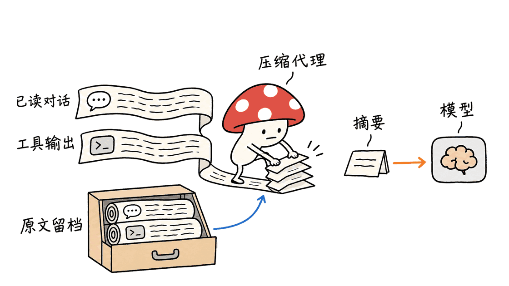
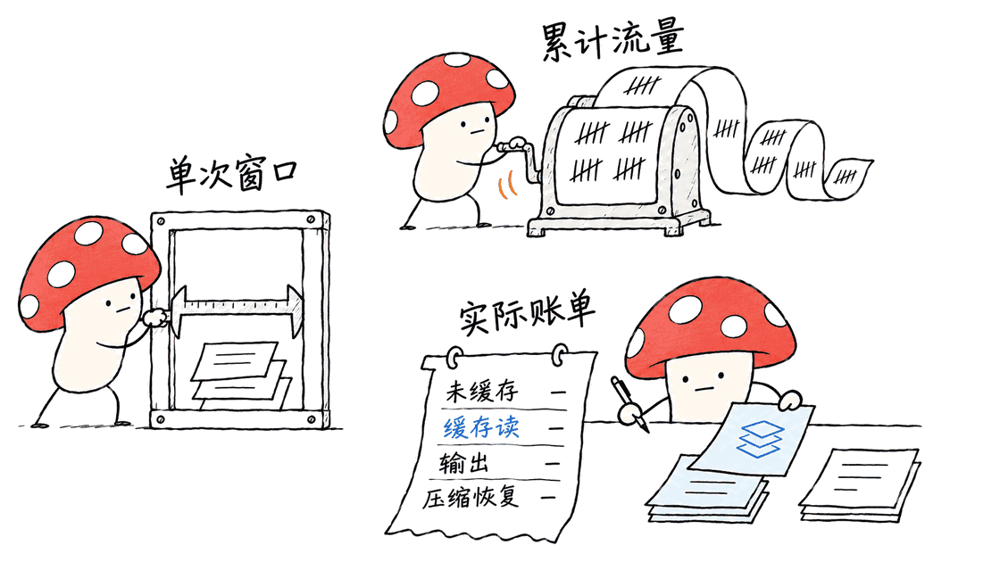

billion-context 通过压缩已经用过的对话和工具输出，让编码 Agent 在有限窗口里继续工作。它保留历史状态，把部分内容换成摘要，并提供按需查找与恢复工具；“十亿上下文”指长期会话累计处理量，不是让模型一次完整看到十亿个不同 token。

官方仓库：https://github.com/ranxianglei/billion-context

本次固定提交 `25b167187ac188e3eb67b18976570943bf98d3f5`，版本 `0.1.213`，核查日期为2026年11月10日。代码、嵌入式 `kernel/`、论文和评测说明都在同一个仓库。许可证正文在 MIT 基础上增加产品出处标注条款，不能只依据 package.json 的 MIT 标签忽略附加要求。

## 它怎样接到Agent与模型之间？

可以把它看成一层理解会话结构的代理。客户端发来消息，它转换和维护会话状态，向模型提供上下文管理工具，执行压缩决策，再把模型输出转回宿主所需的流式协议。

核心 `acp-kernel` 负责摘要块、消息引用、可压缩范围与渲染等机制；摘要本身由模型写，不是内核在本机训练出一个新模型。项目里的 ACP 名称也不应与其他同名 Agent 通信协议混用。

模型可使用四类工具：`compress` 折叠消息范围，`decompress` 取回历史块，`search_context` 搜索摘要及可见历史，`acp_status` 查看窗口使用和可压缩状态。宿主适配、协议重建和持久化，则决定这些工具能否在真实长会话中稳定工作。

它不只是把旧文本截掉。一个典型场景是：Agent 已读过大量搜索结果、完成第一轮排查，再把这些中间过程收成“发现了什么、排除了什么、下一步改哪里”，给新任务腾出窗口。当前决策、文件路径、错误信息和未完成步骤需要保留；是否写出了有用摘要，仍依赖模型与压缩策略。



## 分层摘要为什么有用，恢复又意味着什么？

项目采用类似 LSM 分层的思路：先把已经消耗的信息压成一代摘要，积累到一定规模后，再整理成更高层摘要。相较于每次重写整个历史，它希望只处理新增的可压缩内容，让稳定的摘要不被无谓反复改写。

这有两方面价值：控制每次送入模型的体积，以及尽量减少稳定前缀被改动造成的缓存损失。它不是“以后永远不丢信息”的证明。多代摘要、范围判断、模型遗漏，以及宿主自己修改会话，都可能影响恢复和召回。

`decompress` 的基础是保留原始消息或下层块。它不是从几句话里数学还原全部细节。工具说明还明确：高层块默认可以先恢复一层；需要原始内容时使用 `full: true`，也可输出到文件，避免重新把大量历史塞回当前窗口。

因此应把会话存储当作正式数据。丢失状态目录、错误复用会话 ID、两边同时修改同一会话，都会影响能力。文章中的“可恢复”应理解为有底稿、引用和状态管理支撑，不能等同于摘要本身无损。

## “十亿token”与“省5倍”有哪些口径？

仓库论文报告主机侧174,327次调用、18.76B累计输入 token，其中1.75B是 fresh input、17.01B是缓存读取。重复发送或读取的历史前缀同样计入累计输入，因此这个数字不等于18.76B独立新知识，也不是单次请求长度。

论文还描述了多主机长期部署与受控小规模实验，提供了比演示更丰富的证据。但它们仍是项目报告，不能直接当成我们复现的效果。README 中健康会话95–97%前缀缓存命中、压缩开销≤2%等说法，也需要连同工作负载、供应商缓存机制和统计口径阅读。

论文的受控对照还有一个值得注意的结论：只加入doctrine提示与消息标签、但不实际执行压缩的对照组，几乎复现了重新读取次数下降的收益（62%对完整方案的63%）。这意味着不能把减少重读全归功于摘要算法，提示与布局同样影响行为。论文入口：
https://github.com/ranxianglei/billion-context/tree/master/paper

“省5倍token”尤其不能自动换成“账单除以五”。实际成本至少要区分：未缓存输入、缓存命中输入、摘要及正常输出、重新取回文件的调用，以及新增的压缩请求。摘要模型的额外输出不是免费的，缓存 TTL 或模型切换也会改变结果。

## 评测报告里，有什么值得关注的反例？

仓库收录一份自称独立第三方的1500题评测，测试的是 `0.1.202`，模型为报告指定的 DeepSeek V4.1 Flash，不能自动视为当前版本对所有模型的结论：
https://github.com/ranxianglei/billion-context/tree/master/benchmarks/third-party-1500

| 场景 | 报告中的结果 | 解读边界 |
| --- | --- | --- |
| ContextBench | Utilized F1：BC 0.3097，full 0.2928；费用4.61美元对11.05美元 | 对该编码证据定位任务有利，不是通用编程成功率 |
| LongMemEval-S | BC 79.2%，full 83.2%，最佳RAG 62.6% | BC高于该RAG基线16.6个百分点，但低于完整上下文 |
| MemoryAgentBench 精确检索AR | BC 27.0%，full 69.0% | 语义摘要可能丢失需要逐字抽取的针状事实 |
| 1.48M-token TTL压力场景 | BC存活，Recall@10为18.58%；full的199例溢出 | 不溢出不等于答案全对，也不等于一次读取全部原文 |

成本表还有一个很容易漏看的细节：LongMemEval-S 的 full 实际顺序批量账单是0.42美元，因为共享材料带来98.1%的前缀缓存命中；报告另外按独立会话、不能跨用户共享缓存的假设，折算出7.97美元。BC为2.30美元，所谓节省71.1%采用的是后一个基线，不是0.42美元。

这不是说哪一个场景必然“不公平”，而是提醒读者先问自己的业务属于哪个场景。我们没有重新执行1500题，也没有验证全部账单底稿或报告独立性。对精确数字、标识符、法律原文和特定代码片段，原文检索与恢复仍应保留。



## 工程上如何先试起来？

项目声明 Node.js 20及以上，本文本机验证使用 Node.js 26.10.0。可先安装固定版本：

```bash
npm install -g billion-context@0.1.213 --prefix=~/.local
export PATH="$HOME/.local/bin:$PATH"
bili --version
bili start --host 127.0.0.1 --port 8787
```

这是给读者的安装步骤；本次研究没有全局安装插件，也没有改动真实客户端或模型密钥。团队试用时建议先用独立配置、会话目录和测试项目，避免把测试历史混入正式会话。

项目提供三种入口：原生插件、启动器、以及修改客户端 baseURL。原生插件命令如 `bili plugin install pi` 会登记客户端配置；启动器如 `bili pi` 管理代理和客户端生命周期；通用方式是在原有上游 URL 前加代理路径，例如：

```text
原地址：https://api.example.com/v1
新地址：http://localhost:8787/bili/https://api.example.com/v1
```

这里的 `api.example.com` 是占位地址，使用时换回真实供应商。不同客户端走插件、URL改写或证书代理的方式不同，不能把“支持某客户端”理解为所有版本和登录方式都完全一样。具体入口参考：
https://github.com/ranxianglei/billion-context/blob/master/docs/clients.md

先做健康检查：

```bash
curl -s http://localhost:8787/__bili/health
curl -s http://localhost:8787/__bili/stats
```

健康接口返回正常，只证明代理在运行。还应从测试客户端发起会话，检查状态面板、工具注入、真实压缩块和用量记录，确认没有直接绕过代理。不要仅看到一个“压缩成功”的提示，就认定整段会话费用已减少。

## 如何做一次有意义的验收？

我建议用一个真实但可丢弃的编码任务做A/B：固定模型、版本、工具和任务目标，分别运行宿主默认模式与BC模式。记录任务是否完成、错误修复次数、遗漏的约束、精确事实召回、恢复次数与延迟，并保留失败轨迹。

费用记录要同时保留 cache read、未命中输入和输出，而不只看总token。短会话可能没有足够冗余可压缩；长会话有缓存收益时，也应把“减少重复读文件”与“更少发送上下文”的贡献分开判断。

配置上先用默认策略，不要同时开多个压缩器竞争同一段历史。固定可复现版本，并核对自动更新和 advisory 机制；项目说明某些缺陷公告可触发升级或回退，仅关普通更新不一定覆盖全部路径。

持久化方面，一台机器上SQLite本地多进程写入与多个实例同时处理同一会话，是两件事；后者有状态竞争风险。仓库也明确提醒，不能把多副本共享RWX/NFS路径当作可靠的会话共享方案。长期存储要考虑权限、备份和保留期，因为里面可能有代码、工具输出和业务信息。


## 本文做了哪些验证？

Mycelium Protocol 完成了固定提交的构建、版本与帮助入口检查，并在仓库提供的隔离预加载环境下，运行6个定向测试文件，共140项通过，覆盖压缩、摘要搜索、恢复报告、协议往返与压缩流处理。另一个独立测试文件通过了真实本地HTTP代理、模拟模型输出的“压缩工具调用→重发请求→第二轮流式回复”链路，总计7个文件141项检查。这里的真实HTTP不代表使用了真实模型。

这些检查使用合成消息与模拟模型输出，没有付费模型调用，没有验证真实摘要质量、客户端长期兼容性、十亿规模会话或节费百分比，也不代表全仓库回归通过。真实落地需要补上模型、缓存和任务质量的联合验收。

## 常见问题

### 安装后模型上下文真的变大了吗？
原生窗口没有因此变大。它通过外部状态和分层摘要，让多轮累计工作可以跨越单次窗口容量；当前请求仍必须满足上游模型限制。

### 它可以替代RAG吗？
会话状态压缩与文档原文检索可以配合。报告中BC在部分编码和时序任务更有利，在精确针状检索上明显掉分，不能一概替代带引用的原文检索。

### 可以当作普通MIT项目直接嵌入吗？
应读取完整LICENSE。项目在MIT正文后增加了产品可见出处与仓库链接要求，服务端或内嵌用途也有随附文档要求；不要只抄一个MIT标签。

---

> © 2026 Author: Mycelium Protocol. 本文采用 [CC BY 4.0](https://creativecommons.org/licenses/by/4.0/deed.zh) 授权——欢迎转载和引用，须注明作者姓名及原文链接，不得去除署名后以原创发布。

<!--EN-->

billion-context manages long coding sessions by replacing selected consumed conversation ranges with summaries while keeping state for lookup and restoration. It helps an agent continue inside a bounded model window. “Billion context” refers to cumulative long-session traffic, not a native window containing a billion distinct tokens at once.

Official repository: https://github.com/ranxianglei/billion-context

We inspected commit `25b167187ac188e3eb67b18976570943bf98d3f5`, version `0.1.213`, on November 10, 2026. The repository includes the kernel, a paper and evaluation reports. Its LICENSE adds product-attribution requirements after the MIT text; the package metadata alone does not describe all terms.

## Where does the proxy fit?

The proxy sits between the agent client and model endpoint, maintains conversation state, exposes context-management tools, executes compression decisions and adapts streaming protocols. `acp-kernel` manages references, blocks, eligibility and rendering. The model writes summaries; the kernel does not train a replacement model locally. ACP here should not be confused with unrelated agent communication protocols.

The model can call `compress`, `decompress`, `search_context` and `acp_status`. A common use case is folding a completed repository investigation into its findings, rejected hypotheses and next steps, leaving room for new work. Pending constraints, paths and error details must survive. Useful summaries depend on the model and policy, not merely on the existence of these tools.


## What do hierarchy and restoration mean?

The design resembles an LSM hierarchy: consumed material becomes first-generation summaries, and accumulated blocks can be distilled into higher tiers. The aim is to process increments and avoid repeatedly rewriting stable summaries. This can bound request size and reduce disruptions to stable cache prefixes.

It does not prove permanent information preservation. Summary omissions, tier distillation, range selection and client-side history changes remain relevant. Restoration relies on retained messages or lower-tier blocks; it does not reconstruct exact source text from an abstract summary.

Tool instructions distinguish restoring one level from restoring original content with `full: true`. Exporting content to a file can avoid inflating the model window again. The state directory, references and session identity are therefore part of the system, not disposable cache. Losing them or concurrently driving the same conversation can undermine restoration.

## What do billion-token and savings claims measure?

The repository paper reports 174,327 calls and 18.76B cumulative input tokens on its main host: 1.75B fresh input plus 17.01B cache reads. Repeated prefixes count toward cumulative input. This is neither 18.76B unique new facts nor a single request length.

The paper includes longitudinal deployment observations and controlled pilot experiments. They are richer evidence than a demo but remain reported results, not our reproduction. README statements about 95–97% healthy prefix-cache hit rates and ≤2% compression overhead depend on workload, provider behavior and accounting.

The paper also reports a control with doctrine prompts and message tags but no executed compression. It reproduces almost the entire refetch reduction: 62% versus 63% for the full bundle. Attribution therefore belongs partly to prompting/layout, not solely to the folding algorithm:
https://github.com/ranxianglei/billion-context/tree/master/paper

Fivefold fewer tokens is not automatically a fivefold lower bill. Uncached input, cache reads, summary and normal output, refetch calls and extra compression requests have different costs. Cache TTL expiry and model switches can change the outcome.

## Which benchmark counterexamples matter?

A repository-hosted report describes itself as an independent third-party 1500-item evaluation of version 0.1.202 using its specified DeepSeek V4.1 Flash setup:
https://github.com/ranxianglei/billion-context/tree/master/benchmarks/third-party-1500

| Scenario | Reported result | Boundary |
| --- | --- | --- |
| ContextBench | Utilized F1: BC 0.3097 vs full 0.2928; cost $4.61 vs $11.05 | Coding evidence localization, not universal coding success |
| LongMemEval-S | BC 79.2%, full 83.2%, best RAG 62.6% | BC exceeds that RAG baseline by 16.6 percentage points but trails full context |
| MemoryAgentBench AR | BC 27.0% exact match vs full 69.0% | Abstraction can lose verbatim needle facts |
| 1.48M-token TTL | BC survives with 18.58% Recall@10; full overflows 199 items | Surviving the limit is not perfect accuracy or full-source residency |

The cost baseline deserves particular attention. LongMemEval-S reports a $0.42 actual sequential-batch bill for full context with 98.1% prefix-cache hits. It separately attributes $7.97 under independent-session assumptions without cross-user cache sharing. BC costs $2.30. The advertised 71.1% saving uses $7.97, not $0.42.

Which comparison matters depends on the application. We did not rerun the 1500 items, verify every underlying bill or independently establish the report's independence. Exact identifiers, numbers and code spans still benefit from source retrieval and restoration.


## How should you try it?

The package declares Node 20 or newer; our local checks used Node 26.10.0. Pin the version initially:

```bash
npm install -g billion-context@0.1.213 --prefix=~/.local
export PATH="$HOME/.local/bin:$PATH"
bili --version
bili start --host 127.0.0.1 --port 8787
```

These are reader instructions. We did not globally install a client plugin, change real client settings or use model credentials. Start with an isolated configuration, session directory and disposable project.

Three entry points exist: native plugins, launchers and a baseURL rewrite. `bili plugin install pi` registers a client configuration entry; `bili pi` manages a proxy/client lifecycle. The generic URL pattern is:

```text
before: https://api.example.com/v1
after:  http://localhost:8787/bili/https://api.example.com/v1
```

Replace the placeholder upstream with the actual provider. Other client lanes may use certificate-based proxying or different integration mechanisms; a supported-client label does not guarantee every version and authentication mode:
https://github.com/ranxianglei/billion-context/blob/master/docs/clients.md

```bash
curl -s http://localhost:8787/__bili/health
curl -s http://localhost:8787/__bili/stats
```

Health confirms that the proxy runs, not that compression or savings occurred. Send a disposable client task and inspect tool injection, real fold blocks, routing and usage. Confirm that requests did not bypass the proxy.

## How do you evaluate a deployment?

Run an A/B on a realistic disposable coding task with fixed model, tools, version and goal. Compare completion, constraint omissions, exact-fact recall, repair attempts, restoration and latency. Keep failed traces.

Record cache reads, uncached input and output separately rather than just total tokens. Short sessions may have little compressible redundancy. Distinguish savings from avoiding repeat file reads from savings in transmitted context.

Begin with default policy and avoid competing compression mechanisms on the same history. Review ordinary auto-update and advisory behavior separately: the repository describes defect advisories that can trigger upgrades or rollbacks, so disabling routine updates is not the whole reproducibility policy.

Treat persisted conversations as sensitive application data. Multiple local SQLite writers are not equivalent to multiple actors concurrently mutating one session. The repository also warns against treating a shared RWX/NFS directory as reliable multi-replica session storage. Plan permissions, backups and retention.


## What did we actually verify?

Mycelium Protocol built the pinned code, checked CLI version/help and ran six targeted test files under the repository's isolated preload: 140 checks passed across compression, search, restoration reports, protocol round trips and compression-stream handling. One additional file passed an actual local HTTP proxy pipeline with mocked model output: compression tool call, request rebuild and a second streamed response. Total: seven files and 141 checks. Actual HTTP transport does not mean a real model was used.

These checks use synthetic messages and mocked model outputs. No paid model calls, real summary-quality evaluation, billion-token marathon, live client compatibility or savings benchmark was performed. This is not a full-repository regression verdict. Deployment needs joint validation of model behavior, cache economics and task quality.

## FAQ

### Does installation enlarge the model's native window?
No. External state and hierarchical summaries let cumulative work exceed one request's capacity, while each outbound request must still fit the upstream model limit.

### Can it replace RAG?
Conversation-state compression and source retrieval can complement each other. The report favors BC on some coding and temporal tasks but shows a large loss on verbatim needle retrieval.

### Is its license plain MIT?
Read the complete LICENSE. It adds visible product attribution and repository links, with documentation provisions for server-side or embedded use. Do not rely only on the package's MIT label.

---

> © 2026 Author: Mycelium Protocol. Licensed under [CC BY 4.0](https://creativecommons.org/licenses/by/4.0/) — free to share and adapt with attribution. You must credit the author and link to the original; removing attribution and republishing as original is not permitted.
