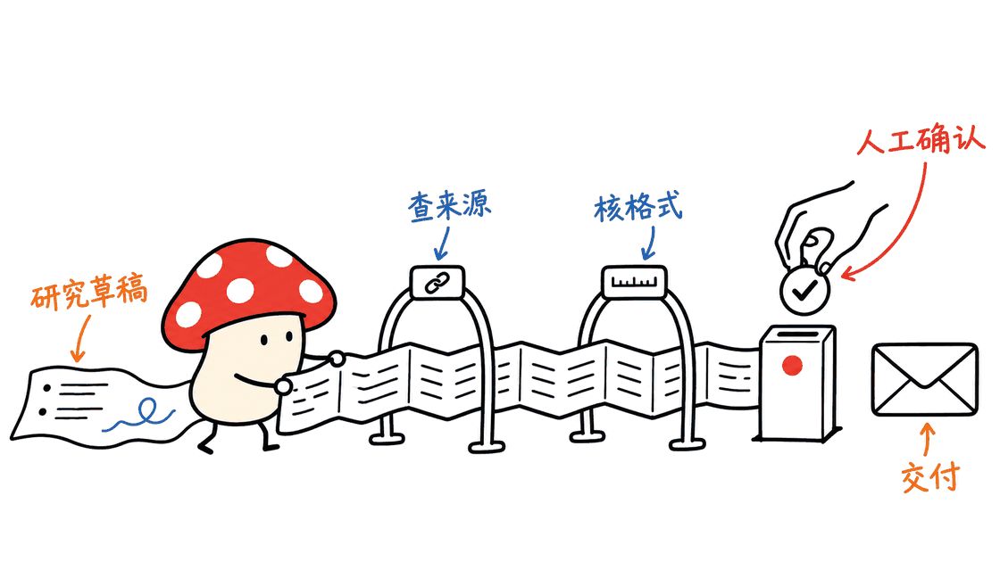

Bisheng 是一个把企业知识、工作流和 Agent 接到同一管理平台的开源项目。它值得关注的地方，是让材料、模型、工具和员工权限形成可运营的应用体系；部署和治理成本也需要一起评估。

仓库由 dataelement 维护，根目录代码采用 Apache-2.0 许可证。本文固定 2026 年 11 月 6 日的提交 `62f5893912a171265769f004fe79a96cfb009fee`，核对 README、架构及部署文件，并在独立 Python 环境运行 35 项现有 CLI 测试。没有启动完整平台、连接真实企业数据或调用付费模型。

仓库：https://github.com/dataelement/bisheng

固定源码：https://github.com/dataelement/bisheng/tree/62f5893912a171265769f004fe79a96cfb009fee

桌面客户端源码：https://github.com/dataelement/bisheng-desktop

## Bisheng解决的是什么问题？

企业的难题常常发生在模型外面：制度文件散落各处，同事不知道该问哪个助手；做报告要在检索、总结和办公软件之间搬运；即便回答准确，也不确定它引用了谁有权看的材料。

Bisheng 尝试把这些环节连起来。知识空间组织文件和权限，模型配置提供推理能力，工作流定义稳定处理步骤，任务模式负责开放式多步骤工作，客户端把本地文件和企业资源接起来。应用工场再把专用业务页面交给团队使用。

这是一个应用平台，不能将它理解为一个新模型，也不能把可私有化部署等同于默认全部离线。若配置外部模型、搜索或文档解析服务，相关数据仍可能离开自己的服务器。

## 七块能力，应当怎样分工？

| 模块 | 官方描述的用途 | 评估时要追问 |
|---|---|---|
| 桌面客户端 | Chat 对话与云端任务；Work 处理获准的本地目录 | 本地材料何时上传，工具获得哪些权限？ |
| 应用工场 | 将本地或 Coding Agent 开发的应用发布到应用中心 | 谁审批，如何扫描密钥和隔离运行环境？ |
| 任务模式 | 拆解目标，使用工具、技能和子 Agent 交付文件 | 费用、超时、失败重试与人工接管如何控制？ |
| 知识空间 | 文件夹、标签、团队共建、带来源的问答 | 检索、引用预览、下载是否遵守同一权限？ |
| 频道订阅 | 聚合网站、公众号资讯并按规则筛选 | 来源可达性、更新失败和重复内容如何处理？ |
| 工作流 | 多轮对话、人工输入、循环、并行与批处理 | 循环终止条件、错误分支和副作用怎样管理？ |
| 企业管理 | 模型、身份、资源授权、用量及审计 | 当前版本及授权实际包含哪些功能？ |

这张表中的能力来自当前 README 和源码说明，不是本文逐项完成的功能验收。厂商展示的客户、下载量和办公交付效果也不作为本次独立实测结论。


## 工作流和任务Agent，应该先用哪个？

固定版式报告、合同字段核对、材料入库等任务，适合先用工作流表达明确步骤。重点是输入格式、节点结果和失败处理可以重复检查。平台支持人工参与，流程可以等人补信息或确认；是否把所有高风险动作放在审批之后，仍取决于具体设计。

目标明确、路径经常变化的研究或材料整理，才更适合交给任务 Agent 动态拆解。README 描述其主 Agent 会规划任务、把独立研究交给子 Agent，并通过技能生成 PPT、Excel、Word 等产物。这说明存在相应产品路径，不保证每次产物都准确、排版完美或无需复核。

一个可行的组合是：Agent 收集材料并形成草稿，工作流执行固定校验和审批，再交付最终文件。建议把写入业务系统、发送通知和对外发布等动作放到独立的确认步骤，不让一次语言模型判断包办整个交付。



## 企业知识库，不能只看“回答对不对”

Bisheng 的知识空间支持组织、文件夹、文件级授权等机制。当前根目录架构说明使用 RBAC 与 OpenFGA 支撑的 ReBAC：前者处理角色与功能范围，后者处理主体与具体资源的关系。具体版本的实现和部署配置需要一起确认。

这带来一个重要的验收方向：同一问题，用两个权限不同的普通员工账号分别提问。允许访问者应得到带来源的答案，不允许访问者不能仅仅因为模型“知道有这份文件”就拿到片段、引用预览或附件。

管理员账号能查询成功，无法证明普通员工的权限路径正确。文件被撤权或删除后，检索索引、缓存、历史会话和引用入口是否及时失效，也应纳入测试。本文没有运行这组多用户权限实验，因此不把源码中的权限机制当作完整安全认证。

## 这套平台为什么需要不止一个容器？

源码中的平台包含管理端和用户端页面、FastAPI 后端、异步任务 Worker，以及数据库、队列、对象存储和检索组件。MySQL 或 DM8 保存业务数据，Redis 处理缓存与队列，Milvus 和 Elasticsearch 支撑向量与全文检索，MinIO 保存文件，OpenFGA 负责关系授权。具体启用服务以部署配置为准。

模型推理、文档解析和应用运行环境还可能需要额外资源。主平台能启动，不意味着模型端点、嵌入、重排、解析和办公文档处理已经准备好。

README 给出的前置条件是至少 8 核 CPU、32GB 内存。它是项目的部署前提描述，不是带本地大模型、多人并发及长任务时的容量承诺。若使用外部模型 API，推理硬件压力会转移，但费用、网络和数据流向仍需记录。

## 按哪份文档安装，才不容易踩坑？

当前固定提交的顶层 README 给出直接执行 Compose 的快速命令，但 `docker/README.md` 已将安装脚本列为入口；Compose 中大量镜像变量也明确要求先在 `.env` 中配置。两份说明存在细节差异，不能只复制首页的一行命令。

建议先固定版本、阅读同一版本的部署目录，再按以下顺序准备：

```bash
git clone https://github.com/dataelement/bisheng.git
cd bisheng
git checkout 62f5893912a171265769f004fe79a96cfb009fee
# 需要已安装且可用的 Docker 和 Compose
bash docker/install.sh --prepare-only
```

`--prepare-only` 的含义是生成和校验配置，不登录镜像仓库、不拉镜像、不启动服务；它仍会调用 Compose 做配置校验。现有 `.env` 会被保留，不会自动合并新字段。

检查生成的 `docker/.env`：镜像架构、存储目录、必要服务、端口及模型服务计划确认后，才运行实际安装：

```bash
bash docker/install.sh
cd docker
docker compose ps
docker compose logs -f backend backend_worker
```

默认访问 `http://服务器IP:3001`。顶层 README 说明首个注册用户成为管理员，首次初始化应在受控网络完成。部署文档也明确列出默认数据库和对象存储凭据，正式交付前需要按文档修改并同步相关连接配置。

当前后端包标记 `3.0.0-beta6`，部署模板的主镜像标记 `v3.0.0`；从 main 拉源码不会自动重新构建这些镜像。源码提交、文档、镜像 tag 或 digest 和数据库迁移版本，应当作为不同项目记录。

Mac 或其他 ARM 主机尤其需要注意：文档要求为每个启用服务选择兼容架构的镜像，沙箱、Socket Proxy 和可选 Gateway 也不能漏掉。把一个后端镜像换成 ARM 版，不等于整套依赖都兼容。

部署说明：https://github.com/dataelement/bisheng/blob/62f5893912a171265769f004fe79a96cfb009fee/docker/README.md

## 开源、商业版、模型费用，如何分开看？

根目录 Apache-2.0 说明这份代码的授权，不代表官网列出的所有企业服务和部署支持都免费提供。当前 README 明确标注统计看板为商业版；可选 Gateway 需要授权文件，安装脚本默认不启用它。

独立桌面客户端、模型权重、文档解析组件和第三方依赖，也应分别看对应仓库和版本的授权。不能用主仓库的许可证替代整个技术栈的核对。

预算可以拆成平台运维、模型调用、文件解析、存储备份、人工维护几项。私有化部署让团队掌握更多配置，但不会消除这些工作。对于只需要个人 PDF 问答的人，整套企业平台的维护成本可能高于收益；已有团队知识和流程问题的组织才更值得试点。


## 本次实际验证了什么？

在隔离的 Python 环境中，实际运行仓库现有 CLI 的三个测试文件：`test_ignore.py`、`test_project.py`、`test_secret_warnings.py`，结果为 35 项通过。它们覆盖文件打包忽略规则、项目配置处理，以及缺失密钥引用告警不输出测试值等行为。

另对安装脚本及其环境处理脚本运行 `bash -n`，语法检查通过。Jina Reader 成功抓取链接正文，官方平台展示图与知识空间截图已下载保存，图中内容仅作为产品说明，不能当作本文运行平台的截图。

本机没有可用的 Docker 命令，没有执行 `install.sh --prepare-only` 或完整部署，也没有测试 RAG 答案质量、多用户权限、桌面文件访问、模型费用或并发性能。35 项 CLI 测试不能替代这些验收。

## 小团队怎样开始更划算？

先选一个边界清楚的场景，例如只面向一个部门的制度问答与报告草稿。准备几十份可公开或已脱敏的文件、两种权限角色、二十个有标准答案的问题，再加几个“没有答案”和“无权限”的反例。

先验证引用是否可追溯、权限是否一致，再接入固定审批工作流。只有当这条链路稳定，才增加桌面目录权限、更多技能和动态任务。记录失败样本、每次任务费用与人工修改量，比单看功能截图更能判断是否适合继续投入。

可以先从项目自己的真实失败记录建立一小套验收集。已有 NamiDSH 文章适合补充理解插件式 Harness 的职责：https://blog.mushroom.cv/blog/namidsh-cordis-plugin-agent-architecture-review/

Mycelium Protocol 的判断是，Bisheng 的价值在于把模型能力纳入组织的知识与交付流程。是否落地成功，最终要看来源、权限、成本和失败恢复能否被实际验证。

## 常见问题

### Bisheng是大模型吗？

不是。它是围绕模型构建应用的平台，负责知识、流程、工具和企业管理等环节。模型端点需要按环境另外配置。

### 自托管就代表全部离线吗？

不代表。若选择外部模型 API、搜索或解析服务，相关输入仍可能出网。需要按实际配置梳理数据流向。

### 一条Compose命令就能交付企业应用吗？

不能。除了容器启动，还需核对配置、模型与解析服务、身份权限、备份、审计和故障恢复。本文没有完成整套部署验收。

### 35项测试通过，是否证明平台安全可靠？

这些只是 CLI 局部行为测试。它们不证明平台权限隔离、RAG 效果、桌面安全或生产负载已经通过测试。

## 一手资料

项目 README：https://github.com/dataelement/bisheng/blob/62f5893912a171265769f004fe79a96cfb009fee/README.md

源码许可：https://github.com/dataelement/bisheng/blob/62f5893912a171265769f004fe79a96cfb009fee/LICENSE

当前部署目录：https://github.com/dataelement/bisheng/tree/62f5893912a171265769f004fe79a96cfb009fee/docker

CLI及测试：https://github.com/dataelement/bisheng/tree/62f5893912a171265769f004fe79a96cfb009fee/src/bisheng-cli

封面为企业材料协作的示意场景，不是实际部署照片。正文插图为解释性绘图。

---

> © 2026 Author: Mycelium Protocol. 本文采用 [CC BY 4.0](https://creativecommons.org/licenses/by/4.0/deed.zh) 授权——欢迎转载和引用，须注明作者姓名及原文链接，不得去除署名后以原创发布。

<!--EN-->

Bisheng is an open-source platform that connects enterprise knowledge, workflows and agents under shared administration. Its useful proposition is a manageable application system around models, files, tools and employee permissions. Deployment and governance costs belong in the same evaluation.

The dataelement repository uses Apache-2.0 at its root. This review pins commit `62f5893912a171265769f004fe79a96cfb009fee` from November 6, 2026, inspects documentation and deployment configuration, and runs 35 existing CLI tests in an isolated Python environment. No full platform, paid model or real enterprise dataset was used.

Repository: https://github.com/dataelement/bisheng

Pinned source: https://github.com/dataelement/bisheng/tree/62f5893912a171265769f004fe79a96cfb009fee

Separate desktop source: https://github.com/dataelement/bisheng-desktop

## What problem does Bisheng address?

Organizations often struggle outside the model: documents live in disconnected places, reports require repeated copying between tools, and a correct answer may still cite material the requester should not access.

Bisheng connects knowledge spaces, model configuration, repeatable workflows, open-ended task agents and desktop work. An application factory provides a path to deliver purpose-built business pages to colleagues. These are application infrastructure capabilities, not a new foundation model.

Self-hosting does not automatically make the system offline. External inference, search and document services can still receive data depending on configuration.

## How should its capabilities be divided?

| Module | Documented purpose | Deployment question |
|---|---|---|
| Desktop client | Chat and cloud tasks; Work with approved local folders | Which files leave the device, and with what permissions? |
| Application factory | Publish locally or agent-developed apps to a team | Who approves builds and reviews secret scans? |
| Task mode | Plan work, call tools and skills, delegate research | What controls spending, retries and intervention? |
| Knowledge spaces | Organize files and answer with sources | Do retrieval, previews and downloads share access rules? |
| Channels | Gather and filter website and public-account content | How are unavailable sources and duplicates handled? |
| Workflows | Conversation, human input, loops, parallel work and batches | What stops loops and handles partial side effects? |
| Enterprise management | Identity, model access, resource grants and audits | Which features are included in this edition and version? |

These are documented features, not a completed acceptance test. Vendor customer lists and illustrated office deliverables are not independent results from this review.


## Workflow or task agent first?

Use explicit workflows for stable tasks such as structured reviews, ingestion and fixed report formats. Inputs, node outputs and failure branches can then be checked repeatedly. Human-in-the-loop support provides a place to request input or approval; the application still has to use that control appropriately.

Task agents fit goals whose routes change frequently. The README describes planning, parallel research delegation and skills producing office documents. This does not guarantee correct facts, perfect formatting or review-free delivery.

One practical arrangement lets an agent draft from collected material, then sends the draft through fixed checks and human approval. Treat external publication, notifications and business-system writes as explicit actions with their own confirmation points.


## Knowledge quality also includes permission quality

Current root architecture guidance describes RBAC and OpenFGA-backed relationship authorization. Knowledge spaces expose organization, folder and file-level permissions. Exact behavior must be checked against the selected release and deployment.

Test one question with two ordinary employee accounts that have different access. Authorized users should receive traceable answers; unauthorized users should not obtain snippets, citation previews or attachments indirectly. Administrator success says little about that boundary.

Also test revocation and deletion across indexes, caches, history and source links. This review did not execute those multi-user checks, so code-level authorization mechanisms are not presented as a security certification.

## Why is this more than one container?

The platform includes management and end-user interfaces, a FastAPI backend, asynchronous workers and several storage services. MySQL or DM8 handles business data, Redis supports queues and caches, Milvus and Elasticsearch support retrieval, MinIO stores files, and OpenFGA handles relationship authorization. Enabled services depend on deployment configuration.

Inference, parsing and application execution can require additional resources. Starting the platform does not configure embeddings, reranking, model endpoints or document processing automatically.

The README lists at least eight CPU cores and 32GB RAM. That is a deployment prerequisite, not a capacity guarantee for local models, concurrent users and long tasks. External inference reduces local compute needs while retaining network, spending and data-handling considerations.

## Which installation instructions should be followed?

The pinned top-level README gives a direct Compose command. The more specific `docker/README.md` now directs users to an installer, and Compose requires image variables in `.env`. Read matching versions together rather than copying one command from the homepage.

```bash
git clone https://github.com/dataelement/bisheng.git
cd bisheng
git checkout 62f5893912a171265769f004fe79a96cfb009fee
# Requires working Docker and Compose
bash docker/install.sh --prepare-only
```

Preparation creates and validates configuration without registry login, image pulls or service startup. It still invokes Compose validation. An existing `.env` is preserved without automatically merging new fields.

Inspect architecture-compatible images, storage locations, services, ports and model plans before actual installation:

```bash
bash docker/install.sh
cd docker
docker compose ps
docker compose logs -f backend backend_worker
```

The default entry is `http://SERVER_IP:3001`. The README says the first registered user becomes administrator; initialize in a controlled network. Deployment documentation lists default database and object-storage credentials, which need coordinated configuration changes before production use.

The checked backend package says `3.0.0-beta6`, while main deployment images use `v3.0.0`. Cloning source does not rebuild those images. Track the source commit, documentation, image tag or digest, and migration version separately.

ARM systems need compatible images for every enabled service, including sandboxes, Socket Proxy and an optional Gateway. Replacing one backend image is insufficient.

Deployment guide: https://github.com/dataelement/bisheng/blob/62f5893912a171265769f004fe79a96cfb009fee/docker/README.md

## What does open source include?

The root Apache-2.0 license governs the supplied code. It does not make every advertised enterprise service free. The README marks statistical dashboards as commercial, and the optional Gateway requires a license file. The installer leaves that Gateway disabled by default.

Review the separate desktop project, models, parsers and dependencies under their own licenses. Budget for operations, inference, parsing, storage, backups and maintenance. A personal PDF assistant may not justify an enterprise stack; an organization with shared knowledge and delivery processes is a more suitable pilot candidate.


## What was actually verified?

Three existing CLI test files were executed: `test_ignore.py`, `test_project.py` and `test_secret_warnings.py`. All 35 tests passed. Their scope includes packaging ignore behavior, project configuration and warnings that do not print the fixture secret value.

`bash -n` passed for the installer and environment helper. Jina Reader successfully fetched the supplied URL. Two official screenshots were downloaded; they describe the product and are not screenshots of a locally running installation.

No Docker command was available on this machine. The installer preparation step and full deployment were not executed. No RAG quality, multi-user permissions, desktop access, real-model costs or concurrency benchmark was tested. CLI tests do not establish those properties.

## How should a small team start?

Choose one bounded workflow, such as department policy questions and report drafts. Prepare a few dozen public or sanitized documents, two permission roles and twenty questions with expected answers. Include absent-answer and unauthorized-access cases.

Verify source traceability and access behavior before adding approval workflows. Add local desktop folders, more skills and dynamic tasks only after the first path is stable. Track failure samples, per-task costs and human editing effort.

For complementary background on plugin runtime responsibilities, see the NamiDSH review: https://blog.mushroom.cv/blog/namidsh-cordis-plugin-agent-architecture-review/

Mycelium Protocol's assessment is that Bisheng connects model capabilities with organizational knowledge and delivery. Successful adoption depends on verified sources, permissions, costs and recovery behavior.

## FAQ

### Is Bisheng a language model?

No. It is an application platform around models. Model endpoints must be configured for the chosen environment.

### Does self-hosting mean fully offline operation?

No. External model, search or parsing services may still receive inputs. Map actual data flows for the deployed configuration.

### Does starting Compose finish deployment?

No. Models, parsers, identity, permissions, backups, audits and recovery still require configuration and testing. This review did not complete full-stack acceptance.

### Do 35 passing tests prove production security?

No. They verify selected CLI behavior, not platform isolation, RAG quality, desktop security or production load.

## Primary sources

README: https://github.com/dataelement/bisheng/blob/62f5893912a171265769f004fe79a96cfb009fee/README.md

License: https://github.com/dataelement/bisheng/blob/62f5893912a171265769f004fe79a96cfb009fee/LICENSE

Deployment: https://github.com/dataelement/bisheng/tree/62f5893912a171265769f004fe79a96cfb009fee/docker

CLI and tests: https://github.com/dataelement/bisheng/tree/62f5893912a171265769f004fe79a96cfb009fee/src/bisheng-cli

The cover is an illustrative enterprise-document scene, not an actual deployment photograph. Body illustrations explain the analysis.

---

> © 2026 Author: Mycelium Protocol. Licensed under [CC BY 4.0](https://creativecommons.org/licenses/by/4.0/) — free to share and adapt with attribution. You must credit the author and link to the original; removing attribution and republishing as original is not permitted.
