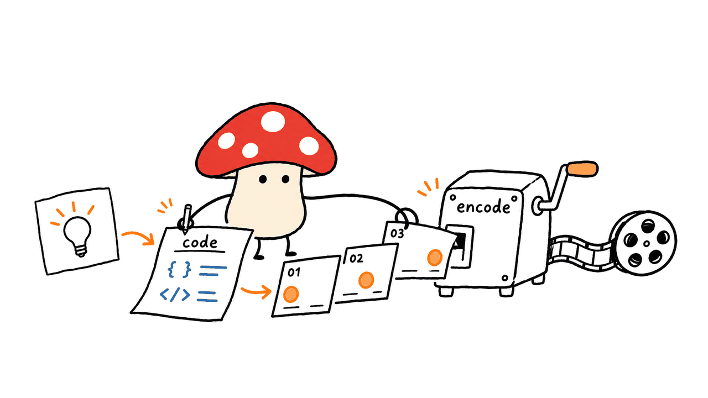
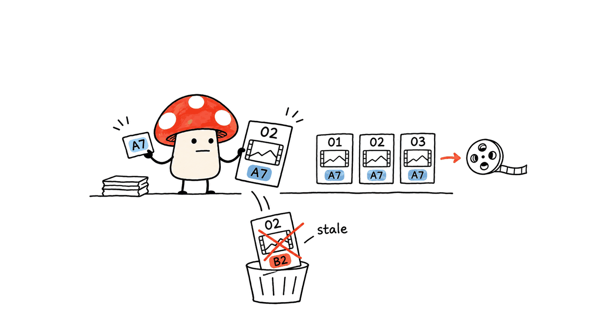

cinecode让编程Agent写脚本和场景代码，再用浏览器与ffmpeg把画面、声音做成视频。它更值得研究的部分，是怎样让创意、确认、渲染和返工形成一条能检查的流程。

官方仓库：https://github.com/sarpstar/cinecode

本文核对提交 `c8a3e7552699360a2b0142c9620882af2069eedb`，代码采用MIT许可，版权署名为Sarp Yıldız（@sarpstar）。查询时GitHub页面约2.8k Stars；“上线不到一周涨到2.2k”的历史说法没有完成独立核验，本文不据此判断产品成熟度。

## 它是视频模型，还是制作工具？

它是一套Agent技能、模板和本地工具，不是新训练的视频生成模型。Agent负责理解需求、组织脚本、编写或修改场景；浏览器按代码出帧，ffmpeg承担编码、合成和音频处理。

这条路线适合结构明确的动态图形、讲解、产品演示和程序化场景。它也可以组合档案照片、旁白或已有素材，所以“代码主导渲染”不等于整个作品只用代码、绝不调用模型。

与其把它描述成“一句话自动拍电影”，不如理解为把制作要求交给一个会用本地工具的Agent，并提供足够明确的流程说明。成片是否好看、脚本是否可信，仍需要审阅。

## 从想法到成片，中间有哪些关口？

仓库将制作分为Quick和Film两种模式：前者以单文件和低分辨率草稿快速迭代，后者将较长作品拆成脚本、场景、声音及审阅等阶段。它们是工作流选择，不是“短片必定几分钟生成”的性能承诺。

Quick模板使用Canvas 2D和2.5D镜头；另一套起步代码使用three.js。两者都强调按时间计算画面，避免把动画只写成依赖上一帧的循环。

流程说明要求先确认方向和脚本、查看前两个场景，再扩展制作与检查。这能减少“全部做完才发现风格错了”的损失。但技能文档里的要求，与所有宿主都能强制执行的状态机不是一回事：仓库说明Claude Code的守卫钩子有版本要求，其他Agent能调用工具，也不表示拥有相同的拦截能力。

对工程师，适合借鉴的是阶段产物：脚本、镜头描述、状态文件、素材许可表和审阅记录。把批准对象留在文件里，比只记住聊天里一句“可以”更方便恢复任务。

## 确定性取帧，为什么比普通录屏重要？

官方捕获工具要求页面提供 `window.READY` 和 `window.captureFrame(i)`：前者报告帧数、帧率与尺寸，后者按帧号给出画面。音频可以通过另一接口离线渲染。

明确的帧接口允许抽查、乱序取帧和多工作进程编码。它将时间变成可定位输入：第几帧出错，可以回到同一个位置检查，而不是再次录屏等待动画走到那里。

续渲又需要另一层条件。若页面或相关本地素材变了，旧帧不能因为文件名存在就被继续采用。代码里有输入指纹和恢复逻辑；本文的浏览器检查也覆盖了素材内容改变、但时间和大小保持不变的情况。

这并不保证任意远程素材永远一致。依赖版本、字体、网络资源、随机种子和渲染环境仍应记录。需要交付可重建成片时，可把关键资源固化并保存摘要；这是本文的工程建议，不是声称所有外部资源都会自动归档。

## 本地检查通过了什么？

Mycelium Protocol在隔离临时仓库运行了原始测试套件：共发现231项，210项通过，21项浏览器测试按默认配置跳过，没有将跳过项记为通过。测试包含临时文件、合成素材及模拟服务，不能外推为完整影片生产认证。

随后单独启用真实Chrome的4项捕获回归检查，范围是恢复与强制重渲、素材变化失效、页面加载异常，以及多工作进程MP4帧数。4项检查全部通过。其中MP4用的是32×32像素、24fps、4帧合成样例，不是让Agent从一句话创作整部影片。

另用同一原始合成页面运行官方 `--verify`，重复帧与乱序取帧检查通过。这只针对该页面，不是所有未来影片的确定性保证。

我们保留了测试日志与源代码摘要；本次没有调用真实旁白模型，没有生成十分钟影片，也没有测量高分辨率生产吞吐量或Windows完整成片流程。浏览器测试的结果以随文发布凭证为准，不把README展示的作品当作本文实测。

## 质检通过，为什么还不等于视频做好了？

仓库关注运动、文字、响度、声音层次等检查，并提供音频母带流程。它们有助于发现可测问题：静止画面、读不清的字、音轨或输出格式异常。

但检测到画面在动，不代表叙事有效；文字有对比度，不代表内容正确；音频达到目标响度，也不表示配乐和旁白有恰当情绪。自动质检与审美审阅应各自保留位置。

工程团队可以把验收分成三组：技术交付是否可播放，内容事实和素材许可是否清楚，作品是否达到沟通目的。不要用一个“渲染成功”字段替代三种不同判断。

## 本地渲染，是否意味着全程离线、没有费用？

不是。运行需要能使用本地工具的编程Agent，以及Node.js、Python、ffmpeg和浏览器。three.js、字体等可能来自网络；旁白既有云端服务路径，也有需另外安装的本地语音选项。Agent用量、外部服务、存储和渲染时间应分别核算。

MIT覆盖项目代码，不会自动覆盖作品里每张档案照片、每首音乐、字体或模型权重的使用条件。素材许可表的意义，是让作品能逐项追溯来源，而非把“搜索到”当成“获得所有用途的许可”。

本地工具测试与完整离线创作是两回事。选型时应先问：哪些步骤必须联网，哪些结果可缓存，缺少服务时能否使用替代素材或系统声音继续草稿？

### 工程师最值得复用的是什么？

是清楚的阶段契约。给输入、产物和批准状态一个可检查的表示，让失败后能判断重做哪一步。再为昂贵渲染建立低成本抽样、内容变化失效和可恢复机制。

一个起步练习是只做15秒的产品讲解，先固定脚本与两张风格帧，再渲染低分辨率草稿。修改一处文字，检查哪些产物真的需要重做。这个练习检验的是返工成本，不只是能否导出MP4。

### 代码视频会替代生成式视频吗？

不必这样判断。对结构、文字、时间和参数要求明确的画面，代码提供可修改的控制；其他视觉需求可以采用别的技术。更有用的选择标准是修改是否可定位、结果能否检查、成本是否可接受。

### 中文可直接保证效果吗？

仓库有中文README，但不等于中文字体、断行、旁白和字幕都经过本文验收。正式制作仍应拿自己的中文文本检查显示与声音。

参考资料：

https://github.com/sarpstar/cinecode/blob/c8a3e7552699360a2b0142c9620882af2069eedb/scripts/capture.mjs

https://github.com/sarpstar/cinecode/blob/c8a3e7552699360a2b0142c9620882af2069eedb/templates/quick/film.html

https://github.com/sarpstar/cinecode/blob/c8a3e7552699360a2b0142c9620882af2069eedb/references/quick-mode.md

封面采用仓库公开的《Boş Koltuk》场景图；正文小M插图用于解释流程。

---

> © 2026 Author: Mycelium Protocol. 本文采用 [CC BY 4.0](https://creativecommons.org/licenses/by/4.0/deed.zh) 授权——欢迎转载和引用，须注明作者姓名及原文链接，不得去除署名后以原创发布。

<!--EN-->

cinecode asks a coding agent to develop scripts and scenes, then uses browser rendering and ffmpeg to produce video. Its useful engineering idea is the connection between creative decisions, explicit approval, rendering and revision.

Repository: https://github.com/sarpstar/cinecode

We examined commit `c8a3e7552699360a2b0142c9620882af2069eedb`. The code is MIT-licensed with copyright attributed to Sarp Yıldız (@sarpstar). GitHub displayed about 2.8k stars. We did not independently establish the claimed rise to 2.2k within its first week.

## Is this a video model or a production toolkit?

It is an agent skill, templates and local tools, rather than a newly trained video model. The agent interprets requirements and writes scene code. A browser renders frames, while ffmpeg handles encoding and media processing.

This approach suits structured animation, explainers, product demonstrations and procedural scenes. Archive images, existing footage or narration can also be used. Code-led rendering therefore does not imply that every part of creation avoids models or external media.

The workflow provides instructions to an agent capable of running local tools. It does not establish that a one-sentence request reliably yields a finished, factually sound and aesthetically successful film.

## Where do the production gates sit?

Quick mode favors a single file and low-resolution drafts. Film mode organizes longer work into approved stages. These are workflow choices, not measured promises about how many minutes a film will take.

The Quick template uses Canvas 2D and a 2.5D camera. Another starter uses three.js. Both encourage computing the scene at a specified time rather than relying entirely on the previous animation frame.

The documented process puts direction, script and two scene previews before expanding production. That can reduce the cost of discovering a wrong look late. A written skill rule, however, is not the same as a universally enforced state machine. Guard hooks have Claude Code version requirements, and other tool-capable agents do not automatically provide equivalent interception.

Useful artifacts include scripts, shot descriptions, state files, license records and approval evidence. A persistent approved artifact is easier to recover than an ambiguous “yes” in chat.

## Why does a frame interface matter?

The capture tool expects `window.READY` to describe the output and `window.captureFrame(i)` to return a specified frame. Audio has a separate offline-rendering interface.

This permits sampling, out-of-order frame checks and parallel encoding. A faulty frame becomes a reproducible input rather than a point one must wait for during another screen recording.

Resuming work needs a further rule: an existing frame is valid only for compatible inputs. The capture implementation tracks relevant local content. Our selected browser regression cases include a changed image whose size and timestamp remain unchanged.

This cannot guarantee that arbitrary remote resources stay stable. Record dependencies, fonts, seeds and the rendering environment. For reproducible delivery, consider retaining critical resources with content hashes. That is our recommendation, not a claim that the toolkit archives every external asset automatically.

## What did the local tests cover?

Mycelium Protocol ran the unmodified upstream suite in an isolated checkout. It discovered 231 tests: 210 passed and 21 browser tests were skipped by the default configuration. Skips were not counted as passes. Fixtures and mocked services make this evidence about tool behavior, not full production certification.

We then enabled four real Chrome regression cases: resume and fresh rendering, invalidation after an image changes, failure on a page-loading error, and frame-count preservation in multi-worker MP4 output. All four passed. The MP4 fixture is only 32×32 pixels, 24 fps and four frames, not a complete agent-created film.

The official `--verify` mode also passed repeated and out-of-order frame checks on the original synthetic page. This applies to that fixture, not every future film.

No real narration model, ten-minute movie, production-resolution throughput benchmark or full Windows filmmaking session was tested. The associated receipts record the actual selected-browser outcomes; repository showcase films are not our own measured results.

## Why is automated QC insufficient?

Motion, text readability, loudness and media-format checks catch useful measurable problems. They cannot alone establish coherent storytelling, factual correctness or appropriate emotional delivery.

Separate technical acceptance, source and rights review, and communication goals. A successful render should not silently stand for all three. Preserve a human review step alongside automated checks.

## Does local rendering mean offline and free?

No. The workflow needs a local tool-capable coding agent, Node.js, Python, ffmpeg and a browser. Libraries or fonts may be fetched from a CDN. Narration can use cloud services or separately installed local engines. Agent usage, external services, storage and rendering time are distinct costs.

The MIT code license does not grant unrestricted rights to every photograph, music track, font or model used in a film. Record the actual license and intended use of each asset.

Local tool operation and a fully offline creative pipeline are different properties. Identify required network stages, reusable caches and possible substitutes before committing to a workflow.

### What should engineers borrow first?

Use explicit stage contracts: identifiable inputs, outputs and approval state. Add inexpensive samples before costly rendering, invalidate stale results when content changes, and preserve enough state to resume after failure.

A useful first exercise is a 15-second product explainer with an approved script and two style frames. Render a low-resolution draft, change one phrase and inspect which artifacts truly need rebuilding. This measures revision control rather than merely proving that an MP4 can be exported.

### Must code rendering replace generative video?

No. Code offers editable control over structured visuals, text, timing and parameters. Other visual requirements may favor other techniques. Compare how precisely revisions can be targeted and verified, and what they cost.

### Is Chinese output guaranteed?

A Chinese README is not a completed Chinese typography, narration and subtitle audit. Check the actual text, fonts, layout and sound required by the project.

Sources:

https://github.com/sarpstar/cinecode/blob/c8a3e7552699360a2b0142c9620882af2069eedb/scripts/capture.mjs

https://github.com/sarpstar/cinecode/blob/c8a3e7552699360a2b0142c9620882af2069eedb/templates/quick/film.html

https://github.com/sarpstar/cinecode/blob/c8a3e7552699360a2b0142c9620882af2069eedb/references/quick-mode.md

The cover is the repository's public scene image from Boş Koltuk. Little M illustrations explain the workflow.

---

> © 2026 Author: Mycelium Protocol. Licensed under [CC BY 4.0](https://creativecommons.org/licenses/by/4.0/) — free to share and adapt with attribution. You must credit the author and link to the original; removing attribution and republishing as original is not permitted.
