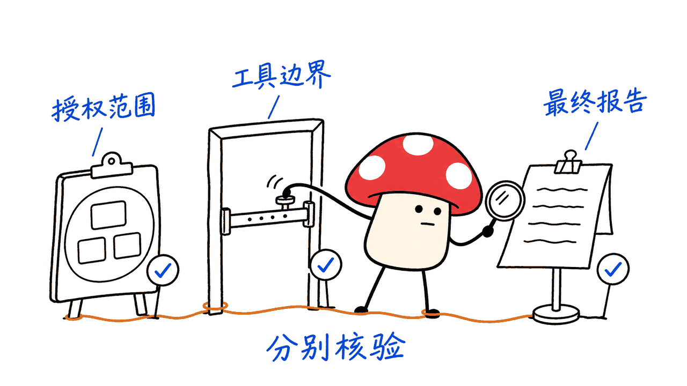

Claude-BugHunter 把安全研究的方法、检查项和报告流程整理成代理可加载的技能包。它能帮助授权测试人员组织工作、减少遗漏；“装上就变漏洞专家”则超出了我们实际核验的范围。

项目来自 elementalsouls，作者 Sachin Sharma。我们固定的提交包含 84 个 `skills/*/SKILL.md` 和 15 个命令文件，Python 包版本为 2.1.0。代码采用 MIT；技能方法论、文档等内容采用 CC BY 4.0，转载内容需要保留相应署名。素材中的“+2037”缺少榜单日期与快照，本次不把它写成已核实的单日增长。

## Claude-BugHunter 实际交付了什么？

它有三类容易混在一起的东西：指导代理思考的技能文档、帮助创建工作目录和调用流程的命令，以及可独立运行的 `cbh` Python 工具。技能增加的是研究上下文与工作规范，不是给基础模型重新训练，也不是自动赋予它新的系统权限。

官方把内容分成方法论、应用安全、企业环境和交付复核等层次，提供与 Burp MCP、HackerOne 等工具的连接。README 宣称整理了 681 个公开报告模式，其中 433 个有逐条引用。这是作者描述的知识整理规模，不等于本工具发现了 681 个新漏洞，也不代表每个模式都经过当前版本端到端复现。

安装路径也有区别。插件路线提供命名空间下的技能和命令；终端运行器需要另行安装，部分工作目录脚手架来自克隆仓库。复制安装会写入个人代理目录，不能把“加载文档”与“安装脚本已经检查过所有副作用”混为一谈。本次只研究源码，没有把它安装到用户的 Claude Code 环境。

## “七问门禁”检查的是证据，还是证据的描述？

项目要求研究者检查真实请求、影响范围、资产授权、攻击者权限、重复性、可证明影响和不应提交的报告类别。这个结构有助于团队把“可疑迹象”与“值得提交的发现”分开。

但要看具体实现。`cbh triage` 读取本地报告文本，通过子串与正则表达式寻找支持信号，并对否认授权范围的措辞做额外处理。它不会因为看见请求片段就自动发送请求，也不会因为看到影响描述就验证服务端确实产生了该影响。

因此，门禁通过表示报告具有受检查的文字信号，不能当成漏洞真实性证明。研究者仍需在授权范围内核对原始请求、响应、身份与时间条件；同样，看到某类关键词而拒绝报告，也不等于完成了所有业务上下文判断。

我的独立判断是：项目最有价值的方向，是把研究过程变成别人能接手检查的材料，而不是把代理的一段流畅解释升级成结论。报告应让复核者区分“观察到了什么”“据此推断什么”“尚缺什么证据”。

## 授权范围能靠提示词自动保证吗？

不能。技能里的授权要求、代码里的域名边界检查和组织实际批准的测试范围，是三个不同层次。一个作用在代理行为上，一个作用在特定输入路径上，另一个来自资产所有者与测试约定。

我们检查的域名边界用例，会拦住把无关域名伪装成后缀匹配的输入，也验证含 URL 或路径的错误目标在被动查询前退出。这是受测入口的边界行为，不是所有脚本、代理工具调用和人工操作都被同一个不可绕过的策略控制。

同理，HackerOne 的账户凭证只在需要读取相应私有资料时才有意义，不是安装技能的必需品。接入 MCP 前，应明确连接器能读取哪些材料、能否发起请求以及输出保存到哪里。研究记录中可能含敏感信息，报告生成器的脱敏和字段处理值得检查，但不能代替整个交付过程的人工复核。

## 本次本地验证覆盖到哪里？

Mycelium Protocol 在提交 `b33313ba0e507dcbf2ed117b86155c6afb25e99e` 上运行了五个原始测试文件，共 65 项全部通过，未修改被测源码。范围包括授权清单导入、报告七问检查、Markdown 章节解析、侦察目标域名边界，以及秘密扫描的跳过目录处理。

用例使用合成的 example 域名、保留测试地址、临时文件和模拟查询。报告测试还检查代码块里的标题不会被误当成真正章节，以及生成报告不会默认泄露操作系统登录名。这些都是具体工程行为，不能推导出真实漏洞发现率、误报率或红队任务成功率。

我们没有扫描任何外部目标，没有执行漏洞利用、连接私有 HackerOne 账户或调用 Claude 进行真实研究，也没有完成全部测试目录或靶场评测。README 的示范对话明确标为 illustrative transcript，应按说明性演示理解；作者的“实战验证”描述也应与独立测量分开。

## 哪些团队更适合关注它？

已经有授权测试流程、希望统一研究笔记和交付材料的安全团队，比期待“一键找洞”的使用者更容易从中受益。先固定版本，选择少量与自身资产相关的技能，在内部训练环境观察遗漏与误报，再决定是否纳入正式工作流。

评估时不要只数技能数量。更值得记录的是：发现能否稳定复现、复核者是否理解影响、原始证据是否完整、版本更新后判断是否变化，以及报告修订需要多少人工。这些才与交付质量有关。

## 常见问题

### 它是新的安全专用大模型吗？

不是。它提供技能内容、命令和工具辅助，依赖现有代理及其底层模型、连接器和执行权限。

### 测试通过是否证明能自动发现真实漏洞？

不能。本次 65 项测试针对本地解析、边界和报告契约，未测试真实目标上的发现能力或完整代理工作流。

### 全部内容都是 MIT 许可吗？

不是。官方明确区分代码 MIT 与内容 CC BY 4.0；使用技能文档、方法论等内容时需要遵守内容许可和署名要求。

## 来源与延伸阅读

官方仓库：https://github.com/elementalsouls/Claude-BugHunter

固定版本的 CLI 实现：https://github.com/elementalsouls/Claude-BugHunter/blob/b33313ba0e507dcbf2ed117b86155c6afb25e99e/cbh/cli.py

许可说明：https://github.com/elementalsouls/Claude-BugHunter/blob/b33313ba0e507dcbf2ed117b86155c6afb25e99e/NOTICE

相关证据与质量门禁讨论：https://blog.mushroom.cv/blog/trust-pyramid-agent-quality-gates-evidence-guide/

---

> © 2026 Author: Mycelium Protocol. 本文采用 [CC BY 4.0](https://creativecommons.org/licenses/by/4.0/deed.zh) 授权——欢迎转载和引用，须注明作者姓名及原文链接，不得去除署名后以原创发布。

<!--EN-->

Claude-BugHunter packages security research methods, checklists and reporting workflows into skills that an agent can load. It can help authorized researchers organize their work and reduce omissions. Installing it does not establish that the agent has become an expert vulnerability researcher.

The project belongs to elementalsouls and is authored by Sachin Sharma. Our pinned checkout contains 84 skills/*/SKILL.md files and 15 command files; the Python package version is 2.1.0. Code is MIT-licensed, while methodology and documentation content use CC BY 4.0. The supplied “+2037” figure lacks a dated Trending snapshot, so we do not present it as verified daily growth.

## What does the bundle deliver?

Separate three components: skill documents that guide reasoning, commands that organize work, and the standalone cbh Python utility. Skills provide context and conventions; they do not retrain the underlying model or grant system permissions.

The author groups material into methodology, application security, enterprise environments and delivery review, with integrations such as Burp MCP and HackerOne. The README describes 681 disclosed-report patterns, 433 individually cited. These are author-reported curation counts, not 681 new vulnerabilities discovered by this tool or evidence that every pattern was reproduced end to end.

Installation paths differ. The plugin supplies namespaced skills and commands; the terminal runner is installed separately, and some engagement scaffolding comes from a clone. Copy installation writes into personal agent directories. We inspected source without installing the bundle into the user's Claude Code environment.

## Does the seven-question gate verify evidence or its description?

The workflow asks about a real request, accepted impact, asset scope, attacker privileges, duplicates, demonstrated consequences and report categories that should not be submitted. This is useful structure for separating suspicious observations from reportable findings.

The CLI implementation has a narrower role. cbh triage reads local report text and uses substrings and regular expressions to identify supporting signals, with additional handling for statements that deny or leave scope unverified. It does not execute a request merely because a request appears in the report, or validate server behavior merely because impact is described.

Passing therefore indicates that the inspected textual signals are present, not that a vulnerability has been proven. Authorized researchers must still review original requests, responses, identities and timing. A keyword-based rejection likewise cannot resolve every business-context question.

Our assessment is that the strongest value lies in producing research material another person can inspect. A fluent agent explanation should not become a conclusion by itself. Reports should distinguish observed facts, inferences and missing evidence.

## Can prompts alone enforce authorization scope?

No. Scope instructions in skills, domain-boundary checks in code and an asset owner's actual approval are separate layers. They respectively influence agent behavior, constrain particular execution paths and define the authorized engagement.

The boundary cases we ran reject unrelated domains disguised as suffix matches and stop malformed URL/path targets before passive lookup. That establishes behavior at those tested entry points. It does not show that every script, tool call and manual action is governed by one unavoidable enforcement layer.

HackerOne credentials are optional when private account data is unnecessary. Before connecting MCP tools, clarify the accessible material, request capabilities and output locations. Findings may contain sensitive information; report-field handling deserves inspection, but it cannot replace review of the entire delivery process.

## What did we actually test?

Mycelium Protocol pinned commit b33313ba0e507dcbf2ed117b86155c6afb25e99e and ran five original test files without changing the tested source. All 65 tests passed, covering scope import, triage, Markdown report sections, reconnaissance domain boundaries and secret-scan directory exclusions.

Fixtures use synthetic example domains, reserved test addresses, temporary files and mocked lookups. Report cases also verify that headings inside code fences do not become real sections and that generated reports do not expose the operating-system login name by default. These are specific engineering contracts, not measurements of vulnerability discovery, false-positive rates or engagement success.

We did not scan external targets, execute exploits, access private HackerOne accounts, call Claude for a live investigation or run the entire test tree or training-platform evaluation. The README labels its sample dialogue an illustrative transcript. The author's battle-tested claims remain distinct from our independent measurements.

## Who is likely to benefit?

Teams with an existing authorized testing process can use the bundle to standardize notes and delivery. Pin a version, select a small relevant subset and observe omissions and false positives in an internal training environment before adopting it for regular work.

Count reproducible findings and review effort rather than skills alone. Useful measures include whether another reviewer can reproduce the observation, understand its impact, inspect complete evidence and detect changed judgments after a version update.

## FAQ

### Is it a new security language model?

No. It supplies skill content, commands and supporting tools that depend on an existing agent, model, connectors and execution permissions.

### Do passing tests establish real vulnerability discovery?

No. Our 65 tests exercise local parsing, boundary and reporting contracts. They do not measure discovery on real targets or a complete agent workflow.

### Is everything MIT-licensed?

No. The project explicitly distinguishes MIT code from CC BY 4.0 content. Reusing skill documents or methodology requires respecting content attribution terms.

## Sources and related reading

Official repository: https://github.com/elementalsouls/Claude-BugHunter

Pinned CLI implementation: https://github.com/elementalsouls/Claude-BugHunter/blob/b33313ba0e507dcbf2ed117b86155c6afb25e99e/cbh/cli.py

License notice: https://github.com/elementalsouls/Claude-BugHunter/blob/b33313ba0e507dcbf2ed117b86155c6afb25e99e/NOTICE

Related evidence and quality gates: https://blog.mushroom.cv/blog/trust-pyramid-agent-quality-gates-evidence-guide/

---

> © 2026 Author: Mycelium Protocol. Licensed under [CC BY 4.0](https://creativecommons.org/licenses/by/4.0/) — free to share and adapt with attribution. You must credit the author and link to the original; removing attribution and republishing as original is not permitted.
