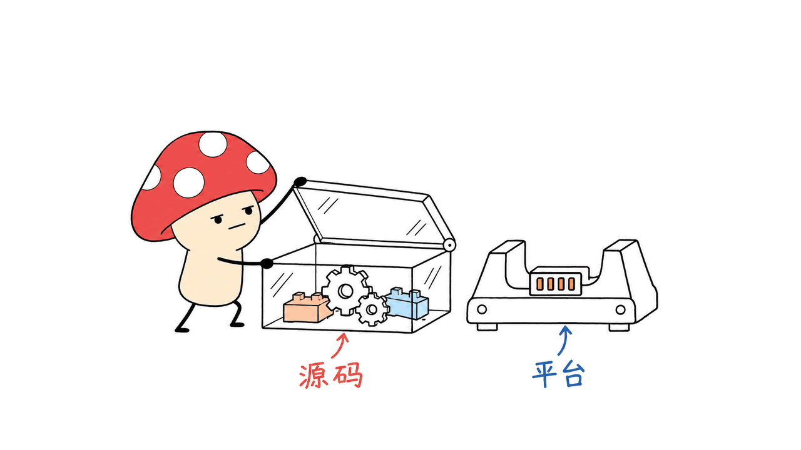
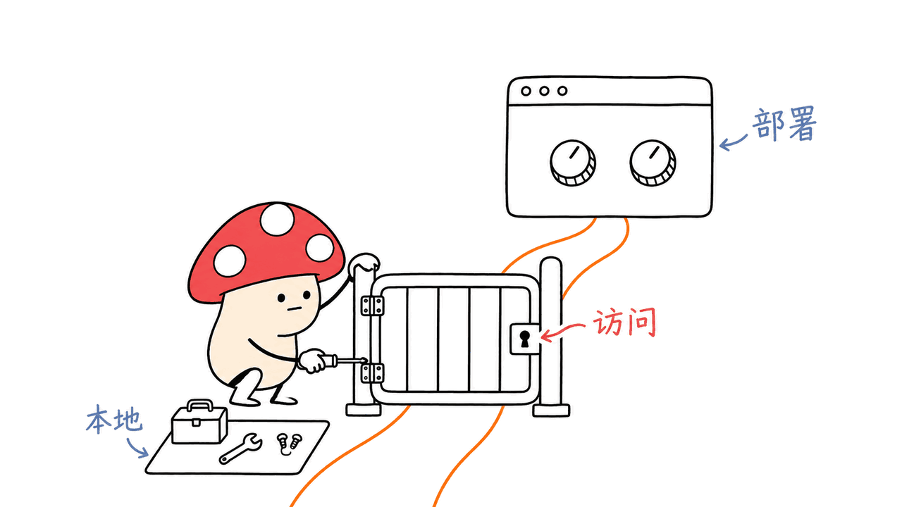

Kitesurf 是面向 Agent 的实验性浏览器引擎，可以在 Cloudflare Workers 中处理网页、执行 JavaScript 和生成截图。2026 年 11 月 13 日，Cloudflare 宣布它已按 Apache 2.0 开源，开发者可以查看、修改并自部署源码。

> 本文保留 8 月 7 日的原始文章地址，于 11 月 14 日根据开源公告修订。修正了旧文中的“即将开源”、无条件兼容现有客户端，以及由内存比例直接推算并发收益的表述。封面采用官方开源公告配图。

官方仓库：https://github.com/cloudflare/kitesurf
开源公告：https://blog.cloudflare.com/kitesurf-open-source/
最初介绍：https://blog.cloudflare.com/kitesurf

## 这次开源，工程师真正多了什么？

以前主要通过 Cloudflare 的服务入口使用它；现在可以检查实现、在本地运行开发环境，并把自己的版本部署到自己的 Workers 账户。代码采用 Apache 2.0，字体、数据与依赖仍有各自许可证，仓库 `NOTICE` 记录了相关声明。

这不等于独立于 Cloudflare 平台的通用 Chrome 二进制。当前项目使用 Worker Loader、Dynamic Workers 等平台能力。源码开放解决可检查与可修改的问题，部署依赖和运行费用仍要单独考虑。

本文源码快照为 `4a2903813a22b08d4f3cc64a4b35339d0293a5d1`，以下构建说明以这个版本为准。



## 没有 Chrome 容器，网页怎样运行？

官方把主要职责分成 Engine、PageScript 和 PageRenderer：Engine 管理会话与客户端连接；PageScript 承载页面及其 JavaScript；PageRenderer 绘制结果。页面执行与渲染因此能够拆开，而不是为每个任务启动一整套 Chrome 容器。

Rust 组件编译为 WebAssembly。Blitz 提供页面解析、DOM、布局与绘制相关能力，Stylo 参与 CSS 处理；页面脚本优先使用 Dynamic Workers，Boa 用于不能走该路径时的回退。Linebender 生态组件与 Krilla 分别参与图形、文字及 PDF 输出。

对工程师来说，值得借鉴的是责任边界：会话控制、网页脚本和图形输出可以分别实现、度量和诊断。但隔离机制本身不能证明任意工作负载绝不会泄漏，也不意味着失败恢复没有成本；这些仍需针对实际应用验收。

## 会说 CDP，是否意味着 Playwright/Puppeteer 全兼容？

不能这样推导。官方 README 明确说 Kitesurf 提供 CDP 端点，而不是完整 Chrome 实现，部分 DevTools 功能尚未支持。

CDP 是客户端与浏览器交互的一层协议。能连接、能创建页面，并不能自动证明每个命令、事件、页面 API、字体和渲染行为都与 Chromium 相同。更合适的接入方式，是先选现有自动化流程中的真实小任务，逐项确认导航、脚本、截图和错误行为。

本地连接示例来自官方 README：

```javascript
import puppeteer from "puppeteer-core";

const browser = await puppeteer.connect({
  browserWSEndpoint: "ws://127.0.0.1:8787/devtools/browser",
});
const page = await browser.newPage();
await page.goto("https://example.com/");
await page.screenshot({ path: "page.png" });
await browser.disconnect();
```

这段是使用入口，不是本文已跑通的浏览器会话。


## 怎样本地运行？自部署是否免费？

当前仓库要求 Node.js 22+、固定版本 pnpm 9.15.4，以及以 `bazel` 命令提供的 Bazelisk。macOS 还需要 GNU tar。Bazel 负责获取固定的 Bazel、Rust 工具链和 WASM 构建工具；第一次构建会编译核心与相关依赖。

```bash
git clone https://github.com/cloudflare/kitesurf.git
cd kitesurf
git checkout 4a2903813a22b08d4f3cc64a4b35339d0293a5d1
pnpm install --frozen-lockfile
pnpm run dev
```

官方本地健康检查入口是 `http://127.0.0.1:8787/health`。端口冲突时可以设置 `KITESURF_PORT`。本地开发由 `wrangler dev` 承载，不等于本机运行完整 Chrome。

部署到 Cloudflare 使用 `pnpm run deploy`。由于页面隔离依赖 Dynamic Workers，官方要求 Workers Paid 计划。源码免费获得，不代表托管计算、平台能力或运维免费；本文没有执行 Kitesurf 的账户部署，也没有产生该浏览器服务的云端测试费用。

## 为什么部署后还要处理访问入口？

这是仓库当前明确提醒的实际配置问题：默认公开的 Worker URL 不应被视为已经具备业务鉴权。能访问浏览器控制端点的人可能驱动网页操作并消耗账户资源。官方建议部署时使用 Cloudflare Access 保护入口，包括版本 URL。

CDP 客户端经 Access 连接时，需要匹配 Service Auth 策略，并携带 `CF-Access-Client-Id` 与 `CF-Access-Client-Secret` 等凭证头。浏览器登录会话和程序化客户端的接入条件不同，不能只复制本地 WebSocket 地址就结束部署。

这也是“开源源码”“本地开发”“自托管服务”与“托管 Browser Run API”需要分开讨论的原因：它们的身份验证、运维责任和收费边界不同。



## 本次验证了什么，没有验证什么？

我们抓取了官方公告和仓库正文，核对固定快照中的 README、构建脚本及部署说明。使用 Node.js 26.10.0，直接运行两份无需完整浏览器构建的上游脚本测试，共 15 项通过：

```bash
node --test scripts/pptr-shared.test.mjs scripts/e2e-shard.test.mjs
```

它们验证 Puppeteer 测试结果整理、重试与门禁辅助逻辑，以及使用替身目录/工具的分片运行器；不是实际 Puppeteer 浏览器测试通过。我们没有构建引擎、运行 `wrangler dev`、执行 CDP 截图、跑完整 WPT、复测 CPU/内存或部署云端实例。

旧文列出的早期资源数据不再作为本次更新的性能结论。即使某项任务内存更低，也不能据此直接计算同预算可增加几倍并发：CPU、持续时间、配额、网络和兼容性都可能成为限制因素。

Mycelium Protocol 的建议是先用自己的真实任务集评价它：页面是否正确、需要的协议行为是否支持、失败是否可诊断、总资源与费用是否合适。开放源码让这些问题更容易调查，但不能代替调查本身。

## 常见问题

**Kitesurf 现在开源了吗？** 是，11 月 13 日公告确认源码采用 Apache 2.0，第三方内容另保留相应许可证。

**能一键替换 Chromium 吗？** 不能承诺。CDP 接口相通不等于 Chrome 功能与网页行为完全一致，需要逐项测试现有流程。

**部署到自己的账户不收费吗？** 官方要求 Workers Paid，因为它使用 Dynamic Workers。具体平台用量与成本应按官方文档和实际工作负载评估。

README与部署说明：https://github.com/cloudflare/kitesurf/blob/main/README.md
第三方声明：https://github.com/cloudflare/kitesurf/blob/main/NOTICE
相关工程阅读：https://blog.mushroom.cv/blog/obscura-rust-headless-browser-ai-agent-web-scraping-mcp/

---

> © 2026 Author: Mycelium Protocol. 本文采用 [CC BY 4.0](https://creativecommons.org/licenses/by/4.0/deed.zh) 授权——欢迎转载和引用，须注明作者姓名及原文链接，不得去除署名后以原创发布。

<!--EN-->

Kitesurf is an experimental browser engine for agents that processes pages, executes JavaScript and produces screenshots on Cloudflare Workers. On November 13, 2026, Cloudflare announced its source release under Apache 2.0.

This revision retains the original August 7 route and publication date, with a November 14 update. It replaces the earlier promise of open source, unconditional client-compatibility language and direct concurrency claims based on memory ratios. The cover uses official announcement artwork.

Repository: https://github.com/cloudflare/kitesurf
Announcement: https://blog.cloudflare.com/kitesurf-open-source/
Original introduction: https://blog.cloudflare.com/kitesurf

## What does open source change?

Developers can inspect and modify the implementation, run a local development setup and deploy their version to their own Workers account. Fonts, data and dependencies retain their respective licenses; consult NOTICE.

This is not a platform-independent Chrome binary. The implementation uses Workers capabilities including Dynamic Workers. Source availability and platform independence are different questions. We inspected commit `4a2903813a22b08d4f3cc64a4b35339d0293a5d1`.


## How does it work without a Chrome container?

Engine manages sessions and client connections, PageScript hosts page execution, and PageRenderer draws output. Rust components compile to WebAssembly. Blitz and Stylo contribute page and CSS processing; Dynamic Workers execute page scripts, with Boa as a fallback. Graphics and text components come from the Linebender ecosystem, and Krilla provides PDF generation.

The useful architectural lesson is separating control, execution and rendering into independently inspectable responsibilities. Isolation alone does not establish that every application is leak-free or that recovery has no cost. Those remain workload-specific questions.

## Does CDP mean full client compatibility?

No. The README explicitly distinguishes a CDP endpoint from a complete Chrome implementation. Some DevTools features remain unsupported.

Connecting and creating a page does not establish that every command, event or page behavior matches Chromium. Start with a small representative workflow and check navigation, scripts, screenshots and errors separately. The documented local connection looks like this:

```javascript
import puppeteer from "puppeteer-core";
const browser = await puppeteer.connect({
  browserWSEndpoint: "ws://127.0.0.1:8787/devtools/browser",
});
const page = await browser.newPage();
await page.goto("https://example.com/");
await page.screenshot({ path: "page.png" });
await browser.disconnect();
```

This is a documented starting point, not a browser session we ran.


## What does local development and hosting require?

The pinned README requires Node.js 22+, pnpm 9.15.4, Bazelisk available as `bazel`, and GNU tar on macOS. Bazel obtains the pinned build toolchains. After cloning and pinning the repository, install dependencies with `pnpm install --frozen-lockfile` and start with `pnpm run dev`.

The local health endpoint is `http://127.0.0.1:8787/health`; use `KITESURF_PORT` if necessary. Local development uses `wrangler dev` rather than a full local Chrome process.

Cloud deployment uses `pnpm run deploy` and requires Workers Paid because page isolation uses Dynamic Workers. Free access to source is not free hosted compute or operations. We did not deploy this browser to an account or run paid cloud-engine tests.

## Why protect the control endpoint?

The README warns that a public Worker URL is not automatically an authenticated business service. A reachable browser-control endpoint can permit page operations and consume account resources. The documented deployment path uses Cloudflare Access, including protection for version URLs.

A programmatic CDP client needs a matching Service Auth policy and service-token headers such as `CF-Access-Client-Id` and `CF-Access-Client-Secret`. Its access conditions differ from a signed-in browser session. Keep local development, self-hosted endpoints and managed Browser Run APIs distinct when designing identity and operations.


## What did we verify?

We retrieved the official text and inspected the pinned build and deployment documentation. On Node.js 26.10.0, two upstream helper-test files ran directly without a complete engine build, with 15 passing checks:

```bash
node --test scripts/pptr-shared.test.mjs scripts/e2e-shard.test.mjs
```

They cover result aggregation, retry/gate helpers and a shard runner using stand-in fixtures. They are not passing browser-based Puppeteer tests. We did not build the engine, start Wrangler, capture a page through CDP, run full WPT, measure resource usage or deploy the cloud service.

This update does not reuse early resource figures as a fresh performance conclusion. Lower memory for one task cannot directly establish proportional concurrency gains: CPU, duration, limits, network and compatibility can become the constraint.

Mycelium Protocol recommends evaluating representative pages, required protocol behavior, diagnosable failures and total resources on your own workload. Open source makes that investigation easier; it does not perform it for you.

## FAQ

**Is it open source now?** Yes. The November 13 announcement releases it under Apache 2.0, while third-party material keeps its own licensing.

**Is it a drop-in Chromium replacement?** That is not established. Protocol access does not imply complete feature or behavior compatibility.

**Is self-hosting on Cloudflare free?** The official requirements include Workers Paid for Dynamic Workers. Assess current platform usage and costs for your workload.

README: https://github.com/cloudflare/kitesurf/blob/main/README.md
Notices: https://github.com/cloudflare/kitesurf/blob/main/NOTICE
Related: https://blog.mushroom.cv/blog/obscura-rust-headless-browser-ai-agent-web-scraping-mcp/

---

> © 2026 Author: Mycelium Protocol. Licensed under [CC BY 4.0](https://creativecommons.org/licenses/by/4.0/) — free to share and adapt with attribution. You must credit the author and link to the original; removing attribution and republishing as original is not permitted.
