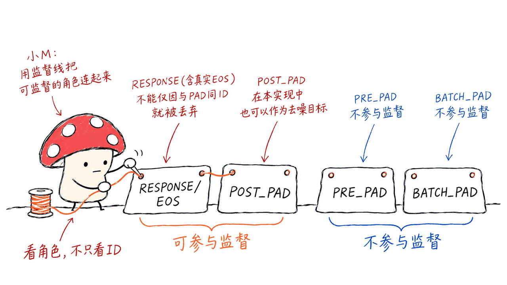

Clover 尝试把一段文字分块并行补全，再把候选内容变成可接受的输出。它的开放 SFT 代码值得研究，但当前训练包有明确的数据、上下文和硬件限制，不能把论文里展示的全部能力视为一键可复现。

DiffuSpace 于11月18日提交技术报告，模型总参数约35B、每个token激活约3B。SFT包及模型许可均标为Apache 2.0。Mycelium Protocol 核对了报告、配置和训练实现，并运行26项原始CPU测试；没有下载35B权重，也没有复现训练、任务榜单或GPU速度。

技术报告：https://arxiv.org/abs/2611.24636

开放代码：https://github.com/DiffuSpace/Clover-35B-A3B-Preview/tree/main/sft

模型权重：https://huggingface.co/Diffuspace/Clover-35B-A3B-Preview

## 分块扩散怎样利用历史，又避免偷看答案？

可以把生成过程想成一张正在修改的便签：当前块内部可以互相参考，已经写好的历史则提供稳定上下文。块与块之间仍依次推进；并行发生在当前块内，不意味着整篇答案一次生成。

Clover 的混合骨干沿用循环记忆与完整注意力的组合，并把 Gated DeltaNet 改造成适合分块去噪的结构。关键约定是：预览当前块时只读历史状态，不把还在修改的候选反复写入或衰减历史；确认的干净文本才推进记忆。

开放训练包把带噪与干净两份序列送入模型。带噪查询只能看本块带噪内容及更早的干净块，不能读取本块的干净答案；干净分支保持因果关系。它解决的不是“掩住一些词”这么简单，还要保证注意力、卷积、位置和专家路由都遵守同一信息边界。

这也给工程师一个实用判断：先验证有没有答案泄漏，再看训练损失降得快不快。如果数据布局泄漏了目标，漂亮的曲线可能只说明模型学会了抄答案。


## 开放的SFT包具体支持什么？

本次固定到代码提交 `685744fe274ddbf33c5267b542446166c1532410`。它通过 ms-swift 插件注册模型和模板，用 FSDP2 组织分布式全参数 SFT，也提供 LoRA 路线。

| 当前包的约定 | 工程含义 |
| --- | --- |
| 单轮 user/assistant 文本，可选 system | 不能直接把完整多轮Agent轨迹当样本传入 |
| 非thinking聊天模板 | 不应默认这份示例复现了所有思考模式训练 |
| 固定4096 token、Preview block size=32 | 对齐后超长样本跳过；不是128K训练入口 |
| 带噪、干净双流 | 4096个语义布局位置对应8192个物理槽位 |
| 扩散交叉熵＋路由负载均衡项 | 不是论文全部训练阶段的完整发布证明 |
| 未启用packing、多轮训练与context parallelism | 不能照搬论文中的其他配置推断支持范围 |

当前去噪标签与同位置token对齐，不使用普通自回归训练的统一右移方式。公开包默认路由辅助系数为0.001；交叉熵按实际被监督的token数，在梯度累积和数据并行间做归一化。

一个很容易改错的细节是 padding：prompt、pre-pad和batch padding不参与去噪监督，但response/EOS以及post-pad可以参与。角色标签而不是token ID决定含义；真实EOS即使与PAD共用ID，也不能直接被整批屏蔽。这里的规则只适用于这份实现，不是所有模型通用的清洗方法。



## 本机26项测试证明了什么？

我们在隔离环境运行了上游的 `test_data.py`、`test_loss.py`、`test_gdn_semantics.py`、`test_moe.py` 和 `test_model.py`，26项全部通过。检查包括数据对齐和可见性、分块输出头损失与梯度、历史预览只读语义、专家负载均衡，以及小配置训练前向和修正后的推理参考之间的一致性。

上游 `scripts/check_scope.py` 也通过了公开包范围、记录的源文件哈希和Python 3.10语法检查。我们没有为它另写一套“模拟实现正确”的替代模型；测试执行的是固定提交中的原始代码和CPU参考路径。

本机使用PyTorch 2.14.0、Transformers 5.19.0。作者锁定的GPU训练依赖是PyTorch 2.11系列，测试环境也写明CUDA 12.9与H200。因此本次CPU结果不等于官方GPU环境复现，更没有覆盖Quack/CUDA内核、两卡FSDP2或ms-swift完整训练。

这些检查的价值是给你修改掩码、损失和缓存时提供回归基线。它们没有证明35B模型在真实数据上收敛、工具调用可靠，或任何设备能达到论文速度。

## 680 tokens/s与16GB显卡成绩能放在一起比较吗？

不能直接比较。先分开看能力与速度：报告列出的SWE-bench Verified为73.6、Terminal-Bench 2.1为51.7，分别通过Codex和Terminus 2评测，编码Agent结果为三次均值；这些不是后文INT4部署配置的成绩。

报告里的680 tokens/s来自GB300、BF16、batch=1、64个内部Agent回放前缀的特定配置，计时包含prefill和尾部处理。报告明确说该回放不评估任务成功率，速度也受块大小和惩罚控制影响。

另一个消费级部署实验采用RTX 5070 Ti 16GB显存、Ryzen 7 9700X、64GB主存，以SGLang和KTransformers分担专家执行。专家权重采用INT4，其他主要模块仍为BF16，每层96个专家放GPU、160个放CPU。它不是把完整模型只装进16GB显存。

| 同一消费卡实验中的Clover设置 | MATH-500正确率 | 解码速度 |
| --- | --- | --- |
| 优化专家放置，验证top-8 | 97.6% | 97.52 tokens/s |
| 优化专家放置，验证top-6 | 96.0% | 106.25 tokens/s |

这些均为作者报告。该表的速度排除prefill、包含thinking token，与前面的GB300端到端回放口径不同。top-6还引入近似计算，因此不能只摘取106.25而丢掉准确率变化。

自推测解码也有两笔成本：生成草稿，以及验证草稿后实际接受多少token。更稀疏的草稿计算未必更快；如果接受长度变短，验证开销可能吃掉节省。真正应记录的是同一硬件、同一任务下的接受率、每轮提交量、首token等待和最终任务结果。


## 真要训练，先准备哪些条件？

官方SFT说明测试环境使用H200，分组专家内核要求Quack支持的Hopper/Blackwell GPU。以下是仓库的全参数训练入口，本文没有执行这段GPU流程：

```bash
git clone https://github.com/DiffuSpace/Clover-35B-A3B-Preview.git
cd Clover-35B-A3B-Preview/sft
uv venv --python 3.12 .venv
source .venv/bin/activate
uv pip install -e '.[test]'
python -m clover_sft.prepare_gsm8k
NPROC_PER_NODE=8 bash scripts/train.sh --max_steps 5 --save_strategy no
```

这是5步冒烟入口，不是低资源训练承诺。单卡LoRA仍要求能放下完整基础模型；它主要训练attention/GDN投影，打包的专家参数保持冻结，不能理解为全模型都在适配。

另一个必须提前验证的约定是检查点：默认launcher只保存模型权重，不恢复优化器和scheduler状态。完整SFT导出的原生检查点包含修正后的历史预览实现；LoRA产物仍需要基础模型及相应修正代码，适配器权重本身不带推理代码。要实现可靠续训，应该实际中断、恢复并对照训练步数和状态，而不是只检查目录中是否出现文件。

README将SGLang和llama.cpp接入指向对应PR，并说明后续补充代码和指南。存在PR链接不等于已核验当前稳定发行版完整支持，实际部署应固定具体提交与运行时。

更稳妥的顺序是：先固定代码与模型revision、确认硬件和依赖；检查一批数据的角色与掩码；跑上述正确性测试；再做少量GPU训练和保存加载验证；最后在保留集上评估质量及吞吐。不要同时改训练目标、专家路由和采样策略，否则很难解释变化来自哪里。

## FAQ

### 35B-A3B意味着只需存3B参数吗？
不是。3B描述激活量，模型仍有约35B总参数。GPU/CPU专家放置可以改变驻留位置，但没有让其他专家权重消失。

### 论文中的联合决策变体已经能从这里直接复现吗？
报告描述了相关问题一次去噪的决策变体，并注明计划后续发布。不能把该变体内部测试成绩当成当前SFT包直接提供的通用能力。

### 已通过测试，能否视为端侧部署完成？
不能。本次只验证CPU小配置正确性路径，没有运行35B推理、消费卡量化或端到端Agent任务。生产验收仍要使用自己的数据与实际设备。

相关背景：MiniMind训练实践 https://blog.mushroom.cv/blog/minimind-64m-llm-training-from-scratch-guide/ ；显式交互决策框架 https://blog.mushroom.cv/blog/jev-interaction-full-duplex-voice-decisions/ 。

来源：报告全文 https://arxiv.org/html/2611.24636v1 ；SFT说明 https://github.com/DiffuSpace/Clover-35B-A3B-Preview/tree/main/sft ；权重与许可 https://huggingface.co/Diffuspace/Clover-35B-A3B-Preview 。

---

> © 2026 Author: Mycelium Protocol. 本文采用 [CC BY 4.0](https://creativecommons.org/licenses/by/4.0/deed.zh) 授权——欢迎转载和引用，须注明作者姓名及原文链接，不得去除署名后以原创发布。

<!--EN-->

Clover reconstructs text in parallel blocks, then turns candidate tokens into accepted output. Its open SFT package is useful to study, but its data, context and hardware boundaries do not reproduce every capability described in the technical report.

DiffuSpace submitted the report on November 18. The model has approximately 35B total and 3B active parameters. The SFT package and model license specify Apache 2.0. Mycelium Protocol audited the report and implementation and ran 26 original CPU tests, without downloading the 35B weights or reproducing GPU training, task scores or speed.

Report: https://arxiv.org/abs/2611.24636

Code: https://github.com/DiffuSpace/Clover-35B-A3B-Preview/tree/main/sft

Weights: https://huggingface.co/Diffuspace/Clover-35B-A3B-Preview

## How does block diffusion use history without leaking targets?

Tokens within the active block can consult each other while completed blocks supply context. Blocks still advance sequentially; parallel reconstruction within a block is not one-pass generation of an entire answer.

Clover's hybrid backbone combines recurrent memory and full attention, adapting Gated DeltaNet for block denoising. A crucial contract is that previewing candidates reads history without writing or decaying it repeatedly. Confirmed clean text advances the memory.

The public training implementation processes noisy and clean copies. A noisy query sees its own noisy block and earlier clean blocks, but not its clean target block. Clean processing remains causal. Attention, convolutions, positions and expert routing must preserve the same information boundary.

For an engineer, the first acceptance criterion should be absence of answer leakage. A rapidly falling loss can otherwise reflect accessible targets rather than useful learning.


## What does the released SFT package support?

We pinned repository revision `685744fe274ddbf33c5267b542446166c1532410`. The package registers a model/template through ms-swift and uses FSDP2 for distributed full-parameter SFT, with a separate LoRA option.

| Current contract | Practical implication |
| --- | --- |
| One text user/assistant exchange, optional system | Full multi-turn agent trajectories cannot be passed through unchanged |
| Non-thinking chat template | The example does not establish every thinking-mode training recipe |
| Fixed 4096-token rows, Preview block size 32 | Oversized aligned examples are skipped; this is not 128K training |
| Noisy and clean streams | Each 4096-position layout uses 8192 physical slots |
| Diffusion CE plus router balancing | Not proof of releasing every report training stage |
| No packing, multi-turn or context parallelism enabled | Do not infer support from broader paper descriptions |

Denoising logits predict targets at the same position rather than using a uniform autoregressive shift. The default router auxiliary coefficient is 0.001. CE normalization follows the actual supervised-token count across accumulation and data-parallel ranks.

Padding deserves particular care. Prompt, pre-padding and batch-padding slots are excluded, while response/EOS and post-padding can be denoising targets. Roles, rather than token IDs alone, define semantics: a genuine EOS sharing a PAD ID must not be discarded blindly. This is implementation-specific, not a universal preprocessing rule.


## What did 26 local tests establish?

We ran upstream `test_data.py`, `test_loss.py`, `test_gdn_semantics.py`, `test_moe.py` and `test_model.py`; all 26 passed. They cover alignment and visibility, chunked-head loss and gradients, read-only history preview, expert balancing, and agreement between a small training configuration and the corrected inference reference.

The upstream scope checker also passed recorded-source hashes and Python 3.10 syntax checks. These are tests of the pinned original implementation and CPU reference paths, not a replacement toy implementation written to match our explanation.

Our environment used PyTorch 2.14.0 and Transformers 5.19.0. The documented GPU stack pins PyTorch 2.11 and specifies CUDA 12.9/H200. Therefore this is not reproduction of the official GPU environment. We did not exercise Quack/CUDA kernels, two-rank FSDP2 or an end-to-end ms-swift training job.

The tests provide a regression baseline for modifications to masks, loss or memory. They do not establish 35B convergence, real tool-use reliability or any reported throughput.

## Can 680 tokens/s be compared directly with 16GB deployment?

No. Separate quality from speed first: the report lists 73.6 on SWE-bench Verified and 51.7 on Terminal-Bench 2.1, using Codex and Terminus 2 respectively, with three-run means for coding-agent evaluations. These are not scores measured under the later INT4 deployment setup.

The report's 680 tokens/s comes from a GB300, BF16, batch-one replay of 64 internal agent prefixes under specific controls. Timing includes prefill and tail handling, and replay does not measure task success.

A separate consumer deployment uses an RTX 5070 Ti 16GB, Ryzen 7 9700X and 64GB host memory with SGLang/KTransformers hybrid execution. Routed experts use INT4 while major non-expert components remain BF16, with 96 experts per layer on GPU and 160 on CPU. This does not place the whole model inside 16GB VRAM.

| Clover configuration in that experiment | MATH-500 accuracy | Decode throughput |
| --- | --- | --- |
| Optimized placement, top-eight verification |97.6%|97.52 tokens/s|
| Optimized placement, top-six verification |96.0%|106.25 tokens/s|

These are author-reported figures. This table excludes prefill and includes thinking tokens, unlike the GB300 replay timing. Top-six verification also introduces approximation; quoting its speed while discarding the accuracy change misrepresents the tradeoff.

Self-speculation has both draft and verification costs. Making drafting sparser can still reduce overall speed when fewer tokens are accepted. Compare accepted progress, first-token wait, hardware and final task outcome under a shared workload.


## What should an engineer prepare before training?

The SFT documentation tests H200, and grouped expert kernels require Quack-supported Hopper/Blackwell hardware. The official entry point below starts a five-step GPU smoke run; we did not execute it.

```bash
git clone https://github.com/DiffuSpace/Clover-35B-A3B-Preview.git
cd Clover-35B-A3B-Preview/sft
uv venv --python 3.12 .venv
source .venv/bin/activate
uv pip install -e '.[test]'
python -m clover_sft.prepare_gsm8k
NPROC_PER_NODE=8 bash scripts/train.sh --max_steps 5 --save_strategy no
```

This is not a low-resource guarantee. Single-GPU LoRA still requires room for the entire base model. It targets attention/GDN projections while packed experts remain frozen.

The default launcher saves model weights only, without restoring optimizer or scheduler state from those weights. Full-SFT native exports include the corrected history-preview implementation. LoRA adapters still need the base model and that corrected implementation; adapter weights alone do not include inference source files. Test interruption and restoration rather than accepting checkpoint-directory existence as recovery evidence.

The README links SGLang and llama.cpp integration PRs and says backend code/setup guides will follow. A PR link is not evidence that the current stable release fully supports the model. Pin the backend implementation actually being tested.

Pin code and model revisions, verify hardware/dependencies, inspect one batch's roles and masks, run correctness tests, then perform a short GPU run and save/load validation. Evaluate a held-out dataset and throughput afterward. Change objectives, routing and sampling separately so changes remain interpretable.

## FAQ

### Does 35B-A3B require storing only 3B parameters?
No. Active compute and total parameters differ. Hybrid placement relocates experts; it does not remove their weights.

### Is the report's joint-decision variant already reproducible here?
The report describes that variant and plans a subsequent release. Its internal results should not be presented as general capabilities directly provided by this SFT package.

### Do passing tests establish on-device deployment?
No. We tested small CPU correctness paths, not 35B inference, consumer quantization or end-to-end agent tasks. Use actual target devices and representative data for acceptance.

Related: MiniMind training https://blog.mushroom.cv/blog/minimind-64m-llm-training-from-scratch-guide/ ; explicit interaction decisions https://blog.mushroom.cv/blog/jev-interaction-full-duplex-voice-decisions/ .

Sources: full report https://arxiv.org/html/2611.24636v1 ; public SFT https://github.com/DiffuSpace/Clover-35B-A3B-Preview/tree/main/sft ; model/license https://huggingface.co/Diffuspace/Clover-35B-A3B-Preview .

---

> © 2026 Author: Mycelium Protocol. Licensed under [CC BY 4.0](https://creativecommons.org/licenses/by/4.0/) — free to share and adapt with attribution. You must credit the author and link to the original; removing attribution and republishing as original is not permitted.
