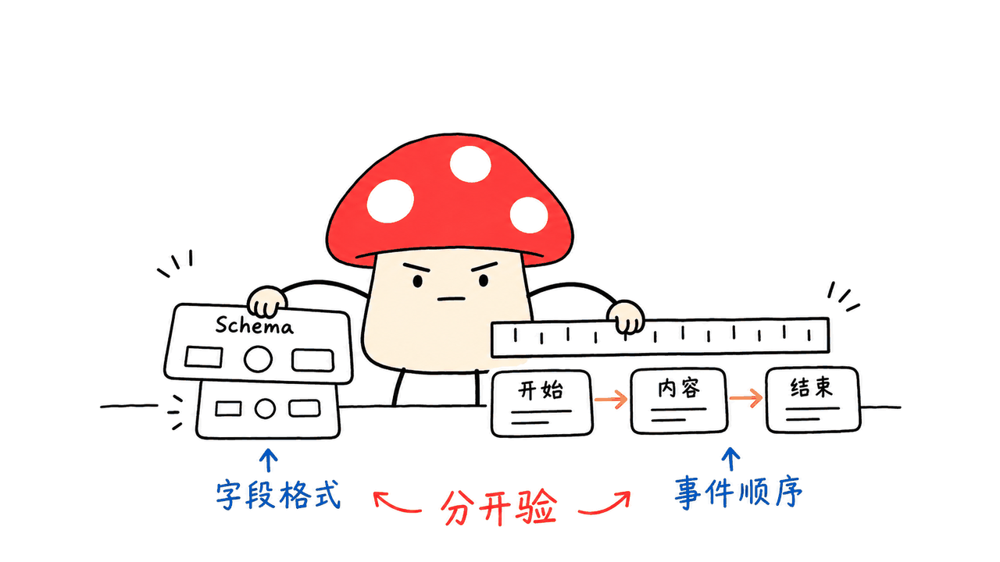
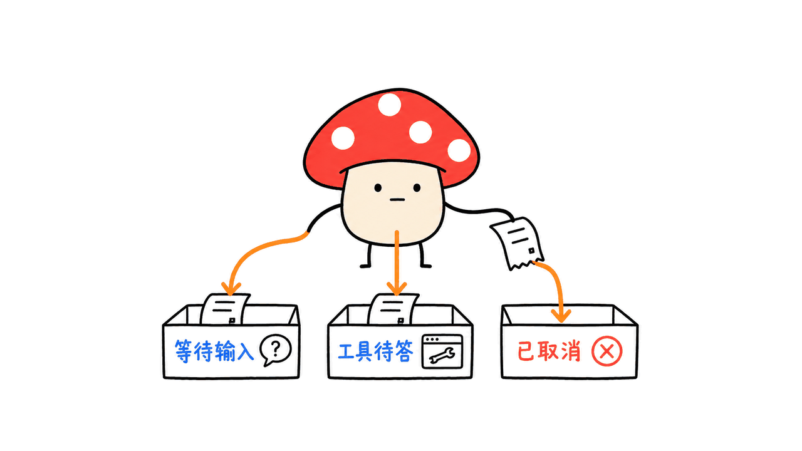
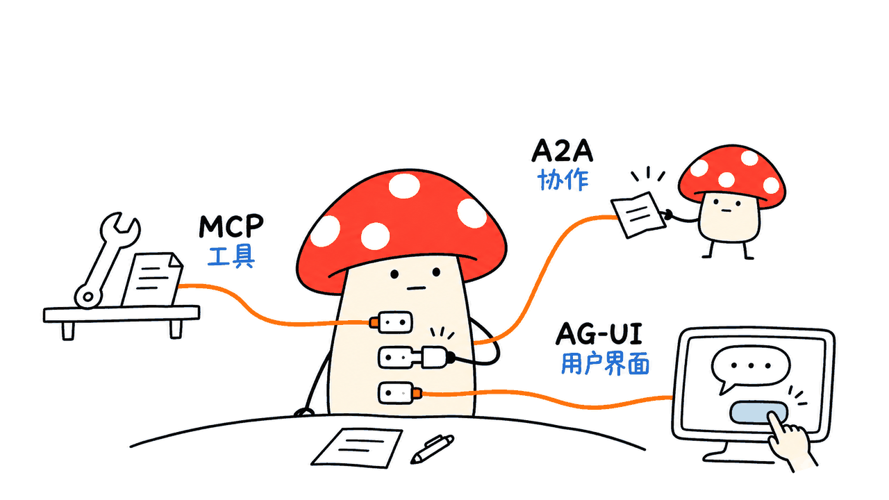

AG-UI 1.0 给 Agent 和用户界面之间的事件流提供了稳定契约；CopilotKit 是实现这类交互的一套前端基础设施。对工程师，真正的收益是减少适配和状态歧义，落地仍需验证生命周期、恢复与权限边界。

## 2026-11-18 更新：榜单热度与规范发布是同一天吗？

不是。今天抓取的 GitHub Trending 显示 AG-UI 单日增加 1,445 Stars、榜单快照总数 20,223；随后仓库 API 查询为 20,308，统计时点不同不应混用。官方 1.0 冻结公告发布于 2026 年 9 月 18 日，不能写成今天才发布。

协议仓库是 ag-ui-protocol/ag-ui，采用 MIT 许可。本文复用 7 月的 CopilotKit 指南地址补充这次协议核查；原始指南作为历史上下文保留在后面，旧星数、旧 API 示例和采用数量不代表今天重新实测。

## 冻结的是什么，没替你完成什么？

稳定的是带版本的协议契约。官方将事件字段结构交给共享 JSON Schema，把顺序、生命周期、归属、兼容和错误处理写进行为规范；新演进走后续草案。SDK 包的发布版本、适配器版本和协议版本应分别记录，不能只看某个包的 semver。

当前 README 列出 31 种事件、8 个家族，涵盖运行、文本、工具、状态、推理、活动、子智能体及透传。团队可以围绕同一份结构生成类型和校验器，但这些文件不会自动替应用完成恢复、授权和业务验收。



## 本地检查发现：Schema 通过就算兼容吗？

我们下载官方 Schema，用 Python jsonschema 在隔离环境中做了 14 个结构检查：包括有效运行、缺失 runId、取消结果、空中断列表、前端待处理工具编号和恢复输入；全部符合预期。校验时没有调用模型或外部服务。

一个有用的负面对照是：单独输入 `TEXT_MESSAGE_END` 和一个从未开始的 messageId，仍通过单条事件结构校验。这不是校验器故障，因为 Schema 没有此前的事件历史。由此可见，验收必须再检查同一条流上的关联和生命周期，不能把这 14 例说成跨框架兼容性认证。

```json
{"type":"TEXT_MESSAGE_END","messageId":"never-opened"}
```

建议把自家适配器录下来的完整轨迹作为另一组验收材料，检查消息关联、状态快照与增量、取消后的界面、断线与重复输入。涉及付款或发信时，还要验证业务幂等和权限；协议中的工具事件不能证明外部动作已正确执行。

## 用户确认、前端工具和取消，为什么要分开？

“等用户”不是一个万能状态。1.0 的中断规范区分三条路径：需要外部输入的运行，以 interrupt outcome 结束，续接通过新运行的 resume 输入按 interruptId 回答；前端工具调用可以正常结束本轮，并在 success outcome 标出 pendingToolCallIds，结果进入后续输入的消息；取消则是 cancelled outcome。

这些 outcome 是带 `type` 的对象，不能随意写成字符串。本地检查也覆盖了这个差异。UI 应按各自语义显示“等待输入”“工具待答”或“已取消”，不要把所有 RUN_FINISHED 都直接渲染为业务已完成。



我的建议是：把用户批准的对象、版本和作用范围保存在业务记录里，恢复时再验证；仅仅收到一个回答并不等于获得执行任意动作的授权。网络重连也不应自动重放一笔不可撤销的操作。

## 四家厂商接入，具体说明什么？

官方集成列表能找到 Google ADK、Microsoft Agent Framework、AWS Strands Agents / Bedrock AgentCore，以及 Oracle Agent Spec。它证明存在具体适配路径；不能外推为这些厂商每个产品、每个版本都互通，也不等于我们逐项运行过官方演示。

| 名称 | 主要边界 | 与 AG-UI 的关系 |
| --- | --- | --- |
| MCP | 工具与上下文 | Agent 可以在后端使用 |
| A2A | Agent 之间的协作 | 可与用户交互协议并用 |
| AG-UI | Agent 与应用之间的运行事件 | 承载文本、状态和工具交互 |
| A2UI 等生成式 UI 规范 | 要展示的 UI 内容 | 可由运行事件携带 |
| CopilotKit | 应用侧交互框架 | 提供界面与协议适配能力 |



## 工程团队怎样采用？

先选一个小流程，例如让 Agent 起草表格修改、展示进度并等待批准。固定协议和 SDK 版本，记录原始流与实际副作用，再验证正常、失败、取消、待工具结果和恢复这几类轨迹。切换框架后重放同一组业务案例，比较可见行为，而非仅比较是否能连通。

我们没有运行四家厂商的 SDK 互操作测试，没有做浏览器端验收、吞吐或延迟基准。当前结论仅来自一手资料核查和 14 例严格结构检查。规范冻结降低的是集成的不确定性；应用状态、身份权限与执行正确性仍需团队自己建立证据。

## FAQ

### AG-UI 是 CopilotKit 的别名吗？

不是。AG-UI 是开放交互协议，CopilotKit 是可使用该协议的应用框架。协议与框架应分别选型、记录版本和验证。

### 1.0 冻结以后就不会再变了吗？

冻结的是该版本契约。后续能力通过新草案和新版本演进；团队仍应核对 SDK 的迁移说明和所用适配器的覆盖范围。

### 这次新增了另一篇文章吗？

没有。本文沿用原文章地址，增加 1.0 核查与工程检查，下面保留 2026 年 7 月 19 日的原始指南，避免重复开文。

本次核查来源（2026-11-18）：

仓库：https://github.com/ag-ui-protocol/ag-ui
冻结公告：https://github.com/ag-ui-protocol/ag-ui/discussions/2792
规范：https://docs.ag-ui.com/spec/1.0
结构 Schema：https://ag-ui.com/spec/1.0/schema.json
中断与恢复：https://docs.ag-ui.com/spec/1.0/basic/patterns/interrupt-resume
迁移指南：https://docs.ag-ui.com/migrating-to-1-0
榜单快照：https://github.com/trending

---

> 以下为 2026-07-19 的原始指南，保留历史上下文。涉及当前协议语义时，以本文前面的 1.0 更新和版本化规范为准；历史代码示例不代表本次运行验证。

> GitHub：CopilotKit/CopilotKit：https://github.com/CopilotKit/CopilotKit · ⭐ 36,147  
> 文档：docs.copilotkit.ai：https://docs.copilotkit.ai/ · 协议：AG-UI Protocol：https://ag-ui.com/  
> 定位：Agent 应用的前端基础设施栈（Frontend Stack for Agents & Generative UI）

---

## 一个你必然会遇到的问题

你有了一个 Agent——用 LangGraph 写的、或者 Claude SDK、或者 CrewAI。它能思考、能规划、能调用工具、能完成复杂任务。

然后你开始想：怎么给用户用？

这个问题比想象的复杂得多。你需要：

- 一个聊天界面，能显示流式输出、工具调用过程、Agent 的中间状态
- 让 Agent 的状态实时反映在 UI 里（比如 Agent 正在修改一个文档，文档页面要同步更新）
- 在关键节点暂停 Agent，等用户确认或输入，然后把答案带回去让 Agent 继续
- 让 Agent 能在聊天流里直接渲染 React 组件（不是文字描述，是真实的交互组件）
- 这一切要在你的 React、Angular、Vue、React Native 项目里开箱可用

如果你自己做这些，你在重新发明一套前端 Agent 基础设施。而这正是 CopilotKit 已经做好的事。

---

## 先说清楚它解决的核心问题

用户和 Agent 的交互过程，本质上是一个双向实时通信问题，但它比普通 WebSocket 通信复杂得多：

```
用户 ←→ UI 组件 ←→ 协议层 ←→ Agent 后端
         ↕                      ↕
      React 状态          Agent 内部状态
```

这个图里有几个很难处理的地方：

1. 协议不标准：每个 Agent 框架（LangGraph、CrewAI、Claude SDK）的通信格式不一样，写一套 UI 只能绑定一个后端。

2. 状态不同步：Agent 的内部状态（比如它维护的任务列表、当前进度）和前端 React 状态是完全隔离的两套东西。

3. 渲染不灵活：Agent 只能输出文字，它无法直接说「我要在聊天流里渲染一个日历选择器」。

4. 交互不可中断：Agent 一旦开始运行，用户只能等它跑完。但真实任务经常需要在中间问用户「这两个方案选哪个？」。

CopilotKit 把这四个问题分别做了抽象，把每一层都变成可插拔的 SDK 原语。

---

## 架构：四层抽象

### 第一层：AG-UI 协议——统一后端连接

AG-UI 是 CopilotKit 团队制定的开放协议，定义了 Agent 后端和前端之间事件流的标准格式。

已采用的框架：Google ADK、LangChain、AWS Strands、Microsoft Agent Framework、Mastra、PydanticAI 以及更多。

这意味着：你用 AG-UI 写一套前端，换后端框架不需要改 UI 代码。

```
你的 React 应用
      ↓  AG-UI 事件流
CopilotKit 运行时
      ↓  标准适配器
LangGraph / Claude SDK / CrewAI / Google ADK / ...（任选）
```

支持的后端框架（15+）：LangGraph（Python/TS/FastAPI）、Google ADK、AWS Strands、Mastra、Claude SDK（Python/TS）、PydanticAI、MS Agent Framework（Python/.NET）、AG2、Agno、LlamaIndex、CrewAI……

### 第二层：共享状态（Shared State）——双向实时同步

这是 CopilotKit 最核心的设计之一：Agent 的状态和 React 的状态之间有一个双向同步通道。

```typescript
// 前端读 Agent 状态 —— 自动响应式，Agent 更新 → 组件重渲染
function TaskBoard() {
  const { agent } = useAgent();
  const tasks = (agent.state.tasks as any[]) ?? [];

  return (
    <ul>
      {tasks.map((task, i) => (
        <li key={i}>{task.title} — {task.status}</li>
      ))}
    </ul>
  );
}

// 前端写 Agent 状态 —— Agent 可以读到这个值并做出反应
function SettingsPanel() {
  const { agent } = useAgent();
  return (
    <button onClick={() => agent.setState({ userPreferences: { theme: "dark" } })}>
      切换深色模式
    </button>
  );
}
```

这解决了什么：传统架构里，Agent 在后端运行，前端只能看到它最终输出的文字。有了共享状态，Agent 可以在执行过程中不断更新状态（比如「正在处理第 3/10 个文件」），前端实时反映，不需要轮询，不需要额外的 WebSocket。

### 第三层：Generative UI——Agent 渲染真实组件

不只是显示文字，Agent 可以在聊天流里直接调用并渲染 React 组件。

```typescript
function YourApp() {
  useComponent({
    name: "showWeather",
    description: "显示一个城市的天气卡片",
    parameters: z.object({
      city: z.string(),
      temperature: z.number(),
      condition: z.string(),
    }),
    render: WeatherCard,  // 你的 React 组件
  });
}
```

当 Agent 决定调用 `showWeather` 工具时，聊天流里出现的不是「当前上海气温 28°C」的文字，而是一个真实渲染的 `WeatherCard` 组件——用户可以和它交互。

三种 Generative UI 模式：

| 模式 | 触发方式 | 特点 |
|---|---|---|
| Static（AG-UI Protocol） | Agent 调用已注册的工具 | 类型安全，Zod schema 验证 |
| Declarative（A2UI） | Agent 描述 UI 结构 | Agent 侧控制布局 |
| Open-Ended（MCP Apps / Open JSON） | Agent 输出任意 JSON | 最灵活，适合动态场景 |

多 Agent 场景可以把组件 scope 到特定 Agent：

```typescript
useComponent({
  name: "renderProfile",
  parameters: z.object({ userId: z.string() }),
  render: ProfileCard,
  agentId: "support-agent",  // 只有这个 Agent 能触发
});
```

### 第四层：Human-in-the-Loop（HITL）——可中断的 Agent 交互

这是整个交互过程里最精妙的设计。HITL 让 Agent 在运行到关键节点时暂停，等用户给出答案，然后把答案折叠进 Agent 的上下文，从暂停的地方继续。

两种模式对应不同的暂停发起方：

模式一：`useHumanInTheLoop`——Agent 自己决定暂停

LLM 判断需要询问用户时，调用一个注册在前端的 HITL 工具：

```typescript
useHumanInTheLoop({
  name: "book_call",
  description: "询问用户选择一个会议时间段",
  parameters: z.object({
    topic: z.string().describe("这次会议是关于什么的"),
    attendee: z.string().describe("和谁开会"),
  }),
  render: ({ args, status, respond }) => (
    <TimePickerCard
      topic={args?.topic ?? "会议"}
      attendee={args?.attendee}
      slots={availableSlots}
      status={status}
      onSubmit={(result) => respond?.(result)}  // 用户选完，答案回传给 Agent
    />
  ),
});
```

聊天暂停 → 出现日历选择组件 → 用户选择时间 → Agent 收到「周一 9:00 AM」→ 继续执行订日历的逻辑。

模式二：`useInterrupt`——代码路径强制暂停

当暂停是流程图里的确定性检查点（不是 LLM 决定的），在 LangGraph 节点里调用 `interrupt()`，前端用 `useInterrupt` 处理：

```python
# LangGraph 节点（Python 后端）
def review_node(state):
    draft = generate_draft(state)
    # 到这里必须让人看一眼
    user_feedback = interrupt({"draft": draft, "message": "请检查这份草稿"})
    return apply_feedback(state, user_feedback)
```

```typescript
// 前端接住这个 interrupt
useInterrupt({
  render: ({ event, respond }) => (
    <DraftReviewCard
      draft={event.data.draft}
      message={event.data.message}
      onApprove={() => respond({ approved: true })}
      onRevise={(feedback) => respond({ approved: false, feedback })}
    />
  ),
});
```

这解决了什么：你再也不需要把整个 Agent 流程切成多个独立请求来实现「让用户审阅」。Agent 保持完整的上下文和状态，只是在某个点上等待人的判断。

---

## 哪些东西可以定制

CopilotKit 的设计原则是：抽象交互机制，不锁定 UI 外观。

可以完全定制的部分：

| 层 | 可定制项 |
|---|---|
| Chat UI | 消息气泡样式、输入框、工具调用展示、流式光标 |
| Generative UI | 任何 React 组件都可以注册为 Agent 工具 |
| HITL 组件 | 暂停时显示的 UI 完全自定义（表单、日历、审批卡片……）|
| 共享状态 Schema | Agent 状态的数据结构由你定义，任意嵌套 JSON |
| 后端框架 | 换 Agent 后端不改前端（AG-UI 适配层） |
| 运行平台 | Web、Mobile（React Native）、Slack、Microsoft Teams |
| LLM 提供商 | OpenAI、Anthropic、Gemini 等（通过后端框架配置）|

不可以绕过的部分：

AG-UI 协议事件格式——这是 CopilotKit 各层能协同工作的基础，必须通过 AG-UI 适配器连接后端。（但适配器对所有主流框架都已经有了。）

---

## `useAgent` Hook：一切的入口

所有交互能力都通过 `useAgent` 收口：

```typescript
const { agent } = useAgent({ agentId: "my_agent" });

// 读状态（响应式）
const city = agent.state.city;

// 写状态（Agent 可读到）
agent.setState({ city: "Shanghai" });

// 发送消息
agent.sendMessage("帮我分析这份报告");

// 暂停/恢复
agent.interrupt();
agent.resume(response);
```

这个 hook 直接坐在 AG-UI 协议层上，给你完整的 Agent 连接控制权。

---

## 平台支持：同一个 Agent，处处可用

| 平台 | 状态 |
|---|---|
| React / Next.js | ✅ GA |
| Angular | ✅ 支持 |
| Vue | ✅ 支持 |
| React Native | ✅ 支持 |
| Slack / MS Teams | 🟡 Beta，邀请内测 |
| Discord / Google Chat | 🔜 Coming soon |

同一个 Agent 后端，通过 AG-UI，在所有平台渲染对应的 Generative UI 和 HITL 组件——不需要为每个平台维护一套对话逻辑。

---

## 快速上手

```bash
npx copilotkit@latest create
```

5 分钟内跑起来，需要一个 LLM API Key（OpenAI / Anthropic / Gemini）。

安装 Agent Skills（让 Claude Code / Cursor / Codex 自动理解 CopilotKit）：

```bash
npx copilotkit@latest skills install
```

---

## 一句话总结

CopilotKit 把「用户和 Agent 的交互过程」拆成四个可独立定制的层：AG-UI 协议统一后端连接、共享状态层双向同步 Agent 和 UI、Generative UI 让 Agent 直接渲染组件、HITL 让 Agent 在关键节点暂停等用户决策。你自己写 Agent 逻辑，CopilotKit 处理整个交互界面。

支持 LangGraph、Claude SDK、CrewAI 等 15+ 框架，覆盖 Web、Mobile、Slack、Teams。36k stars，AG-UI 协议已被 Google、AWS、Microsoft、LangChain 采用。
---

> © 2026 Author: Mycelium Protocol. 本文采用 [CC BY 4.0](https://creativecommons.org/licenses/by/4.0/deed.zh) 授权——欢迎转载和引用，须注明作者姓名及原文链接，不得去除署名后以原创发布。

<!--EN-->

AG-UI 1.0 gives agents and user-facing applications a stable event contract. CopilotKit is one framework for building that interaction layer. The practical benefit is less adapter and state ambiguity; applications still need lifecycle, recovery and authorization checks.

## November 18 update: did the protocol launch today?

No. Today’s GitHub Trending snapshot shows 1,445 daily stars and 20,223 total stars. A later repository API query returned 20,308. These are different observation times. The official announcement freezing AG-UI 1.0 is dated September 18, 2026, not today.

The protocol repository, ag-ui-protocol/ag-ui, is MIT licensed. This update reuses the July CopilotKit article URL. The original guide remains below as historical context; its old star counts, adoption totals and code examples were not revalidated as current measurements.

## What does a frozen specification provide?

It stabilizes a versioned contract. The shared JSON Schema defines structure, while the behavioral specification defines ordering, lifecycle, attribution, compatibility and error handling. Future changes move through subsequent drafts. Record protocol, SDK package and adapter versions separately.

The current README lists 31 event types in eight families: runs, text, tool calls, state, reasoning, activity, subagents and passthrough. Shared types and validators help implementations agree on shapes. They do not automatically provide application recovery, authorization or correct side effects.


## Does passing JSON Schema establish interoperability?

We used the official schema with Python jsonschema in an isolated environment for 14 structural fixture checks. These cover valid runs, missing runId, cancelled outcomes, empty interrupt lists, pending frontend tool IDs and resume inputs. All behaved as expected. Validation made no model or external-service calls.

A useful boundary example is that TEXT_MESSAGE_END with a never-opened messageId passes as an individual event. The validator has no preceding stream history. This is a reason to test lifecycle behavior separately, not a validator defect or a claim of cross-framework conformance.

```json
{"type":"TEXT_MESSAGE_END","messageId":"never-opened"}
```

Record complete adapter traces and check message associations, snapshots and deltas, cancellation, disconnections and duplicate inputs. Payments or email require separate authorization and idempotency evidence. A tool event does not prove a correct external action.

## Why separate interrupts, frontend tools and cancellation?

The 1.0 rules distinguish three paths. An interrupt closes the current run and a new run carries resume entries keyed by interruptId. A frontend tool can leave the run successfully closed with pendingToolCallIds; its result travels in a later input’s messages. Cancellation uses a cancelled outcome.

Outcomes are objects with a type discriminator, not arbitrary strings; the fixtures check this distinction. Interfaces should distinguish waiting for input, unresolved frontend tools and cancellation. RUN_FINISHED alone must not become a blanket “business task complete” label.


Our recommendation is to persist the approved object, version and scope in business records and recheck them on continuation. Receiving a response does not grant arbitrary action authority, and reconnecting should not blindly repeat an irreversible action.

## What do vendor integrations establish?

The official integration list names Google ADK, Microsoft Agent Framework, AWS Strands Agents and Bedrock AgentCore, and Oracle Agent Spec. These are concrete adapter paths. They do not establish compatibility across every product or version, and we did not execute all vendor demos.

| Component | Main boundary | Relationship to AG-UI |
| --- | --- | --- |
| MCP | Tools and context | Can be used behind the agent |
| A2A | Agent-to-agent collaboration | Complements user interaction |
| AG-UI | Agent-to-application runtime events | Carries text, state and tools |
| A2UI and related UI specifications | UI payload descriptions | Can travel through runtime events |
| CopilotKit | Application interaction framework | Provides UI and protocol integration |


## How should a team adopt it?

Start with a small workflow: draft a spreadsheet change, expose progress and ask for approval. Pin versions, record the original stream and side effects, then exercise success, failure, cancellation, unresolved tools and continuation. Replay the same business cases when switching frameworks and compare observable behavior.

We did not run vendor SDK interoperability, browser acceptance or throughput and latency benchmarks. This update combines source verification with 14 strict structural checks. The stable specification reduces integration uncertainty; teams still need evidence for their own state, access and execution rules.

## FAQ

### Is AG-UI another name for CopilotKit?

No. AG-UI is an open interaction protocol; CopilotKit is an application framework that can use it. Evaluate and version them separately.

### Does a frozen 1.0 mean the ecosystem stops changing?

No. The versioned contract stays stable while future capabilities move through new drafts and versions. SDK and adapter migration guidance still matters.

### Is this a separate new post?

No. It updates the existing article URL. The July 19 guide remains below as dated context, with no claim that its examples were rerun for this update.

Sources checked November 18, 2026:

Repository: https://github.com/ag-ui-protocol/ag-ui
Freeze announcement: https://github.com/ag-ui-protocol/ag-ui/discussions/2792
Specification: https://docs.ag-ui.com/spec/1.0
JSON Schema: https://ag-ui.com/spec/1.0/schema.json
Interrupts and resume: https://docs.ag-ui.com/spec/1.0/basic/patterns/interrupt-resume
Migration: https://docs.ag-ui.com/migrating-to-1-0
Trending snapshot: https://github.com/trending

---

> The following is the original July 19, 2026 guide, retained as historical context. The 1.0 update above and versioned specification take precedence for current protocol semantics. Historical code examples were not executed during this update.

## CopilotKit: The Frontend Infrastructure for Agent-Native Applications

GitHub: CopilotKit/CopilotKit：https://github.com/CopilotKit/CopilotKit · ⭐ 36,147  
Docs: docs.copilotkit.ai：https://docs.copilotkit.ai/ · Protocol: AG-UI：https://ag-ui.com/

### The Problem It Solves

You've built an agent — with LangGraph, Claude SDK, CrewAI, or whatever backend. Now you need to put it in front of users. That means:

- A chat UI that handles streaming, tool call display, intermediate state
- Agent state that drives real-time UI updates (the agent modifies a document → the document view updates live)
- The ability to pause the agent at decision points, collect user input, and resume with the answer folded back in
- Agents that can render actual React components (not just text) directly in the chat stream
- All of this working across React, Angular, Vue, React Native — without rebuilding for each

Without CopilotKit, you're building this infrastructure yourself. That's what it takes to connect an agent to real users.

### Four Abstraction Layers

Layer 1 — AG-UI Protocol: Unified Backend Connection

An open event-based protocol standardizing how agents communicate with UIs. Adopted by Google ADK, LangChain, AWS Strands, Microsoft Agent Framework, Mastra, PydanticAI, and more.

Result: switch agent backends without changing UI code. One frontend, any AG-UI-compatible backend (15+ frameworks).

Layer 2 — Shared State: Bidirectional Reactive Sync

```typescript
const { agent } = useAgent();

// Reads agent state — reactive, auto re-renders on agent update
const tasks = (agent.state.tasks as any[]) ?? [];

// Writes state the agent can read
agent.setState({ userPreferences: { theme: "dark" } });
```

Agent state and React state stay synchronized in real time. No polling. No separate WebSocket setup.

Layer 3 — Generative UI: Agents Render Components

Register any React component as an agent-callable tool:

```typescript
useComponent({
  name: "showWeather",
  description: "Display a weather card for a city",
  parameters: z.object({ city: z.string(), temperature: z.number() }),
  render: WeatherCard,
});
```

When the agent calls `showWeather`, a real React component renders in the chat stream — not text describing the weather, an actual interactive `WeatherCard`. Three modes: Static (AG-UI tools), Declarative (A2UI), Open-Ended (MCP Apps / Open JSON).

Layer 4 — Human-in-the-Loop: Interruptible Agent Execution

Two patterns:

`useHumanInTheLoop` — the LLM decides to pause (agent-initiated): registers a client-side HITL tool; when the LLM calls it, a custom component renders; user answers; agent gets the result and continues.

`useInterrupt` — the graph enforces a checkpoint (deterministic): `interrupt()` in your LangGraph node; `useInterrupt` renders the custom UI on the frontend; user responds; agent resumes with full context intact.

The key: the agent doesn't restart. It keeps its state and context, just waits at a specific point for human input.

### What's Customizable

| Layer | Customizable |
|---|---|
| Chat UI | Message styles, input area, streaming display, tool call rendering |
| Generative UI | Any React component can be an agent tool — yours, not ours |
| HITL components | Any UI for pause points: forms, calendars, approval cards |
| State schema | Arbitrary nested JSON, your types |
| Agent backend | Any AG-UI-compatible framework |
| Platform | Web, React Native, Slack, Teams |

What's not optional: the AG-UI protocol wire format. Everything else is yours to define.

### Platform Coverage

| Platform | Status |
|---|---|
| React / Next.js | ✅ GA |
| Angular, Vue | ✅ Supported |
| React Native | ✅ Supported |
| Slack / MS Teams | 🟡 Beta |

Same agent backend. Every platform. AG-UI handles the wire protocol, CopilotKit handles the UI layer per framework.

### Quick Start

```bash
npx copilotkit@latest create
# Need an LLM API key (OpenAI / Anthropic / Gemini)
```

### Summary

CopilotKit abstracts the user-agent interaction into four independently customizable layers: AG-UI protocol for backend portability, shared state for bidirectional reactive sync, Generative UI for agent-rendered components, and HITL for interruptible execution with human decision points. You write the agent logic; CopilotKit handles the interaction surface.

15+ backend frameworks. React, Angular, Vue, React Native, Slack, Teams. AG-UI adopted by Google, AWS, Microsoft, LangChain. 36k stars.
---

> © 2026 Author: Mycelium Protocol. Licensed under [CC BY 4.0](https://creativecommons.org/licenses/by/4.0/) — free to share and adapt with attribution. You must credit the author and link to the original; removing attribution and republishing as original is not permitted.
