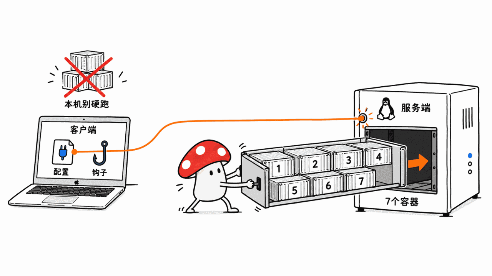

> 📌 开源仓库：lktiep/cortex-hub
> GitHub：https://github.com/lktiep/cortex-hub
> 协议：MIT ｜ 语言：TypeScript ｜ Stars：93 ｜ Forks：41 ｜ 创建：2026-03-18 ｜ 最近提交：2026-10-23（v1.3.11）

---

**BLUF**：Cortex Hub 是一个自托管后端，用**一个 MCP 端点**给 Claude Code、Cursor、Codex、Gemini 等多个编程 Agent 提供四样东西：跨会话记忆、团队共享知识库、基于 AST 图的跨仓库代码搜索（GitNexus）、以及质量门与合规评分；后来又加了一层多 Agent 调度（Conductor）。README 声称 31 个 MCP 工具。我们的判断：思路成熟、迭代很勤（创建约 6 个月，贡献统计里主作者 614 次提交、机器人发版 254 次，2026-10-23 当天还在发 v1.3.11），适合**有一台 Linux 服务器、多个 Agent 轮流干同一批仓库**的小团队。但它不是 Mac 本机的即装即用工具：README 的系统要求写的是 Ubuntu 22.04+ 加 Docker，仪表盘没有登录，README 头部那个 96.0% R@5 的基准成绩用的是一个已经被删除的嵌入器，且我们没有自己复现。

## 它到底是什么？

Cortex Hub 把「Agent 每次开新会话都从零开始」这个问题做成了服务端基础设施。README 的核心设想是：换 IDE、换机器、换项目，Agent 都应该记得团队之前的决定和踩过的坑。

它由下面几块组成（据 README 的架构图与技术栈表）：

| 组件 | 技术 | 作用 |
|---|---|---|
| MCP 服务 | Hono on Node.js，Streamable HTTP | 31 个工具的统一入口，API Key 鉴权 |
| 代码智能 | GitNexus | AST 解析、执行流、Cypher 图查询 |
| 向量与记忆 | mem9 + Qdrant | 语义召回、知识库 |
| LLM 网关 | CLIProxy | 多供应商、有序回退链、日常/月度 token 预算 |
| 应用库 | SQLite (WAL) | 会话、质量、用量、知识元数据 |
| 仪表盘 | Next.js 15 + React 19 | 13 个页面，静态导出，nginx 提供 |
| 编排 | Docker Compose | 我们读 compose 文件，里面是 qdrant、ollama、llm-proxy、gitnexus、api、mcp、watchtower 七个容器 |

### 四类能力分别做什么？

- **记忆**（每个 Agent 一份）：`cortex_memory_store` / `cortex_memory_search`，按分支、项目隔离，带语义去重。
- **知识库**（全团队共享）：`cortex_knowledge_store` / `cortex_knowledge_search`。有「厅类型」（fact、event、discovery、preference、advice、general）、有效期（`valid_from` / `invalidated_at`，可以查「某天什么是真的」）、以及「被谁取代」的链条。README 说这部分借鉴了 MemPalace。
- **代码智能**：`cortex_code_search` 不指定仓库时会并行扫所有已索引仓库；`cortex_code_context` 看一个符号的调用者和被调用者；`cortex_code_impact` 估算改动的影响面；`cortex_detect_changes` 在提交前分析未提交改动。
- **质量与合规**：会话结束按构建、回归、规范、可追溯四个维度各 25 分打分，并给出 A/B/C/D 合规等级；Claude Code 钩子可以在没有调用过知识/记忆召回之前阻止编辑，提交前质量门没过就拦提交。

另外有一个「食谱系统」：任务完成时，如果执行日志显示出非平凡流程，会用 LLM 抽成可复用的食谱，并按使用成功率重排检索结果（`相似度×0.6 + 有效率×0.3 + 新近度×0.1`，仅在被选用 ≥3 次后生效）。这是 README 的设计描述，我们没有验证它的实际效果。

## 96.0% R@5 的基准，该怎么看？

README 的卖点之一：在 LongMemEval-S 全部 500 题上，R@5 为 96.0%、R@10 为 97.8%，对比 MemPalace 的 96.6% / 98.2%，并强调零成本、离线、嵌入速度约 10 毫秒/条（对 MemPalace 的约 600 毫秒）。

我们读完 `benchmarks/README.md` 后有几点要提醒：

1. **嵌入器已经换了。** README 自己在注释里承认：测这个成绩时用的是进程内的 `Xenova/all-MiniLM-L6-v2`，这条路径已在提交 `1fbfafc` 中删除，现在所有嵌入都走内置 LLM 网关，默认 ollama 容器的 `all-minilm`（384 维，中位 27 毫秒）。所以头部成绩对应的并不是你今天部署出来的版本。
2. **NDCG@10 写的是 1.44。** 标准 NDCG 的上限是 1，README 没有解释这个数字是怎么算的，不能和别的系统直接比较；「比 MemPalace 高 62%」这句话也因此没有参考意义。
3. **对手数字来自对方的公开成绩**，不是同一台机器同一流程的对照实验。
4. **分类成绩有差异。** 偏好类问题（single-session-preference，30 题）R@5 只有 83.3%，时间推理类 94.7%。
5. README 里另有一组更诚实的自测：在它自己的 1256 个代码块上做 8 个已知答案的查询，`all-minilm` 的 recall@1 是 2/8、recall@5 是 6/8；换成 `bge-m3`，recall@1 升到 4/8，但索引耗时从 43 秒涨到 662 秒（约 15 倍）。作者的结论是「这是排序问题而不是召回问题」。样本只有 8 个查询，只能当方向参考。

我们没有在本机复现这些数字。

## 跟同类相比有什么区别？

本站写过几个相邻的方案，定位不同：

| 项目 | 形态 | 重点 | 代价 |
|---|---|---|---|
| claude-mem | 单机插件，会话记忆 | 把单人会话上下文存下来 | 不跨机器、不管团队 |
| dense-mem | MCP 记忆，强调证据与出处 | 治理与溯源 | 不含代码图与调度 |
| **Cortex Hub** | 服务端，一端点多 Agent | 记忆 + 团队知识 + 跨仓库代码图 + 质量门 + 调度 | 要运维 7 个容器，要一台 Linux 服务器 |

具体文章：
https://blog.mushroom.cv/blog/claude-mem-persistent-context-agent-session-memory-typescript/
https://blog.mushroom.cv/blog/dense-mem-governed-ai-memory-mcp-evidence-provenance/

最大的差异不是某个功能，而是**它把记忆放在服务器上、按 API Key 区分身份**，所以多个 IDE、多个人、多台机器共用一份。如果你只有一个人、一台电脑，这个架构对你是过度设计。

## 多 Agent 调度（Conductor）能用到什么程度？

这块 README 写得很克制，我们认为这是它最可信的地方：`docs/conductor.md` 给每一行能力标了状态，并要求「有测试文件覆盖且通过」才能打勾。

- 已打勾：计划树与环检测、依赖/优先级/文件锁的调度器、按任务路由与回退、租约与离线回收、审批通过/驳回、两次失败后升级、macOS 与 Linux 上的 TypeScript worker（工作树到 PR）。
- 标「能跑但有检查没人跑」：Windows worker；claude、codex、gemini 三个引擎的配额输出识别「只对着样例测过，没遇过真实配额耗尽」；安装指南「还没有任何机器完整走过」。
- 计划中：按任务统计成本、开机自启、语义能力匹配。

它自己列出的已知限制里，有三条值得单独提：**文件锁只和任务声明的 `files` 一样可靠**（没列文件的任务不受保护）；**共用一个 API Key 会让通知被先轮询到的会话抢走**，需要给 Lead 和 worker 分开发 Key；**用户审批门只能在仪表盘上关，而仪表盘没有登录**，谁能打开页面谁就能批。

## 给 Mac 用户的建议

- **别把它当本机工具装。** README 的服务端要求是 Ubuntu 22.04+、Docker 24+、最低 2 vCPU / 4 GB，推荐 4 vCPU / 8 GB / 50 GB 磁盘，作者推荐的是 Hetzner CX22 约 4.5 美元/月。我们没有在 Mac 上跑这套 compose，不知道 ghcr.io 上的镜像是否提供 arm64 版本，部署前先核对。
- **Mac 作为客户端是完整支持的。** 一键安装脚本 `install.sh` 会检测 Claude、Gemini、Cursor、Windsurf、VS Code、Codex 并写好 MCP 配置，装钩子；Conductor 的 worker 文档也明确覆盖 macOS。所以合理姿势是：**服务端放一台 Linux 小机器（或一台内网的 Mac mini 自己试），Mac 笔记本当客户端**。
- **最低成本的试法**：先只接记忆和知识库，不开 Conductor；把嵌入保持在默认的 `all-minilm`，要提升排序再考虑 `bge-m3` 或它可选的 Jev 重排（需要 TYPESAFE_API_KEY，会把候选代码片段发给外部 API，数据就不再「全部留在自己基础设施里」了）。
- **中文使用要谨慎。** 默认 `all-minilm` 是英文向的模型；README 的 LongMemEval 也是英文数据。中文记忆与知识的召回质量，需要自己用 `bge-m3` 之类多语言模型实测，别直接信 96.0%。
- **安全上**：给仪表盘前面加一层访问控制（Cloudflare Access 之类）再用，不要裸露；Lead 与 worker 分开 Key；`curl | bash` 安装方式请先读脚本。

## 局限和坑

1. **单人项目为主。** 贡献者 4 人，主作者 614 次提交，其余 1 次级别；总线风险很集中。
2. **README 前后不完全一致。** 比如网络拓扑图写「18+ 个 MCP 工具」，别处写 31 个；基准注释与正文并存。读的时候以 compose 文件和 `docs/` 为准。
3. **许可证干净，但依赖不都是。** 仓库本身 MIT；它组合的 GitNexus、Qdrant、ollama、CLIProxy 各有自己的协议，我们没有逐一核对。
4. **自动化提交占比高。** 贡献榜里机器人发版 254 次，主要是 `chore: release` 一类；统计「活跃度」时请扣掉。
5. **效果类说法大多是作者估算。** 例如「每次上下文切换省 10-15 分钟」「80% 更少 token」都是用例文档里的叙述，不是实测。

## FAQ

### Cortex Hub 和 Claude Code 自带的记忆有什么区别？
自带记忆是本机文件，单人单机；Cortex Hub 是服务端，多 Agent、多机器、多人共用，并有有效期和替代链。代价是你要自己运维服务。

### 能完全离线吗？
记忆与检索部分，嵌入走内置 ollama 容器，不需要外部 API Key。但网关要转发你自己的 LLM Key，食谱抽取和 Conductor 的引擎都需要模型调用；可选重排会访问外部 API。

### 我是个人开发者，值得上吗？
多数情况下不值。有多台机器、多个仓库、且常换 IDE 时才会明显受益；否则本机记忆插件更省事。

### 可以直接商用吗？
仓库是 MIT；但你实际部署的各个镜像与依赖请自行核对协议。

## 一手源

https://github.com/lktiep/cortex-hub
https://github.com/lktiep/cortex-hub/blob/master/benchmarks/README.md
https://github.com/lktiep/cortex-hub/blob/master/docs/conductor.md
https://github.com/lktiep/cortex-hub/blob/master/docs/guides/use-cases.md
https://github.com/lktiep/cortex-hub/blob/master/infra/docker-compose.yml
https://lktiep.github.io/cortex-hub/

---

> © 2026 Author: Mycelium Protocol. 本文采用 [CC BY 4.0](https://creativecommons.org/licenses/by/4.0/deed.zh) 授权——欢迎转载和引用，须注明作者姓名及原文链接，不得去除署名后以原创发布。

<!--EN-->

> 📌 Open-source repo: lktiep/cortex-hub
> GitHub: https://github.com/lktiep/cortex-hub
> License: MIT | Language: TypeScript | Stars: 93 | Forks: 41 | Created: 2026-03-18 | Latest commit: 2026-10-23 (v1.3.11)

---

**BLUF**: Cortex Hub is a self-hosted backend that exposes **one MCP endpoint** to Claude Code, Cursor, Codex, Gemini and others, and gives them four things: cross-session memory, a shared team knowledge base, AST-graph code search across repositories (GitNexus), and quality gates with compliance scoring. A multi-agent orchestration layer (Conductor) was added later. The README claims 31 MCP tools. Our verdict: a mature idea with a fast cadence (about six months old; 614 commits from the main author, 254 bot release commits, v1.3.11 shipped on 2026-10-23), well suited to **small teams with a Linux server and several agents rotating across the same repos**. It is not a drop-in local Mac tool: the stated server requirement is Ubuntu 22.04+ with Docker, the dashboard has no login, and the headline 96.0% R@5 was measured with an embedder that has since been removed. We did not reproduce it.

## What is it, exactly?

Cortex Hub turns "the agent starts from zero in every new session" into server-side infrastructure. The README's premise: switching IDE, machine or project should not make the agent forget the team's decisions and past bug fixes.

| Component | Technology | Role |
|---|---|---|
| MCP server | Hono on Node.js, Streamable HTTP | Single entry for 31 tools, API-key auth |
| Code intelligence | GitNexus | AST parsing, execution flows, Cypher graph |
| Vectors and memory | mem9 + Qdrant | Semantic recall, knowledge base |
| LLM gateway | CLIProxy | Multi-provider, ordered fallback, daily/monthly token budgets |
| App DB | SQLite (WAL) | Sessions, quality, usage, knowledge metadata |
| Dashboard | Next.js 15 + React 19 | 13 pages, static export behind nginx |
| Orchestration | Docker Compose | The compose file we read defines seven containers: qdrant, ollama, llm-proxy, gitnexus, api, mcp, watchtower |

### What do the four capability groups do?

- **Memory** (per agent): `cortex_memory_store` / `cortex_memory_search`, scoped by branch and project, with semantic de-duplication.
- **Knowledge base** (team-wide): `cortex_knowledge_store` / `cortex_knowledge_search`, with hall types (fact, event, discovery, preference, advice, general), validity windows (`valid_from` / `invalidated_at`, so you can ask what was true on a given date), and a supersession chain. The README says this part is inspired by MemPalace.
- **Code intelligence**: `cortex_code_search` without a repo argument fans out across all indexed repos; `cortex_code_context` shows callers and callees; `cortex_code_impact` estimates blast radius; `cortex_detect_changes` analyses uncommitted changes before commit.
- **Quality and compliance**: sessions are scored 25 points each on build, regression, standards and traceability, plus an A/B/C/D compliance grade; Claude Code hooks can block edits until knowledge and memory recall have been called, and block commits until quality gates pass.

There is also a "recipe system": when a finished task shows a non-trivial workflow, an LLM extracts it as a reusable recipe and search results are re-ranked by usage success (`similarity*0.6 + effective_rate*0.3 + recency*0.1`, only once a doc has been selected at least 3 times). That is the README's design description; we did not verify its effect.

## How much should you trust the 96.0% R@5?

The README headline: on all 500 LongMemEval-S questions, R@5 is 96.0% and R@10 is 97.8%, against MemPalace's 96.6% and 98.2%, at zero cost, offline, with about 10 ms per embedding versus about 600 ms.

After reading `benchmarks/README.md`, our caveats:

1. **The embedder has changed.** The README itself notes that the score was measured with in-process `Xenova/all-MiniLM-L6-v2`, a path removed in commit `1fbfafc`. All embeddings now go through the internal LLM gateway, defaulting to the bundled ollama container's `all-minilm` (384 dims, median 27 ms). The headline figure does not describe what you deploy today.
2. **NDCG@10 is reported as 1.44.** Standard NDCG is capped at 1; the README does not explain the computation, so it cannot be compared with other systems, and the "62% higher than MemPalace" claim carries no weight.
3. **The competitor figures are MemPalace's published numbers**, not a same-machine, same-pipeline comparison.
4. **Categories vary.** Single-session-preference (30 questions) is only 83.3% R@5; temporal reasoning is 94.7%.
5. The README also contains a more candid self-test: on its own 1,256 code chunks and 8 queries with known answer files, `all-minilm` gets recall@1 of 2/8 and recall@5 of 6/8; `bge-m3` lifts recall@1 to 4/8 but indexing takes 662 s versus 43 s (about 15x). The author's reading: it is a ranking problem, not a retrieval problem. Eight queries is only directional.

We did not reproduce any of these numbers locally.

## How does it differ from similar projects?

| Project | Form | Focus | Cost |
|---|---|---|---|
| claude-mem | Single-machine plugin, session memory | Keep one person's session context | No cross-machine or team sharing |
| dense-mem | MCP memory with evidence and provenance | Governance and traceability | No code graph or orchestration |
| **Cortex Hub** | Server, one endpoint for many agents | Memory + team knowledge + cross-repo code graph + quality gates + orchestration | Seven containers to run, a Linux server needed |

Our earlier write-ups:
https://blog.mushroom.cv/blog/claude-mem-persistent-context-agent-session-memory-typescript/
https://blog.mushroom.cv/blog/dense-mem-governed-ai-memory-mcp-evidence-provenance/

The real difference is not any single feature. It is that **memory lives on a server and identity is by API key**, so several IDEs, people and machines share one store. For one person on one computer this is over-engineering.

## How far can Conductor be trusted?

This is the most credible part of the README. `docs/conductor.md` marks each capability with a status, and a check mark requires a passing test file.

- Checked: plan trees with cycle detection, a dispatcher with dependencies, priority and file locks, per-task routing and fallback, leases and offline reclaim, review approve/reject, escalation after two failures, and a TypeScript worker on macOS and Linux (worktree to PR).
- "Works but rests on a check nobody has run": the Windows worker; quota detection for the claude, codex and gemini engines (fixtures only, no live quota hit); and the setup guide, which no machine has followed end to end yet.
- Planned: per-task cost tracking, autostart on boot, semantic capability matching.

Three of its own listed limitations deserve emphasis: **locks are only as good as the `files` a task declares**; **a shared API key splits notifications** to whichever session polls first, so give the lead and workers separate keys; and **user gates can only be closed from the dashboard, which has no login**, so anyone who can open the page can approve.

## Advice for Mac users

- **Do not treat it as a local Mac install.** The README's server requirements are Ubuntu 22.04+, Docker 24+, minimum 2 vCPU / 4 GB, recommended 4 vCPU / 8 GB / 50 GB disk; the author suggests a Hetzner CX22 at about $4.50/month. We did not run the compose stack on a Mac and do not know whether the ghcr.io images ship arm64 builds; check before deploying.
- **A Mac as a client is fully supported.** `install.sh` detects Claude, Gemini, Cursor, Windsurf, VS Code and Codex, writes the MCP config and installs hooks; the Conductor worker docs explicitly cover macOS. A sensible layout is a small Linux box (or a Mac mini on your LAN for a trial) as server, with the laptop as client.
- **Cheapest way to try it**: connect only memory and knowledge, skip Conductor, keep the default `all-minilm`, and consider `bge-m3` or the optional Jev reranker later. The reranker needs TYPESAFE_API_KEY and sends candidate code snippets to an external API, so data no longer stays entirely on your infrastructure.
- **Be careful with Chinese.** The default `all-minilm` is English-oriented and the LongMemEval data is English. Measure Chinese recall yourself with a multilingual model such as `bge-m3` before trusting 96.0%.
- **Security**: put access control in front of the dashboard (Cloudflare Access or similar), use separate keys for lead and workers, and read any `curl | bash` installer before running it.

## Limitations and pitfalls

1. **Mostly a one-person project.** Four contributors; the main author has 614 commits, the others one each, so bus-factor risk is concentrated.
2. **The README is not fully self-consistent.** The network topology says "18+ MCP tools" while elsewhere it says 31, and the benchmark note sits next to unchanged headline numbers. Trust the compose file and `docs/` first.
3. **Clean license, mixed dependencies.** The repo is MIT, but GitNexus, Qdrant, ollama and CLIProxy each have their own licenses, which we did not audit one by one.
4. **High share of automated commits.** 254 bot release commits (`chore: release`) inflate activity statistics.
5. **Most effect claims are author estimates**, such as "10-15 minutes saved per context switch" and "80% fewer tokens"; they are narrative in the use-case docs, not measurements.

## FAQ

### How is it different from Claude Code's built-in memory?
Built-in memory is local files for one person on one machine. Cortex Hub is a server shared by many agents, machines and people, with validity windows and supersession. The cost is operating the service yourself.

### Can it run fully offline?
Memory and retrieval embed through the bundled ollama container, so no external API key is needed. But the gateway forwards your own LLM keys, recipe extraction and Conductor engines call models, and the optional reranker calls an external API.

### Is it worth it for a solo developer?
Usually not. It pays off with several machines, several repos and frequent IDE switching; otherwise a local memory plugin is simpler.

### Can I use it commercially?
The repo is MIT, but check the licenses of every image and dependency you actually deploy.

## Primary sources

https://github.com/lktiep/cortex-hub
https://github.com/lktiep/cortex-hub/blob/master/benchmarks/README.md
https://github.com/lktiep/cortex-hub/blob/master/docs/conductor.md
https://github.com/lktiep/cortex-hub/blob/master/docs/guides/use-cases.md
https://github.com/lktiep/cortex-hub/blob/master/infra/docker-compose.yml
https://lktiep.github.io/cortex-hub/

---

> © 2026 Author: Mycelium Protocol. Licensed under [CC BY 4.0](https://creativecommons.org/licenses/by/4.0/) — free to share and adapt with attribution. You must credit the author and link to the original; removing attribution and republishing as original is not permitted.
