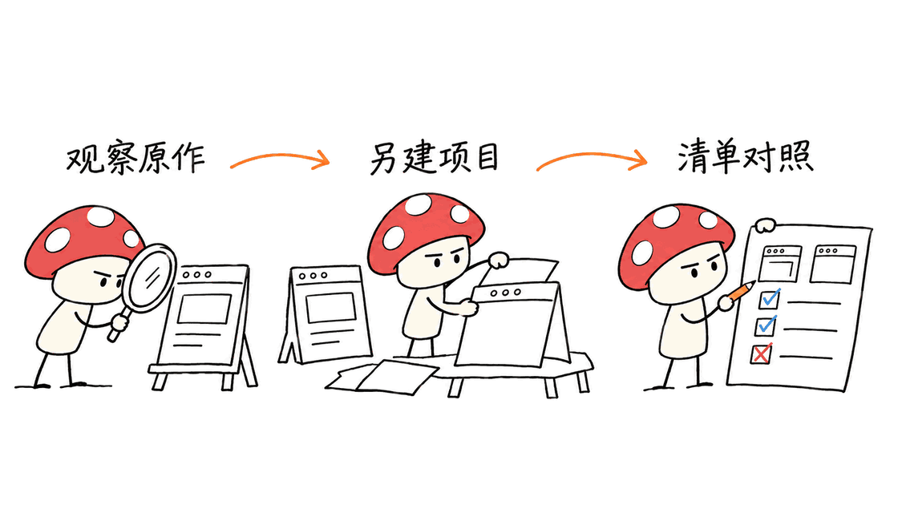
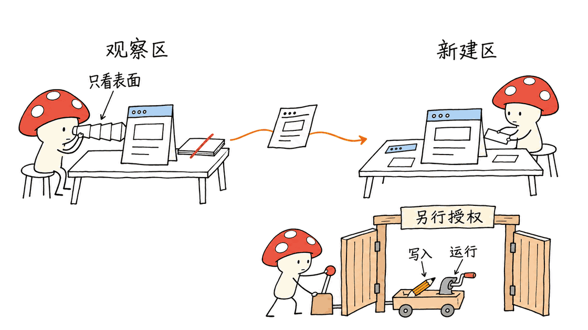
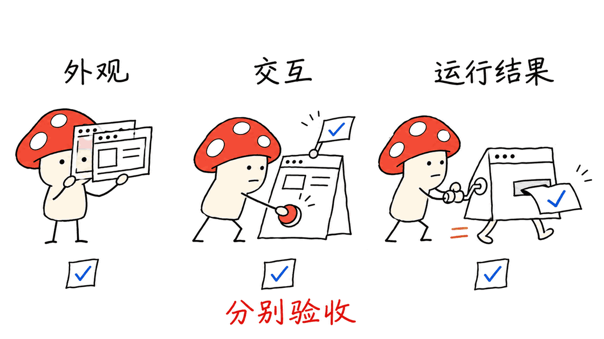

Craft Anything试图把“看懂一个软件”和“让Agent做一个自己的版本”接起来。它提供Rust分析引擎、桌面工作台、CLI和MCP，把目标观察、代码生成、结果比较与修正放进同一条链路。真正值得关注的是这套可留下证据的工作流程，而不是把“anything”理解成任何软件都能一键完整复刻。

完整仓库地址已经确认：
https://github.com/storytold/craft-anything

本文固定分析提交`869eb8548ae3cf9162181659c3ab47441b9c300d`，工作区版本0.4.0，代码采用`MIT OR Apache-2.0`双许可，源码构建要求Rust 1.97或更新版本。字体和其他第三方组件另有许可说明。项目仍标记为early alpha，下面分别讨论实现、官方验证与本次实际检查。

## 从研究到交付，中间多了哪些环节？

普通编程对话常从“照这个页面做一个”直接进入写代码。Craft Anything在中间加入目标资料、执行记录和验收结果：

| 阶段 | 做什么 | 应留下什么 |
| --- | --- | --- |
| Study | 观察网页、软件界面或允许读取的文件 | 截图、布局信息、结构分析、证据与未知项 |
| Build | 交给编码Agent生成一个项目 | 源码、执行过程、问题与审批记录 |
| Check | 比较目标和新结果 | 差异、检查记录、尚未满足的要求 |
| Ready | 预览、运行、继续提要求 | 可打开的产物，以及仍需验证的边界 |

一个项目目录里，`craft.json`保存请求和历史，`capture/`保存目标观察，`app/`放生成项目，`checks/`留比较结果，`investigation.cany/`保存研究证据，`inbox/`放待回答的问题。需要继续修改时，讨论的对象不再只有聊天记录，而是同一个项目及其证据。

这仍不能保证Ready就等于可商用交付。登录、支付、服务端权限、异常恢复与部署环境，都需要明确的验收任务。



## Rust引擎怎样服务桌面、CLI和MCP？

桌面使用egui，CLI和MCP共享工具注册表与分发逻辑。源码分层包括格式解析、反汇编、JavaScript分析、证据、平台服务、外部引擎适配、会话、AI和界面，而不是为每个入口重新实现一份能力。

底层`formats`负责ELF、PE、Mach-O、WASM、DEX、APK、ASAR等格式解析；`evidence`保存证据、稳定标识、置信信息、限制和未知项。上层工具把这些结构交给界面或Agent，帮助区分“读到了什么”和“据此推断了什么”。

README用320个工具概括项目。固定提交里的生成文档列出301个engine工具，AI与setup层还有额外工具；README另一处写300个engine工具，可见计数存在同步差异。更实际的办法是看本机`commands`、当前模式和依赖是否满足，而不是把总数当成跨平台全部可运行的承诺。

工具目录：
https://github.com/storytold/craft-anything/blob/main/docs/tools.md

没有模型也能运行部分分析；要从分析走到代码生成，仍然需要本机编码Agent、可用账户或相应后端。开源界面并不自动包含免费推理、图像生成或其他外部服务额度。

## Clean room到底限制了什么？

默认Clean room只允许一张明确的工具表：可以观察访客能看到的网页、截图、可见布局、窗口和屏幕，也能管理新建项目；读取原目标代码、内部文件、反汇编和页面内部资料的工具则需要Deep模式。新工具没有进入允许列表时，默认不能在Clean room里运行。

这不是“所有工具只读”。允许列表中包括新项目文件写入、构建命令和设备相关动作，其中有副作用的操作还需要对应授权。Clean room主要区分的是**是否读取原目标内部**，而不是禁止一切修改或执行。

更关键的是，项目文档明确说明：**Clean room不是操作系统沙箱。** 外部编码Agent仍以运行者的权限执行。平台或Agent自身能读写哪些路径、运行哪些命令，是另一层约束。

当前Claude Code文档还区分构建与聊天：构建有权限桥接，聊天和问答会限制其自身部分文件与执行工具；ACP路径另有拒绝规则，其他Agent并不一定具有相同限制。相关限制有测试覆盖，但文档也注明部分路径尚未用真实Agent现场核验。不能把某个适配器的保护推广到所有后端。

源码与适配说明：
https://github.com/storytold/craft-anything/blob/main/crates/engine/src/clean_room.rs
https://github.com/storytold/craft-anything/blob/main/docs/claude-code.md



Deep模式允许更深入读取，不等于取得目标软件、品牌和素材的再使用授权。学习和验证时优先选择自己的软件或明确许可的样例，也更容易准备正确答案。

## Claude Code、Codex和ACP，不能只看“支持”两个字

项目优先支持本机Claude Code，调用已有的`claude`程序及其登录状态，不提供自己的Claude登录。构建前检查登录，部分超出固定操作范围的行为会进入项目审批卡片；具体账户与使用约定仍属于使用者和对应服务。

README明确写着：Codex适配器已存在，但尚未在真实安装环境验证。其专项文档已经描述MCP连接、工具审批和启动参数，说明实现路径存在，却不能据此补写成“已经完整实测”。通过MCP连接到本引擎，和让应用使用Codex作为构建后端，也不是同一个验收项。

ACP方面列出了Gemini CLI、Qwen Code、opencode、goose、Hermes和Maki等候选，其中README只把Maki标为有live运行记录。Copilot则通过本机CLI和单独登录接入。不同版本、模型选择及协议能力可能影响实际可用性。

Codex专项说明：
https://github.com/storytold/craft-anything/blob/main/docs/codex.md

## 怎样试，才能知道它真的帮上了忙？

官方源码起步路径如下；这些是项目提供的操作说明，不是本文已经完成的整机安装结果：

```bash
git clone https://github.com/storytold/craft-anything
cd craft-anything
cargo run --release -p craft-anything
cargo install --path apps/craft-anything-cli
craft-anything-cli doctor
craft-anything-cli commands
```

桌面构建会拉取和编译依赖，Linux桌面还有窗口系统与GTK等开发依赖。`doctor`用于发现编码Agent、引擎和配置缺口，不代表真实目标重建已经成功。MCP接入或setup可能改写客户端配置，应先看连接计划和备份说明；无需一开始就安装所有外部引擎。

更小的试用任务可以是自己维护的报名页：

1. **先写验收条件。** 约定桌面、平板、手机三种宽度，菜单状态、表单必填错误、成功反馈和键盘操作；服务端请求如何确认也写清楚。
2. **先观察，再生成。** 用Clean room研究自有站点的可见状态，要求新建项目，不混进原代码目录。选择明确的技术栈和可运行命令。
3. **按差异修正。** 查看每轮checks，而不是只听Agent宣布完成。需要启动服务、安装依赖或使用额外素材时，逐项理解审批的对象。
4. **另做功能验收。** 在新项目验证提交、错误提示、焦点和实际网络请求。页面截图很像，不说明表单接通了，也不说明移动端所有状态都正确。

这是一个建议流程，本文没有通过真实模型完整重建该报名页，也没有测量端到端成功率。



## 本次实际验证了什么？

在macOS ARM64、Rust 1.98.1上，使用独立临时target目录和锁文件，运行`craft-anything-evidence`及`craft-anything-formats`两个crate的测试：**606项通过，0失败，0忽略**。包含证据标识、序列化、格式解析和边界输入等检查；这606项不是整个工作区测试，更不是606种软件重建任务。

另跑了engine里的**3项Clean room门禁测试，全部通过**，覆盖工具表有效且无重复、读取目标内部需要Deep、单次运行切换不修改已保存设置；该轮另有525项engine测试被过滤，未执行。

原始代码和锁文件没有修改。没有运行完整桌面界面、付费模型调用、真实Claude/Codex构建、Ghidra、Frida、Android设备或整套网站重建流程。测试结果只能支持所执行底层模块的行为，不能证明任意外部文件都安全，或全平台工具全部可用。

官方`tool-status`也将工具分成Verified、Partial、Unverified等不同状态：例如部分Apple项只用合成Mach-O/plist验证，Android设备工具需要实际设备，部分外部引擎需要额外安装。应把“有实现”和“在目标环境跑通”分开。
https://github.com/storytold/craft-anything/blob/main/docs/tool-status.md

## 谁适合关注？

适合想系统研究自有应用、把观察资料交给编码Agent的开发者，也适合需要可追溯差异和项目证据的原型团队。它的工程价值在于让研究与构建共用工具和项目状态，并把未知项、审批、比较记录留在流程里。

如果目标只是改一个已有仓库，直接使用编码Agent可能更省事；如果要求完整恢复闭源业务、后端数据或未经观察的全部逻辑，这套工作台也不能替代原始资料与独立验收。

## 常见问题

### 不配置AI，能使用它吗？
可以使用部分检查与分析能力；生成新项目需要合适的编码Agent和相关服务。

### Clean room能隔离恶意程序吗？
不能把它等同系统沙箱。它约束通过本引擎暴露的工具，外部Agent与程序的权限仍需单独理解。

### 页面检查通过，就是可以上线了吗？
不是。截图比较、交互测试、后端行为和部署验证是不同检查层，需要按实际任务分别验收。

相关工程分析：
https://blog.mushroom.cv/blog/agent-workspace-jumper-crab-robot-review/

---

> © 2026 Author: Mycelium Protocol. 本文采用 [CC BY 4.0](https://creativecommons.org/licenses/by/4.0/deed.zh) 授权——欢迎转载和引用，须注明作者姓名及原文链接，不得去除署名后以原创发布。

<!--EN-->

Craft Anything connects software study with agent-assisted reconstruction. A Rust engine powers a desktop workbench, CLI and MCP server, carrying observations, generated code, comparisons and refinements through one project. Its useful proposition is an evidence-bearing workflow, not a guarantee that arbitrary software can be reproduced completely.

Repository:
https://github.com/storytold/craft-anything

This review pins commit `869eb8548ae3cf9162181659c3ab47441b9c300d`, workspace version0.4.0, licensed under MIT OR Apache-2.0. Building requires Rust1.97 or newer. Third-party assets and components have separate notices. The project is early alpha.

## What does the workflow retain?

| Phase | Work | Reviewable artifact |
| --- | --- | --- |
| Study | Observe a target within the selected mode | Captures, layout measurements, analysis, evidence and unknowns |
| Build | Ask a coding agent to produce a project | Source, execution history, questions and approvals |
| Check | Compare the build with the target | Differences and unmet requirements |
| Ready | Preview, run or request another change | A usable artifact plus remaining verification limits |

Project folders retain `craft.json`, target observations in `capture/`, generated files in `app/`, comparison runs in `checks/`, research in `investigation.cany/` and questions in `inbox/`. This provides more continuity than a chat transcript alone. Ready still does not prove authentication, payments, backend permissions or production deployment.


## One Rust engine, several interfaces

The egui desktop, CLI and MCP dispatch through a common registry. Lower layers parse formats such as ELF, PE, Mach-O, WASM, DEX, APK and ASAR; higher layers handle disassembly, JavaScript analysis, platform services, sessions, external engines and agents.

The evidence layer carries stable identifiers, confidence information, limitations and unknowns. Its purpose is to preserve the distinction between an observation and an inference.

The README advertises320 tools. The generated documentation at this commit lists301 engine tools, with additional AI/setup tools; another README passage says300 engine tools. Treat that as documentation drift, not a capability score. Inspect the actual command list, selected mode and local prerequisites.
https://github.com/storytold/craft-anything/blob/main/docs/tools.md

Some inspection works without AI. Generation requires a suitable coding agent and services; open-source software does not include free model or asset-generation usage.

## Clean room is a tool boundary, not an operating-system sandbox

Clean room is the default. Its explicit allowlist permits public-facing observation and work on the newly generated project. Tools that read the original's code, files or internal structure require Deep mode. New tools are Deep-only until added to the list.

The allowlist is not read-only: it includes generated-project writes, build commands and some device actions, with relevant consent rules. Its central distinction is access to the original's internals, not the absence of all side effects.

An external coding agent still runs with its own permissions. Craft Anything's documentation explicitly says this is not OS isolation. The Claude Code adapter applies different controls for builds versus chats/questions; ACP has additional handling, and other agents do not automatically inherit identical restrictions. Some controls have test coverage but lack live-agent verification.
https://github.com/storytold/craft-anything/blob/main/crates/engine/src/clean_room.rs
https://github.com/storytold/craft-anything/blob/main/docs/claude-code.md


Deep mode permits deeper inspection; it does not grant reuse rights to the target's code, branding or assets. Start with software and sample material under your control.

## Agent adapters have different evidence behind them

Claude Code is supported first through the user's existing local `claude` installation and sign-in. The workflow checks authentication and uses project approval cards where appropriate. It does not provide a separate Claude account or paid usage allowance.

The README says a Codex adapter exists but has not been verified on a real installation. Its detailed documentation describes MCP setup and approval behavior, which establishes an implementation path, not a completed live verification. Connecting an agent to the MCP engine and using that agent as the application's builder are separate integration cases.

Among the listed ACP candidates, only Maki is explicitly described in the README as having a live run. Copilot uses its installed CLI and separate sign-in. Versions, model selection and protocol support can affect actual behavior.
https://github.com/storytold/craft-anything/blob/main/docs/codex.md

## A practical first evaluation

The documented source-start path is:

```bash
git clone https://github.com/storytold/craft-anything
cd craft-anything
cargo run --release -p craft-anything
cargo install --path apps/craft-anything-cli
craft-anything-cli doctor
craft-anything-cli commands
```

These are upstream instructions, not a full installation reproduced here. Desktop builds compile dependencies; Linux additionally needs the documented window-system and GTK development packages. Doctor checks prerequisites. Setup/MCP connection can modify client configuration, so review its plan and backup behavior first.

A small page you own makes a useful evaluation target:

1. Define desktop/tablet/mobile layouts, menu states, required-field errors, success feedback, keyboard behavior and the expected network request.
2. Observe the visible states in Clean room, then request a separate new project with an explicit stack.
3. Read differences in each check run and understand approvals for execution, dependencies or assets.
4. Independently test submission, errors, focus and backend requests. A similar screenshot is not proof of a working form.

This is a proposed procedure. No real model rebuilt that page during this review, and no end-to-end reconstruction success rate was measured.


## What was actually tested?

On macOS ARM64 with Rust1.98.1, a separate temporary target directory and the pinned lockfile, the `craft-anything-evidence` and `craft-anything-formats` suites completed with **606 passed, zero failed and zero ignored**. They cover evidence identifiers, serialization, parsers and boundary inputs. These are lower-layer checks, not the entire workspace or606 software-reconstruction tasks.

Three targeted engine Clean room tests also passed: allowlist validity/uniqueness, refusing internal inspection without Deep, and per-run mode selection without changing saved settings. Another525 engine tests were filtered out.

Source and lockfile were unchanged. The desktop, paid model APIs, real Claude/Codex builds, Ghidra, Frida, Android devices and a complete website rebuild were not run. Passing these tests is not a full hostile-input security audit.

The upstream tool-status page separately distinguishes Verified, Partial and Unverified cases. Some Apple checks use synthetic Mach-O/plist inputs; device tools need hardware and external engines need installation. Implemented and live-verified are different states.
https://github.com/storytold/craft-anything/blob/main/docs/tool-status.md

## Who should evaluate it?

It is useful to developers studying their own software and prototype teams that need observations, approvals and comparison history to travel with an agent's project. A simple edit to an existing repository may need only a coding agent. Missing backend logic, private data and unobserved behavior still require original information and independent acceptance tests.

## FAQ

### Can it work without an AI service?
Some inspection and analysis can. Generating a project requires an appropriate coding agent and services.

### Does Clean room isolate malicious programs?
It is not an OS sandbox. Its tool restrictions and an external agent's execution permissions are separate boundaries.

### Does passing a visual check mean production readiness?
No. Visual, interaction, backend and deployment checks need their own acceptance criteria.

Related engineering review:
https://blog.mushroom.cv/blog/agent-workspace-jumper-crab-robot-review/

---

> © 2026 Author: Mycelium Protocol. Licensed under [CC BY 4.0](https://creativecommons.org/licenses/by/4.0/). Reuse and quotation are welcome with author attribution and the original URL; do not remove attribution or republish as original work.
