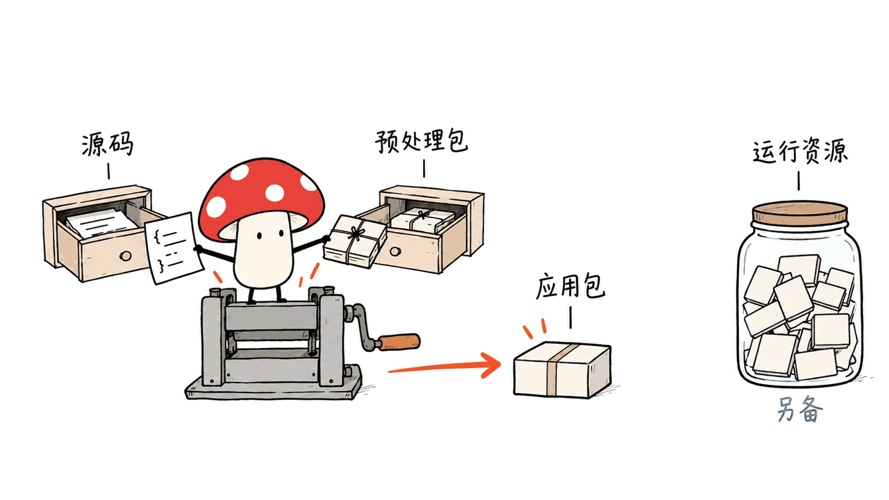

d2r-mobile-build 把苹果端游戏应用的编译和打包搬进 GitHub Actions，适合需要重复构建、保留产物与追踪版本的人。它是构建工具，不是一份包含游戏全部内容的免费安装包。

仓库为 jiayx/d2r-mobile-build，工作流采用 MIT 许可。本文审查于 2026-10-17，固定源码提交 `e92853236714bbf96642faadd781dccf29da9c9c`。

## d2r-mobile-build 到底做了哪一段？

它调用 jhaizhou-ops/d2r-mobile 的源码，下载准备好的输入，选择编译环境，再把 iOS IPA 或 macOS App 发布到用户自己的仓库。构建入口默认追踪上游最新正式 Release，也允许指定 `source_repository` 和 `source_ref`。

这里有三个独立对象：游戏移植源码、构建所需预处理包，以及运行时游戏资源。能编译通过，只说明前两者在某个环境下组合成功；不能证明资源完整、签名可用或设备体验可靠。

README 给出的 6 分钟 iOS、7 分钟 macOS 是维护者估计，包含下载、编译、打包与发布。本次没有启动远程 Actions，不把这些时间写成我们的实测。

## 怎样按可复现方式开始？

1. 在项目主页选择 Use this template，按上游建议创建私有仓库。
2. 选择 Build IPA 或 Build macOS，将对应平台的预处理配置填入 `prepared_input`。两者输入不能混用。
3. 首次排查时固定一个明确的上游提交，而不是一直追踪 `main`。同时保存构建工具版本、输入校验值和运行编号。
4. 私有源码仓库另设只读 Contents 权限的 `SOURCE_TOKEN`；不要把令牌写进输入 JSON 或文章示例。
5. 下载产物时同时保留 `SHA256SUMS.txt`、`build-report.json`，macOS 则保留对应 Mac 校验文件与报告。

入口可复用远程 `@main` 构建逻辑。因此，单纯记录移植源码提交还不足以复现；还应记录实际调用的工作流版本、Xcode 与预处理输入身份。

上游提供了自行生成预处理包的文档。对正式复现，自己从有权使用的材料准备输入比只记一个会更新的下载地址更可靠。私有仓库是存储方式，不会自动改变输入材料的授权。

## iPhone、iPad 与 Mac 应该选哪个包？

| 平台 | README 指定产物 | 需要另外确认 |
|---|---|---|
| iOS 26 及以上 | 标准 IPA | 签名、应用标识、匹配资源 |
| iOS 18–25 | `-ios18.ipa` | 同上，并确认系统分支 |
| Apple 芯片 Mac，macOS 26+ | `-macos26.zip` | 资源目录与对应应用 |
| Apple 芯片 Mac，macOS 15–25 | `-macos15.zip` | 独立应用变体与存档目录 |

README 要求 A14 / M1 或更新芯片、至少 6GB 内存。A14–A16 另需匹配的 Legacy 资源，A17 Pro 及更新芯片和 M 系列 iPad 使用标准 Data。这是维护者写明的支持条件，不代表我们逐款验证过。

更新之前先备份存档；iOS 保持应用标识，macOS 保持原应用分支及资源路径。相同版本资源可复用不等于所有未来版本都能混用。

## 我们实际验证了什么？

我们在 Apple Silicon Mac 上运行上游构建工具的 unittest。系统 Python 首轮因 `zip(..., strict=True)` 不受支持出现 1 项错误；改用与上游 CI 同系列的 Python 3.12 后，35 项测试全部通过，没有修改上游源码。

这些测试检查输入校验、源码选择、打包与发布逻辑中的模拟场景。我们没有下载游戏资源、编译 IPA/App、执行设备安装或测量帧率、电池续航。通过单元测试不等于游戏已在本机跑通。

Mycelium Protocol 的判断是：这个项目最值得借鉴的是把手工构建变成有版本、有输入身份、有报告的流水线。真正落地仍要走完“构建成功→签名安装→加载合法资源→存档回归”的验收链，不能只截一张 Actions 绿勾。

## 常见问题

### 它开源了整个游戏吗？

没有。MIT 是这个构建工具仓库的许可，不能自动覆盖游戏代码、商标、原始资源或其他依赖；使用时要分别核对各自权利。

### 可以直接装 IPA 吗？

iOS 仍需签名和安装工具，并导入匹配的运行资源。构建产物不是 App Store 分发，签名有效性和更新方式需要自行管理。

### 本文算实机游戏评测吗？

不算。这里是源码与构建流程审查，以及 35 项上游工具测试；没有设备运行、画质、帧率或耗电结论。

## 一手资料与关联阅读

项目与 README：https://github.com/jiayx/d2r-mobile-build

预处理输入：https://github.com/jiayx/d2r-mobile-build/blob/main/docs/PREPARED_INPUT.md

Mac 输入：https://github.com/jiayx/d2r-mobile-build/blob/main/docs/MACOS_PREPARED_INPUT.md

上游源码：https://github.com/jhaizhou-ops/d2r-mobile

相关工程阅读：https://blog.mushroom.cv/blog/motonav-round-screen-navigation/

封面为原创概念图，正文为解释构建流程的示意图，不是游戏截图或实机证据。

---

> © 2026 Author: Mycelium Protocol. 本文采用 [CC BY 4.0](https://creativecommons.org/licenses/by/4.0/deed.zh) 授权——欢迎转载和引用，须注明作者姓名及原文链接，不得去除署名后以原创发布。

<!--EN-->

d2r-mobile-build packages Apple-platform compilation and distribution into reusable GitHub Actions workflows. Its value is repeatable builds with identifiable inputs and reports; installing and running a game remains a separate acceptance step.

The repository is jiayx/d2r-mobile-build, licensed MIT. We inspected commit `e92853236714bbf96642faadd781dccf29da9c9c` on October 17, 2026.

## What does the workflow actually build?

It consumes d2r-mobile source, prepared build inputs and a compiler environment, then publishes IPA or macOS application artifacts to your repository. The default source selection follows the upstream stable release; explicit repository and ref inputs support controlled experiments.

Keep source code, prepared compilation inputs and runtime game data separate. A successful package proves neither a complete resource installation nor working signing, save migration or device performance. MIT permission for this workflow does not automatically license those other materials.

The README estimates approximately six minutes for iOS and seven for macOS. We did not execute remote builds, so these remain maintainer estimates.

## How should you start a reproducible build?

Create a private repository from the template and select the appropriate platform workflow. Supply the matching `prepared_input`, pin a source commit, and retain input checksums and run identifiers. Private source access requires a narrowly scoped Contents-read `SOURCE_TOKEN` secret.

Preserve the package checksums and build report alongside each artifact. The entry workflow references reusable build logic on `@main`: recording the game-source commit alone is insufficient. Also record the actual workflow revision, Xcode environment and prepared-input identity.

For controlled reproduction, use the upstream preparation documentation with materials you are entitled to use. A private repository changes visibility, not underlying distribution rights. Do not place access tokens in workflow inputs or shared reproduction notes.

## Which Apple package applies?

| Target | Package variant | Additional checks |
|---|---|---|
| iOS 26+ | Standard IPA | Signing and matching resources |
| iOS 18–25 | `-ios18.ipa` | Correct OS branch and signing |
| Apple Silicon, macOS 26+ | `-macos26.zip` | Matching app and resource directory |
| Apple Silicon, macOS 15–25 | `-macos15.zip` | App variant and separate save directory |

The README specifies A14/M1 or newer with at least 6GB RAM. A14–A16 devices need matching Legacy resources; newer supported devices use standard Data. These are documented requirements, not our device compatibility measurements.

Before upgrades, back up saves, retain the iOS application identifier, and keep the intended macOS variant and resource location. Reusing matching existing data does not promise cross-version compatibility forever.

## What did we verify locally?

The original Python interpreter produced one error because it did not support `zip(..., strict=True)`. Using Python 3.12, matching the upstream CI series, all 35 upstream build-tool unit tests passed without source modifications.

The tests cover mocked input, source-selection, packaging and publishing behavior. We did not download game resources, compile an IPA/App, install on hardware, or measure gameplay performance and battery life.

Our engineering conclusion is to treat build success as the first checkpoint. Signing, resource loading and save regression need their own evidence before declaring a working installation. The workflow is useful because it makes build provenance explicit rather than replacing that acceptance process.

## FAQ

### Is the entire game MIT licensed?

No. The workflow repository's MIT license does not automatically cover game content, trademarks, upstream code or dependencies.

### Is the IPA ready for App Store installation?

No. The documented path uses signing and sideloading tools and requires matching runtime resources.

### Is this a gameplay benchmark?

No. It reports source inspection and 35 upstream tool tests, with no hardware gameplay or performance measurements.

## Primary sources and related reading

Repository: https://github.com/jiayx/d2r-mobile-build

Prepared inputs: https://github.com/jiayx/d2r-mobile-build/blob/main/docs/PREPARED_INPUT.md

macOS inputs: https://github.com/jiayx/d2r-mobile-build/blob/main/docs/MACOS_PREPARED_INPUT.md

Upstream source: https://github.com/jhaizhou-ops/d2r-mobile

Related engineering review: https://blog.mushroom.cv/blog/motonav-round-screen-navigation/

Cover and body illustrations are conceptual, not gameplay screenshots or device evidence.

---

> © 2026 Author: Mycelium Protocol. Licensed under [CC BY 4.0](https://creativecommons.org/licenses/by/4.0/) — free to share and adapt with attribution. You must credit the author and link to the original; removing attribution and republishing as original is not permitted.
