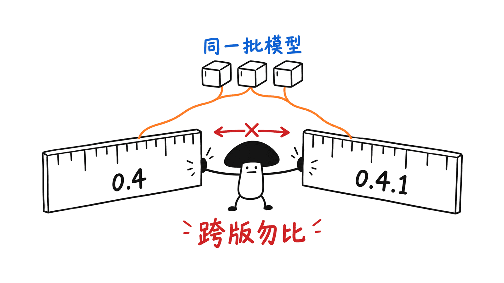
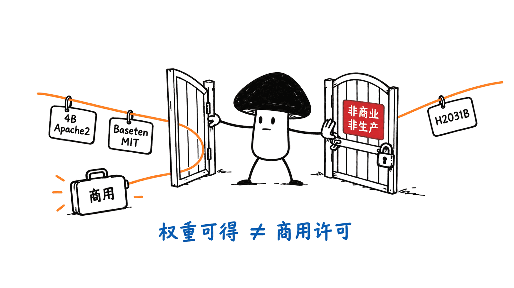
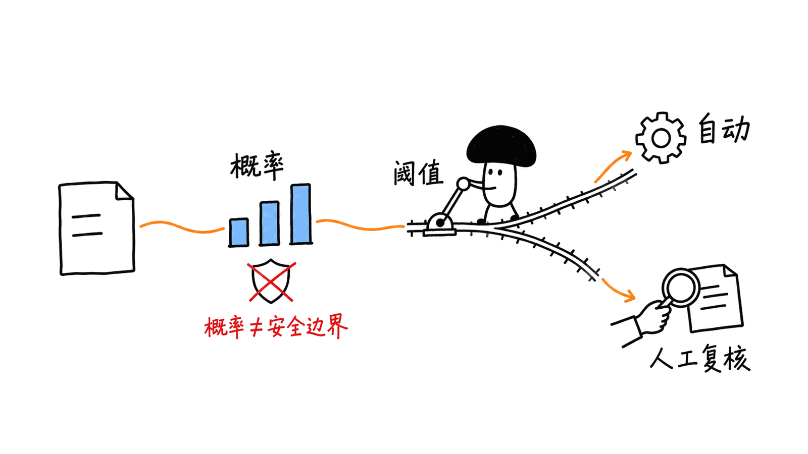

决策模型能把工单、合同或截图直接变成选项和概率。但在 Baseten、H2O Lightning 与 Jev 之间选型，先要对齐榜单版本和使用许可。核查后的结论是：Baseten 的发布成绩有竞争力，H2O 31B 有明确的视觉重读工程路径，Jev 适合托管接入；三者不能靠一句“谁第一”代替业务验收。

本文由 Mycelium Protocol 核对官方报告、模型卡、许可证及榜单原始 JSON。资料查阅日为 2026 年 10 月 24 日，榜单数据文件生成于 10 月 22 日。本文是公开资料对照与工程评估，没有运行模型推理，也没有自行重测准确率、延迟或抗攻击能力。

## 71.24 分为什么不能直接称为当前第一？

Baseten 模型卡公布的 mammoth-1 71.24、elephant-1 62.65、Jev 1.14 62.2，属于 Jev Decision Index 0.4 发布口径。当前官方 Space 数据文件的版本标签已是 0.4.1，Full score 如下：

| 模型 | 发布材料中的 0.4 分数 | 当前 0.4.1 Full score | 当前公开部分 Public index |
|---|---:|---:|---:|
| mammoth-1，27B | 71.24 | 68.44 | 75.34 |
| elephant-1，9B | 62.65 | 60.26 | 72.24 |
| H2O Lightning 31B | 此处不补填旧值 | 66.58 | 66.69 |
| Jev 1.14 | 62.2 | 60.24 | 60.70 |
| H2O Lightning 4B | 不与其他榜单拼接 | 此快照未收录 | 此快照未收录 |

这张表对应榜单记录的参赛配置，不意味着当前模型卡新版运行参数已在榜单上重测，尤其不能把 H2O 新 profile 的结果覆盖到旧参赛行。

这里的 Public index 读取 `scores.public_skill`，Full score 读取 `scores.balanced_skill`；不是把原始准确率当成指数。0.4.1 数据在 Full score 下记录 GLiDE 1.2 为 71.52，mammoth-1 为第 3 行、带并列标记。因此，“发布时 0.4 第一”有出处，“当前仍然全球第一”不成立。

elephant-1 比 Jev 高 0.02 分，只是这份快照的点估计差值，不能据此宣布业务上稳定胜出。榜单的并列标记也提示读者不要过度解释相近分数。

Full score 使用私有同技能与新领域集合，映射到公开标尺后按 60% / 40% 组合；Public index 则是公开任务的聚合。两列回答不同问题。公开任务强、私有迁移相对弱，并不矛盾。版本更替造成数字变化，也不等于模型权重突然退化。

官方榜单及可下载数据：
https://huggingface.co/spaces/multimodalart/jev-decision-index
https://huggingface.co/spaces/multimodalart/jev-decision-index/blob/main/data/index.json

## 三方到底在输出什么？

它们的共同点是先定义问题，再返回有限集合上的决策结果。Choice 选部门，Noul 返回某个陈述成立的概率，Score 在有序评分标准上给出结果或分布。它们适合路由、筛选、审核辅助和质量打分，不负责撰写完整客服回复。

同一份 State 可以承载多个问题，例如“是否退款”“应由哪个部门处理”“紧急程度”。共享前缀或共享 State 能减少重复处理，但问题仍会增加计算和输入；不能推导成无限数量的问题免费。

类型正确只说明输出能被程序读取，不说明判断正确。概率也需要在自己的数据上校准，才能用于自动执行阈值。

## Baseten：不确定性训练值得关注，运行时同样重要

mammoth-1 和 elephant-1 分别基于 Qwen3.5-27B 与 9B，采用块双向注意力，支持文本及图片，训练长度上限为 16,384 tokens。模型卡说明语言模型针对文本和图像决策进行完整微调，视觉编码器冻结。

最终训练混合包含 621 万条决策样本，安全与弃答部分占 16.1%，约 100 万条。目标结合交叉熵和 Brier 校准项，并训练“不知道”选项。这是应对信息不足的重要设计，不能把这约 100 万条全部说成同一种拒答样本，更不能等同于已经解决幻觉或提示注入。

视觉编码器冻结也不直接证明 OCR 一定落后。它描述训练方法；要判断密集表格、票据小字和截图定位能力，仍需同尺寸图片、同题目、同运行配置的结果。本次视觉榜单文件没有找到这两个模型的对应参赛行，因此不编造它们与 H2O 的视觉名次对比。

两款模型采用 MIT 许可，模型仓库同时提供部署脚本。官方 `setup.sh` 安装固定的 OneJev 与 `serve.patch` 环境，要求 CUDA GPU；不能仅用普通 Qwen 聊天端点替代其决策运行时。超长请求会被拒绝，不会静默截断。

Baseten 托管 API 也接受图片。模型卡明确写着免费周截止 2026 年 10 月 27 日 23:59，美国太平洋时间；这是有期限的活动，不是长期价格。本文没有调用该 API。

官方资料：
https://huggingface.co/baselabs/mammoth-1
https://huggingface.co/baselabs/elephant-1
https://labs.baseten.co/articles/mammoth-1-and-elephant-1-frontier-decision-models

## H2O：31B 与 4B 的许可证、底座都不同

这是采购前最应先看的差别：

| 规格 | 底座 | 当前模型卡许可 | 使用边界 |
|---|---|---|---|
| Lightning 4B | Qwen3.5-4B | Apache 2.0 | 可以按许可证条件评估商用与自建 |
| Lightning 31B | Gemma-4-31B-it | H2O Model Non-Commercial Licence v1.1 | 免费提供的是非商业、非生产使用；生产或商业用途需另行确认授权 |

31B 不能因为权重可下载，就统称为可自由商用的开源模型。其许可证明确把企业内部、与生产和营收无关的评估纳入允许范围；托管服务适用另外的条款。本文没有替任何具体用途取得商业授权。

### image_reread 是分辨率翻倍吗？

31B 的 Decision Index 配置先用 560 个图像 soft tokens 读取图片；对最高概率低于 0.8 的 Choice 或 Score 图片问题，再用 1120 个 soft tokens 重读，并平均两次结果。这里的 560 / 1120 是图像 token 预算，不能直接写成像素分辨率；Noul 图片问题不走这条重读路径。

它把额外算力放在不确定的问题上，但会改变时延和成本。模型卡的 `two-way`、`decision-index`、`decision-index-max` 是不同 profile，不能拿其中一个的准确率搭配另一个的最低延迟。

当前视觉榜单是另外的 vision 0.4：31B 的 Public 为 76.51，Full 为 70.56，第 11 / 55；该行还注明每题最多四张图片，超过按失败计。这个成绩与 ImageJevBench 的 Intelligence、Capability 第一并不冲突，它们是不同榜单和指标。

### “长记录全读”有哪些前提？

31B 的 Decision Index runbook 以一张 96GB RTX PRO 6000 为目标，FP8 权重、131,072 token 引擎上下文，State 最多 126,976 tokens，超出返回 HTTP 422。它依靠专用 vLLM 构建与 shim；长输入也可能切换为单向读取，并非始终双向全读。

其他启动方式可能使用 BM25 选择，或头尾裁剪。故“全读不截断”是特定配置的行为，不是所有部署的默认承诺。官方还记录 H100 80GB 的另一套配置，不能把 96GB profile 原封不动照搬过去。

4B 的公开模型卡提供 GGUF 入口，体量更适合小设备评估；但“双向模式的 vLLM 成绩”不会自动迁移成手机或 Mac 上的量化成绩。它在 JevBench 上的 73.82 也不是本篇表格里的 Decision Index 分数。

官方模型、运行文件与视觉榜单：
https://huggingface.co/h2oai/h2o-lightning-4b
https://huggingface.co/h2oai/h2o-lightning-4b-gguf
https://huggingface.co/h2oai/h2o-lightning-31b
https://github.com/h2oai/vllm
https://huggingface.co/spaces/multimodalart/jev-decision-index/blob/main/data/vision.json

## Jev：托管省运维，但“仅文本”已经不完整

TypeSafe 当前文档列出的 Jev 1.14 输入仍是文本，可用字符串、JSON 或文本数组。默认限制是每请求 64k tokens、State 加任一问题 32k。启用 `TypeSafe-Danger-Zone-Long-Context: true` 后，两者可升至 262k；官方明确提示长上下文更慢、准确率更低。

图片和 Box 定位问题已提供实验接口，需要 `TypeSafe-Danger-Zone-Images: true`。官方说它们尚未达到生产就绪标准，协议与精度可能变化。因此合理描述是“成熟接口以文本为主，图片支持仍实验性”，而非完全不支持图片。

定价文档确认 每百万输入 tokens 0.042 美元，输出免费。例如每月 10 万次、平均每次 2,000 输入 tokens，纯模型输入费是 8.40 美元；这是算术示例，不含人工复核、存储及重试，也不代表实测平均用量。共享 State 合并问题能避免重复提交，但问题文本本身也应计费。

当前 `jev-latest` 与 `jev-preview` 都指向 `jev-1.14.0`。生产建议固定版本并记录响应中的实际模型 ID。文档说明不提供客户数据微调；闭源权重与公开 SDK 是不同层次，后者不能让用户自行私有部署模型。

70–500ms 只能作为带条件的宣传范围。榜单记录 Jev API p50 为 196ms、p95 为 296.8ms，并明确包含实验室 HTTPS 往返，不能与其他模型的单卡进程耗时直接排名。

关于安全，官方 Jev 1.13 Jaggedness 页面明确承认，State 中的对抗指令或误导内容能够改变回答。这足以说明外围防护必要，但不是本文对 1.14 的攻击实测，也不能得出 Baseten 或 H2O 自动更安全的结论。

官方资料：
https://docs.typesafe.ai/models
https://docs.typesafe.ai/images
https://docs.typesafe.ai/model-jaggedness/jev-1.13

## 中小团队怎样落地，而不是照抄排行榜？

先选一个边界清楚的工作流，例如客服工单的部门路由。把可执行动作和评价结果分开：模型负责给概率，应用负责决定是否自动执行。

1. 固定问题和动作。 部门选择使用互斥选项，补充“信息不足”；把是否退款与实际退款执行分开。来自工单的文字只作为业务数据，不能直接变成工具权限。
2. 留出业务验收集。 覆盖中文、缺失凭证、相互矛盾记录、选项改名和注入文本。对图片加入小字、倾斜及多页材料。以下是建议的验收方案，本次没有执行这些测试。
3. 固定完整配置。 记录权重 revision、运行时补丁、量化、图像预算、截断策略、问题模板和超时。H2O 尤其要记录 profile；Jev 固定版本；Baseten 保存其决策部署脚本版本。
4. 按错误代价选阈值。 在留出集上观察自动处理覆盖率与错误率的关系，再设定转人工条件。不要把 0.9 直接解释成“任何业务里都有九成可靠”。
5. 先影子运行，再逐步放量。 同时报人工判断，不立即触发高成本动作；验收后从可撤销的低风险路由开始。监测 p95、超时、拒绝率、重读率和每个正确自动决策的总成本。

选择上，没有 GPU 运维能力、主要处理文本的小团队，可先评估 Jev 托管接口。需要自建且关心通用文本决策，可比较 Baseten 9B / 27B。预算紧张、希望尝试本地图像决策，可以从 H2O 4B 开始；31B 则先确认许可，再评估显存和视觉收益。

这些是依据已核实能力做的选型建议，不是对你的部署吞吐量或识别效果的保证。自建还需把闲置 GPU、扩缩容、更新补丁和故障值班计入成本。

## 常见问题

### 这些模型能直接替代客服大模型吗？

不能。它们擅长有限选项判断，可以放在生成模型前做路由和审核辅助；需要自然语言解释和对话时，仍应使用合适的生成模型。

### Mac 能跑哪个，内存够就行吗？

H2O 4B 有 GGUF 仓库可作为起点，但还要核对运行时能否正确实现其决策协议与读取方式。Baseten 官方路径要求 CUDA，H2O 31B 文档使用 Linux CUDA GPU。本机是 M4 / 16GiB，本次没有安装这些模型，不能宣称 Mac 上已跑通。

### 为什么不把 H2O 4B 的 73.82 放进总榜？

因为它属于 JevBench 综合指标，而本篇比较表使用 Decision Index 0.4.1 Full score。混合不同任务、成本和时延权重的指数，会制造虚假的排序。

相关背景：本站关于 StartLux 概率决策与结构化接口的介绍：
https://blog.mushroom.cv/blog/startlux-decision-typed-decision-model-jev-compatible-games-demo/

本文原文：https://blog.mushroom.cv/blog/decision-models-comparison/

---

> © 2026 Author: Mycelium Protocol. 本文采用 [CC BY 4.0](https://creativecommons.org/licenses/by/4.0/deed.zh) 授权——欢迎转载和引用，须注明作者姓名及原文链接，不得去除署名后以原创发布。

<!--EN-->

Decision models turn tickets, contracts and screenshots into typed answers with probabilities. Choosing between Baseten, H2O Lightning and TypeSafe Jev requires matching benchmark editions, deployment profiles and licenses before comparing scores. Baseten offers strong published text results, H2O 31B documents conditional visual re-reading, and Jev offers a managed service.

Mycelium Protocol checked primary reports, model cards, licenses and raw leaderboard JSON on October 24, 2026. The leaderboard files were generated on October 22. We did not run inference or independently measure accuracy, latency or attack resistance.

## Which Decision Index scores are comparable?

Baseten's release numbers belong to Decision Index 0.4. The current Space labels its data 0.4.1:

| Model | Release 0.4 score | Current 0.4.1 Full score | Current Public index |
|---|---:|---:|---:|
| mammoth-1, 27B | 71.24 | 68.44 | 75.34 |
| elephant-1, 9B | 62.65 | 60.26 | 72.24 |
| H2O Lightning 31B | Not backfilled here | 66.58 | 66.69 |
| Jev 1.14 | 62.2 | 60.24 | 60.70 |
| H2O Lightning 4B | Different-board scores excluded | Absent from this snapshot | Absent |

These are the board’s recorded entrant configurations, not a re-evaluation of the newest model-card profiles. In particular, H2O’s newer profile results must not overwrite its recorded board row.

Public index uses `scores.public_skill`; Full score uses `scores.balanced_skill`, not raw accuracy. The current file puts GLiDE 1.2 at 71.52 and mammoth-1 on the third row with a tie marker. “First at the 0.4 release” is supported; “currently first worldwide” is not.

The elephant–Jev gap is just 0.02 points in this snapshot, not evidence of a robust business advantage. Full score combines private same-skill and new-domain results, mapped to the public scale, at 60% / 40%. A version change is not proof of a weight regression. Public performance and private generalization answer different questions.

https://huggingface.co/spaces/multimodalart/jev-decision-index
https://huggingface.co/spaces/multimodalart/jev-decision-index/blob/main/data/index.json

## What do these models return?

Choice selects a named option, Noul returns the probability that a statement is true, and Score evaluates an ordered rubric. Multiple questions can share a State or prefix, avoiding repeated processing of the same record. Questions still add input and computation. These models route or judge; they do not write a complete customer-service response.

Valid output types do not guarantee correct decisions. Probabilities require validation and calibration on the target domain before they control actions.

## Baseten: uncertainty training and a specialized runtime

mammoth-1 and elephant-1 build on Qwen3.5-27B and 9B, use block-bidirectional attention, accept text and images, and support 16,384 tokens. Their language models were fine-tuned on text and image decisions while the vision encoder stayed frozen.

The final mixture contains 6.21 million examples; 16.1%, roughly one million, cover safety and abstention. Training combines cross-entropy with a Brier calibration term and a learned “I don't know” option. These are useful uncertainty mechanisms, not proof that hallucinations or prompt injection have been eliminated.

A frozen encoder alone does not establish poor OCR performance. We found no corresponding mammoth or elephant entrant in this visual-board snapshot, so we do not invent a visual ranking against H2O.

Both models use MIT licensing. Their repositories include serving code: `setup.sh` installs a pinned OneJev plus `serve.patch` environment and requires a CUDA GPU. A generic Qwen chat endpoint does not reproduce this decision runtime. Overlength requests are refused rather than silently truncated.

The hosted API also accepts images. The card dates its free week to October 27, 2026, 11:59 PM Pacific Time. That is a temporary offer, not a permanent price. We made no API calls.

https://huggingface.co/baselabs/mammoth-1
https://huggingface.co/baselabs/elephant-1
https://labs.baseten.co/articles/mammoth-1-and-elephant-1-frontier-decision-models

## H2O: distinguish the two sizes and their licenses

| Model | Base | Current license | Deployment implication |
|---|---|---|---|
| Lightning 4B | Qwen3.5-4B | Apache 2.0 | Commercial evaluation and deployment subject to license conditions |
| Lightning 31B | Gemma-4-31B-it | H2O Model Non-Commercial Licence v1.1 | Free non-commercial, non-production use; commercial or production permission requires separate confirmation |

Available weights do not make 31B a permissive commercial model. Its license includes internal company evaluation unrelated to production or revenue. Hosted services have separate terms. We have obtained no commercial permission for a particular deployment.

### What does image_reread actually do?

The 31B Decision Index profile first reads an image with 560 soft tokens. For image Choice or Score questions with top probability below 0.8, it re-reads with 1120 soft tokens and averages both results. These are image-token budgets, not pixel dimensions. Image Noul questions are excluded from this re-read rule.

Profiles matter: `two-way`, `decision-index` and `decision-index-max` spend different amounts of computation. Accuracy from one cannot be combined with the lowest latency from another.

On the separate vision 0.4 board, 31B scores 76.51 Public and 70.56 Full, ranking 11 of 55. Its row accepts at most four images per question; larger cases count as failures. This does not contradict different placements on ImageJevBench's Intelligence and Capability metrics.

### Does it always read the entire record?

The Decision Index runbook targets one 96GB RTX PRO 6000, FP8 weights and 131,072-token engine context. State is limited to 126,976 tokens; oversized records receive HTTP 422. Its specialized vLLM build and shim may use one-way reading for longer inputs. Other launch configurations can use BM25 selection or head-and-tail cutting.

Thus whole-record reading is a profile-specific behavior. The card also documents a different H100 80GB setup; the 96GB profile is not portable unchanged.

The 4B model has a GGUF repository, making it a useful small-device evaluation candidate. That does not transfer CUDA two-way benchmark results to a phone or quantized Mac runtime. Its JevBench composite of 73.82 is also not a Decision Index score.

https://huggingface.co/h2oai/h2o-lightning-4b
https://huggingface.co/h2oai/h2o-lightning-4b-gguf
https://huggingface.co/h2oai/h2o-lightning-31b
https://github.com/h2oai/vllm
https://huggingface.co/spaces/multimodalart/jev-decision-index/blob/main/data/vision.json

## Jev: managed inference, with experimental images

TypeSafe lists text as the default input: strings, JSON or text arrays. Default context limits are 64k per request and 32k for State plus any one question. The `TypeSafe-Danger-Zone-Long-Context: true` header raises both to 262k, with documented speed and accuracy penalties.

Images and Box localization already exist behind `TypeSafe-Danger-Zone-Images: true`. TypeSafe explicitly says they are not production-ready and may change. “Text-first production interface with experimental images” is more accurate than “text only.”

The official rate is $0.042 per million input tokens, with output free. A hypothetical 100,000 monthly requests at 2,000 input tokens each cost $8.40 for model input alone, excluding retries, storage and review. Shared State avoids duplication; question text still contributes to billing.

Both current aliases point to `jev-1.14.0`. Pin a version and log the actual returned model ID. TypeSafe does not offer customer-data fine-tuning; open SDKs do not provide self-hostable model weights.

A blanket 70–500ms claim is not a comparable performance test. The board records hosted Jev at p50 196ms and p95 296.8ms, explicitly including HTTPS round trips from its lab. These cannot be directly ranked against local single-process timings.

The official Jev 1.13 Jaggedness page acknowledges that adversarial State content can move answers. This motivates application controls, but it is not our attack test of 1.14 and does not establish that the other models are safer.

https://docs.typesafe.ai/models
https://docs.typesafe.ai/images
https://docs.typesafe.ai/model-jaggedness/jev-1.13

## How should a small team deploy this?

Start with a bounded workflow such as ticket routing. Separate judgment from authority: the model provides probabilities; the application decides whether an action may execute.

1. Define mutually exclusive routing options plus insufficient information. Keep refund classification separate from payment execution. Ticket content must not become tool permission.
2. Build a held-out acceptance set covering Chinese, missing evidence, conflicting records, renamed options and injection attempts. Add small print, skew and multiple pages for vision. This is a proposed plan, not testing performed here.
3. Pin weights, runtime patches, quantization, image budget, selection policy, question template and timeout. Record H2O's profile, Jev's model version and Baseten's serving revision.
4. Choose thresholds from coverage-versus-error curves and business error costs. A reported 0.9 probability does not imply 90% reliability in every domain.
5. Run in shadow mode, then gradually enable reversible low-risk actions. Track p95, timeouts, refusal and re-read rates, and total cost per correct automated decision.

For managed text workflows, evaluate Jev first. For self-hosted general text decisions, compare Baseten's 9B and 27B. For smaller local visual experiments, consider H2O 4B. For 31B, settle permissions before investing in hardware. Include idle GPU capacity, upgrades and operations in cost comparisons.

## FAQ

### Can these replace a conversational model?

They can route or judge before a generative model, but do not replace natural-language response generation.

### Can they run on a Mac?

H2O 4B provides GGUF weights, but protocol and attention support still need verification. Baseten's documented path requires CUDA; H2O 31B documents Linux CUDA hardware. We did not install or run these models on our M4 with 16GiB, so make no Mac performance claim.

### Why exclude H2O 4B's 73.82 from the main table?

It is a JevBench composite, not Decision Index 0.4.1 Full score. Combining different task and cost/latency weights would create a misleading ranking.

Original article: https://blog.mushroom.cv/blog/decision-models-comparison/

---

> © 2026 Author: Mycelium Protocol. Licensed under [CC BY 4.0](https://creativecommons.org/licenses/by/4.0/) — free to share and adapt with attribution. You must credit the author and link to the original; removing attribution and republishing as original is not permitted.
