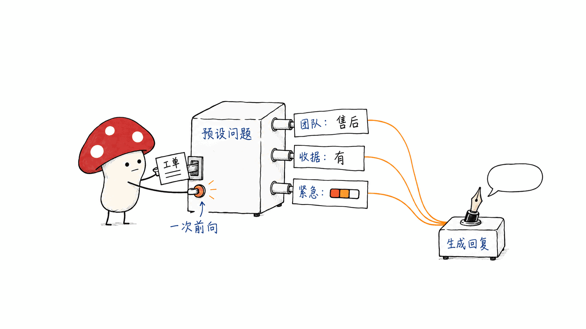
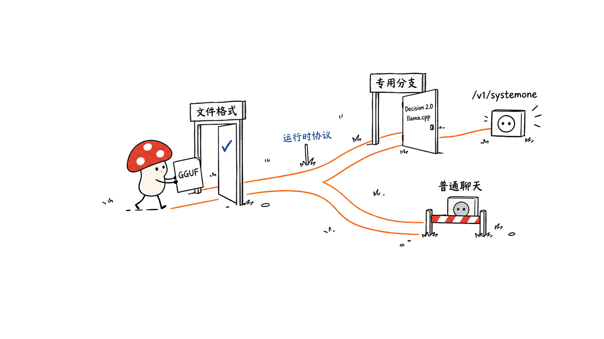
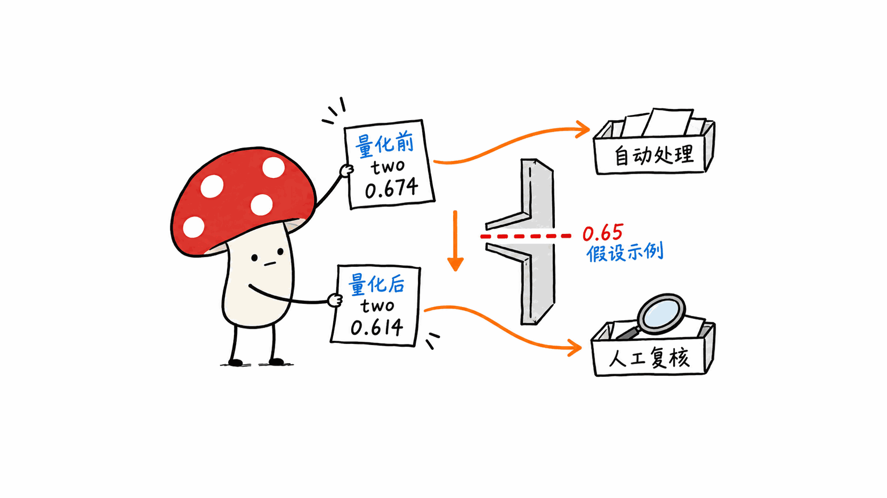
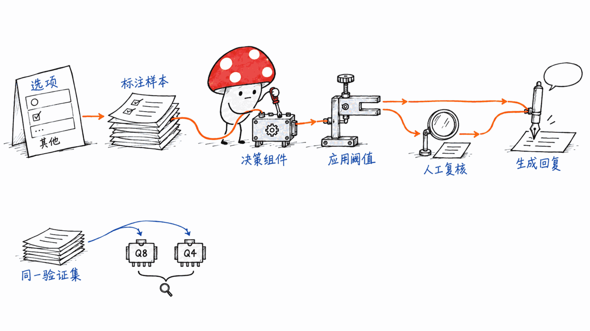

**BLUF**：Decision-2.0-Kai-0.6B 是基于 Qwen3-0.6B-Base 微调的 0.6B 参数决策模型，采用 Apache-2.0 协议，支持 8,192 token 输入。你给它文本或 JSON，以及需要回答的选择题、是非题和评分题，它在一次前向计算里返回结构化结果。

官方 Q4_K_M GGUF 文件只有 400.9MB，适合考虑放在本地工作流的分类与分流入口。但部署必须使用支持 Decision 2.0 的特定 llama.cpp 分支及 `/v1/systemone` 接口；文件小不等于运行内存只需 400MB，GGUF 后缀也不代表普通聊天客户端已经支持。量化还可能改变概率阈值，即使最终分类标签保持一致。

本文核对了完整模型卡、配置、加载代码、GGUF 文件清单，以及发布方提供的验证记录。本次没有下载权重运行推理，也没有在 Mac mini 上测延迟或质量。 下文把发布方结果与我们的工程判断分开说明。

> 模型：https://huggingface.co/vllm-sr/Decision-2.0-Kai-0.6B
> 官方 GGUF：https://huggingface.co/vllm-sr/Decision-2.0-Kai-0.6B-GGUF
> 所属项目：https://github.com/vllm-project/semantic-router
> 信息核对日期：2026-10-11

## 为什么本地工作流需要一个只做判断的小模型？

个人或小团队的 AI 工作流里，经常出现这样的请求：一条客户消息应该交给售后还是账单团队？输入有没有提到发票？紧急程度应该排在哪一档？

这些问题的输出空间早就确定了。若把每个问题都交给聊天模型，应用还要处理提示词、逐 token 生成、JSON 格式检查和重试。Kai 的思路是把问题和候选答案作为输入，直接输出候选项的概率、选择结果或评分。它减少的是取得固定格式判断结果的生成环节，后续解释、回复和工具执行仍由其他组件负责。

例如一条「昨天到货时商品损坏，客户有收据，要求今天换货」的工单，可以同时问：

| 问题 | 输入里定义的类型 | 应用需要的结果 |
|---|---|---|
| 应由哪个团队接手？ | `choice` | 在售后、账单、技术之间选择，并返回各项概率 |
| 客户是否有收据？ | `noul` | 返回是非判断的数值结果 |
| 有多紧急？ | `score` | 根据预先定义的等级返回评分与分布 |

这些问题共用同一份输入，一次前向计算一起回答。一次前向并不意味着题目数量和文本长度对耗时没有影响：输入仍要编码，8,192 token 的预算也要容纳状态、问题和选项。



这也划清了能力边界：Kai 不生成客服回复，不写解释段落，也不能直接抽取一个不在候选集合中的任意订单号字符串。要识别「属于哪个已知类别」可以用选择题；要抽取未知字符串，仍需规则、抽取模型或生成模型。

## 它和我们之前写的决策模型有什么区别？

Mycelium Protocol 之前介绍过 AgentJev 0.6B、LiquidAI D1 和 Cloudflare CLEF。Kai 延续了固定类型决策这个方向，本篇真正值得展开的新点是 Decision 2.0 的权重包、官方 GGUF 和量化验证材料，以及这些材料给本地应用设计带来的影响。

模型卡将 Kai 标为 `zero-shot-classification`，基座是 Qwen3-0.6B-Base。配置中的架构名为 `Decision2Model`，`max_input_tokens` 为 8192；除了 backbone，还加载独立的 decision head。它不是把普通 Qwen 聊天模型提示成「只输出 JSON」的同义包装。

| 项目 | 本地应用应该先看什么 |
|---|---|
| AgentJev 0.6B | System One 决策接口和先前公开评测的定义 |
| LiquidAI D1 | 无文本生成的决策形式与不同规模的模型选择 |
| Cloudflare CLEF | 部署接口、使用方式和微调链路 |
| Decision 2.0 Kai | 专用模型包、GGUF 运行时支持、量化后的概率与阈值 |

相关背景：https://blog.mushroom.cv/blog/agentjev-0-6b-system-one-decision-model-qwen3/

所属的 vLLM Semantic Router 是一套更大的路由系统。2026-10-11 抓取的 GitHub 元数据中，它有 6,075 stars，最近推送为当天 03:56:28 UTC；这些只是项目快照，不是模型效果证据。使用 Kai 权重不要求先安装整套 Router：模型卡提供独立的 Transformers 入口，GGUF 卡也给出了独立服务器启动方式。

## 官方分数能说明什么，不能说明什么？

Kai 模型卡列出了以下结果，均为发布方披露的数据：

| 模型 | JevArena | 人工标注迁移任务 | Jev Decision Index |
|---|---:|---:|---:|
| Decision 2.0 Kai 0.6B | 48.6 | 45.9 | 16.3 |
| Decision 1.0 Kai | 35.9 | 35.7 | 6.5 |
| GLiNER2.5-Decide | 42.5 | 44.1 | 未列出 |
| Bosun v3.1 0.6B | 38.5 | 34.2 | 未列出 |

来源：https://huggingface.co/vllm-sr/Decision-2.0-Kai-0.6B

模型卡解释，JevArena 使用相同的固定提示和计分规则，缺失或非法答案计为错误；人工标注迁移分数是 15 个任务的 macro-F1 中位数乘以 100。因此 45.9 不是所有样本合并后的正确率，48.6 也不能直接改写成「分类准确率 48.6%」。

Decision 2.0 的 Index 结果，模型卡描述为使用官方 0.2.1 工具包在发布权重上的独立复现；对照模型来自 2026-09-28 的公开榜单快照。本文没有重跑该评测。GGUF 的 provenance 还有另一组带时间戳的 Index 快照值，它说明转化来源模型的记录，不能当作量化版重新跑出的成绩。

更不能拿这里的 48.6 与旧文里的 AgentJev 79.25 直接比高低：评测名称、任务和计分口径不同。模型卡支持的结论是「在它列出的同规模对照中，Kai 的这组分数领先」，不是「它适合所有业务标签体系」。

官方另给出单 GPU、单问题请求的中位延迟 4.9ms。卡片没有说明 GPU 型号和完整测试条件，这个数字不能外推成 Mac 延迟、多问题吞吐或端到端请求时间。

## 400MB 的 GGUF 能直接拖进 Ollama 吗？

目前的一手说明要求专用运行时；我们没有验证普通 Ollama 或 LM Studio 的兼容性。

这是本地部署最容易踩的坑。文件采用 GGUF，并不意味着现成的聊天服务懂得它的 decision head、问题格式和结果协议。官方 GGUF 卡明确指向下面这个分支：

https://github.com/Xunzhuo/llama.cpp/tree/decision2-gguf

启动命令为：

```bash
llama-server \
  -hf vllm-sr/Decision-2.0-Kai-0.6B-GGUF:Q8_0 \
  --embeddings --pooling none \
  -c 8192 -b 8192 -ub 8192 -np 1
```

这里的 `llama-server` 必须来自支持 Decision 2.0 的运行时。请求走 `/v1/systemone`；把它接到普通 `/v1/chat/completions` 后期待生成客服回复，会用错接口。命令中的 `--embeddings` 是这套运行路径的一部分，也不等于模型应被当作常规向量检索嵌入模型使用。



官方仓库当前文件大小如下，按十进制单位换算：

| 格式 | 文件字节数 | 约合体积 |
|---|---:|---:|
| BF16 | 1,202,396,320 | 1.20GB |
| Q8_0 | 643,660,960 | 643.7MB |
| Q4_K_M | 400,918,688 | 400.9MB |

文件与元数据：https://huggingface.co/vllm-sr/Decision-2.0-Kai-0.6B-GGUF/tree/main

这些是下载文件大小。进程还需要上下文、计算缓冲区和运行时内存；我们没有测峰值占用，不能承诺「400MB RAM 就能跑」。对已有本地生成模型的机器来说，更有意义的问题是：决策模型和生成模型同时常驻时，还有多少内存余量？

GGUF provenance 记录显示，三种格式都保留了 10 个 F32 decision-head 张量，并报告这些 head 张量与源模型匹配。量化标签描述不了所有张量的精度；即使 head 保留，主干量化仍会影响输出。

## 标签相同，为什么量化后还要重新验阈值？

官方仓库提供了 `validation.json`。我们检查的是发布方已上传的记录，没有在本机重新执行这些请求。

每种格式覆盖 10 个请求、19 个问题，其中 18 个有效、1 个非法问题，涉及 59 个概率值。三种格式的 8 个选择题标签都与参考结果一致；18 个有效问题的 argmax 也一致。非法问题仍返回预期错误。这是很有用的格式与数值冒烟验证，但样本太少，不能证明业务质量不下降。

| GGUF 格式 | 最大概率绝对差 | 最大评分绝对差 | 选择题标签一致 |
|---|---:|---:|---:|
| BF16 | 0.008125 | 0.016788 | 8/8 |
| Q8_0 | 0.008886 | 0.015545 | 8/8 |
| Q4_K_M | 0.060266 | 0.078737 | 8/8 |

验证记录：https://huggingface.co/vllm-sr/Decision-2.0-Kai-0.6B-GGUF/blob/main/validation.json

上表的概率差以 0—1 的概率单位计，不是相对误差百分比；评分差也需要结合对应题目的量表理解。它们衡量与参考实现的数值接近程度，不是与人工正确答案的差距。



记录里有一个很具体的例子：某选择题的首选概率从参考结果的 0.67383 变成 Q4 的 0.61356，首选答案都还是「two」。若应用的自动处理门槛恰好设为 0.65，前者会自动处理，后者会进入复核。这个门槛是我们用来解释风险的假设，不是模型推荐配置。

因此「量化前后标签一样」不能替代「量化前后应用行为一样」。Q4 比 Q8 节约约 242.7MB 文件空间，却可能让阈值附近的样本改变路径。我们的工程建议是先用 Q8 建立业务验证基线，再比较 Q4 的误分、复核率与延迟；这是一条验证顺序，不是本文已经测出的最佳精度。

同样要克制对概率的解释。模型配置中的 `calibration` 为 `null`，表示这里没有声明额外的校准配置，不等于证明概率必然未经校准。它也不能支持「0.9 输出在你的业务里有 90% 正确率」这样的承诺。模型给出的概率和 `confidence` 都需要用本地标注样本验证；provenance 里的 score-bias 元数据也不能自动证明业务概率已经校准。

## 给个人或小团队的接入方式

先做一个窄任务：把一类工单分给三四个明确的处理队列，附带一个是否满足条件的判断。候选项定义应具体、互相有清楚边界，并给范围外输入留一个「其他／人工处理」选项。否则再稳定的结构化输出，也可能把未知问题硬塞进已有类别。

如果先走 Python，模型卡要求 `transformers>=5.17`、`torch` 与 `safetensors`，使用 `AutoModel` 加载且开启 `trust_remote_code=True`。这会执行模型包中的代码，部署时应审查并固定模型 revision。下面是接口结构示例，本文未执行，也没有附上虚构输出：

```python
from transformers import AutoModel

model = AutoModel.from_pretrained(
    "vllm-sr/Decision-2.0-Kai-0.6B",
    revision="cc7f30cda9e7c7b28c5f71ef33f01e09385f1c4b",
    trust_remote_code=True,
)

result = model.system_one(
    state="客户询问上个月的账单能否补开发票。",
    questions={
        "team": {
            "type": "choice",
            "instructions": "应交给哪个团队？",
            "criteria": {
                "billing": "账单、收费与开票",
                "returns": "退货、换货与损坏商品",
                "other": "不属于上述类别，转人工",
            },
        },
        "invoice": {
            "type": "noul",
            "instructions": "客户是否在询问发票？",
        },
    },
)
```

示例固定的是本次检视的 HF 原始模型包 revision。是非题的类型字段确实叫 `noul`，不是 `boolean`。这类命名细节，比把模型接成聊天端点后反复调提示词更值得先确认。



验证集应该包含真实中文表达、简称、含糊请求、多个意图和未知类别。记录每条样本的期望队列、概率、是否进入复核，以及最终人工判定；量化版本变更时用同一份数据重跑。把业务规则留在应用里：一个未经过业务验证的模型概率，不应单独决定退款或其他高影响操作。

Kai 的合理位置，是一个可评估、可替换的本地判断组件。当业务需要新的候选集时，它比固定标签分类器更灵活；当业务需要长回复、复杂推理或自由文本抽取时，需要其他模型接力。下载门槛已经很低，下一步真正要付出的成本是运行时适配和业务验证。

## 常见问题

### Decision 2.0 Kai 能替代本地聊天模型吗？

不能覆盖聊天生成的用途。它输出选择、是非判断和评分，用于路由或过滤；生成解释和回复仍需要生成模型。

### Q4 只有 400.9MB，是否肯定适合 1GB 内存的设备？

不能据文件大小推断。上下文和缓冲区都会增加占用，本文没有运行内存实测，设备端还需验证运行时是否可用。

### 可以直接使用官方评测分数设自动化阈值吗？

不能。公开分数衡量指定任务，概率还可能受量化影响。阈值需要根据你的标注数据、错误成本和复核能力确定。

## 一手源

- 原始模型卡：https://huggingface.co/vllm-sr/Decision-2.0-Kai-0.6B
- 模型配置：https://huggingface.co/vllm-sr/Decision-2.0-Kai-0.6B/blob/main/config.json
- 官方 GGUF 与启动要求：https://huggingface.co/vllm-sr/Decision-2.0-Kai-0.6B-GGUF
- 转换来源与张量元数据：https://huggingface.co/vllm-sr/Decision-2.0-Kai-0.6B-GGUF/blob/main/provenance.json
- 发布方冒烟验证：https://huggingface.co/vllm-sr/Decision-2.0-Kai-0.6B-GGUF/blob/main/validation.json
- Decision 2.0 llama.cpp 分支：https://github.com/Xunzhuo/llama.cpp/tree/decision2-gguf
- vLLM Semantic Router：https://github.com/vllm-project/semantic-router

---

> © 2026 Author: Mycelium Protocol. 本文采用 [CC BY 4.0](https://creativecommons.org/licenses/by/4.0/deed.zh) 授权——欢迎转载和引用，须注明作者姓名及原文链接，不得去除署名后以原创发布。

<!--EN-->

**BLUF**: Decision-2.0-Kai-0.6B is an Apache-2.0 decision model with 0.6B parameters, fine-tuned from Qwen3-0.6B-Base, with an 8,192-token input budget. Supply text or JSON and a set of choice, yes/no or scoring questions, and it returns structured decisions in one forward pass. The official Q4_K_M GGUF file is only 400.9MB, making it a candidate for local classification and routing. Deployment requires a llama.cpp branch that supports Decision 2.0 and its `/v1/systemone` endpoint. File size does not equal runtime RAM, and a GGUF extension does not establish compatibility with ordinary chat clients. Quantization can also change threshold-based behavior while leaving the winning label unchanged.

We reviewed the complete model cards, configuration, loading code, GGUF inventory and published validation records. We did not download the weights or run inference, latency tests or quality evaluations on our Mac mini. Published results and our engineering interpretation are identified separately below.

> Model: https://huggingface.co/vllm-sr/Decision-2.0-Kai-0.6B
> Official GGUF: https://huggingface.co/vllm-sr/Decision-2.0-Kai-0.6B-GGUF
> Parent project: https://github.com/vllm-project/semantic-router
> Sources checked: October 11, 2026

## Why would a local workflow need a small decision model?

Solo developers and small teams repeatedly encounter questions such as: should this customer message go to returns or billing? Does it mention an invoice? Which urgency level applies?

The possible outputs are already known. Asking a chat model introduces prompting, token-by-token generation, JSON validation and retries. Kai takes the questions and candidate answers as input, then returns probabilities, choices or scores. It removes the generation stage used to obtain a fixed-format decision; explanations, replies and tool execution remain the responsibility of other components.

A ticket describing a damaged delivery, a receipt and a replacement request for today can answer three questions together:

| Question | Input type | Result needed by the application |
|---|---|---|
| Which team should handle it? | `choice` | A choice among returns, billing and technical, with probabilities |
| Does the customer have a receipt? | `noul` | A numeric yes/no result |
| How urgent is it? | `score` | A score and distribution over predefined levels |

The questions share one input and are answered in a single forward pass. This does not make latency independent of input length or question count. Encoding still costs compute, and the 8,192-token budget must accommodate the state, questions and options.


That design also defines the limits. Kai does not generate customer replies or explanatory paragraphs, and it cannot directly return an arbitrary order-number string outside a supplied candidate set. Choosing a known category fits its interface; extracting an unknown string requires rules, an extraction model or a generative model.

## How does it differ from decision models we covered earlier?

Mycelium Protocol previously covered AgentJev 0.6B, LiquidAI D1 and Cloudflare CLEF. Kai follows the same broad direction of typed decisions. The new engineering material here is the Decision 2.0 model package, official GGUF release and quantization validation, together with their implications for local applications.

The model card labels it `zero-shot-classification` and identifies Qwen3-0.6B-Base as its base. Its configuration uses the `Decision2Model` architecture and an 8192 `max_input_tokens` value. A separate decision head is loaded alongside the backbone. This is more than prompting an ordinary Qwen chat model to return JSON.

| Project | What a local application developer should inspect first |
|---|---|
| AgentJev 0.6B | The System One interface and definitions of earlier public evaluations |
| LiquidAI D1 | Non-generative decisions and the available model sizes |
| Cloudflare CLEF | Deployment interfaces, usage and fine-tuning workflows |
| Decision 2.0 Kai | Its model package, GGUF runtime support and quantized probabilities |

Related background: https://blog.mushroom.cv/blog/agentjev-0-6b-system-one-decision-model-qwen3/

The parent vLLM Semantic Router is a larger routing system. Our October 11, 2026 GitHub snapshot showed 6,075 stars, with the latest push at 03:56:28 UTC that day. These are project snapshots, not evidence of model quality. Using Kai's weights does not require installing the whole Router: the model card offers a standalone Transformers entry point, and the GGUF card gives a separate server command.

## What do the published scores establish?

The following figures come from the publisher's model card:

| Model | JevArena | Human-labelled transfer | Jev Decision Index |
|---|---:|---:|---:|
| Decision 2.0 Kai 0.6B | 48.6 | 45.9 | 16.3 |
| Decision 1.0 Kai | 35.9 | 35.7 | 6.5 |
| GLiNER2.5-Decide | 42.5 | 44.1 | Not listed |
| Bosun v3.1 0.6B | 38.5 | 34.2 | Not listed |

Source: https://huggingface.co/vllm-sr/Decision-2.0-Kai-0.6B

The card says JevArena uses frozen prompts and common scoring rules, counting missing or invalid answers as errors. Human-labelled transfer is the median macro-F1 across 15 tasks, multiplied by 100. Thus 45.9 is not pooled accuracy across every sample, and 48.6 should not be rewritten as “48.6% classification accuracy.”

For Decision 2.0, the card describes the Index result as an independent reproduction on the released weights using the official 0.2.1 kit. Other models use a September 28, 2026 public-board snapshot. We did not rerun the evaluation. The GGUF provenance contains a different timestamped Index snapshot describing the source model; those figures are not a fresh benchmark of the quantized files.

Nor can 48.6 be directly compared with the AgentJev 79.25 figure in our older coverage: the benchmarks, tasks and scoring differ. The supported claim is that Kai leads the listed same-size comparisons on these measures, not that it will lead on every business taxonomy.

The card also reports 4.9ms median latency for single-question requests on one GPU. It does not identify the GPU or full test conditions. That figure cannot establish Mac latency, multi-question throughput or end-to-end response time.

## Can you drop the 400MB GGUF straight into Ollama?

The primary-source instructions require a specialized runtime. We have not verified ordinary Ollama or LM Studio compatibility.

A GGUF file does not guarantee that a chat server understands its decision head, question schema or response protocol. The official card specifically points to this branch:

https://github.com/Xunzhuo/llama.cpp/tree/decision2-gguf

Its startup command is:

```bash
llama-server \
  -hf vllm-sr/Decision-2.0-Kai-0.6B-GGUF:Q8_0 \
  --embeddings --pooling none \
  -c 8192 -b 8192 -ub 8192 -np 1
```

This `llama-server` must come from a runtime supporting Decision 2.0. Requests use `/v1/systemone`. Sending it ordinary `/v1/chat/completions` calls and expecting generated replies uses the wrong interface. The `--embeddings` flag belongs to this execution path; it does not imply that Kai should be used as a conventional retrieval embedding model.


Current official file sizes, expressed in decimal units:

| Format | Bytes | Approximate size |
|---|---:|---:|
| BF16 | 1,202,396,320 | 1.20GB |
| Q8_0 | 643,660,960 | 643.7MB |
| Q4_K_M | 400,918,688 | 400.9MB |

Inventory: https://huggingface.co/vllm-sr/Decision-2.0-Kai-0.6B-GGUF/tree/main

These are download sizes. Context, compute buffers and the runtime add memory consumption. We did not measure peak RAM and cannot promise operation within 400MB. On a machine already hosting a generative model, the practical question is how much headroom remains with both models resident.

The GGUF provenance reports that all three formats retain 10 F32 decision-head tensors and that these tensors match the source model. A quantization label does not describe the precision of every tensor. Preserving the head also does not prevent backbone quantization from changing the outputs.

## Why recheck thresholds when the labels still match?

The official repository includes `validation.json`. We examined the publisher's uploaded records; we did not execute these requests locally.

Each format covers 10 requests and 19 questions: 18 valid and one invalid, involving 59 probability values. All eight choice labels agree with the reference, as do the argmax results for the 18 valid questions. The invalid question preserves the expected error. This is useful protocol and numerical smoke-test evidence, but too small to establish unchanged business quality.

| GGUF format | Maximum absolute probability difference | Maximum absolute score difference | Choice-label agreement |
|---|---:|---:|---:|
| BF16 | 0.008125 | 0.016788 | 8/8 |
| Q8_0 | 0.008886 | 0.015545 | 8/8 |
| Q4_K_M | 0.060266 | 0.078737 | 8/8 |

Validation: https://huggingface.co/vllm-sr/Decision-2.0-Kai-0.6B-GGUF/blob/main/validation.json

Probability differences use 0–1 probability units, not relative percentage error. Score differences also depend on the corresponding question's scale. These numbers measure numerical proximity to a reference implementation, not distance from human ground truth.


One recorded choice illustrates the practical issue. The winning probability moves from 0.67383 in the reference to 0.61356 in Q4, while the winning label remains “two.” With an automatic-handling threshold of 0.65, one result proceeds and the other goes to review. That threshold is our hypothetical example, not a recommended model setting.

Unchanged labels do not guarantee unchanged application behavior. Q4 saves roughly 242.7MB of file space over Q8, but samples near a threshold may follow different paths. Our engineering recommendation is to establish a business-validation baseline with Q8, then compare Q4's routing errors, review rate and latency. This is a proposed validation sequence, not a precision choice established by our own inference tests.

Probabilities also need careful interpretation. The model configuration has `calibration: null`, meaning it declares no additional calibration configuration; this does not prove that the probabilities are necessarily uncalibrated. It also provides no basis for promising that a 0.9 output means 90% correctness on your workload. Both probabilities and `confidence` require checks against labelled local data. Score-bias metadata in the provenance does not automatically establish business-specific probability calibration either.

## A practical integration path for individuals and small teams

Start with a narrow task: route one class of tickets into three or four clearly defined queues, plus a condition check. Define candidates concretely with clear boundaries, and leave an “other / human review” option for out-of-scope input. Otherwise even a consistently structured output can force unknown requests into the wrong known category.

The Python route requires `transformers>=5.17`, `torch` and `safetensors`, and loads through `AutoModel` with `trust_remote_code=True`. This executes code in the model package, so review it and pin the model revision for deployment. The following shows the interface structure. We did not run it and supply no invented result:

```python
from transformers import AutoModel

model = AutoModel.from_pretrained(
    "vllm-sr/Decision-2.0-Kai-0.6B",
    revision="cc7f30cda9e7c7b28c5f71ef33f01e09385f1c4b",
    trust_remote_code=True,
)

result = model.system_one(
    state="The customer asks for an invoice for last month's bill.",
    questions={
        "team": {
            "type": "choice",
            "instructions": "Which team should handle the request?",
            "criteria": {
                "billing": "Bills, charges and invoices",
                "returns": "Returns, replacements and damaged items",
                "other": "Outside these categories; send to a human",
            },
        },
        "invoice": {
            "type": "noul",
            "instructions": "Is the customer asking about an invoice?",
        },
    },
)
```

The example pins the HF source-package revision reviewed for this article. The yes/no type is indeed called `noul`, not `boolean`. Check this schema detail before trying to integrate through a chat endpoint.


Your validation set should include real Chinese phrasing, abbreviations, ambiguous requests, mixed intents and unknown categories. Record the intended queue, probabilities, review decision and human judgement for each example, then rerun the same set when changing quantization. Keep business rules in application code: an unvalidated model probability should not alone authorize a refund or another consequential operation.

Kai fits as an evaluable, replaceable local decision component. It offers more flexibility than a fixed-label classifier when candidate sets change. Long replies, complex reasoning and free-text extraction require other models. Downloading the model is now relatively inexpensive; runtime integration and workload validation are the costs that remain.

## FAQ

### Can Decision 2.0 Kai replace a local chat model?

It does not cover chat generation. It returns choices, yes/no results and scores for routing or filtering; another model must generate explanations and replies.

### Does a 400.9MB Q4 file guarantee operation on a 1GB device?

No. Context and compute buffers add memory, and we have no runtime-memory measurements. Device-specific runtime availability also needs verification.

### Can published benchmark scores determine my automation threshold?

No. Those scores measure specified tasks, and quantization can alter probabilities. Choose thresholds using your labelled data, error costs and review capacity.

## Primary sources

- Original model card: https://huggingface.co/vllm-sr/Decision-2.0-Kai-0.6B
- Model configuration: https://huggingface.co/vllm-sr/Decision-2.0-Kai-0.6B/blob/main/config.json
- Official GGUF and runtime requirements: https://huggingface.co/vllm-sr/Decision-2.0-Kai-0.6B-GGUF
- Conversion provenance and tensor metadata: https://huggingface.co/vllm-sr/Decision-2.0-Kai-0.6B-GGUF/blob/main/provenance.json
- Publisher's smoke-test records: https://huggingface.co/vllm-sr/Decision-2.0-Kai-0.6B-GGUF/blob/main/validation.json
- Decision 2.0 llama.cpp branch: https://github.com/Xunzhuo/llama.cpp/tree/decision2-gguf
- vLLM Semantic Router: https://github.com/vllm-project/semantic-router

---

> © 2026 Author: Mycelium Protocol. Licensed under [CC BY 4.0](https://creativecommons.org/licenses/by/4.0/) — free to share and adapt with attribution. You must credit the author and link to the original; removing attribution and republishing as original is not permitted.
