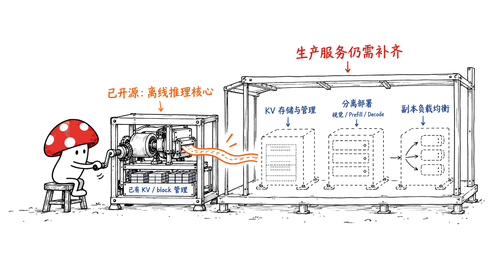
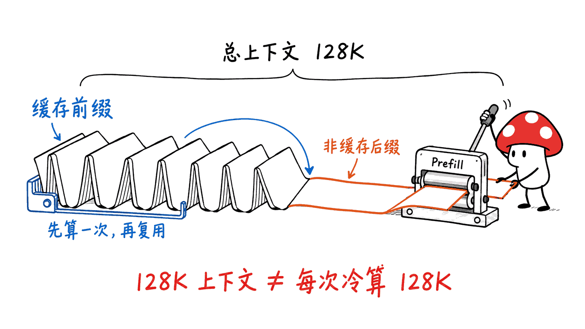
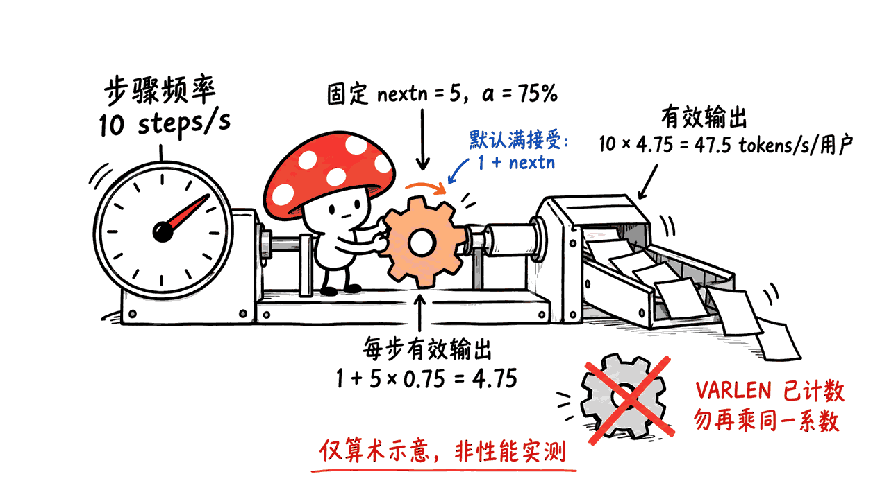

DeepInfer 是把 DeepSeek 模型运行在大规模加速器集群上的推理框架，此次开源提供离线推理核心。正确仓库名是 deepseek-ai/DeepInfer，中间是大写字母 I；项目采用 Apache-2.0，目前官方列出的模型为 DeepSeek-V4.1-Flash。

值得读它，不只是因为“官方生产系统使用过”，还因为它把算子、并行、调度、投机解码与评测方式放在一起公开。但源码可见不等于完整线上服务已经开箱即用，更不能把集群 benchmark 的曲线直接换成个人电脑上的速度。

本文依据 2026 年 10 月 20 日的官方文档，固定源码版本：774ce244b87cc0eb8d4b94ab9f5de2ab22049f01。我们只做源码与指标口径复核，没有安装推理引擎、下载权重或执行 GPU／NPU 性能测试。

仓库：https://github.com/deepseek-ai/DeepInfer
官方部署问答：https://github.com/deepseek-ai/DeepInfer/blob/774ce244b87cc0eb8d4b94ab9f5de2ab22049f01/doc/inference_deployment_qa.md

## 开源的是哪一部分，完整服务还差什么？

当前发布包含模型与采样运行时、优化算子、分布式并行和离线调用接口。官方说明它主要从 vLLM 发展而来，也参考 SGLang、TensorRT-LLM；不能因此将它视为对所有模型、设备和服务接口都保持相同兼容性的替代品。

官方同时列出完整服务需要补齐的内容：KV cache 系统、视觉编码／Prefill／Decode 分离部署，以及 Prefill 和 Decode 各数据并行副本间的负载均衡。部分引擎能力已有实现，但完整生产基础设施没有随这次发布全部开放。

这里的“缺 KV cache 系统”，指官方生产级缓存管理与存储体系，不是说模型执行时完全没有 KV 或 block 管理。分清引擎内存管理和跨请求、跨节点的持久缓存服务，才不会误读开源范围。



官方另有 deepseek-recipe，用于 API 协议与模型 token 序列之间的编码解码。协议转换组件、推理内核与线上服务编排各有职责，拥有其中一个不能自动替代另外两个。

## 哪些硬件可以按官方路径部署？

| 项目 | 官方当前要求或支持范围 |
| --- | --- |
| 操作系统与编译器 | Linux、GCC 13或更新 |
| Python | 文档安装路径使用3.12 |
| NVIDIA | SM100 GPU、CUDA 13 |
| 昇腾 | Ascend 950、CANN 9.2 |
| 默认模型 | deepseek-ai/DeepSeek-V4.1-Flash-1017 |

这是面向特定加速器与分布式基础设施的工程项目。硬件显存、并行规模、通信域和互联带宽都会影响能否运行以及运行效率，不能仅凭“也是 NVIDIA 显卡”就假定满足要求。我们的 Apple Silicon 环境不在官方推理运行范围内。

官方部署问答建议大规模 Decode 使用 Wide-EP，典型为 EP64–128；其“高效部署单元”的建议甚至是64张Prefill加64张Decode。这是生产效率建议，不是所有离线示例一律要128张卡的最低启动门槛。离线实例应按实际模型、内存和拓扑验证。

## 它把推理优化放在哪些层？

算子层复用 FlashMLA、DeepGEMM、DeepEP、TileKernels、DeepSelect 及 TileLang 算子。上层通过 Attention DP／balanced CP、MoE EP 与 EPLB 组织计算和通信，让不同阶段选择合适的并行方式。

DP 是请求侧的数据并行，EP 把 MoE 专家分散到设备上，EPLB 负责缓解专家负载不均，CP 用于上下文并行。框架支持某项并行能力，不代表官方线上部署就一定启用；部署问答明确说其当前生产配置不使用 TP、CP。

调度层默认把 CPU 批调度与设备执行重叠。README 的“zero-overhead batch scheduler”应理解为减少调度暴露在关键路径上的目标与设计，不应转述为在任何负载下 CPU 都没有成本。

DSpark 则结合草稿 token 与置信度调度校验：给更有希望被接受的候选分配验证计算。它减少的是验证浪费，真实收益仍依赖接受率、batch、硬件和模型行为。

## SWA bounded replay是不是让所有长上下文都不用重算？

不是。这里针对特定模型结构，用有限后缀重建相关滑动窗口注意力状态，而不是把全部历史上下文处理变成常数开销。

README 给出的默认配置是 compact 模式并保留140个token，要求覆盖SWA窗口与最大回退长度。部署问答讨论的128token窗口及其缓存管理细节属于另一层描述，不能把这些数字不加条件地互换。

benchmark 的输入也区分缓存前缀与非缓存后缀：先计算共享前缀，再为请求分支计算剩余部分。因此，一张标“128K context”的吞吐图，不一定表示每个请求都从零完整处理128K token。



## 官方性能图表应该怎样读？

README 的 Prefill 图在4张SM100上测得，Decode 图在64张SM100上测得，各自在同一scale-up通信域内。这两个阶段的设备规模不同，不能从两张图推导同一台机器的端到端性能。

至少核对以下口径：

| 指标 | 具体含义 | 容易误读的地方 |
| --- | --- | --- |
| Prefill tokens/s/GPU | 非缓存输入吞吐，按设备归一化 | 不代表完整上下文冷启动吞吐 |
| Decode avg_SPS | 稳态解码步骤数/秒 | 步骤数不等于输出token数 |
| 每用户token/s | 按每步有效输出换算的交互速度 | 不能用全请求汇总值代替 |
| Decode tokens/s/GPU | 按batch、CP等条件换算 | 草稿全接受口径不等于真实接受率 |

benchmark 的默认 decode 计数使用每步 `1 + nextn` 个token，属于满接受口径。固定长度草稿绘图函数另用 `τ = 1 + nextn × a`，其中 a 是传入的逐token草稿接受率。VARLEN 模式下，原脚本明确禁止再套同一系数，以免重复计算。



我们在CPU上直接加载未经修改的官方绘图模块，用合成记录跑了六项检查：满接受系数、指定接受率换算、VARLEN防重复换算、重复扫描点取最新记录、混合配置拒绝，以及Prefill窗口延迟计算。

例如，假设输入为每秒10步、每rank64请求、CP=1、nextn=5，接受率75%时，函数算出每用户47.5 token/s、每GPU3040 token/s。这里只是合成输入的算术演示，不是DeepInfer实测速度。

官方脚本还区分 warmup、稳态、负载均衡统计刷新与 profiler 区段。trace 中的 step 时间受 profiler 扰动，不应直接用于换算服务速度。比较其他框架时，应保留原始JSONL并对齐设备、互联、缓存、输入输出、接受率与测量窗口。

## 从源码启动的正确顺序是什么？

在满足官方硬件和驱动条件的Linux机器上，先创建干净的Python 3.12环境，再按对应后端构建：

```bash
git clone https://github.com/deepseek-ai/DeepInfer.git
cd DeepInfer
git checkout 774ce244b87cc0eb8d4b94ab9f5de2ab22049f01
python3.12 -m venv .venv
source .venv/bin/activate
export DEEPINFER_ACCELERATOR=nvidia
./build.sh
python examples/offline_inference.py
```

昇腾按官方说明选择 `ascend` 后端。构建脚本会安装平台依赖、编译随仓库提供的算子和扩展，NVIDIA 路径还会安装指定 NCCL 版本。因此应使用独立环境，不要把这段命令当成一个纯Python、无底层依赖的小工具。

默认首次运行会把模型下载到Hugging Face缓存。已有本地权重时可设置 `DEEPINFER_HF_MODEL_DIR`；它影响默认模型路径，不能覆盖显式传入的其他 `--model_name`。这些是官方部署步骤，本文没有在本机完成它们。

先验证小规模离线正确性，再测试对应硬件的PPL、结构化输出、长上下文，最后考虑多节点部署。不要一开始就将离线推理接口包成公网API，然后假设生产级缓存、路由与故障恢复已经齐备。

## 确定性和结构化输出有哪些条件？

NVIDIA 路径下，官方给出的确定性组合是开启 `DEEPINFER_BATCH_INVARIANT=1`、关闭 `DEEPINFER_ENABLE_MTP_VARLEN`，并为 `SamplingParams` 提供固定 `seq_seed`。不能只设一个随机种子，就把跨batch、跨平台完全一致视为已验证承诺。

结构化输出支持正则、JSON Schema和EBNF约束。它解决输出格式符合约束的问题，不自动证明字段内容真实、工具参数有权限或业务决策正确。生产接入仍需语义校验。

评测目录提供AIME 2026、HLE和GPQA Diamond的离线流程，生成与评分分离。AIME每题32样本、GPQA每题8样本的Pass@1是按样本平均准确率计算，不是“多试几次只要中一次就算正确”。这同样需要在比较模型结果时对齐。

## 常见问题

### DeepInfer是新模型权重吗？

不是。这是推理框架；当前默认权重另从DeepSeek-V4.1-Flash-1017获取，模型许可与框架许可也应分别查看。

### 开源后能直接复制DeepSeek完整线上服务吗？

不能。官方明确列出缓存、分离部署和副本负载均衡等缺口，协议转换也有独立组件。离线核心与完整运营平台之间仍有工程工作。

### 这篇给出了本地跑分吗？

没有。本机只验证了六项绘图与指标计算行为，没有运行模型、CUDA／CANN算子、集群性能或真实服务负载。

## 一手资料与延伸阅读

项目README：https://github.com/deepseek-ai/DeepInfer/blob/774ce244b87cc0eb8d4b94ab9f5de2ab22049f01/README.md
示例与指标：https://github.com/deepseek-ai/DeepInfer/blob/774ce244b87cc0eb8d4b94ab9f5de2ab22049f01/examples/README.md
绘图换算：https://github.com/deepseek-ai/DeepInfer/blob/774ce244b87cc0eb8d4b94ab9f5de2ab22049f01/examples/sweep/plot_pareto.py
部署问答：https://github.com/deepseek-ai/DeepInfer/blob/774ce244b87cc0eb8d4b94ab9f5de2ab22049f01/doc/inference_deployment_qa.md
评测说明：https://github.com/deepseek-ai/DeepInfer/blob/774ce244b87cc0eb8d4b94ab9f5de2ab22049f01/eval/README.md
相关工程阅读：https://blog.mushroom.cv/blog/strix-halo-halogen-gufo-prefill/

封面是原创集群硬件概念图，正文配图用于说明边界，不是本次运行的集群照片。核验日期：2026-10-20；没有推理速度、质量或硬件兼容性实测。

---

> © 2026 Author: Mycelium Protocol. 本文采用 [CC BY 4.0](https://creativecommons.org/licenses/by/4.0/deed.zh) 授权——欢迎转载和引用，须注明作者姓名及原文链接，不得去除署名后以原创发布。

<!--EN-->

DeepInfer is DeepSeek's inference framework for large accelerator deployments. The public release provides an offline inference core, not the entire production serving platform. The correct repository is deepseek-ai/DeepInfer, with a capital I; the framework is Apache-2.0, and its currently listed model is DeepSeek-V4.1-Flash.

Its value is the combination of kernels, parallelism, scheduling, speculative decoding, and measurement tooling. Availability of production-derived source does not establish a turnkey service or personal-computer performance.

We reviewed official documentation and pinned source 774ce244b87cc0eb8d4b94ab9f5de2ab22049f01 on October 20, 2026. We did not install the inference engine, download weights, or benchmark GPUs/NPUs.

Repository: https://github.com/deepseek-ai/DeepInfer
Official deployment Q&A: https://github.com/deepseek-ai/DeepInfer/blob/774ce244b87cc0eb8d4b94ab9f5de2ab22049f01/doc/inference_deployment_qa.md

## What is included, and what remains outside?

The release includes optimized kernels, model and sampler runtimes, distributed execution, and offline entry points. DeepSeek acknowledges its origins primarily in vLLM, with inspiration from SGLang and TensorRT-LLM. That does not imply identical compatibility across models, devices, and service APIs.

The README explicitly lists additional requirements for a complete service: a KV cache system, Vision Encoder/Prefill/Decode disaggregation, and load balancing across prefill and decode data-parallel replicas. Much engine-side functionality exists, but the complete production infrastructure is not fully released.

The cache gap concerns production management and storage, not an assertion that model execution uses no KV or block management. Separate engine memory mechanisms from cross-request, cross-node persistent cache services.


DeepSeek Recipe is a separate protocol/token encoding and decoding component. Protocol conversion, inference execution, and service orchestration have distinct responsibilities.

## Which hardware follows the documented path?

| Component | Current official requirement or support |
| --- | --- |
| OS/compiler | Linux, GCC 13 or newer |
| Python | Documented setup uses 3.12 |
| NVIDIA | SM100 GPUs, CUDA 13 |
| Huawei | Ascend 950, CANN 9.2 |
| Default checkpoint | deepseek-ai/DeepSeek-V4.1-Flash-1017 |

Memory capacity, parallel scale, communication domains, and interconnects determine feasibility and efficiency. A generic NVIDIA label is insufficient. Our Apple Silicon environment is outside the documented inference hardware.

The deployment Q&A recommends Wide-EP, typically EP64–128, for large-scale decode. Its efficient production unit can be 64 prefill GPUs plus 64 decode GPUs. This is an efficiency recommendation, not a universal 128-device minimum for every offline example. Validate the actual checkpoint, memory, and topology.

## Where do the optimizations sit?

Kernels include FlashMLA, DeepGEMM, DeepEP, TileKernels, DeepSelect, and custom TileLang work. Attention DP/balanced CP and MoE EP with EPLB organize computation and communication.

DP handles data-parallel requests, EP distributes experts, EPLB mitigates expert imbalance, and CP handles context parallelism. Supported capability is not a production configuration: the Q&A says its current production deployment uses neither TP nor CP.

Asynchronous scheduling overlaps CPU batch preparation with device execution by default. The “zero-overhead” label describes reducing exposed scheduling overhead; it should not be expanded into a universal zero-CPU-cost promise.

DSpark uses draft tokens and confidence-scheduled verification to allocate verification work more efficiently. Benefits depend on acceptance, batches, model behavior, and hardware.

## Does bounded replay eliminate long-context computation?

No. It rebuilds specific sliding-window attention state from a bounded suffix for the relevant architecture. It does not turn every operation over the full context into constant work.

The README's default configuration uses compact replay with 140 retained tokens, covering the SWA window and maximum backtracking. The Q&A's 128-token window discussion describes a different layer of that mechanism; those values are not interchangeable without their conditions.

The benchmark also separates a cached prefix from a non-cached suffix. It computes a shared prefix and forks requests for the remaining work. A “128K context” curve therefore need not describe a fresh 128K prefill for every request.


## How should the benchmark curves be read?

The README reports four SM100 GPUs for prefill and 64 for decode, each within a single scale-up domain. They are different stage configurations, not one machine's end-to-end result.

| Metric | Meaning | Limit |
| --- | --- | --- |
| Prefill tokens/s/GPU | Non-cached input throughput per device | Not necessarily cold full-context work |
| Decode avg_SPS | Steady-state steps per second | Steps are not output tokens |
| Per-user token speed | Effective outputs per step applied to step rate | Not aggregate concurrency throughput |
| Decode tokens/s/GPU | Batch/CP-adjusted token accounting | Full draft acceptance differs from actual acceptance |

Default decode reporting accounts for `1 + nextn` tokens per step, assuming full acceptance. Fixed-length draft plotting instead supports `tau = 1 + nextn × a`, where a is the supplied per-token draft acceptance. The original helper rejects that multiplier for VARLEN records, preventing double counting.


We loaded the unmodified plotting module on CPU and exercised six checks with synthetic records: full acceptance, specified acceptance conversion, the VARLEN guard, latest duplicate sweep points, mixed-configuration rejection, and prefill window latency.

For an illustrative input of ten steps/s, 64 requests per rank, CP=1, nextn=5, and 75% acceptance, it computes 47.5 tokens/s/user and 3,040 tokens/s/GPU. These are synthetic arithmetic examples, not measured DeepInfer performance.

Warmup, steady-state windows, load-balancer statistics flushes, and profiler segments are handled separately. Trace step durations include profiler disturbance and should not be used directly to infer service speed. Preserve raw JSONL and align devices, interconnects, caching, workload, acceptance, and measurement windows before comparing frameworks.

## What is the documented deployment sequence?

On a supported Linux host with matching hardware and drivers:

```bash
git clone https://github.com/deepseek-ai/DeepInfer.git
cd DeepInfer
git checkout 774ce244b87cc0eb8d4b94ab9f5de2ab22049f01
python3.12 -m venv .venv
source .venv/bin/activate
export DEEPINFER_ACCELERATOR=nvidia
./build.sh
python examples/offline_inference.py
```

Use the documented `ascend` backend for Ascend. The build script installs platform packages, compiles vendored operators and extensions, and pins an NCCL version on NVIDIA. Use an isolated environment; this is not a dependency-free Python utility.

The default model downloads into the Hugging Face cache on first run. `DEEPINFER_HF_MODEL_DIR` can point the default to local weights but does not override another explicit `--model_name`. These are reader instructions; we did not execute this deployment.

Validate offline correctness, platform-specific PPL, structured output, and long contexts before attempting multi-node serving. Adding an HTTP wrapper does not supply the missing cache, routing, and recovery infrastructure.

## What conditions apply to determinism and structured output?

For NVIDIA, the documented deterministic combination enables `DEEPINFER_BATCH_INVARIANT=1`, disables `DEEPINFER_ENABLE_MTP_VARLEN`, and supplies a fixed `seq_seed` through `SamplingParams`. A seed alone does not establish cross-batch or cross-platform identity.

Regex, JSON Schema, and EBNF constrain output format. They do not prove content truth, tool authorization, or business correctness; semantic validation remains separate.

Evaluation tooling covers AIME 2026, HLE, and GPQA Diamond with generation separated from scoring. AIME uses 32 samples per task and GPQA eight; reported Pass@1 averages per-sample accuracy. It is not an “any one of many attempts succeeds” metric. Align that definition when comparing results.

## Frequently asked questions

### Is DeepInfer a new set of model weights?

No. It is an inference framework. Default weights come from DeepSeek-V4.1-Flash-1017 separately; inspect model and framework licenses separately.

### Does the release reproduce DeepSeek's whole online service?

No. The official list identifies cache, disaggregation, and replica-load-balancing gaps. Protocol conversion is also a separate component.

### Did this report benchmark inference locally?

No. We checked six plotting/accounting behaviors on synthetic inputs, without running the model, CUDA/CANN operators, cluster performance, or real serving traffic.

## Primary sources

README: https://github.com/deepseek-ai/DeepInfer/blob/774ce244b87cc0eb8d4b94ab9f5de2ab22049f01/README.md
Examples and metrics: https://github.com/deepseek-ai/DeepInfer/blob/774ce244b87cc0eb8d4b94ab9f5de2ab22049f01/examples/README.md
Plotting conversion: https://github.com/deepseek-ai/DeepInfer/blob/774ce244b87cc0eb8d4b94ab9f5de2ab22049f01/examples/sweep/plot_pareto.py
Deployment Q&A: https://github.com/deepseek-ai/DeepInfer/blob/774ce244b87cc0eb8d4b94ab9f5de2ab22049f01/doc/inference_deployment_qa.md
Evaluation: https://github.com/deepseek-ai/DeepInfer/blob/774ce244b87cc0eb8d4b94ab9f5de2ab22049f01/eval/README.md
Related engineering reading: https://blog.mushroom.cv/blog/strix-halo-halogen-gufo-prefill/

The cover is an original cluster-hardware concept, not a photograph of equipment used in this research. Body illustrations explain boundaries. Checked October 20, 2026; no inference speed, quality, or hardware compatibility benchmark was performed.

---

> © 2026 Author: Mycelium Protocol. Licensed under [CC BY 4.0](https://creativecommons.org/licenses/by/4.0/) — free to share and adapt with attribution. You must credit the author and link to the original; removing attribution and republishing as original is not permitted.
