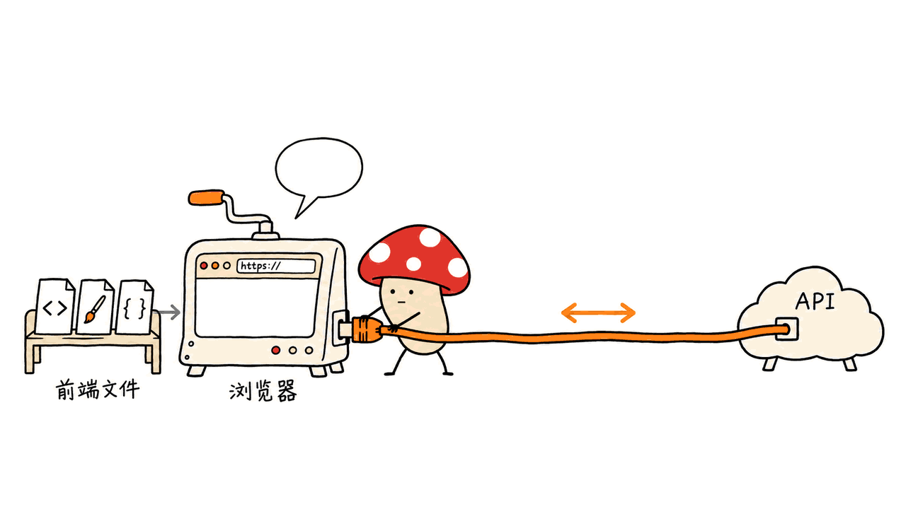
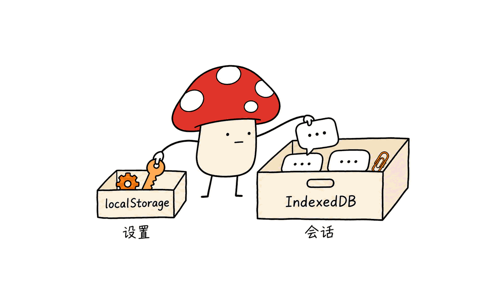
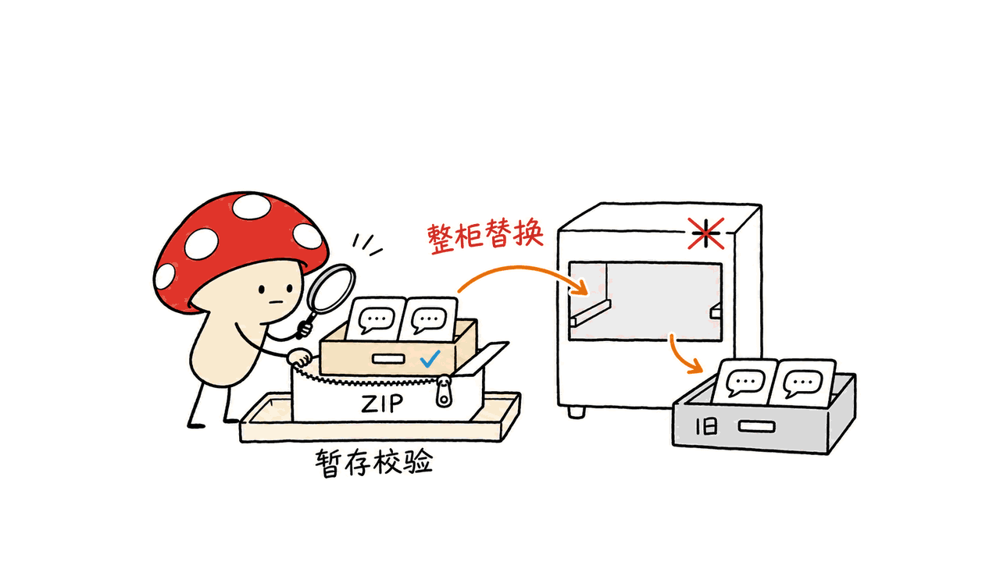

DeepSeek chat-demo 是官方提供的静态聊天前端，不需要你另外搭建聊天应用服务器。浏览器会直接连接配置的API服务，模型生成、文件上传与语音处理仍依赖相应服务；“零应用后端”没有消除这些依赖和使用成本。

官方仓库：https://github.com/deepseek-ai/chat-demo 。本次核对v0.1.1，固定提交 `5d5dd754ebc1948e977ddb880a9eb5aa25f37b4c`，采用MIT许可。我们完成本地构建、TypeScript检查，以及使用虚构密钥和模拟SSE响应的浏览器检查，没有向真实DeepSeek服务发送测试请求。

## “纯静态”具体省掉了什么？

前端使用React、Zustand和Rspack，构建后输出dist目录。你可以将它放在静态托管上，浏览器负责界面、会话组织和本地数据存储，不必为了这些功能自建登录、数据库和聊天转发服务器。

文档列出的界面能力包括多会话、编辑与重新生成、消息分支、停止或续写，以及Markdown、代码高亮、KaTeX公式和Mermaid图表。中英双语、主题和移动布局也在同一前端中，适合作为个人API工作台或二次开发样本；这些完整功能没有在本次逐项复测。

但API端仍负责实际生成与相关服务。发送消息、上传附件、语音输入和朗读会把对应内容发往配置的API地址。本地保存历史与向服务发送内容可以同时发生，不能将它宣传成全部数据都留在设备内的离线应用。



对个人而言，自带密钥、自己管理浏览器数据的方式比较直接。若要给团队提供统一额度、成员权限、审计或共享密钥，则需要另外设计受控网关和身份管理；仓库没有因为是官方示例，就自动提供这些企业服务。引入网关后的部署也应如实称为新增了服务端组件。

## 怎么运行，是否只有一个HTML？

官方在线体验：https://deepseek-ai.github.io/chat-demo/

可从实际仓库的Releases页面下载发行包，解压后打开index.html；也可以从源码构建。应保留整个发行目录或dist目录，里面还有脚本、样式、字体等资源，不能把“静态网站”理解成只搬走一个HTML文件。

```bash
git clone https://github.com/deepseek-ai/chat-demo.git
cd chat-demo
git checkout 5d5dd754ebc1948e977ddb880a9eb5aa25f37b4c
pnpm install --frozen-lockfile
pnpm dev
```

README要求Node.js22.12+和pnpm，开发地址为http://localhost:8090。pnpm build生成dist。直接双击文件还取决于浏览器是否允许file页面存储，以及API是否接受该来源的跨域请求；我们没有验证真实API的file来源兼容性。

MDN也说明file URL下的localStorage行为没有统一保证。长期使用时，固定一个可信的本地或HTTPS站点来源更容易管理数据；换协议、域名、端口或浏览器配置文件后，历史不会自动跟随过去。

## 为什么换一个API地址不一定就能用？

rspack.config.ts通过createConfig的apiOrigin在构建期注入API地址，默认https://api.deepseek.com。替换默认服务需要调整配置并重建，不能假定设置界面已经提供任意端点切换。

聊天默认使用deepseek-flash，通过Anthropic兼容的Messages接口发送流式请求，附件走Files接口。客户端还使用搜索、读链接、标题和latest_reminder等扩展，语音则走ASR/TTS接口。只支持普通Chat Completions文本问答的网关，未必能接住这套协议和功能。

服务方还要允许跨域请求及相应鉴权头。把浏览器请求转到一个名称相似的兼容服务，不能证明附件、搜索、语音和流式错误处理都已兼容。适配时应按功能逐项验证，而不是只看首次文本返回是否成功。

## 密钥和聊天记录究竟存在哪里？

| 内容 | 本地位置 | 使用时的含义 |
|---|---|---|
| API Key、语言、主题等设置 | localStorage | 页面脚本能读取，按浏览器来源和配置文件隔离 |
| 会话、消息分支、附件原件 | IndexedDB | 清站点数据、换配置文件或存储异常可能影响可用性 |
| 已发出的消息、附件和语音 | 配置的API服务 | 本地存储不能代替对远程处理与保留策略的核对 |



代码直接将密钥写入localStorage，它不是一个能向页面脚本隐藏密钥的保险箱。个人应确认自己信任所使用的页面和来源；公共部署者也不能把一把公司共享密钥写进前端包，并期待访问者无法提取。为多用户保管服务密钥，需要改变密钥所在的信任边界。

“删除全部聊天”清理的是本地会话、附件原件和未发送草稿，会停止正在进行的回复，但保留API Key和设置。README明确说明，已上传到API服务的文件不会因此被删除；需要远程删除或数据保留保证时，应另行核对服务能力。

## ZIP备份是否能恢复所有内容？

当前历史格式是export_format_version:3的ZIP，导出会话消息树与本地仍存在的图片原件，不包含API Key、应用设置和非图片附件原件。非图片附件可以保留元数据，但导出包不能被当成所有原始资料的完整备份。

导入属于整体替换，用户确认并完成校验后会替换全部本地会话与附件，不是追加合并。代码先写暂存区，再在事务中提交；校验或提交失败应保留原有正式记录。导入前保留当前数据的独立副本，能降低选错归档带来的损失。

文档也列出格式转换中不能完整保留的运行状态。需要长期归档的人，应核对附件原件、来源材料和设置是否有独立副本；不要仅凭“导出成功”判断以后能完整恢复工作环境。本次没有实际测试ZIP导入、图片和文档附件迁移。



## 我们实际验证了什么？

在临时克隆目录中，按锁文件安装依赖后，pnpm type和pnpm build通过，dist中也保留了LICENSE。运行源码没有修改，未安装或配置到现有生产应用中。

浏览器检查使用隔离Chrome157与本地静态服务，阻断外部HTTPS请求，并在页面内注入模拟API响应。通过界面输入虚构密钥，模拟/models校验，再发送一条测试提问，前端显示了分片SSE组成的“LOCAL TEST RESPONSE”。刷新后检查IndexedDB，测试会话和回复仍在，localStorage也保留了虚构密钥。

这验证了选定前端路径的密钥保存、流式显示与本地持久化。测试回复完全来自本地夹具，不能当作DeepSeek模型输出，也没有验证真实鉴权、网络CORS、额度、搜索、附件或语音服务。刷新后默认打开新聊天，历史条目仍在；测试数据库读回与自动恢复上次界面是两项不同检查。

## 常见问题

### “零后端”是否等于免费、离线聊天？

不等于。无需自建应用后端，仍要有可用API、账号权限及相应服务额度。没有网络时，本地历史与界面可用到什么程度，要与生成、上传和语音功能分别验收。

### 能直接拿来做企业共享聊天平台吗？

它提供了可研究的界面和本地会话实现，但没有替你完成统一身份、成员权限、服务密钥托管、配额与跨设备同步。团队场景应按自己的数据和管理要求补充架构，不能直接继承“零后端”假设。

### 开发者最值得先读哪些代码？

先看services/api的请求、SSE和错误分类，再看services/chat的消息树、数据库和备份模块。明确协议与本地状态后，再修改React界面。流式回复中断、分支选择、数据迁移和删除语义，都比把聊天框画出来更需要验收。

## 来源与验证范围

官方仓库：https://github.com/deepseek-ai/chat-demo

实际仓库发行页：https://github.com/deepseek-ai/chat-demo/releases

在线体验：https://deepseek-ai.github.io/chat-demo/

固定版本：https://github.com/deepseek-ai/chat-demo/tree/5d5dd754ebc1948e977ddb880a9eb5aa25f37b4c

历史格式：https://github.com/deepseek-ai/chat-demo/blob/5d5dd754ebc1948e977ddb880a9eb5aa25f37b4c/src/services/chat/history/README.md

localStorage说明：https://developer.mozilla.org/en-US/docs/Web/API/Window/localStorage

本文为Mycelium Protocol基于源码与受限本地检查的独立分析；不将模拟回复、类型检查或构建通过当成真实服务能力证明。

---

> © 2026 Author: Mycelium Protocol. 本文采用 [CC BY 4.0](https://creativecommons.org/licenses/by/4.0/deed.zh) 授权——欢迎转载和引用，须注明作者姓名及原文链接，不得去除署名后以原创发布。

<!--EN-->

DeepSeek chat-demo is an official static chat frontend that needs no separately deployed application server. The browser still calls the configured API for generation, uploads and speech. Removing the application backend does not remove those dependencies or service usage costs.

Official repository: https://github.com/deepseek-ai/chat-demo . We reviewed MIT-licensed v0.1.1 at `5d5dd754ebc1948e977ddb880a9eb5aa25f37b4c`, built it, ran TypeScript checks and exercised a synthetic browser API/SSE fixture. No real DeepSeek request or key was used.

## What does static deployment remove?

React, Zustand and Rspack produce a dist directory that can be served by a static host. The browser organizes the interface, conversations and local persistence without requiring your own login, database or chat relay server for the supplied personal workflow.

The documented UI includes multiple conversations, editing/regeneration, branches, stop/continue controls, Markdown, code highlighting, KaTeX and Mermaid. Language, theme and mobile layouts make it a useful personal API workbench and development sample; this review did not retest that entire feature list.

Generation and related capabilities still live at the API service. Sending messages, uploading attachments and using speech sends relevant content there. Local history and remote processing coexist; this is not an entirely offline application.


Personal bring-your-own-key use is straightforward. Team identity, quotas, auditing and shared-key custody require additional design. An official demo does not automatically provide these services; adding a controlled gateway introduces a server-side component and should be described accordingly.

## Is it just one HTML file?

Online app: https://deepseek-ai.github.io/chat-demo/

Use the actual repository’s Releases page for archives, or build the source. Preserve the entire extracted release or dist directory, including scripts, styles and fonts. A static site does not mean that index.html can be moved alone.

```bash
git clone https://github.com/deepseek-ai/chat-demo.git
cd chat-demo
git checkout 5d5dd754ebc1948e977ddb880a9eb5aa25f37b4c
pnpm install --frozen-lockfile
pnpm dev
```

The README requires Node.js22.12+ and pnpm; development runs at http://localhost:8090 . pnpm build writes dist. Opening index.html directly also depends on file-origin storage support and the API’s cross-origin policy. We did not validate a real API from file URLs.

MDN documents that file-URL localStorage behavior is not guaranteed. A stable, trusted local or HTTPS origin is easier to manage for regular use. Changing protocol, domain, port or browser profile does not automatically carry the stored history over.

## Why is changing the API address insufficient?

rspack.config.ts injects apiOrigin at build time via createConfig, defaulting to https://api.deepseek.com . Change that configuration and rebuild for a different default service; do not assume the settings UI supports arbitrary runtime endpoint selection.

The default model is deepseek-flash. Chat uses Anthropic-compatible Messages, attachments use Files, and requests include DeepSeek extensions for search, link reading, titles and latest_reminder. Speech uses ASR/TTS endpoints. A gateway supporting only ordinary Chat Completions text requests may not implement these capabilities.

The service must also accept the relevant cross-origin requests and authentication headers. One successful text response does not establish upload, search, speech or streaming-error compatibility. Validate each capability separately.

## Where are keys and conversations stored?

API keys, locale, theme and other settings use localStorage. Conversations, message branches and original attachments use IndexedDB. Both are scoped to browser profile and origin; clearing site data or moving profiles affects access. Messages and files already sent to the API follow the service’s separate processing and retention behavior.


The app writes the key directly to localStorage. Page scripts can read it; this is not custody that hides a secret from the frontend. Use a page and origin you trust. A public deployer cannot safely conceal a company-wide secret by embedding it in a frontend bundle. Holding service credentials for multiple users requires a different trust boundary.

Delete all chats clears local conversations, original attachments and unsent drafts and stops replies, while preserving the key and settings. The README explicitly says uploaded service-side files are not deleted by this action. Verify remote deletion and retention separately when required.

## Does the ZIP preserve everything?

The current export_format_version:3 ZIP contains conversation trees and locally available original images. It excludes API keys, settings and original non-image attachments. Non-image metadata can remain, but this is not a complete backup of all original materials.

Import replaces local conversations and attachments after confirmation and validation; it does not merge them. The implementation stages data before a transaction replaces the live stores. Validation or commit failure should preserve previous live records. Keep an independent current copy before importing an archive.

The format documentation lists further runtime-state conversion limits. For long-term archives, verify source attachments, original materials and settings separately. We did not exercise ZIP import or image/document migration in this review.


## What did our local check establish?

Dependency installation from the lockfile, pnpm type and pnpm build passed in a temporary clone. The build included LICENSE. Runtime source remained unchanged, and the app was not installed into an existing production deployment.

An isolated Chrome157 session used a local static server with external HTTPS blocked and a synthetic API response injected in the page. A fictitious key was entered through the UI, /models validation was simulated, and a test prompt received chunked SSE displaying “LOCAL TEST RESPONSE.” After reload, IndexedDB retained the session and response and localStorage retained the fictitious key.

This checks selected frontend key, streaming-display and persistence behavior. The response came entirely from a fixture. No real model output, authentication, CORS, quota, search, attachments or speech was validated. Reload opens a new-chat view while history remains listed; database persistence and automatic restoration of the previous view are different checks.

## FAQ

### Does zero backend mean free offline generation?

No. The application host can be static, but usable APIs, access rights and service quota are still needed. Evaluate offline history/UI separately from generation, upload and speech.

### Is it already an enterprise shared-chat platform?

It provides inspectable UI and local conversation code, not completed team identity, permissions, service-key custody, quotas or cross-device synchronization. Design those around your actual requirements rather than carrying the zero-backend assumption into a different product.

### Which code should developers read first?

Read services/api for requests, SSE and error classification, then services/chat for message trees, storage and backups. Understand protocol and state before modifying React views. Interrupted streams, branch selection, migration and deletion semantics need explicit acceptance checks.

## Sources and scope

Official repository: https://github.com/deepseek-ai/chat-demo

Actual Releases page: https://github.com/deepseek-ai/chat-demo/releases

Online demo: https://deepseek-ai.github.io/chat-demo/

Pinned revision: https://github.com/deepseek-ai/chat-demo/tree/5d5dd754ebc1948e977ddb880a9eb5aa25f37b4c

History format: https://github.com/deepseek-ai/chat-demo/blob/5d5dd754ebc1948e977ddb880a9eb5aa25f37b4c/src/services/chat/history/README.md

Storage reference: https://developer.mozilla.org/en-US/docs/Web/API/Window/localStorage

Mycelium Protocol’s independent analysis uses source inspection and bounded local checks. A synthetic response, successful type check or build is not proof of real service capability.

---

> © 2026 Author: Mycelium Protocol. Licensed under [CC BY 4.0](https://creativecommons.org/licenses/by/4.0/) — free to share and adapt with attribution. You must credit the author and link to the original; removing attribution and republishing as original is not permitted.
