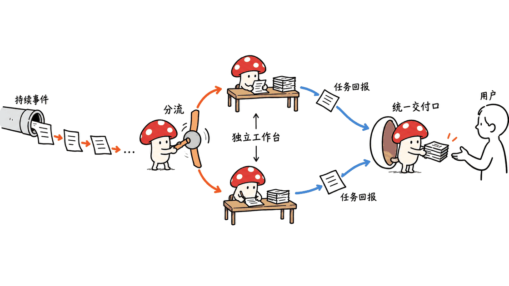
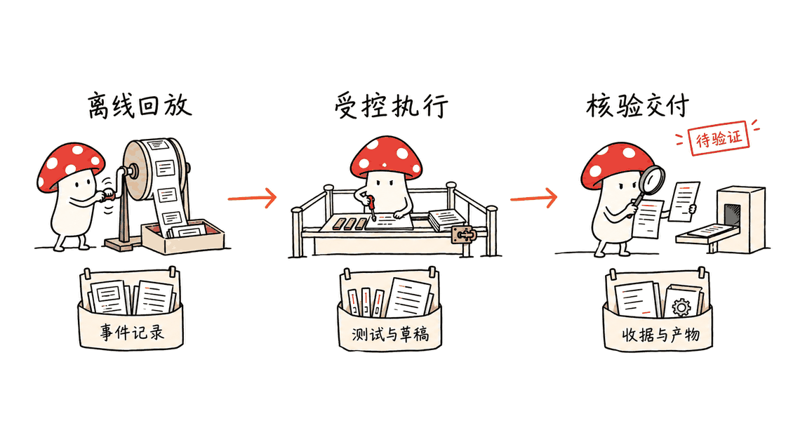

Super-agent要解决的，是让Agent持续接收事件、并行推进任务，同时减少人类维护会话和转述上下文的工作。工程落点包括路由、授权、持久状态和交付恢复，不能只理解为多开几个子Agent。

DeepSeek官方组织已经公开MIT原型 `dsh-superagent-prototype`。它明确声明：这是研究代码，不是正式产品，与内部版本和文章描述并不完全一致，部分设想尚未实现。

官方原型：https://github.com/deepseek-ai/dsh-superagent-prototype

Harness官网：https://www.deepseek.com/en/harness/

相关底座源码：Harness主仓库负责宿主与插件运行，Cordis是其采用的插件框架上游；它们与研究原型不是同一个项目。

https://github.com/deepseek-ai/deepseek-harness

https://github.com/cordiverse/cordis

本次固定核查提交 `6337fc823ce20251c8de8085948165c81aaa701e`，日期为2026年10月31日。封面为路由与持久执行的概念配图，不是DeepSeek实际部署照片。

## 原文找到了吗，哪些内容能直接核实？

《Super-agent设计探索：迈向更自主的Agent系统》的入口追溯到以下公众号链接。不过，本次直接抓取和Reader读取均遇到访问验证，没有取得公众号正文；DeepSeek官网新闻页和站点地图也暂未找到该文的独立全文页面。

公众号入口：https://mp.weixin.qq.com/s/zoS7GlReWPhfCjENGxXCdg

全文对照采用署名“DeepSeek产品部”、文末标明Yujia Qiao参与实现与写作的转载，再与官方仓库的README、领域文档及源码交叉核对。这里不把转载域名说成DeepSeek官网，也不把设计讨论说成Harness已经上线的全部能力。

全文转载：https://www.chaincatcher.com/article/2300676

下文分三层：原文的架构思路，公开原型已经落到代码的部分，以及本文新增的工程建议和离线练习。

## 应该复制的是怎样的职责分工？

公开原型把面向人的连续交互交给主Session，把具体工作放进独立Worker上下文；事件先经过程序筛选，再决定是否需要模型判断。已有任务订阅的后续事件，可以直接送往相关Worker，避免每条消息都让全局协调者重新分派。

公开代码将这些概念进一步细化：

| 对象 | 它回答的问题 | 对应源码 |
|---|---|---|
| Trigger | 发生了什么事件，稳定ID是什么？ | `src/core/model.ts` |
| Thread | 哪些事件属于同一段持续讨论？ | `src/core/intake.ts` |
| Policy / Eval | 谁可以发起工作，是否值得接单？ | `src/core/ports.ts`、`evals.ts` |
| Mandate | 这项工作凭什么被允许，范围多大？ | `src/core/model.ts` |
| Ticket | 哪项业务工作正在推进？ | `src/core/tickets.ts` |
| Assignment | 当前哪次执行承接这张工单？ | `src/core/assignments.ts` |

这比单纯保存一个聊天Session更重要。模型会话可以换，执行进程可以重启，但业务工单、授权依据和事件归属需要保持连续。Worker说“准备好了”，也不等于PR已经合并或用户已经验收。

领域模型：https://github.com/deepseek-ai/dsh-superagent-prototype/blob/main/docs/001-domain.md



## “订阅直通”如何避免变成绕过授权？

在公开原型中，新的工作请求经过准入与研判；已经订阅的Thread事件则可能作为上下文进入原有Ticket。**能补充上下文，不等于能扩大授权。**

这点尤其容易在群聊里混淆：允许Agent读一个讨论串，不表示串中每个人都能要求它部署生产系统。代码与文档将Subscription和Mandate分开；需要扩大工作范围时，应该形成新的授权判断，而不是把新消息拼进提示词后默认执行。

还要注意策略变更的语义。原型会使受影响的研判重新处理，并通知运行中的任务；不能笼统宣称“改了策略就已经取消所有旧任务”。如果业务要求立即撤回某项写权限，生产实现还需要把撤回落实到工具调用边界。

工程上可以保留三层独立控制：Source识别事件与身份；Policy决定能否发起或扩大工作；工具适配器限制实际可执行的动作。模型输出只能在这个范围内做选择。

授权说明：https://github.com/deepseek-ai/dsh-superagent-prototype/blob/main/docs/002-authorization.md

## 为什么数据库和Outbox比更多Prompt更关键？

原型的`Engine`是领域对象的统一写入口；`Store`通过SQLite事务保存状态，外部工作交给持久化`Effects`，对外消息还有Outbox收据。它们处理的是“模型已经决定了，但执行中断以后怎么办”。

一条可靠路径应当是：先在同一事务里保存决定和待执行动作，提交后再调用外部系统。不要先发评论、再尝试写数据库，否则中途失败后系统可能连自己做过什么都不知道。

| 故障 | 应保留的事实 | 恢复动作 |
|---|---|---|
| 同一事件重复投递 | 稳定的Source事件ID | 返回已有处理记录 |
| 工单已接、Worker尚未启动 | Ticket和待执行Assignment | 继续原派工，不另建任务 |
| Worker会话被重启 | 执行记录、目录与外部产物 | 先核对，再恢复 |
| 外部发送成功但响应丢失 | 稳定消息ID及待确认收据 | 查询或去重后重试 |
| Worker提交ready | 报告和关联PR状态 | 分别等待交付或验收条件 |

公开GitHub发送适配器已经做了一件具体的事：把消息ID放进HTML标记，并在再次发评论前查找该标记。这是值得保留的对账机制，但不是跨SQLite和GitHub的全局exactly-once事务。

多实例、网络分区或外部平台查询延迟，还可能带来新的竞争条件。不能把单机SQLite的恢复测试，直接换成“云端高可用已经完成”。

关键代码：

https://github.com/deepseek-ai/dsh-superagent-prototype/blob/main/src/app/store.ts

https://github.com/deepseek-ai/dsh-superagent-prototype/blob/main/src/app/effects.ts

https://github.com/deepseek-ai/dsh-superagent-prototype/blob/main/src/sources/github-channel.ts


## 上下文、后台执行与Watchdog如何落地？

原文用Inline、Spill和链式召回讨论按需上下文。落实到工程，可以采用有预算的读取接口：窗口内只保留必要证据与引用，完整材料留在外部，使用稳定ID逐步取回。以下是结合公开代码的实现建议，不要求把所有历史都塞进Router。

源码中的`MasterAssessor`已经提供受限上下文读取和游标等机制。适配时应让每个对象都有稳定ID，读接口限制长度与页数，并把证据引用带回，而不是只给模型一个无法追溯的摘要。

后台执行也应有真实的作业ID、取消接口与完成事件。前台返回“已启动”只能说明接单，不代表任务成功；耗时命令的最终状态需要重新进入事件流。

至于Watchdog，文章讨论的是主系统之外的独立控制回路，还可以检查任务是否取得实质进展。原型的健康状态、重试和恢复代码，不能自动等同于这套语义级Watchdog已经完整实现。

建议先监控确定性指标：队列最老等待时间、重试次数、最近一次可验证产物、预算和任务阶段。需要模型判断偏航时，再让独立审查器读取这些证据；对重启、停工和改策略设置权限与次数上限。这是本文建议的补齐路径，不是对原型现有功能的承诺。

## 可以从哪些接口组装自己的框架？

若继续使用DeepSeek Harness，可以沿官方的`Runtime → Engine → Assessor / Executor / Outbox`结构扩展，新增来源参考Cookbook。若换成其他模型或执行平台，先保持领域规则不动，再替换端口适配器。

| 边界 | 应承担的责任 |
|---|---|
| Source | 事件ID、游标、Thread映射与来源身份 |
| Assessor | 给定候选证据，返回受约束的研判结果 |
| Executor | 排队、启动、追加输入、取消与汇报 |
| Repositories | 事务、恢复与查询 |
| Outbox / Channel | 记录意图、发送、去重及对账 |
| 运行监督 | 并发、超时、预算和异常升级 |

不要让Router直接跑长命令，也不要让Worker绕过交付记录直接向所有渠道发消息。角色边界应落实为接口和可见工具，而不是只在系统提示词里写一句“请遵守”。

原型的目录与账号包装器也不是操作系统沙箱。部署文档明确说明角色预设以`danger-full-access`运行，Worker可以触达该OS账户可访问的资源。真正接入工作机器前，应使用适合任务的独立账户或隔离执行环境，并让凭据权限与任务范围匹配。

部署与权限：https://github.com/deepseek-ai/dsh-superagent-prototype/blob/main/docs/006-deployment.md

新增Source示例：https://github.com/deepseek-ai/dsh-superagent-prototype/blob/main/docs/008-cookbook.md

## 七个可运行练习验证了什么？

本文提供一个离线工程练习，直接调用上游真实的`Engine`、SQLite `Store`、`Effects`和健康面板类；研判、执行与消息目的地使用确定性替身。它不是另写一套同名玩具框架，也没有连接真实模型、GitHub或飞书。

下载源码包：https://blog.mushroom.cv/downloads/deepseek-superagent-engineering-lab.zip

包内含复现说明和MIT许可文件，保留上游版权通知。

| 场景 | 实际断言 |
|---|---|
| 事件重放 | 重开数据库后，同一ID仍是duplicate |
| 未授权发起人 | 不进入模型研判，不产生Ticket |
| 待派工恢复 | 数据库重开后继续原Assignment |
| 订阅跟进 | 后续上下文直达，Mandate不变 |
| ready与merged | PR未合并时，ready不自动等于合并 |
| 事务回滚 | 收据与待发送动作一起撤销 |
| 回执不确定 | 两次发送尝试对应一个带去重键的逻辑结果 |

最后一个场景的目的地是明确支持幂等键的替身，不能据此保证任意外部API都不会重复执行。数据库重开也不是突然断电实验；示例没有启动OS Worker，因此不会验证真实进程取消、沙箱或提示词注入抵抗能力。

复现步骤：解压下载包，再检出官方原型并把练习文件复制到其测试目录：

```bash
git clone https://github.com/deepseek-ai/dsh-superagent-prototype.git
cd dsh-superagent-prototype
git checkout 6337fc823ce20251c8de8085948165c81aaa701e
pnpm install --frozen-lockfile
# 将 /path/to/lab 替换为解压后的目录
cp /path/to/lab/mycelium-practice.spec.ts tests/mycelium-practice.spec.ts
pnpm typecheck
pnpm exec vitest run tests/mycelium-practice.spec.ts
```

本地结果为7项通过，新增文件也通过类型检查。在加入练习之前，上游完整`pnpm check`已完成：59个测试文件、1197项测试通过，同时通过类型检查与构建。

运行环境为Apple M4、16GB、macOS 26.6.2、Node 26.10.0及pnpm 11.7.0。仓库声明的Node范围是`^22.19.0 || >=24.0.0`。这些结果验证的是离线代码行为，不是联网Agent完成真实研发任务的成绩。

## 怎样分阶段进入真实工程？

1. 先回放一份脱敏事件样本，只记录过滤与研判结果，检查哪些消息不应接单。
2. 接上独立Worker环境，只允许读取、运行测试和准备补丁，交付先保持草稿。
3. 为每种外部写操作明确去重与对账办法，加入中断、重启和响应丢失测试。
4. 接入真实模型后，单独评估误接单、漏接单、越范围动作和需要人类介入的次数。
5. 确认成本与质量后，再开放更多事件来源与并发；语义Watchdog放在有证据可读的基础上。

原文的初步实验使用合成消息流，并以等待工具替代真实编码工作。因此，它可以帮助理解调度设计，不能证明真实修bug能力提升；订阅直通减少Router开销，也不应被改写成已经提高了任务完成速度。

若要建立自己的验收指标，应同时记录端到端完成时间、有效产物、重试与外部写入次数、模型费用，以及人类花在确认和纠错上的时间。只看“开了多少Worker”，容易把高并发当成高产出。



## 常见问题

### 这是DeepSeek Harness的新产品功能说明吗？

不是。原文是架构探索，官方仓库是部分实现的研究原型。本文额外提供的练习也只是离线验证材料，三者不能混为同一个已上线产品。

### 只要多开Worker，就能实现Super-agent吗？

不能。还需要事件归属、授权依据、持久化工单、上下文预算、外部动作对账和异常恢复，否则会话越多，人工管理负担可能越大。

### 原型通过测试，就可以直接接生产账号吗？

不能这样推导。上游自行提醒研究代码需要审查；本次没有验证真实账户权限、联网模型判断、OS隔离或生产外部写入。

相关阅读：

https://blog.mushroom.cv/blog/corespeed-tie-mac-studio-guide/

https://blog.mushroom.cv/blog/aws-infinity-agent-runtime/

---

> © 2026 Author: Mycelium Protocol. 本文采用 [CC BY 4.0](https://creativecommons.org/licenses/by/4.0/deed.zh) 授权——欢迎转载和引用，须注明作者姓名及原文链接，不得去除署名后以原创发布。

<!--EN-->

Super-agent aims to keep an agent available across ongoing events and parallel tasks while reducing the human effort of managing sessions. The engineering work concerns routing, authority, durable state and delivery recovery, rather than simply starting more subagents.

DeepSeek's official organization publishes the MIT-licensed `dsh-superagent-prototype`. Its README explicitly distinguishes research code from a formal product and from the full internal implementation or design article.

Prototype: https://github.com/deepseek-ai/dsh-superagent-prototype

Harness: https://www.deepseek.com/en/harness/

Related foundations: Harness supplies the host/plugin runtime; Cordis is its upstream plugin framework. These are distinct from the research prototype.

https://github.com/deepseek-ai/deepseek-harness

https://github.com/cordiverse/cordis

This review pins `6337fc823ce20251c8de8085948165c81aaa701e`, checked October 31, 2026. The cover is a conceptual photograph, not DeepSeek's actual infrastructure.

## Was the original article retrieved?

The article was traced to a WeChat link, but direct and Reader requests encountered verification rather than its body. No standalone full-text entry was found in the checked DeepSeek news page or sitemap.

Original entry: https://mp.weixin.qq.com/s/zoS7GlReWPhfCjENGxXCdg

For full-text comparison, this review used a credited reprint naming DeepSeek's product department and Yujia Qiao, then cross-checked implementation claims against the official repository. It does not present that mirror as a DeepSeek-owned domain or equate the design with shipped Harness features.

Reprint: https://www.chaincatcher.com/article/2300676

The following separates design ideas, public implementation and additional engineering recommendations.

## Which responsibilities should a framework preserve?

The public prototype separates a user-facing main Session from task-specific Workers. Deterministic admission precedes semantic assessment; subscribed follow-ups can reach existing work without repeated global dispatch.

| Object | Question it answers | Code |
|---|---|---|
| Trigger | What happened, with which stable ID? | `src/core/model.ts` |
| Thread | Which events belong to one discussion? | `src/core/intake.ts` |
| Policy / Eval | Who may originate work, and should it be accepted? | `src/core/ports.ts`, `evals.ts` |
| Mandate | What authority and scope were granted? | `src/core/model.ts` |
| Ticket | Which business task remains open? | `src/core/tickets.ts` |
| Assignment | Which execution currently owns it? | `src/core/assignments.ts` |

Sessions and processes can change while task identity, authority and event history remain. A worker reporting ready also differs from a PR actually merging.

Domain: https://github.com/deepseek-ai/dsh-superagent-prototype/blob/main/docs/001-domain.md


## Does subscription bypass authorization?

A new request passes admission and assessment. An existing subscription can supply context without creating new authority. Reading a group thread does not grant every participant permission to deploy production changes.

The prototype distinguishes Subscription from Mandate. Wider scope needs a new authorization decision. Policy updates can invalidate assessments and notify running work; they do not establish that every previous task has already been cancelled.

Keep source identity, authorization decisions and actual tool capabilities separate. Production revocation must reach the tool boundary, rather than relying on new prompt text alone.

Authorization: https://github.com/deepseek-ai/dsh-superagent-prototype/blob/main/docs/002-authorization.md

## Why do transactions and an outbox matter?

`Engine` is the domain's write boundary. SQLite `Store` transactions persist state, durable `Effects` schedule external work, and an Outbox records delivery receipts. Commit decisions and intended effects before performing external operations.

| Failure | Durable fact | Recovery |
|---|---|---|
| Duplicate event | Stable source ID | Reuse its record |
| Accepted but unlaunched task | Ticket and Assignment | Resume existing work |
| Restarted execution | History, directory and external artifacts | Inspect before repeating |
| Lost delivery response | Stable message ID and pending receipt | Reconcile or deduplicate |
| Worker ready | Report plus associated PR state | Apply separate completion conditions |

The GitHub adapter already embeds a message-ID HTML marker and searches prior comments before posting again. Preserve that reconciliation when adapting it. It is not an atomic exactly-once transaction across SQLite and GitHub, nor proof of multi-instance cloud availability.

Code:

https://github.com/deepseek-ai/dsh-superagent-prototype/blob/main/src/app/store.ts

https://github.com/deepseek-ai/dsh-superagent-prototype/blob/main/src/app/effects.ts

https://github.com/deepseek-ai/dsh-superagent-prototype/blob/main/src/sources/github-channel.ts


## What about context, asynchronous work and watchdogs?

Inline/Spill and linked recall motivate bounded, referenced context. An engineering interpretation is to expose budgeted read APIs with stable IDs, keeping complete material outside the prompt. The following recommendations build on the public implementation.

The public `MasterAssessor` contains bounded context and cursor mechanisms. Adapters should return stable references and enforce length/page limits. Background tools likewise need real job IDs, cancellation and completion events; started does not mean succeeded.

The article's independent watchdog also considers meaningful progress. Ordinary health, retry and recovery code should not be described as its complete implementation. A practical extension starts with queue age, retries, evidence of progress and budgets, then optionally asks an independent model to review that evidence. Limit its intervention permissions and retry count. This is a proposed extension, not a verified prototype feature.

## How can these ideas become a framework?

Within Harness, retain `Runtime → Engine → Assessor / Executor / Outbox`. To change model or execution platform, replace adapters while preserving domain invariants.

| Boundary | Responsibility |
|---|---|
| Source | IDs, cursors, thread mapping and native identity |
| Assessor | Constrained judgment over candidate evidence |
| Executor | Queue, start, deliver input, cancel and report |
| Repositories | Transactions and durable queries |
| Outbox / Channel | Intent, delivery, deduplication and reconciliation |
| Supervision | Concurrency, timeouts, budgets and escalation |

Keep long execution away from the Router and require Workers to report through the delivery system. Enforce these boundaries with interfaces and tools, not only role descriptions.

The deployment guide explicitly says role presets use `danger-full-access`. Account wrappers select credentials but do not isolate the OS process. Use an appropriate dedicated account or execution boundary when moving beyond offline tests.

Deployment: https://github.com/deepseek-ai/dsh-superagent-prototype/blob/main/docs/006-deployment.md

Source cookbook: https://github.com/deepseek-ai/dsh-superagent-prototype/blob/main/docs/008-cookbook.md

## What does the runnable exercise demonstrate?

The downloadable offline lab imports the real upstream `Engine`, SQLite `Store`, `Effects` and health board. Assessment, execution and destinations are deterministic stand-ins; no live model or GitHub/Feishu account is used.

Download: https://blog.mushroom.cv/downloads/deepseek-superagent-engineering-lab.zip

The package includes reproduction instructions and both MIT notices.

| Case | Assertion |
|---|---|
| Replay | Reopened database still identifies a duplicate |
| Unauthorized origin | No assessment or Ticket |
| Queued recovery | Existing Assignment continues |
| Follow-up | Context arrives without widening Mandate |
| Ready versus merged | An open owned PR remains a separate condition |
| Rollback | Receipt and effect disappear together |
| Ambiguous delivery | Two attempts, one logical keyed result |

The final case uses a fake idempotent destination. It proves no universal guarantee about external APIs. Reopening SQLite is not a power-loss experiment, and no OS Worker is launched, so real cancellation, sandboxing and prompt-injection resistance remain untested.

Unzip the package and copy its test into a pinned upstream checkout:

```bash
git clone https://github.com/deepseek-ai/dsh-superagent-prototype.git
cd dsh-superagent-prototype
git checkout 6337fc823ce20251c8de8085948165c81aaa701e
pnpm install --frozen-lockfile
cp /path/to/lab/mycelium-practice.spec.ts tests/mycelium-practice.spec.ts
pnpm typecheck
pnpm exec vitest run tests/mycelium-practice.spec.ts
```

All seven extra cases passed, and the added file passed typechecking. Before adding it, the full upstream `pnpm check` passed 59 test files and 1197 tests, plus typechecking and build.

The host was Apple M4, 16GB RAM, macOS 26.6.2, Node 26.10.0 and pnpm 11.7.0. The declared Node range is `^22.19.0 || >=24.0.0`. These are offline code results, not a score for a live agent solving development tasks.

## How should deployment progress?

1. Replay sanitized events and inspect admission decisions without execution.
2. Add isolated Workers for reads, tests and draft patches.
3. Define reconciliation for every external write and test interruptions and lost responses.
4. Evaluate the real model's false admissions, missed tasks, scope violations and human interventions.
5. Expand sources/concurrency only after cost and quality are understood; add semantic supervision on top of evidence.

The article's preliminary experiment uses synthetic messages and waiting tools in place of real coding. It informs scheduling design, not bug-fixing ability. Reduced routing overhead from direct delivery should not be rewritten as demonstrated faster task completion.

Measure verified artifacts, end-to-end time, retries, external writes, model cost and human correction time together. Worker count alone does not establish useful throughput.


## FAQ

### Is this a shipped Harness feature announcement?

No. The article is design exploration; the official repository is a partial research prototype. The added lab is a third, explicitly offline artifact.

### Is starting more Workers sufficient?

No. Event ownership, authority, durable tasks, context budgets, reconciliation and recovery remain necessary.

### Do passing tests authorize production accounts?

No. The upstream README asks for review, and this exercise does not validate live credentials, model judgment, OS isolation or production writes.

Related:

https://blog.mushroom.cv/blog/corespeed-tie-mac-studio-guide/

https://blog.mushroom.cv/blog/aws-infinity-agent-runtime/

---

> © 2026 Author: Mycelium Protocol. Licensed under [CC BY 4.0](https://creativecommons.org/licenses/by/4.0/) — free to share and adapt with attribution. You must credit the author and link to the original; removing attribution and republishing as original is not permitted.
