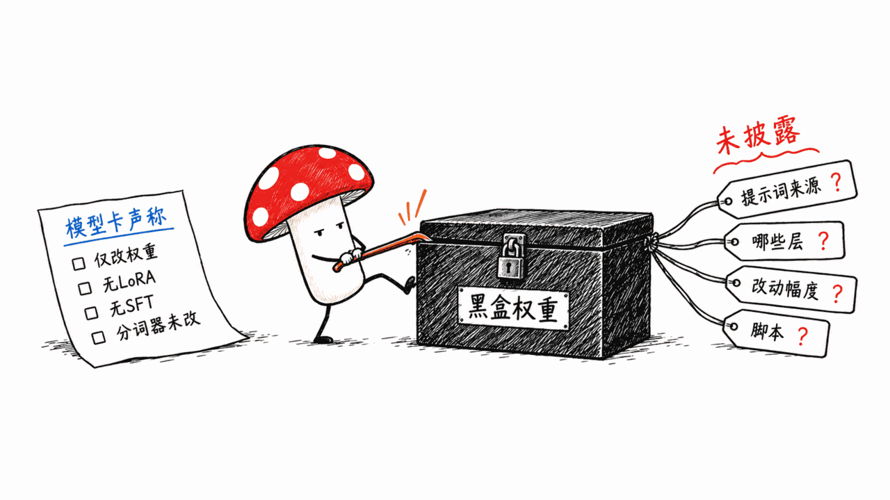
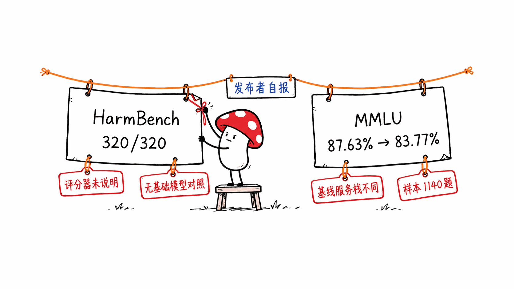
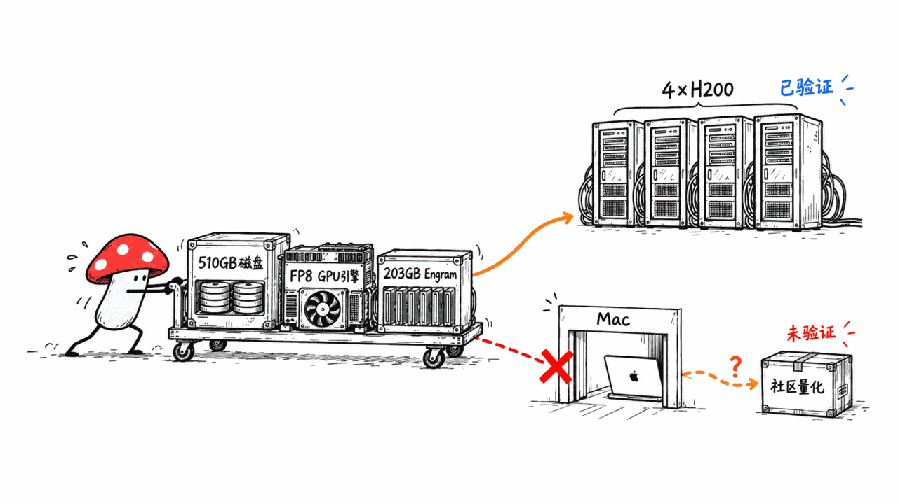
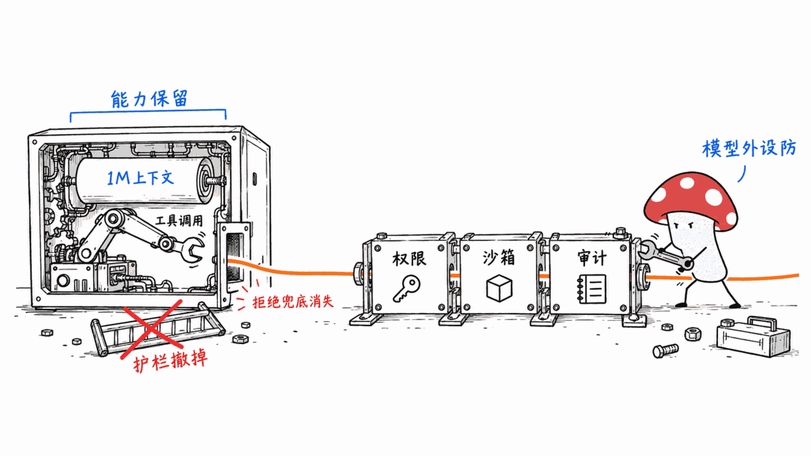

*by Mycelium Protocol*

---

模型地址：https://huggingface.co/dealignai/DeepSeek-V4.1-Flash-1017-UNCENSORED-FP8
基础模型：https://huggingface.co/deepseek-ai/DeepSeek-V4.1-Flash-1017
授权：MIT（与上游一致）

---

## 一句话结论

**这是 DeepSeek-V4.1-Flash-1017 的"去审查"权重改写版：模型卡自报 HarmBench-320 全部顺从（320/320），代价是 MMLU 抽样从 87.63% 降到 83.77%（-3.86pp）。但数字都是发布者自测，模型卡没有披露消融到底怎么做的；磁盘 510GB，只在 4×H200 上验证过，Mac 不能直接跑它。**

本站已经写过 DeepSeek V4-Flash 的本地部署（硬件选型、antirez 的 Metal 推理等），这篇不重复"怎么跑基础模型"，只回答一个问题：**一个把拒绝行为从权重里抹掉的 DeepSeek，到底改了什么、证据有多硬、谁能跑、风险在哪。**

本文不涉及任何绕过安全限制的操作方法，也不会复述有害提示词。

## 先把事实摆出来

| 项目 | 数据（来源：HF API 与模型卡） |
|---|---|
| 发布者 | dealignai（模型卡署名 @dealignai，算力由 @jordanschenck 提供） |
| 创建时间 | 2026-10-18（基础模型 10-17 才上线，晚了一天） |
| 热度（10-23 查询） | 3808 下载、265 likes；基础模型 51911 下载、2386 likes |
| 授权 | MIT，LICENSE 为 DeepSeek 原文 |
| 磁盘体积 | 48 个 safetensors 分片，合计约 510GB |
| 架构（config.json） | 40 层 MoE，384 个路由专家，每 token 激活 6 个，隐藏维 5120，1M 上下文 |
| 精度 | FP8 e4m3 + ue8m0 块缩放，专家为 FP4 |
| 已验证硬件 | 4×H200（564GB 显存），张量并行 4 |

## 它到底改了什么？

模型卡的说法是：**仅权重层面的修改**。它列了一长串"这不是什么"：不是量化衍生品、没有改聊天模板、没有系统提示词覆盖、没有 LoRA、没有监督微调/RLHF/DPO、没有改分词器。换句话说，这是典型的 abliteration 思路（找到与"拒绝"相关的方向，并在权重里削弱它），而且加载方式和上游完全一致。

但要注意，**"典型思路"是我们的归类，不是模型卡写的**。模型卡没有说：

- 用了多少条、什么类型的提示词来找拒绝方向；
- 改了哪些层、哪些张量，改动幅度多大；
- 是单次投影还是迭代，有没有对能力做补偿；
- 有没有放出可复现的脚本或改动文件。

对比本站此前写过的 Qwen3.8-27B-OBLITERATED，那个项目至少公开了三代方法和每一代的 MMLU 代价。这一份只给了结果，没给过程。你拿到的是一个黑盒权重，唯一能查证的是"文件确实在、结构和上游一致"。

文中还有个小细节：评测表里被测模型一直被叫作"CRACK bundle"，而标题叫 UNCENSORED，同时还提到有个 ABLITERATED-FP8 别名仓库。这更像是发布者内部流水线的名字没改干净，并不影响结论，但提示这份模型卡是快速成稿的。

## 自报的两组数字，分别能说明什么？

### 能力：MMLU 抽样 -3.86pp

- 方法：57 个学科、每科 20 题，共 1140 题，4 选 1 的 logit 打分，聊天模式（不开推理），贪心解码。
- 结果：基础模型 87.63%（999/1140），去审查版 83.77%（955/1140）。
- 分类：STEM -2.37pp，人文 -7.31pp，社科 -2.92pp，其他 -3.46pp。

我们的折扣理由：

1. **基线来自另一套服务栈。** 基础模型用的是 DeepSeek 官方 API，去审查版跑在发布者自己的 4×H200 引擎上。模型卡自己也承认是"同样的提示和解码，不同的服务栈"。这意味着 3.86pp 里混着多少"服务栈差异"，无法拆开。
2. **样本很小。** 1140 题时单个模型的标准误约 1.1pp，两者差值的不确定性大致 1.5pp 量级，所以 -3.86pp 约两三个标准误，方向可信，幅度要打折。单学科只有 20 题，一题就是 5pp，学科级结论基本是噪声。
3. **最大的单项降幅值得盯但不能下结论。** moral scenarios 从 80% 掉到 40%（20 题里 16 对变 8 对），moral disputes 85% 到 65%，人文整体降幅最大。这和"拒绝/价值判断相关方向被动了"在直觉上相容，但没有做对照实验，我们只能说"值得复测"。
4. **只测了不开推理的一道选择题。** 对一个主打推理档位（low/high/max）、工具调用和 1M 上下文的模型，卡里声称这些能力都"preserved（保留）"，但没有给任何推理、代码、智能体、视觉或长上下文的对照分数。上游 README 里的 Terminal-Bench、DeepSWE 等成绩，去审查版一项都没重测。

### 顺从度：HarmBench-320 全部 COMPLY

- 方法：HarmBench 文本测试集 320 条（159 标准、81 上下文、80 版权），推理档位 max，贪心，最多生成 200 个新 token。
- 结果：320/320 顺从，硬拒绝、软回避、加免责声明都是 0。

折扣理由：

1. **评分器没有说明。** 模型卡写"四档分类器"，但没说是规则、另一个模型还是人，也没给复核方式。
2. **只生成 200 token，且推理未结束时"看推理开头判断意图"。** 这意味着一部分"顺从"是根据思考过程的开头推断的，而非完整答案。
3. **没有基础模型的对照行。** 我们不知道上游在同一套评分下的拒绝率，也就无法说明"改动带来了多少变化"。
4. **版权类 80 条也计入。** 它们和有害内容性质不同，混在一起会抬高"全部顺从"的观感。
5. **"顺从"不等于"内容正确、可用"。** 评分只看是否给出实质内容，没有验证内容准确性。

所以更稳妥的读法是：**这是一个"拒绝率被压到接近 0"的强证据**（几乎所有开源去审查版都能做到），而不是"安全评估已完成"的证据。

## Mac 能跑吗？

**这个 FP8 版本不能。** 理由都来自模型卡与文件清单：

- 体积约 510GB，超过任何 Mac 的统一内存上限的实用范围（最高配 512GB 也要给系统和 KV/Engram 留空间）。
- 模型卡说原生 FP8 + FP4 MoE 需要支持 FP8 的 GPU，已验证 4×H200，"非 FP8 硬件不被上游参考引擎支持"，构建链要 CUDA 12.8 工具链。
- 服务示例用 SGLang，并提到 203GB 的 Engram 表要放到主机内存（SGLANG_ENABLE_DSV41_ENGRAM_HOST_TABLE=1），这对内存提出了额外要求。
- 发布者自己提示：**别直接把这个 FP8 再量化**，朴素低比特量化会叠加误差，合规性可能回退；应该在目标精度上重做消融流程。他们给的低比特版本是同账号下的 EXL3 2.9bpw（面向 NVIDIA 的格式）。这是发布者的说法，卡里没有给对照数据。

Mac 方向目前我们只看到旁系线索，**都没有本机验证**：同一基础模型在 mlx-community 有 oQ4e-mtp 量化（HF 显示约 432GB，不是去审查版）；社区还出现了多个 GGUF 与 abliterated 变体（例如 AtomicChat、mrfakename 等）。它们是不同作者、不同方法，质量与安全性不能由这张模型卡背书。我们没有下载任何权重，也没有跑这些版本，所以"Mac 能跑某个去审查版"在这里不下结论。

本站关于 DeepSeek V4-Flash 的本地部署与 Metal 推理文章可作为硬件背景参考，这里不重复。

## 授权与滥用风险

- **授权**：MIT，源自上游 MIT，允许商用和再分发。MIT 不带使用限制条款，也不对输出内容负责。
- **模型卡的"责任使用"段**：写明仓库"人工审批门控"，申请者需确认 18 岁以上、遵守所在地法律、对所有输出负全责，发布者"不承担任何责任"。元数据里也声明了姓名、机构、国家、用途等申请字段。但我们 10-23 查询 HF API 时返回的 gated 状态是 False，没有实际尝试申请，所以"门控是否真的生效"我们无法确认。
- **能力不变、护栏撤掉的组合风险更高。** 这个底座本身是 1M 上下文、会调用工具的推理模型，去审查后用于智能体场景时，工具调用环节没有任何拒绝兜底，意味着一旦被接到真实系统（邮件、代码执行、浏览器），"模型自己会拒绝"这层防线不存在。企业或个人使用时，应把权限控制、沙箱和审计放在模型之外。
- **生态在快速增殖。** 基础模型上线才几天，我们在 HF 搜索里就看到十个左右的去审查/消融衍生（含 heretic、MXFP4、NVFP4、EXL3、GGUF 等）。这说明门槛极低，也意味着"单个仓库有没有门控"对整体风险影响有限。
- **请求署名**：模型卡请求二次分发、量化、评测或撰写文章时标注"Based on dealignai/DeepSeek-V4.1-Flash-1017-UNCENSORED-FP8"，本文已在文首与一手源处注明。

## 值不值得关注？

如果你是**研究者**，它的价值在于：同一个旗舰开源 MoE 的"拒绝行为可以被权重编辑去掉"又得到一次实例，而且 FP8 原生格式下改动后仍能被官方引擎加载。它提供的可复现信息很少，所以更适合当样本，而不是方法参考。

如果你是**想在 Mac 上用"不拒绝"模型的个人用户**，这个版本不是你的选项；先问清楚自己要的是什么：多数日常需求（写作、编程、翻译）用基础模型即可，被拒绝的场景往往是提示词表述问题，而不是需要整个换权重。

如果你是**做产品的团队**，请把它当作"红队测试对象"：用它测试你自己的外围防护是否在模型不拒绝时依然有效，而不是直接上线。

## FAQ

**这是 DeepSeek 官方发布的吗？**
不是。官方模型是 deepseek-ai/DeepSeek-V4.1-Flash-1017，去审查版由第三方 dealignai 发布，和 DeepSeek 无关联声明。

**MMLU 降了 3.86pp，是不是说明去审查一定伤能力？**
不能这样推。基线与被测模型用的是不同服务栈，样本只有 1140 题，且只测了一个不开推理的选择题设置。我们只能说"自报有可见下降，幅度需要独立复测"。

**HarmBench 100% 顺从意味着什么？**
意味着在发布者自己的评分设置下，模型几乎不再拒绝。它不代表输出内容准确，也没有基础模型的同口径对照。

**512GB 的 Mac Studio 能跑吗？**
FP8 版本不行：磁盘 510GB，引擎要求 FP8 GPU。其他社区量化版我们没有验证。

**许可证允许商用吗？**
MIT 允许。但许可证不替你承担合规责任，使用者要自己遵守所在地法律。

**能不能自己再量化它？**
发布者明确不建议直接量化这个 FP8 权重，称合规性可能回退。这是其自述，没有给对照数据。

## 一手源

- https://huggingface.co/dealignai/DeepSeek-V4.1-Flash-1017-UNCENSORED-FP8
- https://huggingface.co/deepseek-ai/DeepSeek-V4.1-Flash-1017
- https://huggingface.co/dealignai/DeepSeek-V4.1-Flash-1017-EXL3-2.9bpw-UNCENSORED
- https://huggingface.co/mlx-community/DeepSeek-V4.1-Flash-1017-oQ4e-mtp
- https://huggingface.co/api/models/dealignai/DeepSeek-V4.1-Flash-1017-UNCENSORED-FP8

> 本文为独立核实与分析，不教授也不鼓励任何绕过安全限制的做法。涉及的模型与代码仅供学习研究，请遵守所在地法律法规。

---

> © 2026 Author: Mycelium Protocol. 本文采用 [CC BY 4.0](https://creativecommons.org/licenses/by/4.0/deed.zh) 授权——欢迎转载和引用，须注明作者姓名及原文链接，不得去除署名后以原创发布。

<!--EN-->

*by Mycelium Protocol*

---

Model: https://huggingface.co/dealignai/DeepSeek-V4.1-Flash-1017-UNCENSORED-FP8
Base model: https://huggingface.co/deepseek-ai/DeepSeek-V4.1-Flash-1017
License: MIT (same as upstream)

---

## The Short Version

**This is a third-party, weight-edited "uncensored" version of DeepSeek-V4.1-Flash-1017. Its card self-reports 320/320 compliance on HarmBench and an MMLU sample drop from 87.63% to 83.77% (-3.86pp). Every number is the publisher's own measurement, the card does not disclose how the edit was done, the checkpoint is about 510GB, and it has only been verified on 4x H200. A Mac cannot run this release.**

We have already covered local deployment of DeepSeek V4-Flash (hardware tiers, antirez's Metal inference). This piece does not repeat how to run the base model. It asks one question: **what changed when refusal behavior was removed from the weights, how strong is the evidence, who can run it, and where is the risk?**

This article contains no instructions for bypassing safety measures and does not reproduce harmful prompts.

## The Facts First

| Item | Data (HF API and model card) |
|---|---|
| Publisher | dealignai (card credits @dealignai; compute from @jordanschenck) |
| Created | 2026-10-18 (one day after the base model appeared) |
| Popularity (checked 10-23) | 3,808 downloads, 265 likes; base model 51,911 downloads, 2,386 likes |
| License | MIT, LICENSE is DeepSeek's original text |
| On-disk size | 48 safetensors shards, about 510GB in total |
| Architecture (config.json) | 40-layer MoE, 384 routed experts, 6 active per token, hidden size 5120, 1M context |
| Precision | FP8 e4m3 with ue8m0 block scales; FP4 experts |
| Verified hardware | 4x H200 (564GB VRAM), tensor parallel 4 |

## What Exactly Was Changed?

The card says the modification is **weight-level only**. It then lists what it is not: not a quantized derivative, no chat-template change, no system-prompt override, no LoRA, no SFT/RLHF/DPO, no tokenizer change. That reads like a typical abliteration approach (locate a direction associated with refusal and weaken it in the weights), and the file loads exactly like the upstream model.

But **"typical approach" is our classification, not something the card states.** The card does not say:

- how many prompts, or what kind, were used to find the refusal direction;
- which layers and tensors were edited, and by how much;
- whether the edit was a single projection or iterative, and whether capability was compensated;
- whether any reproducible script or edit file is provided.

Compare the Qwen3.8-27B-OBLITERATED project we covered earlier: it at least published three generations of method and the MMLU cost of each. This release gives results without the process. You receive a black-box checkpoint; all you can verify is that the files exist and the structure matches upstream.

One small oddity: the evaluation tables call the tested model the "CRACK bundle" while the title says UNCENSORED, and an ABLITERATED-FP8 alias repo is mentioned. It looks like an internal pipeline name that was not fully cleaned up. It does not change the conclusions, but it suggests a card written quickly.

## What Do the Two Self-Reported Numbers Actually Show?

### Capability: MMLU sample, -3.86pp

- Method: 57 subjects x 20 questions = 1,140 questions, 4-choice logit scoring, chat mode (no reasoning), greedy decoding.
- Result: base 87.63% (999/1140), uncensored 83.77% (955/1140).
- Breakdown: STEM -2.37pp, humanities -7.31pp, social sciences -2.92pp, other -3.46pp.

Why we discount it:

1. **The baseline comes from a different serving stack.** The base model was scored through DeepSeek's official API; the uncensored model ran on the publisher's own 4x H200 engine. The card itself says "identical prompt and decoding, different serving stacks". How much of the 3.86pp is stack difference cannot be separated out.
2. **The sample is small.** At 1,140 questions the standard error of one score is about 1.1pp, and the difference between two scores is uncertain by roughly 1.5pp, so -3.86pp is around two to three standard errors: the direction is credible, the magnitude should be discounted. Per subject there are only 20 questions, so one question equals 5pp and subject-level findings are mostly noise.
3. **The largest single drops deserve attention but not conclusions.** Moral scenarios went from 80% to 40% (16 of 20 correct to 8 of 20), moral disputes from 85% to 65%, and humanities fell most overall. This is consistent with value-judgment-related directions having been touched, but there is no controlled experiment, so we can only say "worth re-testing".
4. **Only one non-reasoning multiple-choice setting was tested.** The model is positioned around reasoning tiers (low/high/max), tool calling and 1M context, and the card says these are "preserved", but it provides no reasoning, coding, agentic, vision or long-context comparison. Upstream's Terminal-Bench and DeepSWE results were not re-run for this version.

### Compliance: HarmBench-320, all COMPLY

- Method: HarmBench text set of 320 (159 standard, 81 contextual, 80 copyright), reasoning effort max, greedy, at most 200 new tokens.
- Result: 320/320 complied; hard refusals, soft redirects and disclaimer-hedged answers are all zero.

Why we discount it:

1. **The grader is not described.** The card says "4-tier classifier" without saying whether it is rules, another model or a human, or how it was checked.
2. **Only 200 tokens, and when reasoning has not finished the grader judges intent from the start of the reasoning trace.** Part of the "compliance" is therefore inferred from the beginning of the thinking, not from a complete answer.
3. **There is no base-model control row.** We do not know the upstream refusal rate under the same grader, so the size of the change is not established.
4. **The 80 copyright items are included.** They differ in nature from harmful-content items, and pooling them makes "all complied" look broader.
5. **Compliance is not correctness.** The grader checks whether substantive content was produced, not whether it is accurate.

The safer reading: **strong evidence that the refusal rate has been pushed close to zero** (nearly every open uncensored release achieves that), **not evidence that a safety evaluation has been done.**

## Can a Mac Run It?

**Not this FP8 release.** The reasons come from the card and the file list:

- About 510GB on disk, beyond what is practical on any Mac (even a 512GB machine needs headroom for the OS and cache).
- The card says native FP8 + FP4 MoE needs an FP8-capable GPU; it was verified on 4x H200, "non-FP8 hardware is not supported by the upstream reference engine", and the build chain needs the CUDA 12.8 toolkit.
- The SGLang example mentions a 203GB Engram table moved to host RAM (SGLANG_ENABLE_DSV41_ENGRAM_HOST_TABLE=1), which adds a host-memory requirement.
- The publisher warns **not to quantize this FP8 checkpoint directly**: naive low-bit quantization stacks error and compliance may regress; they say the abliteration should be redone at the target precision. Their low-bit option is an EXL3 2.9bpw release under the same account (an NVIDIA-oriented format). This is the publisher's claim; the card gives no comparison data.

For Macs we only saw side clues, **none verified locally**: mlx-community hosts an oQ4e-mtp quantization of the same base model (HF shows about 432GB; not the uncensored one), and the community has produced several GGUF and abliterated variants (for example from AtomicChat and mrfakename). Those are different authors with different methods; their quality and safety cannot be vouched for by this card. We downloaded no weights and ran none of them, so we make no claim that any uncensored variant runs on a Mac.

Our earlier DeepSeek V4-Flash local-deployment and Metal-inference posts remain the hardware background; we do not repeat them here.

## License and Misuse Risk

- **License**: MIT, inherited from upstream; commercial use and redistribution are allowed. MIT carries no use restrictions and does not take responsibility for outputs.
- **The card's "Responsible use" section**: states the repo is manually gated; applicants must confirm they are 18+, will comply with local law and accept full responsibility for outputs, and the publisher disclaims all liability. The metadata also declares application fields (name, organization, country, use case). However, when we queried the HF API on 10-23 it returned gated as False, and we did not attempt to apply, so we cannot confirm whether the gate is actually enforced.
- **Unchanged capability with the guardrail removed is a higher-risk combination.** The base is a 1M-context reasoning model that calls tools. In agent settings, an uncensored version has no refusal backstop at the tool-calling step: once connected to real systems (mail, code execution, a browser), "the model will refuse" is no longer a defense layer. Permission control, sandboxing and auditing have to live outside the model.
- **The ecosystem is multiplying fast.** Days after the base model appeared we found roughly ten uncensored or abliterated derivatives on HF search (heretic, MXFP4, NVFP4, EXL3, GGUF and more). The barrier is low, so whether any single repo is gated has limited effect on overall risk.
- **Attribution request**: the card asks that redistributions, quantizations, benchmarks and write-ups credit "Based on dealignai/DeepSeek-V4.1-Flash-1017-UNCENSORED-FP8"; this article credits it at the top and in the sources.

## Is It Worth Your Attention?

If you are a **researcher**: it is another instance showing that a flagship open MoE can have its refusal behavior removed by weight editing, and that the edited FP8 checkpoint remains loadable by the official engine. It offers little reproducible information, so treat it as a specimen rather than a method reference.

If you are an **individual who wants a model that does not refuse, on a Mac**: this release is not for you. First ask what you actually need: most everyday work (writing, coding, translation) is fine with the base model, and many refusals are prompt-phrasing issues rather than reasons to swap weights.

If you are a **product team**: treat it as a red-team subject. Use it to check that your own outer protections still hold when the model does not refuse, not as something to ship.

## FAQ

**Is this an official DeepSeek release?**
No. The official model is deepseek-ai/DeepSeek-V4.1-Flash-1017. The uncensored version is by third party dealignai, with no claimed affiliation with DeepSeek.

**Does a 3.86pp MMLU drop prove uncensoring always hurts capability?**
No. The baseline and the tested model used different serving stacks, the sample is 1,140 questions, and only one non-reasoning multiple-choice setting was used. All we can say is "a visible drop is self-reported; the size needs independent re-testing".

**What does 100% HarmBench compliance mean?**
Under the publisher's own grading, the model almost never refuses. It does not mean the outputs are accurate, and there is no same-grader base-model control.

**Can a 512GB Mac Studio run it?**
Not the FP8 release: 510GB on disk and the engine requires an FP8 GPU. We did not verify other community quantizations.

**Does the license allow commercial use?**
MIT does. But a license does not carry compliance for you; users must follow the law where they are.

**Can I re-quantize it myself?**
The publisher advises against quantizing this FP8 checkpoint directly, saying compliance may regress. That is their claim, with no comparison data.

## Primary Sources

- https://huggingface.co/dealignai/DeepSeek-V4.1-Flash-1017-UNCENSORED-FP8
- https://huggingface.co/deepseek-ai/DeepSeek-V4.1-Flash-1017
- https://huggingface.co/dealignai/DeepSeek-V4.1-Flash-1017-EXL3-2.9bpw-UNCENSORED
- https://huggingface.co/mlx-community/DeepSeek-V4.1-Flash-1017-oQ4e-mtp
- https://huggingface.co/api/models/dealignai/DeepSeek-V4.1-Flash-1017-UNCENSORED-FP8

> This is independent verification and analysis. It does not teach or encourage bypassing safety measures. Models and code mentioned are for learning and research only; follow the laws where you live.

---

> © 2026 Author: Mycelium Protocol. Licensed under [CC BY 4.0](https://creativecommons.org/licenses/by/4.0/) — free to share and adapt with attribution. You must credit the author and link to the original; removing attribution and republishing as original is not permitted.
