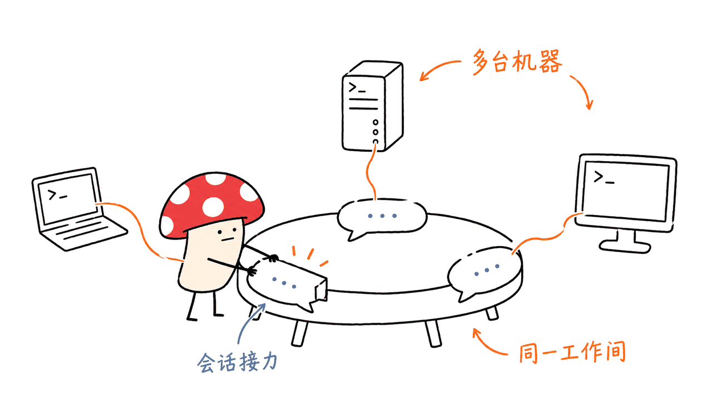
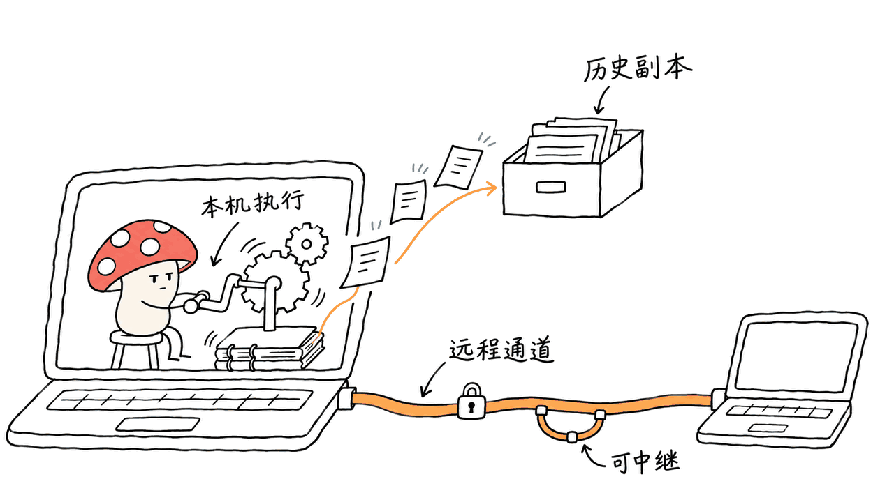
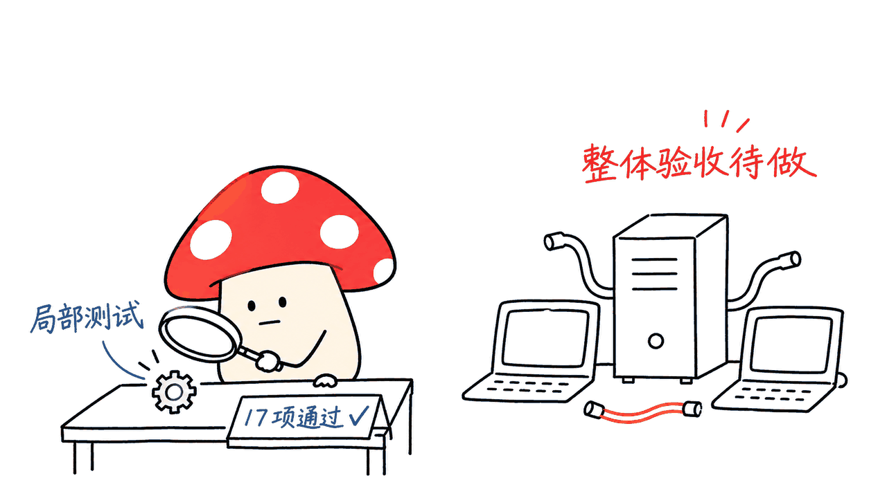

DeskFleet把多台电脑上的编程Agent、终端和代码变更，接进一个可以共同参与的工作间。它适合已经有本地开发机、远程服务器和多个编程工具，却缺少统一协作入口的团队。

官方仓库是 `yet-another-ai/deskfleet`，本次核查版本为0.21.0，固定提交 `9bd4a762ebb59934117823958577441b6f298c72`。客户端、机器守护进程和服务端采用Apache-2.0；仓库内引入的第三方技能保留各自许可。本文以仓库及其链接的deskfleet.org为准，不混用另一个同名站点的功能、价格和条款。

项目地址：https://github.com/yet-another-ai/deskfleet

官方入门：https://www.deskfleet.org/guide/getting-started

## 它把哪些分散的工作接到了一起？

常见场景是：Mac上写代码，Linux服务器跑构建，Windows机器做安装验证。每台机器有自己的目录、登录状态和工具链；Agent会话散在终端里，别人很难接着处理，也看不到它是否在等待授权。

DeskFleet保留这些执行环境，通过ACP连接机器上已安装和认证的Agent。README列出了Codex CLI、Claude Code、Cursor CLI、Grok CLI、Oh My Pi、DeepSeek Harness和自定义ACP程序。接入的是既有编程工具，模型费用和能力仍取决于这些工具及其供应商。

团队成员可以阅读同一会话、加入待办消息、回答权限请求，或在提供者支持时用Steer now调整正在进行的回合。Git差异、PTY终端、文件传输和远程桌面让人可以继续处理Agent没有完成的部分。关闭Electron窗口后，进程默认留在托盘；要停止任务，必须区分关窗口与退出应用。



## 本地执行，为什么还需要中央服务器？

系统分成三层。Vue界面由Electron和Web客户端共享；每台执行机器上的TypeScript守护进程负责Agent、目录、Git和原生能力；中央Rust/Actix Web服务使用PostgreSQL管理账户、团队、机器登记、授权和历史副本。

机器本地SQLite保存执行日志，并把目录与会话历史同步给中央服务。于是机器离线后，其他人仍能阅读已经同步的记录，但不能据此判断机器此刻仍在工作。仓库留在本机，也不意味着会话内容从未上传：中央历史副本本身就是需要评估的数据流。

远程操作、终端、文件和桌面使用经过授权的WebRTC，必要时回退TURN中继。账户管理、目录与历史、信令仍走HTTPS/WebSocket。P2P描述的是部分传输路径，不代表不需要控制平面，也不代表所有网络条件下都能直连。

内置MCP再把跨机器能力交给Agent：发现目标机器、调用远端工具、传递文件等。这里的生产力与权限是同一件事的两面——能让Agent检查另一台机器，也意味着要明确谁能读、谁能操作、凭证属于哪个工作区。



## 能自托管吗？离线和安全边界在哪里？

可以。官方提供中央服务自托管文档，需要PostgreSQL、邮件服务、TLS反向代理，以及视网络情况配置的TURN；Web界面可与API一起托管，也可独立提供。开发环境的公开测试密码和回环端口配置不应直接当生产配置。

源码还列出可选的分析、实验和错误报告集成。评估“数据留在自己手里”时，应检查实际构建配置、日志与历史同步、第三方上报和模型提供方，而不是只看开源许可证。

自托管文档明确说明：数据库故障会阻断中央路由和信令，但不自动撤销已经建立的WebRTC授权，也不停止机器上已有Agent和终端。守护进程正常连接时每20秒对账授权；丢失撤销广播后的恢复依赖数据库与信令重新可用。这意味着紧急撤权需要设计可验证的停机路径，不能把“服务器不可用”理解成“所有执行已停”。

会话可选择从已提交HEAD创建独立worktree，或直接使用现有目录。前者减轻多个Agent改同一工作区的冲突，但不是沙箱。归档先停止活动进程，再按主机清理设置处理worktree：默认有未提交修改或未跟踪文件时保留，但被忽略文件（包括.env）不构成保护。恢复会复用保留的目录，或按最后提交的HEAD重建已移除目录；被丢弃的本地文件无法靠聊天记录恢复。重要产物仍需提交或备份。

## 我们实际验证了什么？

Mycelium Protocol在固定提交上直接运行了3份原始Node测试文件，17项全部通过，没有修改上游实现或断言。测试命令是：

```bash
node --test apps/daemon/src/peer-admission.test.ts \
  apps/daemon/src/worktree-branch-naming.test.ts \
  apps/daemon/src/linux-desktop-permissions.test.ts
```

连接准入测试检查128个活动名额、释放后的重复使用保护，以及16,384条防重放记录满时拒绝新增，而非挤掉仍有效的记录。分支命名测试建立真实临时Git仓库和worktree，验证会话分支名、保留用户分支、嵌套目录与同仓库多checkout的处理。

Linux桌面权限测试使用模拟的平台回调，检查屏幕与控制权限共用请求、避免重复征询，以及显式请求如何更新状态。这验证的是状态逻辑，没有在Linux桌面上实际弹出Portal，也没有完成远程控制。

我们没有部署整套服务，没有连接真实Agent、模型API、WebRTC或TURN，也没有测远程桌面延迟。17项通过是这些局部行为的证据，不能升级成整个产品的安全认证或跨平台验收。



## 哪些团队值得试，第一轮怎么验收？

它最值得尝试的对象，是确实需要跨机器接力、共享会话和人工介入的团队。只有一台电脑、一个工具、一个人的项目，可能暂时没有承担控制服务和机器登记成本的必要。

第一轮应选没有生产凭证的测试仓库和两台机器：一台生成小改动，另一台构建并回传结果。再验证用户分支不被覆盖、权限拒绝确实阻断操作、网络中断后状态显示准确、撤权能结束访问，以及归档前后未提交产物如何处理。验收的是可观察结果，不能只看机器显示在线。

统一入口降低了切换成本，却不会自动解决合并冲突、代码质量和责任归属。我们的判断是：DeskFleet的价值在于把已有Agent与实际执行环境组织起来；团队仍需为任务划分、权限和最终合并负责。

## 常见问题

### DeskFleet包含一个新的AI模型吗？

不包含本文所述的新模型。它通过ACP监督既有Agent程序，并通过MCP暴露机器操作能力；使用哪个模型取决于接入工具的配置。

### Apache-2.0是否意味着所有运行成本都免费？

不意味着。客户端、守护进程和服务端代码的许可与模型推理费、服务器、邮件、TURN带宽及运维成本是不同问题。

### 机器离线后还能继续远程执行吗？

中央副本支持阅读已同步的历史；机器离线不意味着远程操作还能继续。要结合实际连接、执行状态和记录的新鲜度判断。

架构文档：https://github.com/yet-another-ai/deskfleet/blob/main/agents/docs/architecture.md

自托管文档：https://github.com/yet-another-ai/deskfleet/blob/main/agents/docs/self-hosted.md

延伸阅读：https://blog.mushroom.cv/blog/plannotator-agent-review-feedback-workspace-guide/

---

> © 2026 Author: Mycelium Protocol. 本文采用 [CC BY 4.0](https://creativecommons.org/licenses/by/4.0/deed.zh) 授权——欢迎转载和引用，须注明作者姓名及原文链接，不得去除署名后以原创发布。

<!--EN-->

DeskFleet brings coding agents, terminals, and code changes from multiple computers into a shared workspace. It targets teams whose repositories, credentials, and toolchains already live across workstations and servers.

We inspected `yet-another-ai/deskfleet` version 0.21.0 at commit `9bd4a762ebb59934117823958577441b6f298c72`. Its client, daemon, and server use Apache-2.0; vendored skills retain their upstream licenses. This article follows the repository and its linked deskfleet.org site, without mixing in the pricing or policies of a different similarly named site.

Repository: https://github.com/yet-another-ai/deskfleet

Getting started: https://www.deskfleet.org/guide/getting-started

## What does the shared workspace connect?

A team might develop on a Mac, build on Linux, and validate installers on Windows. Each machine holds its own tools and authenticated agent sessions. DeskFleet exposes those sessions through one interface while keeping execution on the enrolled machine.

The README lists ACP-compatible Codex CLI, Claude Code, Cursor CLI, Grok CLI, Oh My Pi, DeepSeek Harness, and custom executables. Model access, inference costs, and agent capability remain dependent on the connected tools and providers.

Teammates can read the same session, queue messages, answer permission requests, and steer a running turn where the provider supports it. Live Git diffs, PTY terminals, file transfers, and remote desktops support direct intervention. Closing an Electron window leaves the application in the tray; it does not necessarily stop its tasks.


## Why is there a central server if execution stays local?

Electron and Web clients share Vue components. A TypeScript daemon owns each machine's agents, directories, Git operations, and native capabilities. A central Rust/Actix Web service uses PostgreSQL for accounts, teams, enrollment, authorization, and replicated history.

Each daemon records its authoritative execution journal in local SQLite and synchronizes history and catalog replicas centrally. Previously synchronized conversations remain readable when a machine is offline. Local repositories do not imply that conversation content never leaves the machine: history replication is a separate data flow.

Authenticated WebRTC carries remote operations, files, terminals, and desktop streams, with TURN relay fallback. Management, signaling, catalog, and history use HTTPS/WebSocket. P2P therefore describes part of the transport, not the absence of a control plane or a guarantee of direct connectivity.

The built-in MCP server lets agents discover and operate on remote targets. Its usefulness makes ownership and scope consequential: reading another machine and operating it require distinct, deliberate authorization.


## What are the self-hosting and revocation boundaries?

The repository documents self-hosting the central server with PostgreSQL, SMTP, a TLS reverse proxy, and optional TURN. The Web app can be bundled with the API or hosted independently. Public development credentials and loopback infrastructure defaults are not production settings.

Architecture documentation also describes optional analytics, experimentation, and error reporting. Data-residency reviews should inspect actual build configuration, replicated history, logs, third-party reporting, and model providers, alongside licensing.

A database outage stops central routing and signaling. It does not automatically revoke established WebRTC grants or stop agents and terminals already running on a daemon. Connected daemons reconcile grants every 20 seconds; recovery from a missed revocation broadcast requires a working database and signaling connection. An emergency stop therefore needs an independently verified operational path.

Sessions may use fresh Git worktrees from committed HEAD or the existing checkout. Worktrees reduce working-directory collisions but are not security sandboxes. Archiving stops active processes and then applies the host cleanup setting. By default, uncommitted edits or untracked files retain a checkout, but ignored files, including .env, do not protect it. Restoration reuses retained checkouts or recreates removed ones at saved committed HEADs. Discarded local files cannot be recovered from conversation history. Commit or back up important artifacts.

## What did we actually test?

Mycelium Protocol ran three unchanged upstream Node test files at the pinned commit. All 17 tests passed:

```bash
node --test apps/daemon/src/peer-admission.test.ts \
  apps/daemon/src/worktree-branch-naming.test.ts \
  apps/daemon/src/linux-desktop-permissions.test.ts
```

Admission tests cover 128 active slots, replay protection after release, and rejecting new grants when 16,384 replay records fill capacity rather than evicting valid tombstones. Branch-naming tests create real temporary Git repositories and worktrees, checking session-qualified names, preservation of user branches, nested directories, and distinct checkouts of one repository.

Linux desktop-permission tests use mocked platform callbacks. They check shared screen/control requests, avoid duplicate prompts, and update state through explicit requests. We did not open an actual Linux Portal or control a remote desktop.

We did not deploy the full server stack, connect real agents or model APIs, exercise WebRTC/TURN, or measure desktop latency. These passing tests support narrow behavioral claims, not a full security or cross-platform certification.


## Who should try it, and how should a pilot be judged?

Teams that need cross-machine handoffs, shared sessions, and human intervention have a concrete reason to try DeskFleet. A solo project on one computer may not yet justify the enrollment and control-plane overhead.

Start with a repository without production credentials and two machines. Generate a small change on one, build it on the other, and return the result. Check that user branches remain intact, denied permissions block operations, disconnections appear accurately, revocation ends access, and uncommitted artifacts behave as expected around archiving. An online indicator alone is not acceptance evidence.

A common interface reduces switching costs. It does not settle merge conflicts, establish code quality, or assign responsibility. DeskFleet's value is organizing existing agents around real execution environments; people still own task boundaries, permissions, and final integration.

## FAQ

### Is DeskFleet a new AI model?

No new model is described here. It supervises existing ACP agents and exposes machine operations through MCP. Model selection follows the connected tool's configuration.

### Does Apache-2.0 make operation free?

No. Code licensing is separate from inference fees, infrastructure, email, TURN bandwidth, and maintenance.

### Can an offline machine still execute remote requests?

Central replicas make synchronized history readable. They do not keep an offline machine remotely reachable. Inspect connectivity, live execution state, and record freshness separately.

Architecture: https://github.com/yet-another-ai/deskfleet/blob/main/agents/docs/architecture.md

Self-hosting: https://github.com/yet-another-ai/deskfleet/blob/main/agents/docs/self-hosted.md

Related reading: https://blog.mushroom.cv/blog/plannotator-agent-review-feedback-workspace-guide/

---

> © 2026 Author: Mycelium Protocol. Licensed under [CC BY 4.0](https://creativecommons.org/licenses/by/4.0/) — free to share and adapt with attribution. You must credit the author and link to the original; removing attribution and republishing as original is not permitted.
